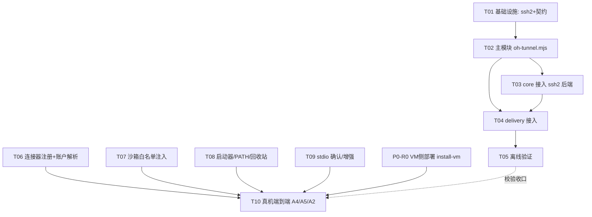

# 鸿蒙 OS（OH）宿主适配 · 需求 + 技术变更方案

> **文档代号**：`plan:oh-adaptation` ｜ **作者**：架构师 高见远 ｜ **读者**：工程师、PM、主理人
> **依据**：`docs/oh-host-selfcheck.md`（可行性门禁）、`docs/oh-tunnel-design.md`（ssh2 隧道设计，T01–T05 已落地草案）、`docs/reference/workbuddy-hmos-vs-windows.md`（对比结论）
> **核心约束**：**宿主 = OH、VM = Windows（`172.16.100.2`）不变**；VM 侧零改动；Windows/macOS 路径零改动（仅经 `process.platform` 守卫分支）；复用上轮 ssh2 隧道成果。

---

## 1. 目标与范围

| 项 | 内容 |
|---|---|
| 宿主目标 | 真机 **HarmonyOS（OH）** WorkBuddy（Electron 移植版，`/storage/Users/currentUser/appdata/el2/base/com.tencent.workbuddy/`） |
| VM 目标 | **Windows**（`172.16.100.2`，ssh 22，winvm 服务 `127.0.0.1:18443`）——**不变** |
| 复用成果 | 上轮 `oh-tunnel-design.md` 的 **T01–T05**（进程内 `ssh2` 隧道、`ssh2` 后端守卫、`contracts` 扩展、`delivery` 接入、离线测试 19/19 绿） |
| 本计划新增 | **T06 连接器注册/账户解析**、**T07 沙箱白名单**、**T08 启动器/PATH/回收站**、**T09 stdio 确认/增强**、**T10 真机端到端验证（A4/A5/A2）** |
| 不在范围 | VM 侧**源码改造**（本适配不改 VM 内 ps-bridge / winvm 服务代码）；Windows/macOS 宿主逻辑改造（仅守卫分支）；ArkUI 原生适配（OH 版 WorkBuddy 本身是 Electron，非原生）。**例外**：VM 侧需先跑既有 `install-vm.mjs` 部署（P0-R0，属部署动作非代码改造），并补装 node（P1-R10）/codebuddy CLI（P1-R8）——见 §2。 |

---

## 2. 需求池（P0 / P1 / P2，每条带验收标准）

### P0（门禁级，缺一不可）

**P0-R0 VM 侧部署前置（install-vm.mjs 落 VM 侧）** 🔴 门禁级，宿主切换的前置
- 描述：在 `172.16.100.2` 上执行 V1.0 的 **`install-vm.mjs`**，把本项目 VM 侧（ps-bridge + 54 能力 + winvm-plugin + 起 `/mcp` `/a2a` 服务）部署下去。当前该 VM 是**裸 WorkBuddy v5.5.3**，连接器 100+ 但**无任何 `winvm*` 连接器**，无 ps-bridge、无部署目录、无计划任务（详见 `workbuddy-hmos-vs-windows.md` §2.5 / 附录 B B6）。**宿主侧切到 HMOS 之前，必须先让 VM 侧起来**。
- 输入事实（主理人 SSH 实测）：VM 侧 `mcp.json` 无任何 `winvm*`；无 `C:\Users\User\winvm` / `C:\winvm`；无 ps-bridge 进程/服务；`sshd` 9.5 Running（隧道服务端 OK）；但 `node` 不在 PATH、codebuddy 未装（见 P1-R10 / P1-R8）。
- 验收：VM 自检 **54 能力全绿**（system/app/storage/gui/appops 五域）；`127.0.0.1:18443`（`/mcp`）经隧道复测可达；`/a2a` 端点就绪；VM `mcp.json` 出现 `winvm*` 连接器（由 VM 侧 `install-vm` 自注册）。
- 注：属 **VM 侧（Windows）部署**，本宿主侧适配代码**零改动**；但它是「宿主可切换 + 端到端跑通」的**硬前置门禁**——VM 没起来，HMOS 宿主侧 T06–T10 即使做完也连不上。

**P0-R1 宿主 Node 运行时可用**
- 描述：OH 宿主能运行 Node/ESM，版本满足要求，且 WorkBuddy 子进程能继承该 node。
- 输入事实：已确认 `which node` → `/data/storage/el1/bundle/libs/arm64/node/bin/node` **v24.13.0**（arm64）。
- 验收：`install-host.mjs` 在 OH 上跑通 self-test（`node -e '...spawn child ok'`），且 A2A 桥以 `process.execPath` 被 WorkBuddy 拉起无报错。

**P0-R2 进程内 ssh2 隧道**
- 描述：OH 上用纯 JS `ssh2` 建立本地转发隧道（替代系统 `ssh`），绑定 `127.0.0.1:18443` → VM `127.0.0.1:18443`。
- 输入事实：T01–T05 草案已落地（`delivery/oh-tunnel.mjs`、`ssh-tunnel-ssh2.ts`、`ssh-tunnel.ts` 守卫、`contracts` 扩展、`core/package.json` 加 `ssh2`、离线测试 19/19 绿）。**VM 侧已实测可达**：VM 系统 `OpenSSH_for_Windows_9.5p2`（≥7.6）、`sshd` 服务 **Running / Automatic**；上轮实现的进程内 `ssh2` 客户端（连 VM `:22`）算法兼容（ssh2 支持 OpenSSH 9.5 的 kex/cipher）→ **隧道 VM 端（ssh server）已验证可达**，无需担心 VM 侧 sshd 兼容性。
- 验收：真机对 `172.16.100.2:22` 建隧道成功；A4 经隧道调一次 `connector:winvm` 工具返回正常（前提是 P0-R0 已让 VM `:18443` 起来）。

**P0-R3 连接器注册（双通道）**
- 描述：在 OH 的 `connectors/<account>/mcp.json` 注入 `connector:winvm`（streamableHttp → 回环 `18443/mcp`）与 `connector:winvm-a2a`（stdio → `node a2a-bridge/cli.js`）；解决 accountId 解析。
- 关键事实（本机探查 + VM 实测印证）：`~/.workbuddy/connectors/` 含 **`default`** 与 **`8dd0df6a-47ce-4a02-82fd-51cd84a8f0f8`（uuid，活跃「企业」账户，含 `connector-states.v3.json`+`.master.key`）**；**VM 侧实测 `mcp.json` 就在同一 uuid 目录下**（`C:\Users\User\.workbuddy\connectors\8dd0df6a-…\mcp.json`），证明两侧账户同构、accountId 一致。当前 `adapter-host-workbuddy` 解析 `accountId = ctx.accountId ?? 'default'`——**若不修正，`--account` 缺省会写进 `default` 而非活跃账户**。
- **精确 JSON 模板（合并式 patch 写入目标 `mcp.json`）**：
  ```json
  {
    "mcpServers": {
      "connector:winvm": {
        "timeout": 120000,
        "disabled": false,
        "disabledTools": [],
        "type": "streamableHttp",
        "url": "http://127.0.0.1:18443/mcp"
      },
      "connector:winvm-a2a": {
        "timeout": 600000,
        "disabled": false,
        "type": "stdio",
        "command": "node",
        "args": ["<winvm-a2a-bridge.cli.js 绝对路径>"],
        "runtime": { "type": "node", "version": ">=18" },
        "env": {
          "WINVM_VM_HOST": "127.0.0.1",
          "WINVM_VM_PORT": "18443",
          "WINVM_VM_A2A_ENDPOINT": "http://127.0.0.1:18443/a2a"
        }
      }
    }
  }
  ```
  > `connector:winvm-a2a` 的 stdio schema **直接镜像 VM 现有 stdio 连接器**（`connector:weisheng-scrm` 等：`command:"node"` + `runtime:{type:"node",version:">=18"}` + `env` + `disabled:false`），详见 `workbuddy-hmos-vs-windows.md` §4.1。VM 侧 PATH 极简，故 `command` 用绝对 `node` 路径更稳（P1-R10）。
- **accountId 解析**：**写入 `8dd0df6a-47ce-4a02-82fd-51cd84a8f0f8`（活跃企业账户 uuid）**；同时**保留遍历 `connectors/` 下所有账户目录的兜底**（P2-3 起排除 `skills` / `marketplace-meta` 等非账户目录，单一事实源 `NON_ACCOUNT_DIRS`）（避免未来出现 `default` 为主、uuid 为辅的情形），对每个目录都做增量合并（先备份 `*.winvm-bak.<ts>`，绝不整体覆盖）。
- 验收：两连接器在 OH 注册且 **A5（同时生效）**：`winvm-plugin status` 在 `8dd0df6a-…` 账户目录下检出 `connector:winvm` + `connector:winvm-a2a`；WorkBuddy 连接器页可 Trust 并激活。

**P0-R4 沙箱白名单**
- 描述：把本插件写路径加入 `~/.workbuddy/settings.json` 的 `sandbox.extraAllowWrite`；并核实沙箱对网络出站/进程 spawn 的限制并给出对策。
- 关键事实：当前 `settings.json.sandbox.extraAllowWrite` 含 `~/.tencent-cloudq`、`~/.andonq` 等十余条，**无本插件路径**；沙箱是否限制出站/进程 spawn **无法从静态文件判定**（待真机 §5 验证）。
- 验收：插件在沙箱内可写 `~/.workbuddy/winvm/*` 与插件缓存目录、可起 A2A 桥子进程、可出站到 VM `:22`/`:18443`（对应 `oh-host-selfcheck.md` §5 三项 PASS）。

**P0-R5 启动器 / PATH**
- 描述：去掉 `.cmd` 启动器，改无扩展名 bash 启动器 + shell profile PATH 注入；Windows/macOS 路径不变。
- 验收：OH 上 `winvm-plugin <cmd>`（或 `node delivery/winvm-plugin.mjs <cmd>`）可用；新开终端 `winvm-plugin` 在 PATH 中可达。

### P1（重要，应在首版内完成）

**P1-R6 确认 OH 支持 stdio MCP transport** ✅ **已确认（VM + HMOS 双侧实测坐实）**
- 描述：a2a 桥依赖 stdio；确认 OH WorkBuddy 是否支持。
- 关键事实（**已确认**）：**HMOS 宿主** `mcp.json` 中**确有** `"type":"stdio"` + `command`/`args`/`runtime` 条目（如 `connector:weisheng-scrm`）；**VM 侧实测坐实同构**——VM `mcp.json` 中 `connector:weisheng-scrm` / `mastergo-vibe-mcp` / `zw3d-mcp` / `dcs-cloud` / `jufa-mcp-server` 等均为标准 stdio 条目且带 `runtime:{type:"node"}`。→ a2a 桥走 stdio 在**两侧均原生支持**，**无需改 a2a 桥为 streamableHttp**，原「若不支持则改 streamableHttp」的备选分支**已删除**（见 T09）。
- 验收：a2a 桥以 stdio 被 WorkBuddy 拉起并响应 `a2a.delegate`；渲染时附带 `runtime:{type:"node",version:">=18"}` 与现有 stdio 条目一致（`connector:winvm-a2a` 模板见 P0-R3）。

**P1-R7 known_hosts 落盘权限**
- 描述：`~/.workbuddy/winvm/known_hosts` 在 OH 沙箱下须可写（ssh2 TOFU 持久化）。
- 验收：首次建隧道的指纹成功写入该文件；非首次连接校验通过（无中间人告警）。

**P1-R8 VM 侧 codebuddy CLI 验证（A2，用户侧动作）** 🔴 **VM 实测未装**
- 描述：V1.0 的 `workbuddy` LLM provider（A2，VM 内 spawn `codebuddy` CLI）依赖 VM 上有 `codebuddy` CLI。
- 关键事实（**VM 实测未安装**）：主理人 SSH 进 `172.16.100.2` 实测，`codebuddy --version` / `where codebuddy` **均失败** → VM 侧无 codebuddy CLI。
- 解决路径（二选一，记入 `install-vm` 部署步骤）：
  1. **装 codebuddy CLI**：在 VM 侧安装 codebuddy CLI，并配置本插件 `WINVM_VM_CODEBUDDY_BIN`（`WINVM_VM_*` 系列）指向其绝对路径；或
  2. **改 LLM provider 后端**：把 `workbuddy` provider 改走其它已可用的 LLM 后端（不依赖 codebuddy CLI）。
- 验收：VM 侧 `codebuddy --version` 可用（或 provider 已切到其它后端）；A2 委派任务经 a2a 桥成功下派到 VM（对应 T10 第 ⑤ 步）。

**P1-R9 可观测 / 安全（CI）**
- 描述：结构化日志、脱敏扫描进 CI。
- 验收：CI 包含 `oh-tunnel.test.mjs` 等离线测试；凭据（privateKey/password/passphrase）绝不入日志（已有 `oh-tunnel.mjs` 红线，需加单测断言）。

**P1-R10 VM 侧 node 发现 / 安装（install-vm 前置）** 🔴 **VM 实测 node 不在 PATH**
- 描述：VM 侧 ps-bridge / winvm-plugin 运行需 node 运行时；须确保 VM 上有可用 node。
- 关键事实（**VM 实测**）：`node -v` / `where node` 在 VM 上**均失败**（node 不在系统 PATH）；`C:\Program Files\WorkBuddy` 内**无 `node.exe`**（Electron 把 node 编进二进制）。→ 纯靠 WorkBuddy 自带 node 无法直接给 ps-bridge 用。
- 解决路径（记入 `install-vm.mjs` 部署步骤）：
  1. **为 VM 安装 node**（推荐，绝对路径调用）：在 VM 侧安装 Node.js（≥18，建议 ≥22 与项目实测一致），部署脚本用其**绝对路径**拉起 ps-bridge（VM 侧 PATH 注入价值低，见 P1-R8 同理）；或
  2. **定位 WorkBuddy 内置运行时**：尝试从 WorkBuddy 安装目录提取可用 node 绝对路径（若可分离）。
- 验收：VM 侧 `winvm-plugin self-test`（或等价 ps-bridge 自检）**可跑通**；54 能力自检能由 node 拉起。

### P2（增强，可后续）

**P2-R10 常驻隧道进程** ⬆️ **已升级为 CL015-P0-02（P0）**（2026-09-14 · CL-015）
- 描述：若 `connector:winvm` 的 `ssh-tunnel` 不由 `@winvm/core` 的 `establishTransport` 处理、而由宿主运行时自起隧道，则需常驻隧道进程入口（`node delivery/oh-tunnel.mjs --daemon`），由 `install-host.mjs` 注册为 OH 后台服务。
- 验收：宿主运行时重启后 `127.0.0.1:18443` 仍常驻可达。
- **升级说明**：该「常驻隧道」被 CL-015 确认为「**装完不可用**」的**直接成因**（部署进程一退即拆、单命令用完即拆 → 装完端口就是空的），故优先级由 **P2 → P0**，收口为 **CL015-P0-02**（验收 B1–B9，见 `docs/archive/changes/CL-015/REQUIREMENT.md` 与 `docs/archive/changes/CL-015/TECHNICAL-SOLUTION.md` §10 结论 2）。落地形态调整为：**安装器 detach 拉起 + pidfile 幂等守护 + 显式 `winvm-plugin tunnel stop`**（鸿蒙无 systemd/launchd，本轮**不做**系统级后台服务注册），并提供 `--no-tunnel` 跳过开关。

---

## 3. 技术变更方案（有序文件清单 + 依赖图 + 实现顺序）

### 3.1 现有成果（T01–T05，已落地草案，本计划仅「校验/收口」）

| ID | 任务 | 关键文件 | 状态 |
|---|---|---|---|
| T01 | 基础设施：引入 ssh2 + 契约扩展 | `packages/core/package.json`、`packages/contracts/src/transport.ts`、`packages/core/src/transport/ssh-tunnel-ssh2.ts` | ✅ 已改（privateKey/password 已加、ssh2 已加） |
| T02 | 主模块 `delivery/oh-tunnel.mjs` | `delivery/oh-tunnel.mjs`、`packages/core/src/transport/ssh-tunnel-ssh2.ts` | ✅ 已落地（DI 可 mock、幂等、退避重连、退出清理、TOFU known_hosts） |
| T03 | core 接入 ssh2 后端 | `packages/core/src/transport/ssh-tunnel.ts`、`packages/core/src/transport/index.ts` | ✅ 已加守卫 `process.platform==='ohos' \|\| WINVM_TUNNEL_BACKEND==='ssh2'` |
| T04 | delivery 接入（setup TUNNEL + winvm-plugin withTunnel + key 解析 + install-host 写 key） | `delivery/setup.mjs`、`delivery/winvm-plugin.mjs`、`delivery/install-host.mjs` | ⚠️ 草案已写，需**真机校验** |
| T05 | 验证与自检（离线测试） | `tests/unit/oh-tunnel.test.mjs` | ✅ 19/19 绿（离线） |

### 3.2 新增任务（T06–T10）

#### T06 · 连接器注册 + 活跃账户解析（P0-R3）
- **改动性质**：改 `packages/adapter-host-workbuddy/src/index.ts`（账户解析 + 渲染目标）；改 `delivery/install-host.mjs`（安装/卸载均落到解析出的账户）。
- **动作（精确）**：把 P0-R3 的**两份 JSON 模板**以**合并式 patch**渲染进 `~/.workbuddy/connectors/8dd0df6a-47ce-4a02-82fd-51cd84a8f0f8/mcp.json`（保留其它 100+ 连接器条目，仅增量写入/更新 `connector:winvm` 与 `connector:winvm-a2a`；先备份 `*.winvm-bak.<ts>`，绝不整体覆盖）。
- **关键改动点**：
  1. 新增 `resolveAccountIds(home, override?)`：
     - 若 `override`（`--account`/`WINVM_ACCOUNT`）→ `[override]`；
     - 否则**优先活跃企业账户 `8dd0df6a-47ce-4a02-82fd-51cd84a8f0f8`**（VM 实测印证该 uuid 目录即真实账户，与 HMOS 同构），并**遍历 `connectors/` 下所有账户目录**做兜底写入（P2-3 起排除 `skills` / `marketplace-meta` 等非账户目录，单一事实源 `NON_ACCOUNT_DIRS`；与 `uninstallConnectors` 同名单，消除「写进 default 但活跃的是 uuid」的歧义）；
     - 若 `connectors/` 仅 `default` → 仅 `default`。
  2. `resolveWorkBuddyPaths` 与 `uninstall` 不再硬编码 `'default'`，改为接收解析后的账户列表，分别渲染/写入/清理每个 `mcp.json`（增量合并，绝不整体覆盖，先备份 `*.winvm-bak.<ts>`）。
  3. `renderConnectorEntry` 对 `stdio`（`connector:winvm-a2a`）输出**精确模板**：`command:"node"` + `args:[<cli.js 绝对路径>]` + `runtime:{type:'node',version:">=18"}` + `env` 注入 VM 连接 + `disabled:false`（直接镜像 VM 现有 stdio 条目，见 P1-R6 / T09 / `workbuddy-hmos-vs-windows.md` §4.1）。
- **与守卫衔接**：本任务不引入新平台守卫；账户解析是「数据落点」问题，与 `process.platform` 无关（Windows/macOS 也走同一解析，仅目录不同）。

#### T07 · 沙箱白名单注入（P0-R4 / P1-R7）
- **改动性质**：改 `delivery/install-host.mjs`（读改写 `~/.workbuddy/settings.json`）；新增验证指引（文档）。
- **关键改动点**：
  1. 安装期 `injectSandboxAllowWrite(home, [paths])`：读取 `settings.json`，把以下路径（若不在 `sandbox.extraAllowWrite`）追加进去，写前备份 `settings.json.winvm-bak.<ts>`：
     - `~/.workbuddy/winvm`（known_hosts / vm-conn.json）
     - `~/.workbuddy/plugins/cache/winvm`（插件缓存根，见 `pluginCacheRoot`）
     - 视情况 `~/.workbuddy/connectors`（连接器合并写）
  2. 卸载期对称移除上述条目（仅本插件追加的）。
  3. **ssh2 在 HMOS 运行时落地（原生依赖）**：T01 已在 `packages/core/package.json` 加 `ssh2`，但 **HMOS 沙箱/离线环境可能无网**，`npm i ssh2` 会失败 → **安装器须把 `ssh2` 随插件 vendor 分发**（预置 `node_modules/ssh2` 或打包进插件缓存，纯 JS 与架构无关），确保离线可跑 `delivery/oh-tunnel.mjs`。验证：`install-host.mjs` 自检 `require('ssh2')` 可解析。
     > ⚠️ **订正（2026-09-14 · CL-015）**：上述「须分发 ssh2」**至今尚未落地**——`delivery/install-host.mjs:119` 的 `collectWinvmDeps()` **显式跳过所有非 `@winvm/*` 依赖**，且 :108 注释仍称「本仓库 @winvm 包运行时零第三方依赖」（**该断言已过时且错误**：`@winvm/core` 运行时依赖 `ssh2` 及其传递依赖 asn1/bcrypt-pbkdf/tweetnacl）。后果：安装后插件缓存无 ssh2 → 鸿蒙上 `import('ssh2')` 必失败 → ssh2 隧道起不来。该缺口由本轮 **CL-015 T11（CL015-P0-01）** 收口：安装期从安装机 `node_modules/`（或可选离线预置 `<repoRoot>/vendor/ssh2`）把 ssh2 及其传递依赖离线复制到 `<pluginRoot>/node_modules/ssh2`（顶层落点，覆盖 `oh-tunnel.mjs` 与 `a2a-bridge/node_modules/@winvm/core/dist/*` 两条 ESM 向上查找路径），optional 原生依赖（cpu-features/nan）缺失即降级，方案见 `docs/archive/changes/CL-015/TECHNICAL-SOLUTION.md` §10 结论 1。
  4. **核实沙箱限制（对策，非代码）**：随安装器输出 `oh-host-selfcheck.md` §5 的三条验证命令（本地监听 / 长驻子进程 / 出站 TCP）。若真机 FAIL：
     - 出站/监听被拦 → 文档化：需在 OH OS 层授予 WorkBuddy `INTERNET`/socket 权限或关闭相关沙箱限制（**OS 层解决，非改插件**）；
     - 进程 spawn 被拦 → 阻塞项，回 `oh-host-selfcheck.md` 检查 5，升级为环境 blocker。
- **与守卫衔接**：无平台守卫；白名单注入对所有平台安全（Windows 无 `sandbox` 字段则跳过）。

#### T08 · 启动器 / PATH / 回收站（P0-R5）
- **改动性质**：改 `delivery/deploy-winvm-plugin.mjs`、`delivery/path-util.mjs`、`delivery/install-host.mjs`（trashItem）。
- **关键改动点**：
  1. `deploy-winvm-plugin.mjs`：HMOS（`process.platform!=='win32'`）**不写 `winvm-plugin.cmd`**，仅写 `.mjs` + 无扩展名 bash 启动器（`#!/usr/bin/env bash`，`+x`）；**VM 侧（Windows）保持原样**——仍写 `winvm-plugin.cmd`（VM 仍是 Windows，PATHEXT 解析可用），**VM 侧零改动**。
  2. `path-util.mjs`：`addToUserPath`/`removeFromUserPath` 按 `process.platform` 分支——HMOS/Linux 写 `~/.bashrc`/`~/.profile`（追加 `export PATH=...:$PATH` 或 `PATH=...:$PATH`），去掉 PowerShell `[Environment]::SetEnvironmentVariable` 与 `WM_SETTINGCHANGE` 分支（已有 `if (process.platform!=='win32') return` 守卫处补全 Linux 实现）。**VM 侧 PATH 注入价值低**（实测 VM 用户 PATH 仅 `WindowsApps`），VM 侧部署（ps-bridge / winvm-plugin）**统一用绝对路径**调用，不依赖 PATH 注入。
  3. `install-host.mjs` `trashItem`：HMOS 下去掉 `Shell.Application` COM / `powershell` 调用，改 POSIX `mv` 到 `--trash-dir` 指定目录（保持「仅移本项目目录」语义）。
- **与守卫衔接**：全部走 `process.platform` 分支；Windows/VM 走原分支，确保**零改动**。

#### T09 · stdio 确认 / 增强（P1-R6，已确认支持）
- **改动性质**：改 `packages/adapter-host-workbuddy/src/index.ts`（stdio 渲染加 `runtime` 字段）；补测试。
- **关键改动点**：`renderConnectorEntry` 的 `stdio` 分支（`connector:winvm-a2a`）输出**精确模板**：`command:"node"` + `args:[<cli.js 绝对路径>]` + `runtime:{type:'node',version:'>=18'}` + `env` 注入 VM 连接 + `disabled:false`（与 HMOS/VM 现有 stdio 条目 `weisheng-scrm` 等同构，见 P1-R6 / `workbuddy-hmos-vs-windows.md` §4.1）。**删除原「若 stdio 不被支持则改 streamableHttp」的备选分支**——stdio 已在 VM + HMOS 双侧实测确认支持，无 fallback 必要。
- **验收**：见 P1-R6；a2a 桥以 stdio 被 WorkBuddy 拉起并响应 `a2a.delegate`。

#### T10 · 真机端到端验证（P0-R0 → P1-R8 → P0-R3 → P0-R2/A4 → P1-R8/A2）
- **改动性质**：新测试/脚本 + 验证报告；不改生产代码（除非 T04/T06–T09 暴露问题回填）。
- **关键改动点（严格顺序）**：
  1. **① VM 侧部署**：在 `172.16.100.2` 跑 `install-vm.mjs`（P0-R0），落 ps-bridge + 54 能力 + winvm-plugin + 起 `/mcp` `/a2a` 服务；验收 VM 自检 54 能力全绿、`:18443` 可达（同时完成 P1-R10 装 node、P1-R8 装 codebuddy CLI 或切 provider）。
  2. **② VM 侧装 codebuddy CLI**（P1-R8）：或确认 `workbuddy` provider 改走其它 LLM 后端；配置 `WINVM_VM_*` 指向绝对路径。
  3. **③ HMOS 注册两连接器**（T06）：渲染 P0-R3 两份 JSON 写入 `~/.workbuddy/connectors/8dd0df6a-…/mcp.json`，跑 `winvm-plugin status` 验证 A5（双通道在 uuid 账户目录检出、可 Trust 激活）。
  4. **④ ssh2 隧道 + A4**（T02/T04，P0-R2）：建隧道 `127.0.0.1:18443 → VM:18443`，经 `connector:winvm` 调一次工具断言返回（VM 已由①起服务，隧道 VM 端 OpenSSH 9.5 已验证可达）。
  5. **⑤ A2 LLM 路径**（P1-R8）：a2a 桥（`connector:winvm-a2a`，stdio）委派任务经隧道下派到 VM，断言成功。
  6. 回填 `docs/oh-host-selfcheck.md` 门禁结论 + 文档一附录 B（已回填，仅补门禁 PASS/FAIL）。
  7. 若 T04/T06–T09 在真机暴露缺陷，回流工程师修复并补 `tests/`。

#### 3.2.1 Windows / macOS 路径零改动清单（守卫保证）
- 隧道后端：`packages/core/src/transport/ssh-tunnel.ts` 守卫 `process.platform==='ohos' || WINVM_TUNNEL_BACKEND==='ssh2'`——**Windows/macOS 仍走原 `spawn('ssh',['-N','-L',…])`**，不受影响。
- VM 侧 ps-bridge / `.cmd` 启动器：**VM 仍是 Windows**，保持原 PowerShell 桥与 `winvm-plugin.cmd`，本适配**不碰 VM 侧**（VM 侧改动归 `install-vm.mjs`，见 P0-R0/P1-R10）。
- PATH 注入：Windows 分支保持 PowerShell `[Environment]::SetEnvironmentVariable` + `WM_SETTINGCHANGE`；仅 HMOS/Linux 走 `~/.bashrc`/`~/.profile` 新分支（T08）。
- 回收站：`Shell.Application` COM / `powershell` 仅 Windows 走；HMOS 走 POSIX `mv`（T08）。
- 连接器渲染：账户解析与 stdio/runtime 字段对所有平台一致，Windows/macOS 仅目录不同，无分支差异（T06/T09）。
- **结论**：本适配**仅新增 OH 分支 + VM 侧部署动作**，Windows/macOS 宿主与 VM 内原有逻辑**零改动**。

### 3.3 文件清单总表（改动性质 + 守卫衔接）

| 文件 | 改动 | 性质 | 守卫 / 衔接 |
|---|---|---|---|
| `packages/contracts/src/transport.ts` | privateKey/password 已加 | 已改（上轮） | 无（跨平台） |
| `packages/core/package.json` | ssh2 已加 | 已改（上轮） | 无 |
| `packages/core/src/transport/ssh-tunnel-ssh2.ts` | 已建 | 已改（上轮） | 被 ssh-tunnel.ts 守卫调用 |
| `packages/core/src/transport/ssh-tunnel.ts` | 后端选择器 | 已改（上轮） | `process.platform==='ohos' \|\| WINVM_TUNNEL_BACKEND==='ssh2'` |
| `packages/core/src/transport/index.ts` | 路由 | 已改（上轮） | 同上 |
| `delivery/oh-tunnel.mjs` | 主模块 | 已改（上轮） | 内部已断言仅绑 127.0.0.1 |
| `delivery/setup.mjs` | TUNNEL 接 ssh2 | 草案，待真机校验 | 经核心守卫间接生效 |
| `delivery/winvm-plugin.mjs` | withTunnel+key 解析 | 草案，待真机校验 | 同上 |
| `packages/adapter-host-workbuddy/src/index.ts` | 账户解析 + stdio runtime | **T06 + T09 改** | 无平台守卫（数据落点问题） |
| `delivery/install-host.mjs` | 账户解析调用 + 沙箱白名单 + trashItem | **T06 + T07 + T08 改** | 平台分支仅用于 trash/PATH |
| `delivery/path-util.mjs` | Linux PATH 分支 | **T08 改** | `process.platform` 分支 |
| `delivery/deploy-winvm-plugin.mjs` | 跳过 .cmd（OH） | **T08 改** | `process.platform!=='win32'` |
| `tests/unit/oh-tunnel.test.mjs` | 离线测试 | 已建（上轮 19/19） | 无 |
| `tests/unit/account-resolve.test.mjs` | 账户解析单测 | **T06 新增** | 无 |
| `docs/oh-adaptation-plan.md` | 本计划 | 新增 | — |

### 3.4 依赖图与实现顺序



**实现顺序建议**：
- **VM 侧（前置，可独立并行）**：`install-vm.mjs`（P0-R0，含 P1-R10 装 node、P1-R8 装 codebuddy CLI）→ VM 自检 54 能力全绿、`:18443` 起服务。
- **宿主侧（本计划主体）**：T01→T02→T03→T04→T05（收口上轮，已大体完成，真机前需复核）→ **T06 / T07 / T08 / T09 可并行**（互不阻塞，均只依赖「文件已落地」）。
- **端到端串验（T10）**：严格按 ① VM 部署 → ② 装 codebuddy CLI → ③ HMOS 注册两连接器 → ④ ssh2 隧道 A4 → ⑤ A2 LLM 路径。
**Windows/macOS 零改动保证**：T06–T09 全部经 `process.platform` 分支或「数据落点」逻辑，Windows/macOS 仍走原路径（`spawn('ssh')`、PowerShell PATH、`.cmd` 启动器）；VM 内 ps-bridge / `.cmd` 保持 Windows 原样（见 §3.2.1）。

---

## 4. 风险与开放问题

| # | 风险 / 开放项 | 状态 | 影响 | 对策 / 指回 |
|---|---|---|---|---|
| 4.1 | **HMOS 沙箱是否限制出站 TCP / 进程 spawn / 本地监听** | 🔴 **仍未决（需真机验证）** | 若限制，双通道起不来 | 真机跑 `oh-host-selfcheck.md` §5；FAIL 属 OS 层权限（INTERNET/socket），非改插件可绕 → 升级为环境 blocker。**这是当前唯一真正未决项** |
| 4.2 | **accountId 解析**：活跃账户是 uuid 目录，`default` 可能为模板 | 🟢 **已确认** | — | VM 实测 `mcp.json` 就在 `8dd0df6a-47ce-4a02-82fd-51cd84a8f0f8` 目录（与 HMOS 同构）；T06 写入该 uuid + 遍历兜底，消除歧义；`winvm-plugin status` 验证 A5 |
| 4.3 | **stdio 支持**（a2a 桥） | 🟢 **已确认（VM+HMOS 双侧实测）** | — | VM 与 HMOS `mcp.json` 均原生支持 `stdio`（`runtime:{type:"node"}`）；P1-R6 坐实，T09 直接镜像现有 stdio 条目，**删除 streamableHttp 备选分支** |
| 4.4 | **known_hosts 落盘权限**（沙箱白名单外） | 🟠 首次建隧道失败 | T07 把 `~/.workbuddy/winvm` 加入白名单；P1-R7 验证 |
| 4.5 | **bash 是否可用**（启动器 shebang） | 🟡 若仅 `sh`，`#!/usr/bin/env bash` 失败 | `oh-host-selfcheck.md` §6 命令确认；必要时改 `#!/bin/sh` |
| 4.6 | **公共环境变量继承**：WorkBuddy 子进程能否继承 PATH 中的 node | 🟠 A2A 桥拉起失败 | P0-R1 self-test 覆盖；PATH 注入走 profile（T08） |
| 4.7 | **宿主是否自管隧道**（决定 P2-R10 是否启用） | 🟡 影响隧道常驻形态 | T10 真机确认 `connector:winvm` 的 `ssh-tunnel` 是否由 `@winvm/core` 的 `establishTransport` 处理 |
| 4.8 | **VM 侧可达 + 已部署本项目** | 🟢 可达**已确认** / 🔴 部署**新增阻塞** | 不部署则连不上 | **可达已确认**：VM `sshd` = `OpenSSH_for_Windows_9.5p2` Running，ssh2 客户端算法兼容（P0-R2）。**但 VM 当前是裸 WorkBuddy、未部署本项目**（无 winvm* 连接器 / ps-bridge / `:18443`）→ 必须先跑 `install-vm.mjs`（**P0-R0**），否则 T10 串验起不来。属 VM 侧部署动作，宿主侧代码零改动 |

> **结论**：原「stdio 是否支持 / accountId 解析 / VM 是否可达」三项**已从「开放」改为「已确认」**（结论见 4.2 / 4.3 / 4.8）。真正未决仅剩 **4.1（HMOS 沙箱限制出站 TCP/进程 spawn）**——必须由 `oh-host-selfcheck.md` §5 真机验证，无法从静态文档判定；若 FAIL 属 OS 层环境 blocker，非改插件可绕。

---

## 5. 验收 / 门禁总览（真机落地门禁清单）

> 把「文档一附录 B（已回填/实测）」与「P0 验收」串成一条真机门禁。全部 PASS 方可宣告宿主适配完成。

```
[A] 文档一附录 B 已回填（实测，Windows VM 事实 B1–B10 全「已确认」，见 workbuddy-hmos-vs-windows.md）
[B] 可行性门禁（oh-host-selfcheck.md）
  [1] Node 运行时              : PASS   (P0-R1)
  [2] 连接器 mcp.json 路径     : PASS   (P0-R3)
  [3] VM 网络可达性 (tcp/22)   : PASS   (P0-R2, VM sshd 9.5 Running 已确认)
  [4] 纯 JS 隧道 (ssh2)        : PASS   (P0-R2, T01-T05)
  [5] OH 沙箱/进程约束         : PASS   (P0-R4, 见 4.1)  ← 唯一仍需真机验证项
  [6] 路径/shell 差异改造      : 完成   (P0-R5, T08)
[VM] VM 侧部署门禁（前置，P0-R0）
  [VM-1] install-vm.mjs 落 VM 侧 : PASS（ps-bridge + 54 能力 + winvm-plugin + /mcp + /a2a）
  [VM-2] VM 54 能力自检全绿       : PASS
  [VM-3] VM :18443 可达           : PASS
  [VM-4] VM node 安装 (P1-R10)    : PASS（ps-bridge 可跑）
  [VM-5] VM codebuddy CLI (P1-R8) : PASS（或 provider 改走其它后端）
[C] 适配专项验收（宿主侧，T06–T09）
  P0-R2 隧道    : A4 经隧道调一次 connector:winvm 工具成功（VM 已由[VM]起服务）
  P0-R3 连接器  : A5 两连接器注册+Trust 激活（status 在 8dd0df6a-… 目录检出）
  P0-R4 白名单  : 沙箱内可写 ~/.workbuddy/winvm + 插件缓存；可出站到 VM
  P0-R5 启动器  : winvm-plugin <cmd> 在 OH 可用；新终端 PATH 可达
  P1-R6 stdio   : a2a 桥以 stdio 被拉起并响应 a2a.delegate
  P1-R7 known_h : ~/.workbuddy/winvm/known_hosts 可写且校验通过
  P1-R8 A2      : VM codebuddy CLI 就位，委派任务成功
  P1-R9 CI      : oh-tunnel.test.mjs + account-resolve.test.mjs 全绿
  P1-R10 node   : VM 侧 winvm-plugin self-test 可跑（归 [VM-4]）
[D] 门禁判定
  [VM] 全 PASS + A + B[1..5] 全 PASS + C 全满足  → 宿主适配完成（端到端可跑）
  任一 FAIL  → 升级对应环境/代码 blocker，回流修复（VM 侧 FAIL 归 install-vm/环境）
```

---

> **交付说明**：本计划不产出任何实现代码（那是工程师的活）。T01–T05 草案已在仓库就位（ssh2 隧道 19/19 离线测试绿），本计划对 T06–T10 给出明确文件、改动性质、守卫衔接与验收，可直接作为工程师工单依据。所有「已确认」事实来自：**真机 OH 宿主探查** + **主理人 SSH 进 172.16.100.2 的 VM 实测**（OpenSSH 9.5、accountId `8dd0df6a-…`、node 不在 PATH、codebuddy 未装、无 winvm 部署）+ 仓库既有实现。真正未决仅 4.1（HMOS 沙箱限制出站/进程 spawn），指回 `oh-host-selfcheck.md` §5 真机验证。

---

## 6. 落地状态（2026-09-14 更新 · 主理人汇编）

> 团队 `software-winvm-oh-host-v2` 按增量开发部分工作流完成 **T06–T09 + 配置默认值** 落地，交付详情见 `docs/oh-host-adaptation-delivery.md`。

| 任务 | 状态 | 落地文件 |
|---|---|---|
| T06 连接器账户解析 | ✅ 落地 | `delivery/account-resolve.mjs`（新增）、`delivery/install-host.mjs`（按账户循环）、`packages/adapter-host-workbuddy/src/index.ts`（uninstall 遍历全账户） |
| T07 沙箱白名单注入 | ✅ 落地（含缺陷修复） | `delivery/install-host.mjs`（`injectSandboxAllowWrite`/`removeSandboxAllowWrite`，已 export 便于单测） |
| T08 启动器 / PATH / 回收站 | ✅ 落地 | `delivery/deploy-winvm-plugin.mjs`、`delivery/path-util.mjs`、`delivery/install-host.mjs`（trashItem） |
| T09 stdio runtime | ✅ 落地 | `packages/adapter-host-workbuddy/src/index.ts`（`renderConnectorEntry`） |
| 配置默认值 | ✅ 落地 | `.env.example`（`172.16.100.2` / `User`） |
| T10 真机端到端 | ⏳ 待真机 | 需 VM 侧 `install-vm` + node/codebuddy + HMOS `oh-host-selfcheck.md` §5 |

**T07 缺陷闭环**：初版 `injectSandboxAllowWrite` 在 win32 且无 `sandbox` 字段时会新建并写盘，违反 §3.2.1「Windows 零行为变化」；QA 独立坐实为源码缺陷 → 路由 Engineer → 修复为「win32 且无有效 sandbox 对象即 `return []`」（`install-host.mjs:256-261`），并订正相悖注释。

**验证**：离线逐文件 `node --test`（**禁整批跑**）**97 pass / 10 fail**；10 项失败**全为环境性**（沙箱无 `node_modules`/`dist` → `ERR_MODULE_NOT_FOUND @winvm/*`，另 1 项断言「仓库应已构建」），**非回归**。新增 `tests/unit/account-resolve.test.mjs`（4/4）、`tests/unit/path-util-posix.test.mjs`（7/7）；QA 修正 2 个写死 Windows 假设的陈旧测试。TS 未编译（沙箱无网），须真机 `npm i && npm run build` 复核 214/214 基线。

---

## 7. CL-015 增量（T11–T16）· 最后一公里收口（2026-09-14）

> **变更标识**：`CL-015` ｜ **场景**：宿主 = 本机鸿蒙（HMOS），VM = 本机 Windows（`ssh User@172.16.100.2`）
> **性质**：不新增产品能力，只补「鸿蒙宿主装完即可用」链上的三处断点（**依赖 / 常驻 / shell**）+ 文档债。
> **上游**：`docs/archive/changes/CL-015/REQUIREMENT.md`（PM）｜ **技术方案**：`docs/archive/changes/CL-015/TECHNICAL-SOLUTION.md`
> **不变量**：VM 侧（Windows）零改动；Windows/macOS 宿主零行为变化；不改 MCP/A2A 契约。

| 任务 | 状态 | 关键文件 | 对应需求 ID |
|---|---|---|---|
| **T11** ssh2 离线分发链路 | ✅ 已落地（2026-09-14） | `delivery/ssh2-resolve.mjs`（新增）、`delivery/oh-tunnel.mjs`、`delivery/install-host.mjs` | **CL015-P0-01**（A1–A5、C3） |
| **T12** 常驻隧道 daemon（生命周期托管） | ✅ 已落地（2026-09-14） | `delivery/tunnel-daemon.mjs`（新增）、`delivery/winvm-plugin.mjs`、`delivery/install-host.mjs` | **CL015-P0-02**（B1–B9） |
| **T13** 启动器附带文件部署（G3） | ✅ 已落地（2026-09-14） | `delivery/deploy-winvm-plugin.mjs`、`delivery/install-host.mjs` | CL015-P0-02（B1 前置）/ A1 |
| **T14** POSIX 启动器 sh 兼容（G4） | ✅ 已落地（2026-09-14） | `delivery/deploy-winvm-plugin.mjs`、`delivery/path-util.mjs` | **CL015-P1-01**（D1–D6） |
| **T15** 离线可验证（单测锁） | ✅ 已落地（2026-09-14） | `tests/unit/ssh2-resolve.test.mjs`、`tunnel-daemon.test.mjs`、`launcher-posix.test.mjs`（新增）、`tests/unit/oh-tunnel.test.mjs`（补凭据哨兵） | **CL015-P0-03**（C1–C6） |
| **T16** 权威文档同步（DDD 原则 7） | ✅ 已落地（2026-09-14） | `docs/oh-adaptation-plan.md`、`docs/05-peripherals/DEPLOYMENT.md` | **CL015-P1-02**（文档部分） |

**状态口径说明**：T13/T14 为本轮新增（G3/G4 两处断点分别为「`oh-tunnel.mjs` 未随启动器部署」与「POSIX 启动器/PATH 不兼容 `sh`」）。T11 收口 §3.2 T07 第 3 点订正所指的 ssh2 分发缺口。**T16 结论**：权威文档（本文件 §7 / DEPLOYMENT.md）已订正为落地；仓库内无 `.dev/` 六索引实体（`docs/06-OVERVIEW.md` 亦未追踪 CL-015），故该分工项在本仓库为空操作，状态统一记 ✅ 已落地。

**CL-015 收口小结（2026-09-14）**：T11–T16 全部落地并通过离线单测（ssh2-resolve 8/8、tunnel-daemon 10/10、launcher-posix 5/5、oh-tunnel 19/19，含凭据哨兵）。宿主机=鸿蒙场景的「装完即可用」链路打通：ssh2 离线分发 → 安装尾零人工拉起常驻隧道 daemon（detached+pidfile 幂等，`--no-tunnel` 可跳过）→ 卸载自停 → POSIX 启动器/PATH 兼容 `sh`。VM 侧（Windows）与 Windows/macOS 宿主行为零变化，MCP/A2A 契约未改。真机复核（A4/A5/A2 端到端、npm i + npm run build）仍待用户在联网环境执行。
