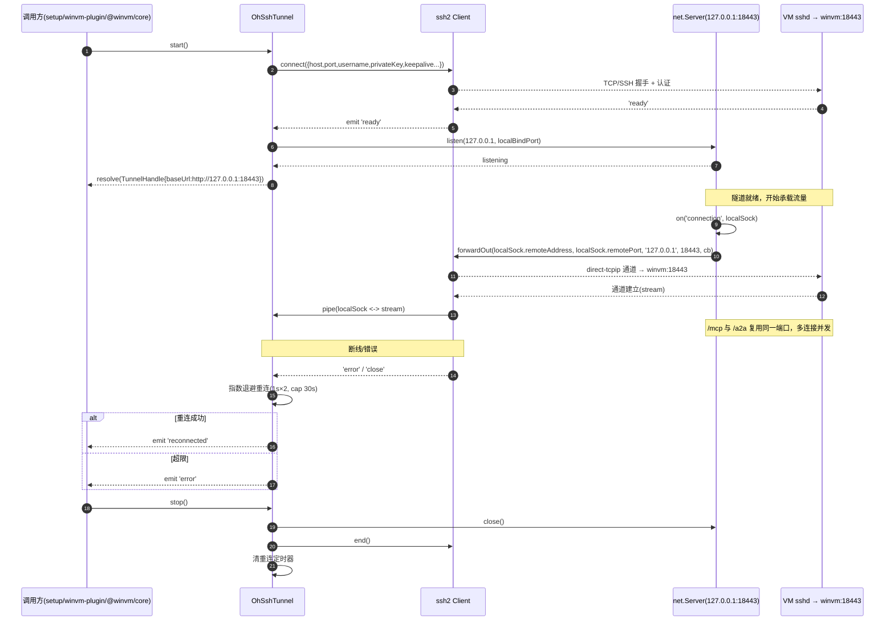
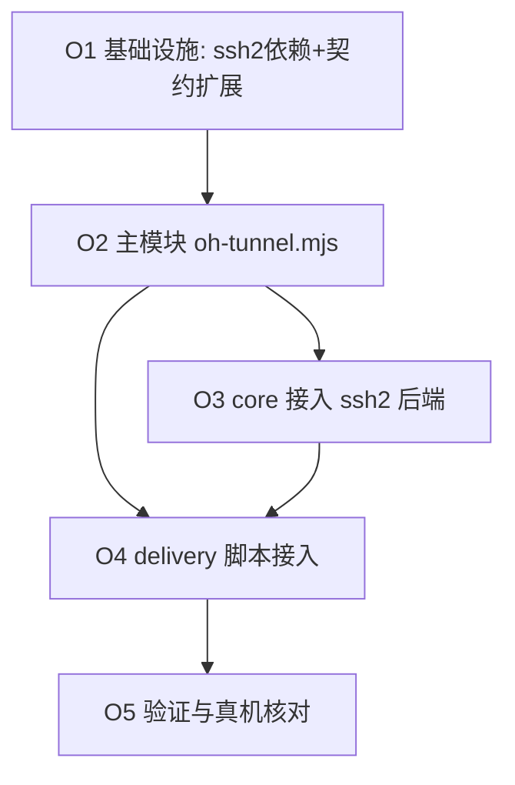

# 进程内 ssh2 本地转发隧道（HarmonyOS 宿主版）设计文档

> 模块代号：`oh-tunnel` ｜ 角色：宿主桥（Host Bridge）传输层替换件 ｜ 作者：架构师 高见远
> 对齐目标：PM「定位 A」——**宿主 = 鸿蒙(OH) WorkBuddy，VM = Windows（172.16.100.2，ssh 22，winvm 服务 18443，VM 侧基本不动）**；改造集中在宿主桥（Node 运行时 + 进程内 `ssh2` 隧道替代系统 `ssh` + OH 版 PATH/launcher + 连接器注册）。

---

## 0. 背景与目标

当前宿主（Windows/macOS）靠**系统 `ssh` 二进制**建立一条 SSH 本地转发隧道，把宿主本地端口 `18443` 转发到 Windows VM 的 winvm 服务端口，该隧道**同时承载 `/mcp` 与 `/a2a` 两个通道**。

移植到 **HarmonyOS(OH)** 后，OH 上大概率**没有系统 `ssh` 二进制**，因此必须把这条隧道改成：

- **进程内**（同一 Node 进程，无外部子进程）
- **纯 JS、零系统依赖**（用 npm 库 `ssh2`，不依赖任何可被 `spawn` 的系统命令）
- **与现有传输抽象 `kind: 'ssh-tunnel'` 完全兼容**，上层（MCP / A2A 客户端）零改动

设计约束：本文件只做**设计与任务分解**，给出主模块 `delivery/oh-tunnel.mjs` 的**草稿/骨架**与需要同步修改的文件清单、接口、配置、调用流程、重连与生命周期、安全红线、集成点与待确认事项。具体实现代码由工程师完成。

---

## 1. 现状探查结论（关键事实，已逐文件核对）

| 位置 | 现有实现 | 说明 |
|---|---|---|
| `delivery/setup.mjs:102-103` | `tunnelLocalPort`/`tunnelRemotePort` 默认均为 `18443` | 端口映射来源 |
| `delivery/setup.mjs:173`（规划）/`:554`（执行） | `spawn('ssh', ['-N','-L', `${localPort}:127.0.0.1:${remotePort}`, '-p', sshPort, 'user@host'])` | **常驻隧道**（TUNNEL 步骤，detached 后台） |
| `delivery/setup.mjs:189,618` | `curl --noproxy 127.0.0.1 http://127.0.0.1:${tunnelLocalPort}/health` | 经隧道探活 |
| `delivery/winvm-plugin.mjs:133` | `resolveVmConn({argv, env, dotEnv, persisted})` | 解析 `host/user/sshPort/servicePort`，优先级 argv > env > .env > vm-conn.json > 默认 |
| `delivery/winvm-plugin.mjs:214` | `withTunnel(vm, fn)`：`spawn('ssh', ['-N','-L', `${localPort}:127.0.0.1:${vm.servicePort}`, ...])` | **CLI 临时隧道**（command/health 复用） |
| `packages/core/src/transport/ssh-tunnel.ts:59` | `establishSshTunnel(cfg)`：用 `spawn('ssh', …)` 建隧道，返回 `TunnelHandle` | **核心抽象 / 替换切入点** |
| `packages/core/src/transport/index.ts:46` | `establishTransport` 的 `case 'ssh-tunnel'` 调用 `establishSshTunnel` | 上层统一入口 |
| `packages/contracts/src/transport.ts:11` | `SshTunnelTransport { kind:'ssh-tunnel', host, user, remotePort, localPort, port?, identityFile?, serverAliveInterval?, serverAliveCountMax? }`；`DEFAULT_LOCAL_PORT=18443` | 传输声明契约 |
| `delivery/install-host.mjs:381` `buildPlugin` | 连接器模型 `connector.transports=[{kind:'ssh-tunnel', host, user, localPort, remotePort, serverAliveInterval:30, serverAliveCountMax:3}]` | 声明式；运行时据此建隧道 |
| `packages/host-a2a-bridge/src/cli.ts:53,92` | 默认 `--endpoint http://127.0.0.1:18443`，transport `kind:'streamable-http'`，A2A path `/a2a` | **a2a 桥以 streamable-http 直连 127.0.0.1:18443** |
| `packages/host-a2a-bridge/src/client.ts:60` | `establishTransport(transport, {path:'/a2a', …})` 复用同一条隧道 | a2a 桥依赖 18443 已被转发 |

**端口映射结论（任务核心）**：

```
宿主 127.0.0.1:18443
   ⇄ [SSH 本地转发，ssh 到 172.16.100.2:22]
      ⇄ VM 127.0.0.1:18443（winvm 服务）
            ├── GET  /health
            ├── POST /mcp    ← connector:winvm（MCP 直调通道）
            └── POST /a2a    ← connector:winvm-a2a → winvm-a2a-bridge（A2A 委派桥）
```

即 **一条隧道、同一本地端口 `18443`、同时承载 `/mcp` 与 `/a2a`**——与 `ssh-tunnel.ts` 头部注释（「一条隧道同时承载 MCP 与 A2A，纯 stdio 做不到」）一致。宿主侧隧道建立后，`host-a2a-bridge` 以 `streamable-http` 直连 `127.0.0.1:18443` 即可，**无需为 a2a 单独建隧道**。

---

## 2. 实现方案与选型理由

### 2.1 选型：`ssh2`（npm 纯 JS 库）
- `ssh2` 是**纯 JavaScript 实现**，仅依赖 Node 内建 `crypto` / `net` / `stream`，**无原生编译、无 node-gyp、无需编译工具链**——契合 OH「零系统依赖」诉求。
- 原生支持 `Client`（SSH 客户端）、`forwardOut`（direct-tcpip，本地转发语义）、`keepalive`，足以 1:1 替代 `ssh -N -L`。

### 2.2 为何「进程内」而非继续调系统 `ssh`
- OH 无 `ssh` 二进制，`spawn('ssh', …)` 直接失败。
- 即便有，系统 `ssh` 还需管理 `known_hosts`、`identityFile`、子进程生命周期、stderr 透传、断线后重拉——进程内方案全部内聚可控。
- 进程内隧道随宿主进程生命周期自然清理（无孤儿监听端口），重连/保活逻辑可自行实现指数退避。

### 2.3 为何不走 stdio/其它方案
- 保持与现有 `kind:'ssh-tunnel'` 抽象一致，上层（MCP / A2A 客户端、`establishTransport` 分发）**零改动**。
- 一条隧道两通道（`/mcp` + `/a2a`）天然满足；纯 stdio 方案无法让两个独立连接器（直调 + a2a 桥）共用同一转发。

### 2.4 架构形态（两路复用、向后兼容）
- **新增** `delivery/oh-tunnel.mjs`：进程内 ssh2 隧道模块（`OhSshTunnel` 类 + `establishSsh2Tunnel` 工厂），返回与现有 `TunnelHandle` **同形**的对象。
- **增强** `@winvm/core` 的 `establishSshTunnel`：引入**后端选择器**——当 `process.platform === 'ohos'` 或 `WINVM_TUNNEL_BACKEND=ssh2` 时用 ssh2 后端；否则仍用系统 `ssh`（Windows/macOS 不变）。这样 `connector:winvm` 的 `kind:'ssh-tunnel'` 在 OH 上自动走新隧道，a2a 桥零改动复用 `127.0.0.1:18443`。

---

## 3. 文件清单

### 新增
- `delivery/oh-tunnel.mjs` —— **主模块草稿**：`OhSshTunnel` 类 + `establishSsh2Tunnel(opts): Promise<TunnelHandle>` 工厂；ESM，可被 `setup.mjs` / `winvm-plugin.mjs` 直接 import。

### 修改（替换现有 `ssh` 调用点 / 打通后端）
- `packages/core/src/transport/ssh-tunnel.ts` —— 增加 ssh2 后端（建议拆出 `ssh-tunnel-ssh2.ts` 被本文件 re-export），`establishSshTunnel` 按后端选择器分发；保留 `renderSshCommand` 供系统 ssh 排障文档。
- `packages/core/src/transport/index.ts` —— `establishTransport` 的 `ssh-tunnel` 分支按选择器选 ssh2 实现（或直接调用 `establishSsh2Tunnel`）。
- `packages/core/package.json` —— `dependencies` 增加 `"ssh2": "^1.16.0"`。
- `packages/contracts/src/transport.ts` —— `SshTunnelTransport` 增加可选 `password?: string` 与 `privateKey?: string`（PEM 字符串），便于 OH 用密码 / 内联密钥鉴权（系统 ssh 仍走 `identityFile`）。
- `delivery/setup.mjs` —— TUNNEL 步骤改用进程内 `await establishSsh2Tunnel({…})`（不再 `spawn('ssh')`）；HEALTH 阶段继续 `curl 127.0.0.1:18443/health`。
- `delivery/winvm-plugin.mjs` —— `withTunnel()` 改用 `establishSsh2Tunnel()`；`resolveVmConn` 增加 **密钥路径**解析：`--vm-key` > `WINVM_VM_KEY` > `vm-conn.json.keyFile` > 默认 `~/.ssh/id_rsa`。
- `delivery/install-host.mjs` —— `buildPlugin` 在 `ssh-tunnel` transport 写入 `identityFile`（或在 `vm-conn.json` 持久化 key 路径），新增 `--vm-key` 参数（含 dry-run 预览）。

### 可选新增
- `tests/unit/oh-tunnel.test.mjs` —— 隧道建立/转发/重连/停止的单元与集成测试（可用 mock sshd 或本地回环对端）。

---

## 4. 模块接口（TypeScript-ish 草稿）

```typescript
// delivery/oh-tunnel.mjs（ESM；下方 TS 仅用于表达契约，实际为 .mjs）

import type { TunnelHandle } from '@winvm/core/transport';

export interface OhTunnelOptions {
  /** VM ssh 可达地址，如 '172.16.100.2' */
  vmHost: string;
  /** VM ssh 端口，默认 22 */
  vmSshPort?: number;            // default 22
  /** ssh 登录用户名 */
  username: string;

  /** 本地监听地址——安全红线：强制默认 127.0.0.1，禁止外网绑定 */
  localBindHost?: string;        // default '127.0.0.1'
  /** 本地监听端口——即隧道入口，默认 18443 */
  localBindPort: number;

  /** 远端（VM 内）目标地址——隧道出口，默认 127.0.0.1（winvm 仅监听回环） */
  remoteHost?: string;           // default '127.0.0.1'
  /** 远端（VM 内）目标端口——winvm 服务端口，默认 18443 */
  remotePort: number;

  // —— 鉴权（与 SshTunnelTransport 对齐，OH 用私钥/密码；系统 ssh 用 identityFile）——
  /** PEM 私钥内容或路径；与 identityFile 互斥优先 */
  privateKey?: string;
  /** identityFile 路径（兼容现有解析），存在则读为 privateKey */
  identityFile?: string;
  /** 私钥 passphrase（禁止落日志） */
  passphrase?: string;
  /** 密码登录（OH 若开启密码鉴权） */
  password?: string;

  // —— 保活（等价 ssh ServerAlive*）——
  keepaliveInterval?: number;    // default 30000 (ms)
  keepaliveCountMax?: number;    // default 3

  // —— 就绪/重连 ——
  readyTimeoutMs?: number;       // default 20000
  reconnect?: {
    enabled?: boolean;           // default true
    baseDelayMs?: number;        // default 1000
    maxDelayMs?: number;        // default 30000
    factor?: number;             // default 2
    maxAttempts?: number;        // default 0 = 无限（受 maxDelayMs 限制）
    jitter?: boolean;            // default true
  };

  /** 已知主机指纹校验；默认首次信任并持久化，false 表示无条件接受（INSECURE，需显式） */
  hostVerifier?: (hostKey: Buffer, callback: (ok: boolean) => void) => void;
  /** stderr / 诊断回调（绝不带凭据） */
  onStderr?: (chunk: string) => void;
}

export type OhTunnelEvent =
  | 'connect' | 'ready' | 'error' | 'close'
  | 'reconnecting' | 'reconnected' | 'exited'
  | 'connection';   // payload: { srcHost: string; srcPort: number }

export declare class OhSshTunnel {
  constructor(opts: OhTunnelOptions);
  /** 建立 SSH 连接 + 本地监听；幂等（已 running 直接返回既有 handle） */
  start(): Promise<TunnelHandle>;
  /** 关闭本地监听 → 结束所有 channel → client.end() → 清重连定时器；幂等 */
  stop(): Promise<void>;
  /** 订阅生命周期事件 */
  on(event: OhTunnelEvent, cb: (payload?: any) => void): this;
  /** 当前是否已就绪（本地端口可连） */
  isReady(): boolean;
}

/**
 * 与现有 establishSshTunnel 同签名的兼容工厂：
 * 返回 TunnelHandle{ localPort, baseUrl, pid, close(), exited() }。
 * 注意：进程内隧道无子进程，pid 固定为 undefined（core 不得依赖 pid 真值）。
 */
export async function establishSsh2Tunnel(
  opts: OhTunnelOptions & { readyTimeoutMs?: number; extraOptions?: string[]; onStderr?: (c: string) => void },
): Promise<TunnelHandle>;
```

> **与 `TunnelHandle` 的兼容契约**：`{ localPort:number; baseUrl:string; pid:number|undefined; close():Promise<void>; exited():boolean }`。`core` 的 `establishTransport` 仅用 `baseUrl` 建 `HttpJsonRpcChannel`，用 `close()/exited()` 管理生命周期；`pid` 仅用于日志，故 `undefined` 安全。

---

## 5. 数据结构 / 配置 Schema（JSON）

### 5.1 持久化 `vm-conn.json`（在现有结构上加 `keyFile`）
```json
{
  "host": "172.16.100.2",
  "user": "vmadmin",
  "sshPort": 22,
  "servicePort": 18443,
  "provider": "workbuddy",
  "cli": "codebuddy",
  "keyFile": "/path/to/id_rsa"
}
```

### 5.2 `SshTunnelTransport`（契约扩展后）
```json
{
  "kind": "ssh-tunnel",
  "host": "172.16.100.2",
  "user": "vmadmin",
  "localPort": 18443,
  "remotePort": 18443,
  "port": 22,
  "identityFile": "/path/to/id_rsa",
  "serverAliveInterval": 30,
  "serverAliveCountMax": 3
}
```

### 5.3 OhSshTunnel 运行期选项（来自 resolveVmConn + key 解析）
```json
{
  "vmHost": "172.16.100.2",
  "vmSshPort": 22,
  "username": "vmadmin",
  "localBindHost": "127.0.0.1",
  "localBindPort": 18443,
  "remoteHost": "127.0.0.1",
  "remotePort": 18443,
  "identityFile": "/path/to/id_rsa",
  "keepaliveInterval": 30000,
  "keepaliveCountMax": 3,
  "readyTimeoutMs": 20000,
  "reconnect": { "enabled": true, "baseDelayMs": 1000, "maxDelayMs": 30000, "factor": 2, "maxAttempts": 0 }
}
```

---

## 6. 程序调用流程（Mermaid 时序图）

> ⚠️ **关键校正（架构师职责）**：任务描述里写的 `forwardIn(localHost,localPort) → 收到 'tcpip' → 建 out-stream` 实际对应 **远端转发（ssh -R）** 的语义（`forwardIn` 让 *服务端* 监听、用 `tcpip` 事件把连接推回客户端）。我们要的是 **本地转发（ssh -L）**：*本地* 监听端口，每来一个本地连接就用 `client.forwardOut(...)`（direct-tcpip）开一条到 VM 远端目标（127.0.0.1:18443）的通道并双向 pipe。下面给出**正确的本地转发流程**；切勿按字面实现成 ssh -R。



**核心转发代码片段（仅示意，非交付实现）**：
```
server.on('connection', (sock) => {
  client.forwardOut(sock.remoteAddress, sock.remotePort, remoteHost, remotePort, (err, channel) => {
    if (err) { sock.destroy(); return; }
    sock.pipe(channel).pipe(sock);
  });
});
```

---

## 7. 生命周期与重连策略

- **`start()` 幂等**：若已 `running` 直接返回既有 `TunnelHandle`，不重复建连/监听。
- **`stop()` 幂等**：关闭 `net.Server` → 结束所有活跃 channel → `client.end()` → 清除重连定时器；重复调用安全。
- **重连（指数退避）**：`'error'`/`'close'` 触发；延迟 = `min(baseDelayMs * factor^n, maxDelayMs)`，默认 base 1s、factor 2、cap 30s；可选 jitter 避免雷鸣；`maxAttempts=0` 表示持续重连（受 maxDelayMs 兜底）。重连成功发 `'reconnected'`，连续失败超限发 `'error'` 并停止。
- **保活**：`keepaliveInterval`/`keepaliveCountMax` 直接映射到 ssh2 的 `keepaliveInterval` 与断开判定，等价原 ssh 的 `ServerAliveInterval`/`ServerAliveCountMax`。
- **进程退出清理**：注册 `process.on('exit'|'SIGINT'|'SIGTERM', () => stop())`，确保宿主退出时关闭监听端口、结束 SSH 会话，**不留孤儿端口 / 僵尸连接**。
- **就绪探测**：`start()` 内轮询 `net.connect(127.0.0.1, localBindPort)` 直到可连或超时（沿用现有 `probePort` 思路），超时则抛 `TransportError`（仅含 host/port/user，不含凭据）。

---

## 8. 安全红线

1. **仅绑定回环**：`localBindHost` 强制默认 `127.0.0.1`，任何配置/参数传入 `0.0.0.0` 或外网地址一律拒绝（启动前断言），绝不对外开放转发端口。
2. **凭据不落日志**：`privateKey` / `password` / `passphrase` 永不进入 `console`、日志、错误信息；错误文本仅含 `host`/`port`/`user` 与 SSH 层通用错误。
3. **主机指纹校验**：默认采用「首次信任 + 持久化指纹到 `~/.workbuddy/winvm/known_hosts`」；**不允许无条件接受**（除非显式 `INSECURE` 开关）。对应 OpenSSH 的 `StrictHostKeyChecking=accept-new`，杜绝中间人。
4. **零对外暴露**：VM 侧 winvm 服务本就只监听 `127.0.0.1`，隧道仅回环映射，端口不出宿主网络边界（与 `ssh-tunnel.ts` 头部「VM 对外零端口暴露」一致）。
5. **密钥来源最小化**：优先 `identityFile`（与现有解析一致）；`vm-conn.json` 只存 key **路径**不存私钥内容；密码鉴权仅在 VM 明确开启时使用且禁止持久化明文。

---

## 9. 集成点

### 9.1 三个替换点（精确）
- **`delivery/setup.mjs` TUNNEL 步骤**：把 `spawn('ssh', ['-N','-L', …])` 改为 `await establishSsh2Tunnel({ vmHost, vmSshPort, username, localBindPort: tunnelLocalPort, remotePort: tunnelRemotePort, identityFile/key, … })` 常驻；HEALTH 阶段继续 `curl 127.0.0.1:${tunnelLocalPort}/health`。
- **`delivery/winvm-plugin.mjs` `withTunnel()`**：把临时隧道的 `spawn('ssh', …)` 改为 `establishSsh2Tunnel()`（`localBindPort` 用 `18443 + random`，`remotePort` = `vm.servicePort`）；`resolveVmConn` 增加密钥路径解析（见 9.3）。
- **`@winvm/core` `establishTransport` 的 `ssh-tunnel` 分支**：OH 后端走 ssh2；`connector:winvm` 运行时自动获得新隧道；`host-a2a-bridge` 以 `streamable-http` 直连 `127.0.0.1:18443` **零改动**复用。

### 9.2 与 `host-a2a-bridge` 的衔接
a2a 桥是 `stdio` MCP server，内部 `establishTransport({kind:'streamable-http', url:'http://127.0.0.1:18443'}, {path:'/a2a'})`。**只要宿主侧隧道在 `127.0.0.1:18443` 建立，a2a 桥无需任何改动**——这是「一条隧道、两通道」设计的最大收益。无需为 a2a 新增隧道或改动 `host-a2a-bridge`。

### 9.3 配置解析优先级（沿用 `resolveVmConn` 约定）
```
argv(--vm-*)  >  env(WINVM_VM_*)  >  .env(VM_*)  >  vm-conn.json  >  默认值
```
新增密钥解析维度（与上面同序）：`--vm-key` > `WINVM_VM_KEY` > `vm-conn.json.keyFile` > 默认 `~/.ssh/id_rsa`。`install-host.mjs` 须把 key 路径写入 `vm-conn.json` 与连接器 `ssh-tunnel` transport 的 `identityFile`，使 OH 宿主无需每次传参。

### 9.4 备选（若 WorkBuddy 宿主运行时自管隧道）
若真机验证发现 `connector:winvm` 的 `kind:'ssh-tunnel'` 不由 `@winvm/core` 的 `establishTransport` 处理、而是由宿主运行时自起隧道，则本模块需额外提供一个**常驻隧道进程入口**（如 `node delivery/oh-tunnel.mjs --daemon`），由 `install-host.mjs` 注册为 OH 后台服务，保持 `127.0.0.1:18443` 常驻；a2a 桥仍零改动。

---

## 10. 依赖

- **`ssh2` `^1.16.0`**（纯 JS；依赖 Node 内建 `crypto`/`net`/`stream`，**无原生编译、无 node-gyp**）。加入 `packages/core/package.json` 的 `dependencies`（`@winvm/core` 是隧道抽象归属层）。
- 不引入任何需要编译的工具链；OH Node 运行时自带所需内建模块。
- 隧道实现只用 `net`（监听/连接），**不依赖 `child_process`**——规避 OH 对子进程的可能限制。

---

## 11. 待明确事项（需真机确认，呼应 PM「B 环境限制」清单）

1. **Node 运行时可用性（P0）**：OH 宿主能否运行 Node.js？沙箱是隔离 OH 运行时、仅 `127.0.0.1`，无法验证——须用户在本机 OH 宿主确认。
2. **`ssh2` 可装可加载**：OH Node 运行时能否 `npm i ssh2` 并 `require`？取决于 npm registry 可达性与 Node ABI 兼容性。
3. **真机网络可达性**：`172.16.100.2:22` 与 `:18443` 在真机是否可达？沙箱 100% 丢包、端口 filtered 是**网络隔离**现象，**不代表真机不可达**——须用户在 OH 本机验证。
4. **密钥分发**：OH 宿主如何获得与 VM `authorized_keys` 配对的私钥（id_rsa 路径 / passphrase / 是否开启密码登录）。
5. **OH 安全策略**：`ssh2` 使用的 cipher/mac/kex 算法是否被 OH 安全框架禁用（必要时在 `algorithms` 里显式协商兼容子集）。
6. **运行时隧道归属（决定 §9.4 是否启用）**：`connector:winvm` 的 `kind:'ssh-tunnel'` 是否由 `@winvm/core` 的 `establishTransport` 处理？若由宿主运行时自管，则需常驻隧道进程方案。
7. **`known_hosts` 落盘权限**：`~/.workbuddy/winvm/` 在 OH 上的可写性与路径规范。

---

## 12. 任务分解列表（有序、含依赖、按实现顺序）

> 约束：≤5 个任务；每任务 ≥3 个相关文件；按功能/层次分组；T01 为基础设施。

| ID | 任务名 | 源文件 | 依赖 | 优先级 |
|---|---|---|---|---|
| **T01** | 项目基础设施：引入 ssh2 依赖 + 契约扩展 | `packages/core/package.json`、`packages/contracts/src/transport.ts`、`docs/oh-tunnel-design.md` | — | P0 |
| **T02** | 主模块草稿 `delivery/oh-tunnel.mjs`：OhSshTunnel 类 + establishSsh2Tunnel 工厂（含 start/stop/on、转发、重连骨架） | `delivery/oh-tunnel.mjs`、`packages/core/src/transport/ssh-tunnel-ssh2.ts`（建议）、`packages/core/src/transport/ssh-tunnel.ts`（后端选择器） | T01 | P0 |
| **T03** | core 传输层接入 ssh2 后端 | `packages/core/src/transport/index.ts`、`packages/core/src/transport/ssh-tunnel.ts`、`packages/core/package.json`（已含） | T02 | P0 |
| **T04** | delivery 脚本接入：setup TUNNEL + winvm-plugin withTunnel + resolveVmConn 密钥解析 + install-host 写 key | `delivery/setup.mjs`、`delivery/winvm-plugin.mjs`、`delivery/install-host.mjs` | T02, T03 | P0 |
| **T05** | 验证与自检：单元/集成测试 + 真机可达性核对（呼应 §11） | `tests/unit/oh-tunnel.test.mjs`、`docs/oh-tunnel-design.md`（待确认项回填） | T04 | P1 |

**依赖关系图**：



**说明**：
- T01 必须最先完成（依赖声明与契约是后续一切基础）。
- T02 产出可在 T03、T04 并行消费；T03 与 T04 互不阻塞，但二者都依赖 T02。
- T05 依赖 T04 集成完成，并在真机（OH 宿主）上核对 §11 待明确事项。
