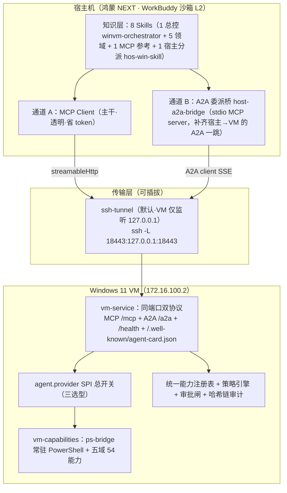
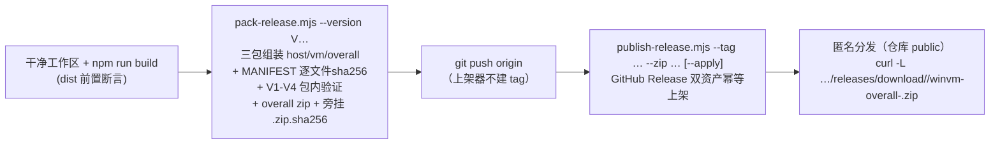

# 部署与运行机制及配置总览 · WinVM Bridge 运维权威手册

> 读者：接手本项目部署与运维的人。本文=**总览手册**：系统性讲清部署机制、运行机制，并逐项穷举每一项配置。
> 实证纪律：所有配置键/端点/命令均以**仓库源码与既有文档**为准（每节标注所在文件）；权威层级 = 仓库文档 > 代码事实 > 任何口头任务书。细节专项文档见 §6.3 权威指针分工，本文不重复其内容只做汇总引用。
> 仓库：`workbuddy-virtual-win-plugin`（GitHub `athronix/workbuddy-virtual-win-plugin`，public）。

---

## 第一部分 总览与架构

### 1.1 项目定位（一句话 + 形态）

让**宿主机上的 AI Agent（V1 = WorkBuddy）安全、可控、可审计地完全操作一台 Windows 虚拟机**（system / app / storage / gui / appops 五域 54 能力）。

| 维度 | 事实 | 出处 |
|---|---|---|
| 版本 | `0.1.0`（V1 基线，npm workspace 根 version） | `package.json` |
| 形态 | npm workspaces 单仓，12 个可独立编译/发布包 + 8 个 WorkBuddy Skill（1 总控 + 5 领域 + 1 MCP 参考 + 1 宿主分派）+ 双端一键部署器 | `README.md` 头部 |
| 协议 | 工具层 MCP（Streamable HTTP / stdio），委派层 A2A v1.0，Agent Card 落 `/.well-known/agent-card.json` | `README.md` §1 |
| 监管 | L0–L3 风险分级 + 策略引擎（白名单拒绝优先）+ 人工审批闸 + 哈希链防篡改审计 + 全链路 traceId | `README.md` §1/§2.4 |
| License | 私有（单一项目仓库），GitHub 仓库 public 分发发布包 | `README.md` 头部、DEPLOYMENT §9.1a |

### 1.2 1+4 分层架构（宿主 → 传输 → VM）



- 分层口径唯一事实源 = 各包 `package.json` 的 `layer` 字段（机检 `scripts/dep-lint.mjs`，rank 序 `L0 < L1a < L1b < L1c < L2 < L3`）；散文与字段分歧时以字段为准（`README.md` §3.2）。
- 依赖单向：`contracts` ← `core`/frameworks ← `adapters`/`vm-service`，反向依赖即门禁失败。

### 1.3 双通道：MCP 直调 vs A2A 委派

| 通道 | 用途 | 端点/形态 | 特点 |
|---|---|---|---|
| **A · MCP 直调**（主干） | 简单、确定性、工具级精确执行（查磁盘→启服务→装应用） | streamableHttp → VM `127.0.0.1:18443/mcp`；连接器 `connector:winvm` | 透明、省 token、结构化 tool 结果 |
| **B · A2A 委派**（长任务） | 多步/强 GUI 任务整体交给 VM 内 Agent，流式回传进度与产物 | 宿主本地 stdio 桥 `a2a-bridge/cli.js` → 内部 A2A client 调 VM `/a2a`（SSE）；连接器 `connector:winvm-a2a` | `a2a.delegate`/`task.get`/`approval.reply`/`task.cancel`/`a2a.health`；`input-required` 审批；artifact 回传 |

关键事实（出处 `README.md` §2.1/§3.3、MEMORY.md 架构节）：

- 两通道**共用同一套能力注册表、策略引擎、审批闸与审计链**，绝不出现两套风控（FR-103）。
- 工具名映射：契约点分名 `system.info.get` → MCP 工具名 `winvm__system.info.get`（**保留点号**，仅加 `winvm__` 前缀；tools/list 实测，出处 `delivery/install-host.mjs:1466`）。
- 纯 MCP 直调命中 L2/L3 ⇒ 服务端收口 `DELEGATION_REQUIRED`，不发续跑令牌，须改走委派（DEPLOYMENT §5.1）。
- 宿主 WorkBuddy 是 MCP client 而非 A2A client，故 A2A 一跳由 `host-a2a-bridge`（stdio MCP server）补齐（ADR-11）。

### 1.4 网络拓扑（鸿蒙沙箱 ↔ SSH 隧道 ↔ Win11 VM）

| 层 | 环境 | WorkBuddy 可达性 | 出处 |
|---|---|---|---|
| L1 | 鸿蒙 NEXT 宿主 OS（`process.platform` 实报 `openharmony`），每 App 独立挂载命名空间 + HMMAC，无 root | ❌ 仅 `$HOME`（hmdfs）跨 App 可读写 | `docs/deploy/通过铠大师app安装部署.md` §1、MEMORY.md |
| L2 | WorkBuddy App 沙箱（`com.tencent.workbuddy`，uid 20020171），自带 node | ✅ 本尊 | 同上 |
| L3 | 用户共享数据目录 `/storage/Users/currentUser/`（hmdfs） | ✅ 读写（跨 App 唯一通道；**不支持符号链接**） | 同上、G7 |
| L4 | VM Windows 系统层（OpenSSH Server/防火墙/Node 前置） | ⚠️ 仅 SSH 之后可达；sshd 未装则通道不存在（鸡生蛋） | 同上 G3 |
| L5 | VM ↔ 宿主 SSH/隧道 | ✅ 通道建立后 | 同上 |

- **VM**：Win11 `172.16.100.2`，SSH 免密用户名 = `User`（以 `~/.workbuddy/winvm/vm-conn.json` 实测为准）；程序目录 `C:/WinVMBridge`，工作区 `C:/WinVMWorkspace`（`README.md` §5.1、DEPLOYMENT §9.2）。
- **服务只绑 VM 回环**：`vm-service` 仅监听 `127.0.0.1:18443`，且该约束**不可关**（非回环绑定 ⇒ 启动校验恒 error；`security.requireLoopbackBind=false` 自 Phase 1 起不再能放宽，`README.md` §2.4、DEPLOYMENT §8.1）。VM 对外零端口暴露，防火墙只需放行 22。
- **访问路径**：宿主一律经 SSH 本地端口转发 `ssh -L 18443:127.0.0.1:18443 User@172.16.100.2`（鸿蒙宿主默认走进程内 ssh2 `delivery/oh-tunnel.mjs`，不依赖系统 ssh，`WINVM_TUNNEL_BACKEND=ssh2`）；`/mcp`、`/a2a`、`/health` 共用同一隧道。

### 1.5 VM Agent 三选型（`WINVM_VM_PROVIDER` / `agent.provider`）

经 `agent.provider` 一行切换，桥接层 / MCP / A2A / Skills 全部零改动（ADR-6/ADR-10，DEPLOYMENT §1.2）：

| 取值 | 包 | 运行时行为 | 备注 |
|---|---|---|---|
| `workbuddy-deterministic`（**默认/基准**） | `@winvm/adapter-agent-workbuddy` | 确定性执行器，不 spawn 任何 CLI | 零登录依赖；codebuddy 缺失仅 WARNING 不阻断（`delivery/preflight.mjs`） |
| `workbuddy` | `@winvm/adapter-agent-workbuddy-llm` | VM 内 spawn `codebuddy` CLI（LLM 常驻会话） | 依赖 codebuddy CLI **登录态**（G4，结构性不可脚本化）；首机建议先跑通 deterministic 再切换 |
| `hermes-agent` | `@winvm/adapter-agent-hermes` | VM 内 spawn `hermes` CLI | CLI 无 `--mcp` 参数，MCP 预注册进其 `config.yaml.mcp_servers`（ADR-13） |

### 1.6 12 包一览（层 = 各包 `package.json` `layer` 字段）

| 层 | 包（目录 `packages/…`） | 职责 |
|----|----|------|
| L0-contracts | `contracts` | 全系统唯一契约源：TS 类型 + JSON Schema（`schemas/`） |
| L1a-core | `core` | transport（HTTP/SSH/stdio）、registry、policy、audit（哈希链）、session 探针、bridge 加载器、config |
| L1b-mcp-framework | `mcp-framework` | MCP server/client（Streamable HTTP + stdio） |
| L1b-a2a-framework | `a2a-framework` | A2A v1.0 server/client（AgentCard / message send·stream / tasks/* / artifacts / input-required） |
| L1c-host-sdk | `host-sdk` | 中性插件模型 SDK（patch / skill-loader / 渲染抽象） |
| L2-adapter-host | `adapter-host-workbuddy` | 渲染 WorkBuddy 原生 plugin.json / marketplace.json / 连接器 mcp.json（双连接器） |
| L3-host-bridge | `host-a2a-bridge` | stdio MCP server：`a2a.delegate`/`task.get`/`approval.reply`/`task.cancel`/`health`，内部 A2A client 调 VM `/a2a` |
| L2-vm-capabilities | `vm-capabilities` | ps-bridge 常驻进程 + 五域 PowerShell 模块（`psmod/`）+ 能力注册表 + 空闲自愈 |
| L2-adapter-agent | `adapter-agent-workbuddy` | VM 内确定性执行器 |
| L2-adapter-agent-llm | `adapter-agent-workbuddy-llm` | VM 内 LLM 执行器（复用确定性执行器，仅 `runGoal` LLM 驱动） |
| L2-adapter-agent-llm | `adapter-agent-hermes` | Hermes Agent 执行器 |
| L2-vm-service | `vm-service` | 同端口双协议服务端 + CLI 入口（`agent.provider` 总开关） |

（表源 `README.md` §3.2，与各包 `packages/*/package.json` `layer` 字段逐包对齐。）

---

## 第二部分 部署机制

### 2.1 七相位部署流水线（`delivery/setup.mjs`，1369 行）

`setup.mjs` 读项目根 `.env`（不存在回退 `.env.example`），一条命令完成「宿主侧 + VM 侧」安装、部署、隧道与自检。安全默认（文件头注 L19-23）：

- **不加 `--apply` 即 dry-run**：只打印计划、不改动任何系统；真执行的**唯一**入口是显式 `--apply`（`.env` 写 `WINVM_DRY_RUN=0` 也不会自动触发——旧实现 footgun 已修，见 `resolveConfig()` L88-94 注释）。
- **`WINVM_DRY_RUN=1` 是兜底保险**：即便传了 `--apply` 也强制保持 dry-run。
- 单相位失败不阻断其它相位，最后汇总报错并置退出码。

七相位逐相表（相位名与 `buildPlan()` L117-225 一致；耗时为 V1.4.0 run 实测量级，见 `docs/deploy/通过铠大师app安装部署.md` §5.3 示例 report）。> 口径注：历史称"七相位/七阶段"（BUILD→…→HEALTH，QA-PROBE 为后续批次增补），代码现共 **8 个相位名**，下表逐相穷举：

| 相位 | 做什么 | 关键命令（计划打印原文） | 失败判据/行为 | 耗时量级 |
|---|---|---|---|---|
| **BUILD** | 仓库态构建全部 packages 到 dist | `npm run build`（= `tsc -b tsconfig.build.json`） | 编译错即失败；`--skip-build` / `WINVM_SKIP_BUILD=1` 时整相省略（发布包态：dist 已构建且 MANIFEST 在册，包内无 src/tsconfig，重跑必失败） | 分钟级 |
| **HOST** | 安装宿主 WorkBuddy 插件（缓存+连接器+skills+桥+hooks） | `node delivery/install-host.mjs …`（透传 `--host/--user/--local-port/--remote-port` 等） | preflight 依赖不齐中止（`--no-preflight` 跳过）；中性模型校验失败中止 | ~1.3s（缓存已热） |
| **VM** | 打包产物 tgz → scp → 远端 `install-vm.mjs --skip-install --skip-build` | `tar` + `scp winvm-dist.tgz` + ssh 执行 | 建目录/传输/安装任一失败该相红（L631-653） | ~33s |
| **VM-START** | 拉起 VM 服务：推 `.ps1` 执行 `schtasks /End` → 强杀占口进程 → `schtasks /Run`，轮询 VM 本机端口监听 **≤420s**（L1210-1215） | `[.ps1 push] schtasks /end → kill port owner → schtasks /run /tn WinVMBridge.Service`（`buildVmStartPs1()` L718-736；铁律：勿内联 PowerShell，必走 scp .ps1 → `powershell -File`） | 420s 未监听 ⇒ 警告不阻断（HEALTH 再验证），提示手动 `schtasks /run` 重跑 | ~18s |
| **TUNNEL** | 确保 SSH 本地转发（daemon-aware 幂等三级：复用常驻 tunnel-daemon → `winvm-plugin tunnel ensure` 拉起 → 仅 ensure 失败才回落自建 ssh 并告警） | `winvm-plugin tunnel ensure --local-port <port>` | **复用判据 = 后端 `/health` 经本地端口打通为唯一硬判据**（`evaluateTunnelReuse()` L831-851：daemon 自报 healthy 仅作信息，本地活≠后端活，黑洞显形"疑似隧道黑洞"） | ~8s |
| **TEST** | 宿主机侧自检能力注册表/ps-bridge/provider | `node packages/vm-service/dist/cli.js --self-test` | self-test 非零即失败 | ~0.4s |
| **QA-PROBE** | 分发 QA 探针夹具到 VM `C:/WinVMBridge/dev-and-qa/probes/` | `scp -P 22 qa/probes/{…} User@VM:C:/WinVMBridge/…` | 单文件失败仅记 ok=false **不阻断**（QA 夹具非运行时依赖）；`VM_HOST` 未配置跳过 | 秒级 |
| **HEALTH** | 经隧道探测 `http://127.0.0.1:18443/health` | `curl -s --noproxy 127.0.0.1 --max-time 30 http://127.0.0.1:<port>/health` | 传输级短重试 3 次 + **D15 载荷级退避复探**：载荷 verdict=unknown（冷启探针超时）时 10s×≤6、总预算 `HEALTH_BUDGET_MS=90_000`（L1244-1275），直到会话门禁结论明确；失败区分「端口未监听」vs「监听但无 HTTP」（`checkTcpOpen`） | ~0.5s–90s |

> **口径沿革（2026-10-23 回改批）**：`DEPLOYMENT.md` §1/§1.3 与 `setup.mjs` 头注旧写"轮询 ≤60s"，与代码事实（L1211 `waitForRemotePort(cfg, 420_000)` = **≤420s**）不符——三处已统一回改为 ≤420s（HEALTH 实际为"传输级 3 次 + D15 载荷级 ≤90s"两级重试，文档同步登记）。本文与代码、DEPLOYMENT.md 三者现已一致。

- `--only-host` = BUILD+HOST+TEST；`--only-vm` = BUILD+VM+VM-START+QA-PROBE（CL-020 迭代④，main() L1084-1099）；`--phase NAME` 单相位补跑（大小写不敏感，与 `--only-*` 互斥且优先，名字不匹配立即报错防呆）。
- 卸载对称：`--uninstall`（预览）/ `--uninstall --apply`（执行，目录入回收站）。
- HEALTH 相位若检出 `session.interactive=false` 会直接打印 VM 交互式重启三步命令（DEPLOYMENT §1.3）。
- `VM_HOST` 留空时 VM 相位转为打印本地手动部署指引，不自动 ssh。

### 2.2 `deploy-all.sh` 与 `--wipe` 清场重装

`deploy-all.sh` 不在仓库根，由 `pack-release.mjs` **生成**进 overall 包（`release/V1.4.2/overall/deploy-all.sh`，40 行）。执行链：

1. node 探测：`WINVM_NODE_BIN` env → `command -v node` → 鸿蒙沙箱自带 `/data/storage/el1/bundle/libs/arm64/node/bin/node`，皆无退出 1。
2. `.env` 缺失 ⇒ 从包内 `.env.example` 复制后**退出 2** 要求编辑（不做默认猜测）。
3. `set -a; . ./.env; set +a` 后硬校验 `VM_HOST` / `VM_USER` / `WINVM_VM_PROVIDER` 三键非空，缺即中止。
4. `--wipe` ⇒ 先 `node delivery/uninstall.mjs --apply --vm-host … --vm-user … --vm-ssh-port …`（双端清场，宿主持久化与 `C:/WinVMBridge` 入回收站可恢复；`C:/WinVMWorkspace` 默认保留）。
5. 恒执行 `node delivery/setup.mjs --apply --skip-build`（七相位 HOST→…→HEALTH；BUILD 跳过原因见上）。
6. 后置 `curl -s --noproxy "*" -m 10 http://127.0.0.1:${WINVM_TUNNEL_LOCAL_PORT:-18443}/health` 打印健康摘要。

**用法纪律**（DEPLOYMENT §9.2/§9.3）：

- 推荐 `bash deploy-all.sh --wipe`——`bash` 显式解释不依赖执行位（新机 hmdfs 解包可能丢 mode 位，Q-4）。
- **发布迭代铁律①（用户 2026-10-18 裁定）**：每迭代重部署前必须清空历史部署（`--wipe`）；不清场的重装只是"补部署"，不构成迭代验收，验证矩阵必须在清空重装态取数。
- 单边：`host/deploy-host.sh`（`exec node delivery/install-host.mjs "$@"`）/ `vm/deploy-vm.sh`（无参时交互确认后 `deploy-vm.mjs --apply --skip-build`）。

### 2.3 发布链：pack-release → publish-release → 匿名分发



`pack-release.mjs`（673 行）安全红线：只读仓库、只写 `release/` 与 `qa/release/`；绝不触碰 VM/隧道/运行态。`--allow-dirty` 仅调试、`--skip-verify` 跳验证；缺 `--version` 时从 HEAD tag 推导（fail-loud）。REL-11 追加 zip 生成（`zip -qr` 从 `release/<version>/` 执行 ⇒ 包内根恒为 `overall/`）与**旁挂校验文件** `winvm-overall-<version>.zip.sha256`（`sha256sum -c` 兼容一行 `<hex>  <zipname>`）；**fail-loud 信任链**：zip 条目集必须 ⊆ MANIFEST 行集 ∪ {MANIFEST.txt}（差集非空即中止；目录条目与 overall/MANIFEST.txt 豁免——`.env` 等敏感文件结构性排除，`differenceZipAgainstManifest()` L357-380）。证据三元组取 **zip 实体** sha256/bytes。

`publish-release.mjs`（373 行）：**默认 dry-run 零写操作**（GET 只读探测容错无网络），`--apply` 才创建/复用 release、zip 与旁挂**各自**先删同名旧 asset 再传（幂等双资产，Q-2）；旁挂缺失 ⇒ warn 继续只上架 zip（兼容旧包）。token 解析顺序 `GH_TOKEN` env → `--token` → `~/.config/gh/hosts.yml`（**值绝不打印**，只打印来源）。成功打印 Release html_url + 匿名下载 URL。真网首跑两雷已修（RFC6570 模板段→400、headers 反压 Content-Type→400，MEMORY 迭代4）。仓库坐标兜底 `DEFAULT_REPO = 'athronix/workbuddy-virtual-win-plugin'`。

### 2.4 三包闭包与 MANIFEST、V1-V4 包内验证

| 包 | 闭包组成（`pack-release.mjs` 头注 L12-16） | 一键脚本 |
|---|---|---|
| `host/` | `install-host.mjs` 的 import/spawn 闭包 + skills + packages 运行时资产 + `node_modules`（@winvm 实体副本 + ssh2 纯 JS 链）+ package.json | `deploy-host.sh` |
| `vm/` | `deploy-vm.mjs → setup.mjs → install-vm.mjs` 闭包 + skills + packages 运行时资产 + `qa/probes` 两件 + package.json（宿主驱动仅 node 内置，**无需** node_modules） | `deploy-vm.sh` |
| `overall/` | host ∪ vm ∪ {bootstrap, prepare-vm, uninstall} ∪ 文档包（docs/ 全套） | `deploy-all.sh` |

每包含：一键脚本 + `README.md`（用法/前置/验证/回滚）+ `MANIFEST.txt`（**逐文件 sha256 + total-sha256 总体指纹**，`writeManifest()` L316-330：行格式 `<relpath>  <sha256>` 两空格）。三包指纹与验证证据落 `qa/release/<version>-pack.txt`。旧包迭代归档纪律：改名保留 `release/V<ver>.superseded-it<N>`，台账 `docs/release/ISSUES.md`。

包内验证（失败即中止、不产出可信包，DEPLOYMENT §9.1）：

| # | 内容 | 防什么 |
|---|---|---|
| V1 | 三包必存文件结构断言（`PACKAGE_REQUIRED` 清单，L154+） | 闭包漏"读文件"型依赖（迭代 1 实案：漏 `vm-service.config.json`） |
| V2 | host 闭包 dry-run 可跑通 | 宿主侧脚本链断 |
| V3 | vm 闭包 dry-run 可跑通 | VM 侧脚本链断 |
| V4 | 能力计数 = 54 | 能力注册表漂移 |

### 2.5 跟批纪律（宿主插件缓存 = 运行态真相源）

> 背景（DEPLOYMENT §1.7，Phase 4 再审计 N-1 实锤）：全量 gate GREEN 只证明**仓库**正确，现网跑的是上次部署推送的产物。**行为/契约类改动合入后，不部署 = 没发生。**

含服务端行为变更的批次合并后，例行执行（约 1 分钟）：

1. **VM 侧部署**：`node delivery/deploy-vm.mjs --apply`（BUILD→scp→install→VM-START→探针全程自轮询；provider 选型变化须带 `--provider`）。
2. **顺序铁律**：`deploy-vm --apply` 会**重新生成**运行时配置（`.generated/vm-service.runtime.json`）与 `start-hidden.ps1`——若该批还有 VM 侧运行态开关补丁，必须 **先部署 → 后打补丁 → 再 kill-restart**（`delivery/tools/kill-restart.ps1`），顺序颠倒补丁被冲掉；仅重启不带新产物用 kill-restart，不重跑 install。
3. **行为指纹复验**（版本指纹 > uptime——`uptimeMs` 只证明重启过不证明版本新）：按该批**可观测面**逐项打点（新契约码→经隧道 POST /mcp 打命中分支的请求核对返回码；新 /health 观测块→GET /health 确认键在册；新 psmod 逻辑→核对 /health psmod 指纹字段）。
4. **登记**：真机收口证据落 `qa/`（命令+输出原文）；治理面文档写"已落地"的时点 = 指纹复验通过之后。
5. **宿主侧对称条目**：改动涉及宿主面（host-a2a-bridge / install-host / skills/ / plugin spec / 连接器 mcp.json 形态）时同批必须 `node delivery/install-host.mjs`（或 `setup.mjs --only-host`）刷新宿主插件缓存——**`~/.workbuddy/plugins/cache/winvm/winvm-bridge/0.1.0/` = 运行态真相源**，改 dist 必实跑 install-host；只跑 `deploy-vm` ≠ 宿主侧改动生效。核指纹：宿主工具清单/描述新文案可见、缓存副本 mtime 跟批。
6. **skill 落点实况**：技能文本不在插件缓存内，宿主运行态落点 = `~/.workbuddy/connectors/skills/connector-winvm/<skill名>/SKILL.md`——跟批核对须对该目录做逐字节 diff（`git diff --no-index --stat`），勿凭短语 grep。
7. **MCP 桥常驻不热加载**：连接器桥进程启动后不热加载新代码；改动后须**新会话/重启连接器**才生效（激活流程 = 重启 WorkBuddy → 连接器管理页对 `winvm` / `winvm-a2a` 分别「信任/启用」，DEPLOYMENT §4.3）。

### 2.6 清场与卸载（`uninstall.mjs` 查杀顺序）

`delivery/uninstall.mjs`（974 行）= bootstrap/setup 的镜像全量卸载器，默认 dry-run、`--apply` 才执行。与 `setup.mjs --uninstall`（只调 install-host/install-vm 对称卸载）相比，uninstall.mjs 还清理**运行态**（隧道 daemon、持久化 marker、PATH/profile、settings.json）。

**VM 段清场顺序（迭代 3 起，铁律②；`buildVmPs1()` L603-652）**——先查杀看门狗与 services 再清场：

1. `0a` **`schtasks /End` 熔断任务级看门狗**（RestartOnFailure PT1M×3——停当前实例、阻断重启窗口）；
2. `0b` **按命令行签名 Kill-Sig 三签名查杀服务进程链**：`vm-service node`（匹配 `C:\WinVMBridge` 命令行）/ `start-hidden wrapper`（powershell 命令行含 `start-hidden`）/ `ps-bridge` 孤儿（powershell 含 `ps-bridge`）。**均排除自身、绝不按可执行体路径匹配**——服务 node 二进制与 WorkBuddy 自己的 MCP servers 共享同一 node.exe，按路径匹配会误杀；
3. `1` `schtasks /Delete /F` 拆除看门狗注册（此时服务进程已死，无重启风险）；
4. `2` 兜底复查残留签名进程（幂等再杀一遍）；
5. 最后才删 `C:/WinVMBridge`。

此顺序消除旧版「先删任务再杀进程」的看门狗重启窗口与 ps-bridge 脱树占口 18443（G6）问题。

清理范围（文件头注 L30-58 实证）：

| 侧 | 移除 | 说明 |
|---|---|---|
| HOST | 常驻 ssh2 tunnel-daemon 进程（**只按记录的 PID 杀，绝不 pkill**）；`plugins/cache/winvm/`；`plugins/marketplaces/winvm/`；`connectors/skills/connector-winvm/`；`installed_plugins.json` 的 `winvm-bridge@winvm` 条目；`connectors/<account>/mcp.json` 的 `connector:winvm`/`connector:winvm-a2a` 键；`settings.json` 的 `sandbox.extraAllowWrite` 与 `enabledPlugins["winvm-bridge@winvm"]`（均先备份）；用户 PATH / shell profile 注入（shell-init.sh 行 + .bashrc/.profile 块）；`~/.workbuddy/winvm/` marker 文件（side.json、vm-conn.json、shell-init.sh、tunnel.state.json、tunnel.pid、tunnel.log、known_hosts——目录本身保留） | 目录移入回收站（默认 `~/.workbuddy/winvm-trash`，`--trash-dir` 覆盖）；注册文件改动先备份 `*.winvm-bak.<ts>` 再改并打印 diff |
| VM | 计划任务 `WinVMBridge.Service`（/End + /Delete）；服务进程链（上述三签名）；`C:/WinVMBridge/`（程序+dist+shared-skills+QA scratch）；VM Agent 技能目录指向共享根的 junction；VM 用户 PATH 条目 `C:\WinVMBridge\delivery`；VM 侧 marker `~/.workbuddy/winvm/side.json`；`C:/WinVMWorkspace` **仅** `--purge-workspace` 时删（默认保留运行时用户数据） | 经 SSH 执行时系统回收站不可见，删除物默认落 `<repoRoot>/.uninstall-trash/<时间戳>/`（RDP 进 VM 找回）；`install-vm --uninstall --recycle-bin` 仅限 VM 内交互运行 |
| 永不触碰 | 仓库本体与 `.env`；双端 `~/.ssh`（密钥/authorized_keys）与 VM OpenSSH Server（OS 级，`--keep-keys` 显式表达）；宿主 WorkBuddy 应用与其它插件/连接器/技能；VM node 运行时与 VM WorkBuddy 插件缓存 | `--vm-host/--vm-user/--vm-ssh-port` 覆盖解析链（默认 env `WINVM_VM_*` > `vm-conn.json` > 报错） |

### 2.7 新机从零部署（铠大师路径 + 降级路径）

权威文档：`docs/deploy/通过铠大师app安装部署.md`（方案 V1/R2）+ `docs/deploy/铠大师app功能规格书.md`（K1-K3，V1.3）。目标 UX = 用户 **3 次点击 + 1 次粘贴**，阶段 C 自动执行约 6–8 分钟。

**四阶段**：

- **A（铠大师侧）**：A1 取包落 L3（GitHub Release 匿名 `curl -L` zip + 旁挂 `.sha256` → `sha256sum -c` 整包校验 → unzip；离线兜底内置目录真实复制，G7/G8）；A2 VM 一键前置（经既有通道推送执行 `tools/winvm-prepare.ps1`：ssd→防火墙 22→Node→可选公钥注入，解析 `KV=VALUE` 八核心键）；A3 表单填 VM IP/用户/provider → 生成 install prompt 复制剪贴板。
- **B（用户）**：打开 WorkBuddy 新任务 → 粘贴 prompt → 发送。
- **C（WorkBuddy 自动，prompt §5.2 模板八步）**：①curl 取包+两资产校验+解压+（首机）公钥摆渡子步（`ssh-keygen -N ''` → cp `.pub` 到 `/storage/Users/currentUser/.workbuddy/winvm/id_ed25519.pub`，**私钥绝不出沙箱**）；②写 `.env`（VM_HOST/VM_USER/VM_SSH_PORT/WINVM_VM_PROVIDER + **显式 `WINVM_DRY_RUN=0`** + HOST_DEPLOY=1/VM_DEPLOY=1/WINVM_SETUP_TUNNEL=1/三端口 18443）；③ `node delivery/bootstrap.mjs check`（只读依赖自检，有阻塞项停下写报告）；④ `ssh -o BatchMode=yes … whoami` 免密验证（失败回退 `bootstrap.mjs trust` 一次密码，仅首机）；⑤ `bootstrap.mjs prepare-vm --apply --ensure-node`（经 SSH 幂等兜底，全 [SKIP] 即证 A2 生效；必须在免密建立之后）；⑥ `bash deploy-all.sh --wipe`（G9 铁律不可省略）；⑦验证矩阵 7 项 → 写 `/storage/Users/currentUser/.workbuddy/winvm/deploy-report.json`（**写完 stat 二次确认 >0 字节**，G10）；⑧同内容回帖；任何一步失败停止后续、report 写明失败相位+错误原文+根因初判。
- **D（铠大师读回）**：每 10s 轮询 report，采信判据 = JSON 可解析且 `finishedAt` 在册；>30min 无文件提示"尚未粘贴"。

**report 契约（C-1，唯一交接口）**：`{version, ok, finishedAt, phases:{WIPE,HOST,VM,VMSTART,TUNNEL,TEST,QAPROBE,HEALTH}, checks:[7 项固定 id: health/capabilities/systeminfo/a2a/gui/audit/bothends，各含 pass+evidence(traceId)], failures:[]}`。report 缺 traceId 类证据而 `ok=true` ⇒ 疑 G12 dry-run 假成功黄条。

**`tools/winvm-prepare.ps1`（单一真相源，ASCII-only+CRLF+无 BOM，守卫 `tests/unit/winvm-prepare-ps1.test.js` 钉死）**：参数 `-PubKey`（可选）/`-SshPort 22`；四步探测先行只改缺项（与 `delivery/prepare-vm.mjs` DB-1/2/3 同口径双实现互证）；**八核心键恒定输出** `ADMIN / SSHD_STATE / SSHD_STARTMODE / FW_SSH / NODE / PUBKEY_USER_AK / PUBKEY_ADMIN_AK / PREPARE_DONE=True`（跳过时值 `SKIPPED`，Q-3；`SSH_PORT` 附加诊断键，App 对未知键忽略前向兼容）。G1 关键点：Windows OpenSSH 对 Administrators 组**忽略** per-user authorized_keys，公钥必双写 `~/.ssh/authorized_keys` **及** `C:/ProgramData/ssh/administrators_authorized_keys` + icacls 收紧 ACL。

**首机公钥摆渡时序（Q-1）**：首机 K2 先跑（无 .pub ⇒ PUBKEY=SKIPPED 两行恒在）→ 粘贴 prompt（步骤 1 建钥+摆渡，trust 一次密码）→ 公钥常驻 hmdfs → **二机起 K2 注入、BatchMode 秒过、全链零密码**。每台新鸿蒙机沙箱各自 keygen，互不共享私钥。

**降级路径（无铠大师，方案 §7）**：用户自行 VM 内装 OpenSSH（或直接跑 winvm-prepare.ps1）、`bootstrap.mjs trust` 输一次密码、`curl -L` 自行取包——其余步骤 2–8 完全相同。铠大师方案**没有引入任何新部署语义**，只做「权限补位（L4）+ 交互降维」，两路径共用同一发布链。

### 2.8 一键脚本矩阵

| 脚本 | 运行位置 | 作用 | 安全默认 |
|---|---|---|---|
| `delivery/bootstrap.mjs check` | 宿主 | 依赖自检（宿主工具 ssh/scp/tar/curl + node + VM 可达 + VM node/CLI 探测） | 只读，任何时刻可跑；退出码 1=有阻塞项 |
| `delivery/bootstrap.mjs trust` | 宿主 | 免密配置：keygen（缺则）→ 一次密码登录追加公钥到双 authorized_keys + icacls | G1 双文件+ACL 判据 |
| `delivery/bootstrap.mjs env` | 宿主 | 由 `delivery/env.example` 交互/参数化生成根 `.env`（旧 .env 先备份 `.env.winvm-bak.<ts>`） | 注意 G12：参数模式不覆盖 `WINVM_DRY_RUN`（模板缺省=1） |
| `delivery/bootstrap.mjs prepare-vm [--apply] [--ensure-node]` | 宿主（经 SSH） | VM 系统层前置幂等兜底（DB-1 sshd / DB-2 防火墙 / DB-3 node / 公钥注入） | 无 --apply 即探测报告 |
| `delivery/bootstrap.mjs all` | 宿主 | check→trust→env→spawn `setup.mjs`（**绝不代传 --apply**，安全红线） | dry-run 呈现计划 |
| `delivery/setup.mjs [--apply] [--env=…] [--only-host|--only-vm] [--phase X] [--skip-build] [--uninstall]` | 宿主 | 七相位双端总编排（含卸载对称） | 无 --apply 即 dry-run；WINVM_DRY_RUN=1 兜底 |
| `delivery/install-host.mjs [--yes] [--uninstall] [--purge-backups] [--dry-run] …` | 宿主 | 宿主插件安装/卸载（幂等增量） | --uninstall 先备份+diff，--yes 才动 |
| `delivery/deploy-vm.mjs [--apply] [--provider …] [--env=…] [--uninstall]` | 宿主 | VM 侧一键子脚本（复用 setup.mjs 的 deployVm/runRemotePs1/deployQaProbes/waitForRemotePort，行为与总脚本一致） | 无 --apply 即 dry-run |
| `delivery/install-vm.mjs [--dry-run|--self-test|--uninstall [--yes]|--provider|--cli|--skills-root|--task-name|--skip-*|--bearer-env-name|--policy-gate-wiring|--admin-endpoint …]` | VM 内（RDP/SSH 或 setup 推送） | VM 侧安装器：依赖解析→build/links→生成 runtime 配置→共享 skills junction→注册计划任务→自检 | 默认预览，--yes 才卸载 |
| `delivery/uninstall.mjs [--apply] [--vm-host… --purge-workspace…]` | 宿主 | 双端全量清场（含运行态：daemon/marker/PATH/settings），镜像安装 | 默认 dry-run |
| `release/<ver>/overall/deploy-all.sh [--wipe]` | 新机发布包 | 一键：uninstall --apply（--wipe 时）→ setup --apply --skip-build → /health 摘要 | .env 缺键即中止 |
| `release/<ver>/host/deploy-host.sh` | 新机发布包 | `exec install-host.mjs "$@"` | 透传 |
| `release/<ver>/vm/deploy-vm.sh` | 新机发布包 | 交互确认后 `deploy-vm.mjs --apply --skip-build` | 无参交互门 |
| `delivery/tunnel-daemon.mjs` | 宿主 | 常驻隧道守护（内部组件，不对外 CLI；由 install-host 尾或 `winvm-plugin tunnel start` detached 拉起） | pidfile 'wx' 独占创建防双实例 |
| `delivery/pack-release.mjs --version V…` | 仓库 | 三包+MANIFEST+V1-V4+zip+旁挂 sha256 | 只读仓库只写 release/qa |
| `delivery/publish-release.mjs --tag … --zip … [--apply]` | 仓库 | GitHub Release 双资产幂等上架 | 默认 dry-run |
| `tools/winvm-prepare.ps1 [-PubKey] [-SshPort]` | VM（管理员 PS） | 系统层前置（铠大师 K2/手工两用） | ASCII+CRLF、幂等 |

---

## 第三部分 运行机制

### 3.1 VM 服务端点清单（逐端点）

来源：`packages/vm-service/src/server.ts` 路由分发（L2096-2240）。服务仅监听 `127.0.0.1:18443`（VM 回环），宿主一律经 SSH 隧道访问；HTTP 层只允许 GET/POST（其余 405）。

| 端点 | 方法 | 作用 | 要点 |
|---|---|---|---|
| `/health` | GET | 健康快照 `buildHealth()` | 顶层含 `ok` / `provider`（含 `approvalTruth`）/ `psBridge`（state 映射 ready/timeout/down→unavailable）/ `session`（state、interactive）/ `capabilities.count/available` / `audit`（chainValid、scope）/ `policyGate`（wiring、shadowHits、directWithActiveTurn）/ `security`（authMode 三态、bearerSelfCheck、innerReconnect）/ `logging`（degraded）/ `exposed`。Bearer 豁免表成员。**版本指纹看字段在册，不看 uptimeMs** |
| `/.well-known/agent-card.json` | GET | A2A Agent Card 发现（RFC 8615） | Bearer 豁免表成员；`a2a.getAgentCard()` |
| `/mcp` | POST | MCP Streamable HTTP JSON-RPC（54 工具直调面） | K-N1 精确归因：VM 内 agent 回连条目由桥拼 `…/mcp?dtid=<委派traceId>`，server 解析注入 `ToolContext.delegationId`；L2/L3 直调命中审批闸 ⇒ 收口 `DELEGATION_REQUIRED` 不发令牌 |
| `/a2a` | POST | A2A v1.0 JSON-RPC：`message/send` / `message/stream`（SSE）/ `tasks/get` / `tasks/list` / `tasks/cancel` / `tasks/subscribe`（SSE）/ `agent/getAuthenticatedExtendedCard` | 版本协商头不符 ⇒ `VERSION_NOT_SUPPORTED` 400；废弃 v0.x 方法名（tasks/send 等）回 MethodNotFound **不静默兼容**；`tasks/cancel` 有滑动窗口风暴门禁（R-5） |
| `/audit/receipt` | GET | 取证回执查询 `?traceId=<委派或调用 traceId>` | 宿主桥以 `audit.receipt` 工具包装（P3-b3 M4） |
| `/admin/llm-session/reset` | POST | LLM 常驻会话复位；`?faultInjection=1` 注入确定性 spawn 故障 | **env 门控 `WINVM_ADMIN_ENDPOINT=1` 才可达否则 404**（install-vm `--admin-endpoint` 注入）；复位=杀子进程→spawnAttempts 归零→disabled→stopped，保留 lastError/lastErrorAt（D11 两信号分离）；日志仅 warn **不入哈希链** |

**Bearer 守卫（ARCH-07/O-9 双条件）**：挂在所有路由分发之前；`security.enforceBearer===true` **且** `tokenEnv` 指向 env 有值才生效，缺任一 ⇒ 整体跳过逐字旧行为；拒绝只写 `logger.warn` 不进审计链（防 DoS 映射成账本膨胀）；是否在位经 `/health.security.authMode` 三态透出（`loopback-only` / `bearer-enforced` / `bearer-configured-missing`）。

### 3.2 服务托管与重启纪律（计划任务 + psmod）

- **托管形态**：VM 服务 = Windows 计划任务 `WinVMBridge.Service`（**不注册为 Windows 服务**——ADR-7，Session 0 必然黑屏），任务动作 = `powershell.exe -NoProfile -ExecutionPolicy Bypass -WindowStyle Hidden -File "<delivery/.generated/start-hidden.ps1>"`，ps1 内再以 `Start-Process -WindowStyle Hidden … -Wait` 拉起 node（隐藏发生在进程创建层——InteractiveToken 任务 Windows 忽略 XML `<Hidden>`，直配 node.exe 会弹常驻控制台窗口，一关服务即停）。
- **ps-bridge**：常驻 PowerShell 子进程（热路径 P95<300ms，ADR-4），带 ping 探测看门狗，空闲僵死先 ping 再重启（ADR-12）。
- **改 `psmod/*.ps1` 必须重启服务**才生效（MEMORY 拓扑节）；`psmod/*.ps1` 必须保留 **UTF-8 BOM**（中文 Windows PS 5.1 无 BOM 按 GBK 解码炸 `$(...)` 行，DEPLOYMENT §8.6①）。
- **重启方式**：VM 桌面内用 `delivery/tools/kill-restart.ps1`；经 SSH 远程 `schtasks /run` 起的隐藏任务会**拖住 ssh 通道不返回**（实测 34min）——远程操作对 ssh 调用设短超时放弃等待，改经隧道 `GET /health` 轮询判翻转（`policyGate.wiring` 即版本指纹）。
- **bind EACCES（G6）**：VM-START 时 socket 未 drain ⇒ 绑定报 EACCES；解药 = 清全持有者 + 递增等待 drain + 循环重试（`qa/p3-batch-sweep/m6-restart.ps1` 通路）；start-hidden.ps1 内建自清理（端口被旧实例占用先强杀 + Sleep 500ms）。诊断铁律：先 `netstat` 全状态 + 前台直跑读 stderr 定性。
- **运维顺序铁律**：先部署 → 后打补丁 → 再 kill-restart（deploy 会重生成 runtime 配置与 ps1，补丁先行会被冲掉）。

### 3.3 双通道运行时行为（SSE / 审批闸 / CL-026 / 取消）

**A2A SSE 流**（`packages/a2a-framework`）：`message/stream` / `tasks/subscribe` 走 SSE，事件 `kind = status-update | artifact-update`（client.ts L164），`status-update.final=true` 收流。任务态机：`completed | failed | input-required | canceled`；审批挂起即 `input-required`（框架写入态，server.ts L65），K4 安全网：桥接层已挂起则 goal 终回调**绝不覆盖**其状态。

**审批闸（L0–L3）**（DEPLOYMENT §5.1 + vm-service/pending-approvals.ts）：

- L0/L1 直接放行；L2/L3 默认人工确认。
- A2A 通道：L2/L3 ⇒ 任务挂起 `input-required`，Message part 带 `data.type='approval-request'` + `approvalId` + `risk` + `capabilityId` + `underlying`（真实意图摘要，`deriveUnderlying` 从被拦参数尽力推断）；宿主经 `a2a.approval.reply`（底层带审批结果的 message/send）批准 → **服务端确定性重放真实执行**（K5：LLM 文本不再是完成证据，链上落 `*-replay` 执行回执）。
- MCP 直调通道：命中 L2/L3 ⇒ `DELEGATION_REQUIRED` 收口，不发放续跑令牌（批1(c)；回滚保险 `WINVM_DELEGATION_REQUIRED_POLICY=off` 退回旧死令牌行为）。
- **TTL**：`WINVM_APPROVAL_TTL_MS` 默认 1800000（30min，`resolveApprovalTtlMs()`，core/constants）。超时按**拒绝**收口：挂起 Promise resolve(false)（桥保持 K3 旧行为 ok=false 绝不自批）、任务转 failed（原因 approval timeout）、清理续跑令牌。MCP 令牌表有界化 `PendingApprovalRegistry`（O-10：`hostApproved===true` 的在途重放条目**不得**逐出；定时器 unref；非法 TTL ⇒ 永不过期逐字旧行为）。
- **策略双闸**（批1）：`allowedCapabilities` 白名单 / `maxRisk` 封顶，缺省 `WINVM_POLICY_GATE_WIRING=shadow`（评估观测不执法）；`on` 才对声明 scope 的委派内层/重放落 `POLICY_DENIED`（链上 `matchedRule='scope:*'/'maxRisk:*'`）。切换 runbook 见 DEPLOYMENT §1.8（读稳→通道化切换→三查回验→回收位）。
- **approvalTruth 防谎报**（CL-K3R，批19 K3 缺省 on；env `WINVM_APPROVAL_TRUTH`）：LLM provider 完成声称的真值层——委派终态若声称完成但链上零内层调用，落 `zeroInnerCalls:true`「完成声称不予采信」，`/health.provider.approvalTruth` 三态指纹透出（G-b 归因入链 `ext.approvalTruth`）。

**CL-026 审批卡强制呈现闭环**（`packages/host-a2a-bridge/src/tools.ts` L111-117 + `skills/winvm-orchestrator/SKILL.md`）：`APPROVAL_PRESENTATION_DIRECTIVE` 权威串随审批载荷注入**五携带面**（delegate 返回体 / task.get 观测面 / SSE 转呈等）。SKILL 协议为 MUST 四步：

1. 先 `show_widget` 出审批卡，**七槽位**全取 approval 载荷：操作 / 目标（=`underlying` 真实意图）/ 通道 / 风险 / 影响清单 / 可逆性 / dry-run 预览，外加 approvalId + 续跑指令（`references/approval-card.md` §2 L37；槽位↔数据来源对照表 §4；缺数据走 §5 固定降级文案，**不得留空/N/A**；凭据字段永不进卡片）；
2. 随后 `AskUserQuestion` 权威收口：批准 / 拒绝 / 暂不决定（超时观察挂起），选项文案带 approvalId 摘要；
3. 禁止纯文本转呈代替出卡、禁止代替用户批准；两工具任一不可用 ⇒ 逐字降级 approval-card.md 文本模板；
4. 批准后 `a2a.approval.reply` → `a2a.task.get` 轮询至终态并汇报证据。MCP 直调无载荷出卡 = 违规诱导。

**取消**：`a2a.task.cancel` 桥工具 → A2A `tasks/cancel` → `requestCancel` abort 打断执行体 + LLM 双路打断（ARCH-22 真取消）；单条 cancel 实测 ~3.4s。**真机红线**：provider=workbuddy 禁批量 `tasks/cancel`——abort 打断常驻会话 ⇒ 重建风暴 ⇒ 服务崩溃（真机实证 198 任务×并发 8 打挂 vm-service + ~90 孤儿 node）；服务端已加风暴门禁：滑动窗口 `WINVM_CANCEL_RATE_MAX`（默认 10，0=禁用）/ `WINVM_CANCEL_RATE_WINDOW_MS`（默认 1000），超限直接拒回带 retryAfterMs（不进 requestCancel）。

### 3.4 隧道运行时（tunnel-daemon / 黑洞判据 / watchdog）

- **常驻守护**：`delivery/tunnel-daemon.mjs`（473 行，内部组件）由 `install-host.mjs` 安装尾（仅 OH/ssh2 后端）或 `winvm-plugin tunnel start` 以 `detached + stdio:ignore` 拉起，父进程退出后自成进程组存活。职责：原子写 pidfile（tmp→rename，'wx' 独占创建防同毫秒双实例）、退出删除；状态机心跳写 `tunnel.state.json`（STARTING/RUNNING/DEGRADED/STOPPING）；经 `OhSshTunnel`（进程内 ssh2）监听 `127.0.0.1:<localPort>` 转发 VM `127.0.0.1:<remotePort>`；指数退避断线自愈（启动期首连失败**不再即退**，同款退避，`--start-retry` 默认无限；giveup 留 STOPPED+reason 终态文件）。凭据纪律：password 仅经 `WINVM_VM_PASSWORD` env、privateKey 仅经 `--key` 文件，绝不进日志。
- **鸿蒙宿主特殊性**：隧道是 WorkBuddy 的 UID 进程非系统服务；强停/卸载 WB 会按 UID 一并杀掉（鸿蒙硬约束非 bug）。跨 App 判活依赖 `kill(pid,0)` 语义：**EACCES≠死、ESRCH=死**。状态文件在共享存储故可被另一 App（HiShell）经同脚本"看见"。
- **黑洞判据**（迭代 2，23fa078）：掉线旧隧道占监听 ⇒ TCP 通但 HTTP 死。`evaluateTunnelReuse(daemonHealthy, httpOk)`：**后端 `/health` 经本地端口打通 = 唯一硬判据**，daemon 自报 healthy 仅作信息；本地活≠后端活。传输级旁证：ping 100% 丢（MEMORY）。
- **杀隧道纪律**：勿 `pkill -f 'ssh -N -L'`（会自杀匹配串所在进程）→ 直 kill PID；uninstall 侧按 pidfile/`-L <port>:127.0.0.1:<port>` 命令行精确签名。
- **兜底 watchdog**：宿主机 automation `HOURLY watchdog aaa87da4`（每小时保活，MEMORY）+ 插件 hooks `SessionStart → session-start.sh` 幂等 `tunnel ensure`（后台异步、已在线秒回 0、失败不阻塞会话启动，timeout 5s）。
- 私钥解析链（ssh2 后端必须真实私钥文件，无法复用系统 agent）：`WINVM_VM_KEY` env → `~/.ssh/id_ed25519` → `id_ecdsa` → `id_rsa`（命中即打印来源）。

### 3.5 审计链与可观测（traceId / audit.receipt / approvalId）

- **哈希链**（`packages/core/src/audit/chain.ts`）：append-only JSONL，每条含 `seq / prevHash（创世="GENESIS"）/ hash`；任一记录被篡改 ⇒ 重算与链上 prevHash 不符 ⇒ **本轮运行期内**校验立即失败；跨轮历史证据 = 启动 `verifyArchive()` 落的 `chain-archive-verify` 条目（**不是** `chainValid`，限定语 SECURITY-GOVERNANCE §4.3.1；单次最多校验历史分片数有界上限 ARCH-06/O-8）。D30 竞态修复：取号在串行 writeQueue 闭包内。
- **落盘**：VM `%LOCALAPPDATA%\WinVMBridge\audit\audit-YYYYMMDD.jsonl`（`audit.dir`，README §6；`redactParams:true` 参数脱敏；`maxFileBytes:5242880` 轮转）。
- **traceId 贯穿**：宿主→传输→VM 服务→能力执行全链路；K-N1 通道 2：委派内层回连经 `/mcp?dtid=` 把委派 traceId 注入 ToolContext.delegationId ⇒ 内层调用精确归因到委派回合。
- **approvalId ↔ traceId 互查**：宿主桥 `approval-audit.ts` 落盘宿主侧审批记录，`lookupByApprovalId` / `lookupByTraceId` 双索引，`hashApprovalPreview` 固化呈现内容哈希；VM 侧 `ext.approvalTruth` / `*-replay` 回执 / blocked 审计（写失败仅 warn，QA 遗留 P2）互证。
- **取证 API**：`GET /audit/receipt?traceId=…` ↔ 桥工具 `audit.receipt`（P3-b3 M4；取证键=委派/调用 traceId）。
- **完成声称口径**：`audit.snapshot` 为信息性声明、运行期不产（Q2 2026-10-10 裁决；事后证据 = 哈希链 + artifacts 哈希）；`COMPLETION_CLAIM_PATTERN` 词表有限属 P2 残留。

### 3.6 GUI 可用性前提

- GUI 能力域（截图/键鼠/UIA/窗口/剪贴板）要求服务跑在**交互式会话**（`WinSta0\Default`，Session≥1）：任务以 `InteractiveToken` 运行；`BootTrigger` 落 Session 0 ⇒ GUI 不可用（系统/网络/应用类不受影响）；`LogonTrigger` 在登录后交互式会话拉起 ⇒ GUI 可用（`StopExisting` 保证先停后起）。
- 经 SSH 远程 `schtasks /run` **不保证**落交互式会话（仅当 VM 已有活跃 RDP 登录才落入）；`/health` 报 `session.interactive=false` 时 setup/`winvm-plugin health` 自动打印 VM 交互式三步重启命令（/end → 强杀占口 → /run，DEPLOYMENT §1.3）。
- **"交互式会话" ≠ "GUI 一定可用"**：`Get-SessionHealth` 还要求**未锁屏**（LogonUI 未跑）且 **Explorer 在运行**；锁屏下仍 `session.state=degraded`（detail「会话降级（锁屏或 Explorer 未运行）」），需人工解锁/重登后重启服务转 healthy。该判定刻意保留未放宽。
- **锁屏不可代码解锁**（Windows 安全边界，批19 定性）；**E2E 前置人工配方**：`powercfg` 禁休眠 + session healthy 门；宿主侧 `npm run lock-probe` 只读 GET /health 做 GUI 可用性前置判定。
- D15：冷启动期会话探针超时会把 `session.interactive` 默认成 false 造成假降级——HEALTH 相位载荷级退避复探（§2.1）就是为了不在结论未明时下终态判断。

### 3.7 54 能力五域与 risk 分级概览

单一事实源 `packages/vm-capabilities/src/registry/definitions.ts`（`WINDOWS_CAPABILITIES`，实测计数：meta 3 / system 14 / app 8 / storage 13 / gui 11 / appops 5 = **54**，与 README §9.4 口径一致）。

| risk | 数量（实测） | 默认策略 | 代表能力（实测 id） |
|---|---|---|---|
| L0 | 27 | 直接放行 | `meta.health.check`、`system.info.get`、`storage.disk.list`、`gui.screen.capture` |
| L1 | 19 | 直接放行 | `app.list`、`storage.search.query`、`gui.window.list`、`app.winget.install` |
| L2 | 7 | **需人工/审批闸** | `system.service.configure`、`system.process.terminate`、`system.registry.write`、`storage.file.delete`、`storage.link.manage`、`app.winget.uninstall`、`appops.gui.produce` |
| L3 | 1 | 需审批；宿主可声明 `maxRisk`（缺省 shadow 观测，执法需 `WINVM_POLICY_GATE_WIRING=on`，§3.3） | `system.power.control`（必须先 dry-run） |

- 能力条目形状字段（实测 definitions.ts）：`id/name/description/risk/module/fn/input(JSON Schema+required)/idempotent/timeoutMs/requiresSession/destructive/destructivePath/supportsDryRun/snapshot('before-after'等)/outputArray`。
- 策略引擎（`core` DEFAULT_POLICY）：路径白名单/系统路径黑名单、**命令面只有黑名单**（`commandAllowlist` 已从契约/配置/schema 三处删除，ARCH-18）、进程白/黑名单、注册表根键白名单；默认 `defaultMaxRisk=L1`、拒绝优先。
- 宿主侧纵深第 2 层（NFR-508）：install-host 把 L2/L3 共 8 个能力静态写入连接器 `disabledTools`（实测清单见 §4.5）。
- 扩充：注册表驱动，改 `definitions.ts` + 对应 `psmod/*.ps1` 即可。

---

## 第四部分 配置穷举（每一项配置逐键）

### 4.1 根目录 `.env` / `.env.example` / `delivery/env.example`

> 读取方：`delivery/setup.mjs`（`resolveConfig()`）、`deploy-vm.mjs`、`install-host/install-vm`（经 setup 透传或 `WINVM_*` env）、`winvm-plugin.mjs`（连接解析链）。`.env` 含连接信息，**已 gitignore，勿入库**；模板 = `.env.example`（52 行，简版）与 `delivery/env.example`（194 行，全版含 CL-018 增量段与注释出处）。`setup.mjs` 无 `.env` 时回退 `.env.example`。

**基础段（两模板共有，与 `resolveConfig()` 逐键对应）**：

| 键名 | 类型 | 缺省 | 所在文件 | 作用 | 取值/备注 |
|---|---|---|---|---|---|
| `WINVM_SERVICE_PORT` | int | 18443 | .env.example / env.example / .env | VM 服务监听端口（仅 127.0.0.1） | 隧道远端目标同值 |
| `HOST_DEPLOY` | bool(1/0) | 1 | 同上 | 是否部署宿主侧插件 | `bool()`: `1`/`true` |
| `HOST_WORKBUDDY_HOME` | path | 空=自动探测 `~/.workbuddy` | 同上 | WorkBuddy 主目录 | |
| `HOST_INSTALL_USER` | str | vmadmin（模板值） | 同上 | 部署归属用户 | 仅日志/路径提示，不参与认证 |
| `VM_DEPLOY` | bool | 1 | 同上 | 是否部署 VM 侧 | |
| `VM_HOST` | ip/host | 空（模板示例 172.16.100.2） | 同上 | VM SSH 地址 | 留空 ⇒ 打印本地手动部署指引不自动 ssh |
| `VM_SSH_PORT` | int | 22 | 同上 | VM OpenSSH 端口 | |
| `VM_USER` | str | User（模板示例） | 同上 | VM Windows 账户名 | 认证仅 SSH 公钥，**无密码字段**（.env.example 版；全版另有可选密码兜底键见下） |
| `VM_DEPLOY_DIR` | path | C:/WinVMBridge | 同上 | VM 内部署根目录 | 正斜杠写法 |
| `WINVM_VM_PROVIDER` | enum | workbuddy-deterministic | 同上 | VM 侧 Agent 选型 | `workbuddy-deterministic` / `workbuddy` / `hermes-agent` |
| `WINVM_WORKBUDDY_CLI` | str | codebuddy | 同上 | LLM 运行时可执行名 | 仅 provider=workbuddy 生效 |
| `WINVM_HERMES_CLI` | str | hermes | env.example | 同上 | 仅 provider=hermes-agent 生效 |
| `WINVM_POLICY_GATE_WIRING` | enum | 空=不注入（服务缺省 shadow） | env.example / .env | 策略双闸执法灰度 | `''`/`shadow`/`on`/`off`；经 deploy-vm 透传 `install-vm --policy-gate-wiring` 写入 start-hidden.ps1 赋值区，跨部署持久（runbook DEPLOYMENT §1.8） |
| `WINVM_SETUP_TUNNEL` | bool | 1 | 两模板 | 是否建立 SSH 本地转发 | TUNNEL/HEALTH 相位前提 |
| `WINVM_TUNNEL_LOCAL_PORT` | int | 18443 | 两模板 | 宿主本地监听端口 | /health、MCP、A2A 全走它 |
| `WINVM_TUNNEL_REMOTE_PORT` | int | 18443 | 两模板 | VM 侧目标端口 | = WINVM_SERVICE_PORT |
| `WINVM_TUNNEL_BACKEND` | enum | win32 空=系统 ssh；OH 自动 ssh2 | env.example | 隧道后端 | 建议显式 `ssh2`（进程内 oh-tunnel.mjs，不依赖系统 ssh；QA E-4 实证双平台识别 ohos/openharmony） |
| `WINVM_DRY_RUN` | bool | 1 | 两模板 | dry-run 兜底保险 | `1`=即便 `--apply` 也强制只规划；`0`=允许执行但**仍需显式 --apply**（G12：新机 prompt 必须显式写 0，否则全程假成功） |
| `WINVM_SKILLS_ROOT` | path | 空=provider 默认 `C:/WinVMBridge/shared-skills` | DEPLOYMENT §1.1 | 共享 Skills 根覆盖 | 等价 `install-vm --skills-root` |
| `WINVM_SKIP_BUILD` | bool | 空=不跳 | setup.mjs L113 | 跳过 BUILD 相位 | 发布包态；等价 `--skip-build` |

**CL-018/C 段（`delivery/env.example` 全版；均为宿主/VM 进程 env，服务与 psmod 消费，详见 §4.7 总表的交叉引用）**：`WINVM_LLM_PERSISTENT` / `WINVM_LLM_SESSION_ID` / `WINVM_LLM_SESSION_IDLE_MS` / `WINVM_LLM_SESSION_READY_MS` / `WINVM_LLM_SESSION_MAX_RESTARTS` / `WINVM_LLM_SESSION_MAX_WS_BYTES` / `WINVM_A2A_TIMEOUT_MS` / `WINVM_LOG_DIR` / `WINVM_LOG_LEVEL` / `WINVM_LOG_MAX_BYTES` / `WINVM_LOG_MAX_FILES` / `WINVM_LOG_MAX_DAYS` / `WINVM_APPROVAL_TTL_MS` / `WINVM_APPOPS_EXCLUDE_PROCS` / `WINVM_APPOPS_EXCLUDE_TITLE_PATTERNS` / `WINVM_NETCFG_TTL_MS`（逐键缺省与作用见 §4.7）。

**可选进阶**：`WINVM_VM_KEY`（SSH 私钥路径，空=默认链探测 `~/.ssh/id_ed25519→id_ecdsa→id_rsa`；ssh2 后端必须有真实私钥文件）、`WINVM_VM_PASSWORD`（不推荐，仅 ssh2 隧道临时兜底，绝不进日志）。

> **与任务书分歧**：任务书提到 `.env.example` 含 `WINVM_VM_HOST/WINVM_VM_USER/WINVM_VM_SSH_PORT/WINVM_VM_PORT`——实测两模板使用的是无前缀 `VM_HOST/VM_USER/VM_SSH_PORT` + `WINVM_SERVICE_PORT`；`WINVM_VM_*` 形式是**进程 env 覆盖层**（供 winvm-plugin/deploy-vm 独立调用时注入，见 §4.7），非模板键。另根 `.env` 实测 16 个生效键（= .env.example 简版键集 + `WINVM_POLICY_GATE_WIRING` + 注释行差异；当前真机部署值 provider=workbuddy 等以该文件为准，含凭据不录本文）。

### 4.2 `delivery/vm-service.config.json`（VM 服务模板配置，4602 字节）

> 角色：**装机模板**（入库）。`install-vm.mjs` 读它生成运行态配置（§4.3）。键集受 `scripts/config-key-lint.mjs` 全键白名单机检（白名单从 `packages/core/src/config/index.ts` 各 `export interface XxxConfig` 与 `PolicyConfig` 派生，配错键名=门禁红而非静默透传）。`$schema`/`comment`/`_comment`/`note` 为刻意放行的注释键。

| 键名 | 类型 | 缺省/模板值 | 所在文件 | 作用 | 取值/备注 |
|---|---|---|---|---|---|
| `server.host` | ip | `127.0.0.1` | vm-service.config.json | 监听地址 | **强制回环，不可关**（生成时强制 host=127.0.0.1；非回环⇒validate 恒 error⇒拒启） |
| `server.port` | int | `18443` | 同上 | 监听端口 | 同 `WINVM_SERVICE_PORT` |
| `transport.preferred` | string[] | `["mcp-streamable-http","a2a-http"]` | 同上 | 双协议同端口 | 数组项不按对象键判白名单 |
| `agent.provider` | enum | `workbuddy-deterministic` | 同上 | VM Agent 总开关 | 被 `--provider`/`WINVM_VM_PROVIDER` 覆盖写入运行态 |
| `agent.providers.workbuddy-deterministic.package` | str | `@winvm/adapter-agent-workbuddy` | 同上 | provider 包名（动态 import） | |
| `…workbuddy-deterministic.options.maxConcurrency` | int | `4` | 同上 | 并发上限 | |
| `…workbuddy-deterministic.options.enableLlmPlanning` | bool | `false` | 同上 | 关闭 LLM 规划 | 确定性执行器特性 |
| `agent.providers.workbuddy.package` | str | `@winvm/adapter-agent-workbuddy-llm` | 同上 | LLM 执行器包 | |
| `…workbuddy.options.runtime` / `cliPath` | str | `codebuddy` / `codebuddy` | 同上 | LLM CLI 名与路径 | cliPath 由 `--cli`/`WINVM_WORKBUDDY_CLI` 注入运行态 |
| `…workbuddy.options.endpoint` | url | `http://127.0.0.1:18443/mcp` | 同上 | VM 内 agent 回连本服务 MCP 端点 | bearer 接线后可含 `?dtid=`（K-N1） |
| `…workbuddy.options.maxConcurrency` | int | `2` | 同上 | | |
| `…workbuddy.options.outputDir` | path | `%USERPROFILE%\WinVMWorkspace\out` | 同上 | 产物目录 | `%ENV%` 占位符由 `expandEnvPath()` 统一展开（ARCH-17） |
| `…workbuddy.options.skillsRoot` | path | `C:/WinVMBridge/shared-skills` | 同上 | 共享 Skills junction 源 | `--skills-root`/`WINVM_SKILLS_ROOT` 覆盖 |
| `…workbuddy.options.bearerEnvName` | str | （缺省不写） | install-vm L796 | VM 内回连凭据**变量名** | `--bearer-env-name` 注入；真值只进进程环境不落盘（NFR-511） |
| `agent.providers.hermes-agent.*` | 同上结构 | runtime/cliPath=hermes；`registerMcp:true`、`mcpServerName:"winvm"` | 同上 | Hermes 选型 | MCP 预注册进 hermes `config.yaml.mcp_servers`（ADR-13） |
| `policy` | obj | 模板仅 `comment`（留空=沿用 core `DEFAULT_POLICY`） | 同上 | 策略覆盖面 | `defaultMaxRisk`（默认 L1）/路径白黑名单/命令黑名单（**只有黑名单**，ARCH-18）/进程白黑名单/注册表根白名单。⚠ 旧键 `policy.approvalTimeoutMs` 已删（P2-T2），留着=启动多一条 warning，真实 TTL 走 env `WINVM_APPROVAL_TTL_MS` |
| `audit.dir` | path | `%LOCALAPPDATA%/WinVMBridge/audit` | 同上 | 审计链落盘目录 | 文件 `audit-YYYYMMDD.jsonl` |
| `audit.redactParams` | bool | `true` | 同上 | 入链参数脱敏 | |
| `audit.maxFileBytes` | int | `5242880`（5MB） | 同上 | 分片轮转阈值 | |
| `session.probeIntervalMs` | int | `15000` | 同上 | 会话健康探针周期 | SessionMonitor 心跳；隧道断线 ~30s 内标记失活 |
| `security.requireLoopbackBind` | bool | `true` | 同上 | 回环约束声明位 | **已非可关开关**：写 false 不放宽只多一条 warning（Phase 1 起） |
| `security.enforceBearer` | bool | `false`（显式写出=把"默认关"变成可 grep 的事实） | 同上 | MCP/A2A Bearer 校验 | 生效双条件：`=true` 且 `tokenEnv` 指向 env 有值；实况见 `/health.security.authMode` 三态 |
| `security.tokenEnv` | str | **模板已删除**（P2-T5 默认态自洽；写回即回"有名无值⇒半开态显形"旧观测形态） | 同上 | bearer 变量名（禁明文落盘） | 两条独立面：宿主侧走 connector `--token-env`，与本文件无关 |
| `security.enforceBearerFailClosed` | bool | `true` | 同上 | 开 enforce 后启动期 bearer 生效自检 | 仅当 `authMode=bearer-enforced` 且回连通路 `broken` 时拒绝进入服务态；写 false=一键回滚位（放行+显式告警） |

（`security.comment` 长注释全文=本表出处，逐字在文件内。）

### 4.3 运行态配置 `delivery/.generated/vm-service.runtime.json`（VM 侧实际 config）

> **路径勘误**：任务书写 `packages/vm-service/.generated/vm-service.runtime.json`——实测仓库该路径不存在，`.generated/` 位于 **`delivery/`** 下（install-vm.mjs L186 `runtimeConfig = join(genDir,'vm-service.runtime.json')`，genDir=`delivery/.generated`，已在 .gitignore）。VM 真机上对应 `C:/WinVMBridge/delivery/.generated/`。

- 生成方式：`install-vm.mjs` 以 `delivery/vm-service.config.json` 为基（`readJson(cfgPath)`），**强制** `server.host=127.0.0.1`、`server.port=--port`，覆写 `agent.provider=<解析值>`（优先级 `--provider` > env `WINVM_VM_PROVIDER` > 模板 `agent.provider` > 字面 `workbuddy-deterministic`；不在 providers 表内即报错退出），LLM 选型注入 `options.cliPath=<--cli|WINVM_WORKBUDDY_CLI|WINVM_HERMES_CLI|默认>`，可选 `options.bearerEnvName`，写出文件并作为计划任务 `--config` 实参。
- **每次 `install-vm`/`deploy-vm --apply` 全量重写**——这就是"先部署→后补丁→再 kill-restart"顺序铁律的根源（运行态开关手工补丁会被冲掉；正式通道 = `--policy-gate-wiring`/`--bearer-env-name` 注入）。
- 同目录伴生物：`task.xml`（UTF-16LE+BOM，schtasks /XML 消费）、`start-hidden.ps1`（隐藏窗口启动器+`$env:` 赋值区，见 §4.6/§4.7）。
- 仓库当前实测该文件仍是**旧形态**（保留 `security.tokenEnv`、无 `enforceBearerFailClosed`），印证它是产物不是模板；VM 现网实况以 VM 侧文件为准。

### 4.4 宿主持久化 `~/.workbuddy/winvm/`

| 文件 | 类型 | 写入方 | 结构与缺省 | 作用 |
|---|---|---|---|---|
| `vm-conn.json` | JSON | install-host.mjs（部署期固化，L1071） | 实测键：`{host:"172.16.100.2", user:"User", sshPort:22, servicePort:18443, identityFile:"/storage/Users/currentUser/.ssh/id_ed25519"}`；winvm-plugin 解析链还识别 `provider`/`cli` | VM 连接信息持久化，`health/server/command/tunnel` 免每次传 `--vm-*`；解析优先级 `argv --vm-* > env WINVM_VM_* > .env(VM_*) > vm-conn.json > 默认`（winvm-plugin.mjs L133-144）；D5：全缺报错不静默回落 |
| `tunnel.pid` | int 文本 | tunnel-daemon（tmp→rename 原子写，'wx' 独占） | 当前 daemon pid | 判活/杀进程唯一指定目标（勿 pkill）；daemon 退出自删 |
| `tunnel.state.json` | JSON | tunnel-daemon 心跳 | 实测：`{state:"RUNNING", lastEvent:"ready", alive:true, updatedAt:ISO, pid}`；状态机 STARTING/RUNNING/DEGRADED/STOPPING(+reason 终态) | 跨 App 可见隧道状态；判活依赖 kill(pid,0) EACCES≠死/ESRCH=死 |
| `tunnel.log` / `tunnel.stdout.log` | JSONL/文本 | daemon（行含 `[winvm-tunnel]` 前缀与 pid）/ detached stdout | 实测 tail：`隧道已就绪：127.0.0.1:18443 → User@172.16.100.2:22 → 127.0.0.1:18443`；hooks ensure 行 `[SessionStart] winvm-bridge tunnel ensure (hook)` | 诊断；凭据绝不进日志 |
| `tunnel-autostart.json` | JSON | install-host 尾（L1358-1371） | 实测：`{enabled:true, command:"winvm-plugin", args:["tunnel","ensure"], updatedAt}` | WorkBuddy 启动钩子据此自动 ensure；卸载移除 |
| `known_hosts` | OpenSSH 格式 | 隧道/trust（StrictHostKeyChecking 处理链） | — | 主机密钥；卸载列入 marker 清理 |
| `shell-init.sh` | sh | install-host PATH/profile 注入 | — | 宿主 POSIX 启动辅助；卸载删行 |
| `side.json` | JSON | install-vm L915-923（**VM 侧**同名目录） | `{"side":"vm"}` | 上下文判定标记（VM 内 winvm-plugin 识别 side） |
| `deploy-report.json` | JSON | 新机部署 prompt 第 7 步 | 契约见 §2.7 | 铠大师↔WB 唯一交接口；写完 stat 二次确认 |
| `id_ed25519.pub` | 公钥 | prompt 首机摆渡子步 | — | 仅摆渡公钥（私钥永不出沙箱，L2→L3 单向公开值红线） |

卸载时本目录 marker 文件（side/vm-conn/shell-init/tunnel.\*/known_hosts）删除、**目录本身保留**（uninstall.mjs L42-44/L511）。

### 4.5 连接器 / 插件配置与 `mcp.json` 生成物、spec、hooks

`install-host.mjs` 落盘面（宿主 `~/.workbuddy/`）：

| 产物 | 路径 | 生成方 | 内容要点 |
|---|---|---|---|
| 插件缓存（运行态真相源） | `plugins/cache/winvm/winvm-bridge/<ver>/`（ver 单一事实源=根 `package.json.version`，读失败 fail-loud 拒装） | install-host | `.codebuddy-plugin/plugin.json`、`a2a-bridge/`（自包含 dist+`node_modules/@winvm/{contracts,core,mcp-framework,a2a-framework}`+`package.json(type:module)`）、`node_modules/ssh2`（CL-015 T11 扁平分发 asn1/bcrypt-pbkdf/tweetnacl 纯 JS 链）、`oh-tunnel.mjs`/`ssh2-resolve.mjs`/`tunnel-daemon.mjs`、`winvm-plugin.mjs`+启动器三件套、`hooks/`、`.winvm-context.json({"side":"host"})`、`.in_use` |
| 插件 spec（`.codebuddy-plugin/plugin.json`） | 同上目录 | adapter-host-workbuddy 渲染 | 实测含 `name/version/description/author/category:"skill"/keywords/license/hooks:"./hooks/hooks.json"/workbuddy{kind:"winvm-bridge",bundleSegments:["plugins","winvm","winvm-bridge"],loadsCapabilities:true}` |
| 市场清单 | `plugins/marketplaces/winvm/` | install-host | marketplace.json |
| 注册条目（转正） | `plugins/installed_plugins.json` | install-host | `winvm-bridge@winvm`，schema `{version:2, plugins:{…scope/installPath/version/installedAt/lastUpdated}}`；清 `.orphaned_at`；卸载同步移除 |
| 启用位 | `settings.json` | install-host | `enabledPlugins["winvm-bridge@winvm"]=true`（使 hooks/SessionStart 生效，D16）+ `sandbox.extraAllowWrite`（OH 沙箱写插件缓存/winvm 目录授权）；卸载先备份再删并打 diff |
| Skills | `connectors/skills/connector-winvm/<skill>/SKILL.md` | install-host（1 总控+5 领域，另有 winvm-mcp-reference） | **技能文本运行态真实落点**（不在插件缓存内），跟批逐字节 diff |
| 连接器 mcp.json | `connectors/<account>/mcp.json`（活跃账户+全局 default 增量 patch，**绝不整体覆盖**） | `renderConnectorEntry()` | 两条目（实测现网形态）↓ |

**`connector:winvm`（MCP 直调，`streamableHttp`）实测生成物**：

```json
{ "timeout": 120000, "disabled": false,
  "disabledTools": ["system.service.configure","system.process.terminate","system.registry.write",
                    "system.power.control","app.winget.uninstall","storage.file.delete",
                    "storage.link.manage","appops.gui.produce"],
  "type": "streamableHttp", "url": "http://127.0.0.1:18443/mcp" }
```

`disabledTools` = `WINDOWS_CAPABILITIES` 全量 L2/L3 清单（`highRiskTools()` NFR-508 纵深第 2 层；实测 7×L2+1×L3=8 项，与 §3.7 表一致）。

**`connector:winvm-a2a`（stdio 桥）实测生成物**：

```json
{ "timeout": 600000, "disabled": false, "type": "stdio",
  "command": "/data/storage/el1/bundle/libs/arm64/node/bin/node",
  "args": ["<pluginRoot>/a2a-bridge/cli.js", "--endpoint", "http://127.0.0.1:18443", "--timeout", "600000"],
  "runtime": { "type": "node", "version": ">=18" } }
```

渲染规则（`packages/adapter-host-workbuddy/src/index.ts` `renderConnectorEntry`）：`ssh-tunnel`→`streamableHttp url=http://127.0.0.1:<localPort>/mcp`；`streamable-http`→带 `headers.Authorization: Bearer ${<tokenEnv>}` 引用；`stdio`→command/args/`runtime{node,>=18}`/可选 env。桥 CLI 参数：`--endpoint`（A2A 目标）、`--timeout`（= `WINVM_A2A_TIMEOUT_MS` / `--a2a-timeout` 透传）、`--token-env`（bearer 变量名通路）。桥暴露 6 工具（tools.ts 实测 name）：`a2a.delegate` / `a2a.task.get` / `a2a.approval.reply` / `a2a.task.cancel` / `a2a.health` / `audit.receipt`。

**hooks**（`delivery/hooks/hooks.json` → 缓存 `hooks/`）：`SessionStart` 一条 command hook：`sh "${CODEBUDDY_PLUGIN_ROOT}/hooks/session-start.sh" </dev/null >/dev/null 2>&1 &`，timeout 5s，幂等 ensure 隧道、失败不阻塞会话。

### 4.6 Windows 计划任务 `WinVMBridge.Service` 参数

XML 由 `install-vm.mjs buildTaskXml()` 生成（`delivery/.generated/task.xml`，UTF-16LE+BOM；任务名 `--task-name` 覆盖，默认 `WinVMBridge.Service`，setup.mjs `SERVICE_TASK_NAME` 同值需同步改）：

| 段 | 值（实测 XML） | 语义 |
|---|---|---|
| Triggers | `BootTrigger`(enabled) + `LogonTrigger`(enabled) | 开机即启（Session 0，GUI 门禁）+ 登录即启（交互式，GUI 可用）；StopExisting 保证先停后起 |
| Principal | `LogonType=InteractiveToken`，`RunLevel=HighestAvailable` | GUI 域要求 Session≥1；副作用=XML `<Hidden>` 被忽略（隐藏靠 ps1 进程创建层） |
| MultipleInstancesPolicy | `StopExisting` | 防 IgnoreNew 吞掉 `/run`（-Wait 常驻 Running 时"反复重启无用"假象根修） |
| Settings | `DisallowStartIfOnBatteries=false`、`StopIfGoingOnBatteries=false`、`AllowHardTerminate=true`、`StartWhenAvailable=false`、`AllowStartOnDemand=true`、`Enabled=true`、`Hidden=true`（被忽略，见上）、`RunOnlyIfIdle=false`、`WakeToRun=false` | |
| ExecutionTimeLimit / Priority | `PT0S`（无限） / `7` | |
| RestartOnFailure | `Interval=PT1M` × `Count=3` | 任务级看门狗——**uninstall 必须先 /End 熔断再查杀**（§2.6） |
| Actions | `powershell.exe -NoProfile -ExecutionPolicy Bypass -WindowStyle Hidden -File "<genDir>/start-hidden.ps1"`，WorkingDirectory=`packages/vm-service/dist` | |
| start-hidden.ps1 拉起命令 | `node "<cli.js>" --host 127.0.0.1 --port <port> --config "<runtimeConfig>"`（经 `Start-Process -WindowStyle Hidden -Wait -PassThru`；端口占用先强杀+500ms，脚本退出兜底 Kill node 防孤儿） | |

### 4.7 进程级环境变量总表（服务/桥/psmod/脚本读取的全部 env）

> 解析纪律（`packages/core/src/constants.ts` 头注）：**所有 env 读取只在 core/constants 做解析与回退，非法值一律回退默认绝不抛错**；psmod 侧因语言隔离硬编码同名 env（单测静态扫描锁一致性）。优先级恒为 CLI 参数 > env > 内置默认。

| 键名 | 类型 | 缺省（core 常量实测） | 所在文件（消费点） | 作用 | 取值/备注 |
|---|---|---|---|---|---|
| `WINVM_SERVICE_PORT` | int | 18443 | setup.mjs resolveConfig | 服务/隧道端口 | §4.1 |
| `WINVM_DRY_RUN` | bool | —（模板 1） | setup.mjs / deploy-vm | dry-run 兜底 | §4.1，G12 |
| `WINVM_SKIP_BUILD` | bool | 关 | setup.mjs L113 | 跳 BUILD | |
| `WINVM_HOST`/`WINVM_USER`/`WINVM_VM_HOST`/`WINVM_VM_USER`/`WINVM_VM_SSH_PORT`/`WINVM_VM_PORT`/`WINVM_VM_DEPLOY_DIR`/`WINVM_VM_KEY` | str | 无/默认链 | winvm-plugin.mjs、deploy-vm、tunnel 链、install-host | VM 连接注入层（独立于 .env 的单次覆盖） | `WINVM_VM_*` 链最高（argv>env>.env>vm-conn）；`WINVM_HOST/USER` 为宿主侧兼容别名（grep 实测存在）；`WINVM_VM_CLI` provider CLI 覆盖 |
| `WINVM_VM_PROVIDER` | enum | workbuddy-deterministic | setup/install-vm/winvm-plugin | Agent 选型 | |
| `WINVM_WORKBUDDY_CLI` / `WINVM_HERMES_CLI` | str | codebuddy / hermes | setup L109-110、install-vm L558 | LLM CLI 名 | |
| `WINVM_SKILLS_ROOT` | path | provider options.skillsRoot→`C:/WinVMBridge/shared-skills` | install-vm | 共享技能根 | |
| `WINVM_POLICY_GATE_WIRING` | enum | `shadow`（POLICY_GATE_WIRING_DEFAULT；''/shadow/on/off） | core/constants L418-425 → start-hidden.ps1 注入 | 双闸执法 | 通道化=跨部署持久；缺省不注入 |
| `WINVM_DELEGATION_REQUIRED_POLICY` | bool | true（L443-445） | vm-service server.ts L1564 | 直调 L2/L3 收口 DELEGATION_REQUIRED | `off`=回旧死令牌行为（回滚保险） |
| `WINVM_APPROVAL_TTL_MS` | int | 1800000（30min） | core/constants L202-206 | 审批挂起 TTL（MCP+A2A 同旋钮） | 超时按拒绝收口；非法回退默认；旧配置键已死 |
| `WINVM_APPROVAL_REPLAY` | bool | true（on） | core/constants L224-229 | K5 批准后服务端重放灰度 | off=仅返 approved:true 无 executed，桥退 K4 提示词；**off 时 token 待短 TTL 清理**（README §9.2）；不放宽任何审批闸 |
| `WINVM_APPROVAL_TRUTH` | enum | `APPROVAL_TRUTH_DEFAULT='on'`（K3 缺省 on，批19） | core/constants L307+ | CL-K3R 审批真值层（防谎报） | 三态指纹入 /health.provider.approvalTruth 与链 ext.approvalTruth |
| `WINVM_CANCEL_RATE_MAX` / `WINVM_CANCEL_RATE_WINDOW_MS` | int | 10 / 1000ms | core/constants L239-246 | tasks/cancel 风暴门禁 | MAX=0 ⇒ 禁用；超限拒回带 retryAfterMs |
| `WINVM_A2A_TIMEOUT_MS` | int | 600000 | core/constants L379-383 | 宿主→VM 委派等待上限 | 优先级 `--timeout` > env > 默认；**≥150s 不得回退**（冷启首轮 75–107s 属正常窗口非故障） |
| `WINVM_LLM_PERSISTENT` | bool | true | core/constants（C1） | codebuddy 常驻会话 | 0=强制单次 -p（排障/回滚）；不可用自动降级语义不变（AC1.5） |
| `WINVM_LLM_SESSION_ID` | str | `winvm-persistent` | 同上 | 固定会话标识 | 仅标识非密钥 |
| `WINVM_LLM_SESSION_IDLE_MS` | int | 300000 | 同上 | 空闲 TTL 回收 | 批20 裁定保持 5min（深度空闲冷启 ~49.3s P2 backlog 由此来） |
| `WINVM_LLM_SESSION_READY_MS` | int | **180000**（`LLM_SESSION_READY_MS_DEFAULT=180_000`，D-5 演进与 warmup 对齐；`delivery/env.example` 旧注释/示例 60000 已于 2026-10-23 回改批统一为 180000） | 同上 | 真实委派 init 等待上限 | D15：预热预算与轮次预算须同描述同一冷启动过程 |
| `WINVM_LLM_SESSION_WARMUP_MS` | int | 180000 | core/constants L141 | 启动期预热 init 上限 | fire-and-forget，超时仅返回不杀会话 |
| `WINVM_LLM_SESSION_MAX_RESTARTS` | int | 5 | C1 | 累计重建上限 | 超限置 disabled 恒退单次 -p |
| `WINVM_LLM_SESSION_MAX_WS_BYTES` | int | 512MB | C1 | 工作集护栏 | 仅注入 ws 探针时生效 |
| `WINVM_LLM_WS_PROBE` / `WINVM_LLM_WS_PROBE_INTERVAL_MS` | bool/int | **缺省启用**（A2-11 死配置终结）/ 5000ms | core/constants L50-61 | 工作集探针 | `=0|false|off` 显式关=逐字旧行为 |
| `WINVM_LOG_DIR` | path | `%LOCALAPPDATA%/WinVMBridge/logs`（LOG_DIR_TEMPLATE） | core/constants C3 | 日志目录 | 文件名 `winvm-service-YYYY-MM-DD.log`；目录不可写降级但服务仍启动，/health.logging.degraded 显形；日志内 token/bearer 恒 0 命中 |
| `WINVM_LOG_LEVEL` | enum | info（debug/info/warn/error/silent） | 同上 | 级别 | 未知值回退默认 |
| `WINVM_LOG_MAX_BYTES` / `MAX_FILES` / `MAX_DAYS` | int | 10MB / 7 / 14 | 同上 | 轮转保留 | |
| `WINVM_NETCFG_TTL_MS` | int | 45000 | core/constants C5 + psmod system.ps1 | network.config 进程内缓存 | `refresh:true` 绕过 |
| `WINVM_NETCFG_PREWARM_TIMEOUT_MS` | int | 60000 | server.ts L986 | 启动预热超时 | WMI 冷态 >20s 极端；与日常解耦 |
| `WINVM_APPOPS_EXCLUDE_PROCS` / `WINVM_APPOPS_EXCLUDE_TITLE_PATTERNS` / `WINVM_APPOPS_EXCLUDE_PROC_PATTERNS` | csv | 空（追加默认名单） | psmod appops.ps1 | appops 窗口/进程过滤 | 默认不含 ApplicationFrameHost（承载真实 UWP） |
| `WINVM_WORKFLOW_PARAMS` / `WINVM_WORKFLOW_INPUT` / `WINVM_WORKFLOW_OUT` | str | — | psmod appops.ps1 L393-397 | 工作流脚本参数注入 | **运行期由能力实现注入子进程**，非运维配置 |
| `WINVM_PSBRIDGE_READY_TIMEOUT_MS` | int | start-hidden.ps1 恒写 `'60000'`（进程 env 缺省同 60000） | install-vm L278/L590 | ps-bridge 握手等待上限 | 真机取证 spawn~10s+dot-source~6s=16.4s 越过旧 15s 默认⇒放宽，3.5x 余量；**该行为 policyGate/bearer 注入锚点行** |
| `WINVM_ADMIN_ENDPOINT` | str | 不注入（404） | install-vm `--admin-endpoint` → ps1 | `/admin/llm-session/reset` 可达开关 | 仅验证时开、验完去掉重部署收回；含 faultInjection 打挂会话能力 |
| `WINVM_BEARER_TOKEN` | str | — | 服务/tokenEnv 默认名 + start-hidden.ps1 占位/真值注入（`--bearer-env-name`/`--bearer-token-value`/部署会话先 `$env:`） | bearer 真值（变量名进配置、真值只进进程环境） | 不落任何明文盘（NFR-511）；三开关联动见 vm-service.config.json security 段 |
| `WINVM_TUNNEL_BACKEND` | str | OH 自动 | setup L925 | 强制 ssh2 | `platform==='ohos'/'openharmony'` 或 `==='ssh2'` 走进程内隧道 |
| `WINVM_TUNNEL_MODE` | enum | — | winvm-plugin L202-218 | 隧道模式选择 | 优先级 argv `--tunnel-mode` > env |
| `WINVM_VM_PASSWORD` | str | — | tunnel-daemon/oh-tunnel | ssh2 密码兜底 | 仅 env 传入绝不进日志/命令行 |
| `WINVM_TUNNEL_LOCAL_PORT` / `WINVM_TUNNEL_REMOTE_PORT` | int | 18443/18443 | setup resolveConfig | 转发两端 | |
| `WINVM_SSH2_DIR` | path | — | ssh2-resolve L112/127 | ssh2 vendor 绝对兜底 | 解析链：注入→裸 import→createRequire 绝对（vendor/WINVM_SSH2_DIR/插件缓存）→三要素错误 |
| `WINVM_NODE_BIN` | path | 探测链 | deploy-*.sh | 一键脚本 node 指定 | 空= PATH→鸿蒙自带 |
| `WINVM_HEALTH_PROBE_TIMEOUT_MS` | int | 5000 | health-probe.ts L22-24 | /health 会话子探针独立短超时 | 超时 psBridge.state='timeout'（可辨识降级值，probe='timeout' 区分原因） |
| `WINVM_HEALTH_BASE` | url | DEFAULT_BASE_URL | scripts/lock-probe.mjs L169 | lock-probe 探测基址 | |
| `WINVM_ACCOUNT` | str | 自动解析 | install-host L337 / account-resolve | 活跃连接器账户 id | 最高优先 |
| `WINVM_PLUGIN_NOAUTORUN` | str | — | deploy-winvm-plugin.mjs L113-114 | cmd 启动器禁自动运行位 | 启动器内部置 1 防递归 |
| `CODEBUDDY_PLUGIN_ROOT` | path | 宿主注入 | hooks/session-start.sh | 插件根定位 | WorkBuddy 运行时 env |
| `GH_TOKEN` | str | 解析链 | publish-release.mjs | GitHub 上架 token | env → `--token` → `~/.config/gh/hosts.yml`；值绝不打印 |

（表源：`grep -rhoE "WINVM_[A-Z0-9_]+" delivery/*.mjs packages/*/src/*.ts scripts/*.mjs` 全量 61 键逐键溯源 + psmod 扫描，2026-10-23 实测。）

### 4.8 版本与构建配置

| 项 | 值 | 出处/备注 |
|---|---|---|
| 运行时 | Node ≥ 20（`engines.node`；README §5.1 写 ≥18 为宿主安装器口径，连接器 stdio 条目 runtime 写 `>=18`） | package.json / mcp.json |
| 包版本 | `0.1.0`（**唯一事实源=根 package.json version**，install-host 读取 fail-loud；升 version ⇒ 缓存路径段变化、装卸天然对称） | package.json、install-host L52-60 |
| 模块体系 | `"type":"module"` 纯 ESM；交付脚本纯 `.mjs` Node 内置零依赖 | package.json、bootstrap 头注 |
| TS 基线 | target ES2022 / module+resolution NodeNext / **strict** + noImplicitOverride + noUncheckedIndexedAccess + noFallthroughCasesInSwitch + forceConsistentCasingInFileNames / declaration+declarationMap+sourceMap / composite+incremental / rootDir src→outDir dist / skipLibCheck / esModuleInterop / resolveJsonModule | `tsconfig.base.json` |
| 构建 | `npm run build` = `tsc -b tsconfig.build.json`（**根无 tsconfig.json，必须带此文件**；build.json references=12 包）；改源必即 tsc -b（dist 陈旧⇒测试假红/假绿） | package.json scripts、README §4 |
| 测试 | **逐文件** `node --test <单文件>`（`.test.js` 与 `.test.mjs` 都要覆盖）；`test:unit` 脚本内部即逐文件 spawn；整批 glob 触发 junction `0xC0000005` 假全红 | package.json、README §8 |
| 门禁 | `npm run gate`（全量：ST1 tsc → ST2 dep-lint（分层方向/幽灵依赖/框架审计边，rank 机检读各包 layer）→ ST2b config-key-lint（全键白名单）→ ST3 静态守卫件（含 CL-026 呈现钉）→ ST4 全仓逐文件 sweep ~25-30min）；`gate:quick` = ST1-ST3（1–2min）；退出码 0 全绿/1 任一段红/2 前置不满足；判据进/不进清单权威 = `scripts/GATE-POLICY.md`；**跳门禁视为未验收** | scripts/gate.mjs 头注 |
| 其它 scripts | `clean`、`typecheck`（=build）、`layout`（dep-lint 单独跑）、`lock-probe`（只读 GET /health GUI 前置判定） | package.json |
| devDependencies | typescript ^5.6.3、@types/node ^22.7.0 | package.json |
| 测试基线口径 | **权威源 = `qa/` 最新 `gate-*.txt`/`*-sweep-result.txt` 汇总行**（FILES=/TOTAL_TESTS=/TOTAL_FAIL=/TOTAL_SKIP=）；查法 `sort -V | tail -1` 后仍需核对 `BASELINE:` 对账行；README 静态数字仅演进记录不作事实源（当前锚：基线演进 1889→2234 例 GREEN，MEMORY） | README §8、MEMORY 关键口径 |
| 沙箱构建约束 | node 必用 `/data/storage/el1/bundle/libs/arm64/node/bin/node`；git 全路径 `/storage/Users/currentUser/.harmonybrew/opt/git/bin/git`；`/tmp` 只读用 `$HOME/wbtmp`；`rm` shim 坏用 fs.unlinkSync；getcwd 偶发异常用绝对路径 | MEMORY |
| 依赖分发纪律 | 12 包仅内部 `@winvm/*` 依赖零联网；`@winvm/core` 唯一第三方运行时依赖 ssh2（optional 原生 cpu-features/nan 缺失即降级）经 copySsh2Runtime 扁平落地 | DEPLOYMENT §4.1 订正（CL-015） |

---

## 第五部分 坑索引（现象 / 根因 / 规避）

来源：`docs/deploy/通过铠大师app安装部署.md` §9 G1–G12 + `.workbuddy/memory/MEMORY.md`「关键坑」节，逐条给现象/根因/规避。

### 5.1 G1–G12（新机部署专项）

| ID | 现象 | 根因 | 规避（落点） |
|---|---|---|---|
| G1 | 公钥已写 per-user authorized_keys 仍要密码 | Windows OpenSSH 对 **Administrators 组成员忽略 per-user authorized_keys**，只认 `C:/ProgramData/ssh/administrators_authorized_keys` 且 ACL 敏感 | 双文件写入 + `icacls /inheritance:r` 收紧（winvm-prepare.ps1 / bootstrap trust / prepare-vm 三处同判据）；App 核 `PUBKEY_ADMIN_AK` KV |
| G2 | trust 需一次密码与零交互冲突 | 首机无公钥可注入 | 快路径=铠大师注入→prompt BatchMode 秒过；密码仅首机兜底 |
| G3 | sshd 未装 ⇒ SSH 通道不存在（鸡生蛋） | 新 VM 镜像无 OpenSSH Server | L4 前置在 SSH 之前完成（铠大师 K2 / 手动 Add-WindowsCapability） |
| G4 | provider=workbuddy 委派失败/登录态缺失 | VM 内 codebuddy CLI **登录态结构性不可脚本化**（DB-4） | 首机先 `workbuddy-deterministic` 跑通全链再切；F-06 引导 |
| G5 | TCP 通但 HTTP 黑洞、部署日志一片✅后续炸 | VM 掉线旧隧道占监听端口；本地活≠后端活 | `evaluateTunnelReuse`：**后端 /health 唯一硬判据**（迭代2）；判据旁证 ping 100% 丢 |
| G6 | 重装撞 18443 bind EACCES | ps-bridge 孤儿占口 / socket 未 drain | uninstall 先 /End 熔断+三签名查杀（迭代3）；部署端递增等待 drain 重试 |
| G7 | 共享盘操作失败 | **hmdfs 不支持符号链接** | 落包用真实目录复制，勿在共享盘做 junction |
| G8 | 远端路径/输出乱码腐化 | 中文文件名经 ssh/PS 码页转换 | 包路径全 ASCII；PS 载荷 ASCII-only |
| G9 | 验证矩阵取数失真 | 未清空的历史部署残留 | prompt 固定 `bash deploy-all.sh --wipe`（铁律①不可省略） |
| G10 | report 读到 0B 假空 | hmdfs 写入窗口内读 | 写侧 stat 二次确认字节>0；读侧仅采信「可解析+finishedAt 在册」 |
| G11 | 新机无 WB 全流程无从谈起 | WB 未装/未登录 | K1 页面前置自检（共享目录可写探针 + `~/.workbuddy/` 结构探测 + Release 可达） |
| G12 | 部署"全程假成功" | `bootstrap.mjs env` 参数模式不覆盖 `WINVM_DRY_RUN`（模板缺省=1），setup 有 DRY_RUN=1 强制 dry-run 防呆 | prompt **显式写 `WINVM_DRY_RUN=0`**；report 缺 traceId 实调证据即判此坑（traceId 不可伪造） |

### 5.2 MEMORY 关键坑（改码/联调/运维通用）

| 坑 | 现象 | 根因 | 规避 |
|---|---|---|---|
| Git Bash 转义 | 远端参数被 MSYS 路径转换破坏 | 远端 shell=Git Bash(MSYS)，`/` 开头参数被改写 | 远端逻辑一律写 `.ps1` → scp（远端路径 `C:/…`）→ `powershell -NoProfile -ExecutionPolicy Bypass -File`；载荷 ASCII 防乱码 |
| 回向通道乱码 | `ssh … > 本地文件` 证据中文腐化 | 同上码页问题反向发生 | VM 侧 `[IO.File]::WriteAllText` 落文件 → scp 回传 → JSON.parse 自证 |
| 杀隧道自杀 | `pkill -f 'ssh -N -L'` 杀掉执行者自身 | 匹配串在自身命令行 | 直 kill PID（pidfile） |
| ssh `cmd &` 脱管 | 远程后台命令吞通道/取不到结果 | SSH 非交互会话脱管语义 | VM 长观测一律前台限时或自带 PID/心跳落盘；真机窗口探针串行化 |
| workbuddy 批量 cancel 红线 | 委派风暴、服务崩溃 | requestCancel abort 打断常驻会话⇒重建风暴（真机 198×8 实证 ~90 孤儿 node） | **provider=workbuddy 禁批量 tasks/cancel**；单条 ~3.4s；服务端 cancel 限流门禁兜底 |
| PS 5.1 Sort-Object | `[ordered]@{}` 排序静默失效 | `Sort-Object <裸键>` 在 5.1 的绑定缺陷 | `-Property { $_.key }` 写法 |
| 沙箱限制合集 | /tmp 写失败、rm 报错、node 找不到、getcwd 异常 | 鸿蒙沙箱各挂载点权限与 shim 缺陷 | `$HOME/wbtmp`；fs.unlinkSync；绝对 node 路径；绝对路径操作 |
| 单测整批假红 | 一次跑全部测试全判死 | link-workspace junction 触发 `0xC0000005` 进程访问违例 | `node --test <单文件>` 逐文件（gate ST4 代码层面杜绝整批） |
| 注释也是守卫输入面 | 改注释文本致静态守卫红 | 守卫扫全仓 src **含注释** | 引用被守卫字段/字样前先 grep 同名静态断言 |
| 版本指纹 > uptime | "已重启"≠"新行为生效" | uptimeMs 只证明重启过 | 用行为/字段指纹验证（/health 开关字段、steps[0].risk） |
| VM 运行态开关 | 手改被部署冲掉 | deploy-vm 重生成 runtime/ps1 | 顺序铁律：先部署→后补丁→再 `kill-restart.ps1`；正式通道=policy-gate-wiring/bearer-env-name 注入 |
| 慢执行熔断误判 | worker 判死但实际在跑 | 只看 mtime 判活 | 双 timeline + git status 差异判活；**同任务严禁双进程并发** |
| Grep 假阴性 | 大文件/多词 `\|` 搜索漏报 | ripgrep 边界 | 目录级 grep/Read/Glob；清点用 `git ls-files`/`git grep` |
| 证据写完再读 0B | 判"为空/缺失"误报 | 写入窗口竞态 | 二次确认（mtime+字节+进程存活） |
| schtasks /run 拖通道 | ssh 调用 34min 不返回（任务实际成功） | 隐藏任务继承 stdout 管道 | ssh 调用设短超时放弃等待，经隧道轮询 /health 判翻转 |
| winget SSH 假拒绝 | 真卸载"拒绝访问" | MSIX alias 需桌面会话 | 真卸载类需桌面会话勿强造；K6 winget 假卸载另立修复项 |
| psmod BOM 丢失 | ps-bridge 启动即退（PSBRIDGE_NOT_RUNNING） | 中文 Windows PS 5.1 无 BOM 按 GBK 解码 `$(...)` 行 | `psmod/*.ps1` 必保留 UTF-8 BOM；重写勿丢 |
| spawn 子进程悬挂 | 子进程错误静默无日志 | 只挂 exit 不挂 error（二者互斥） | **凡 spawn 必同时挂 exit+error 监听** |
| dist 陈旧假红/假绿 | 测试吃旧产物 | 改源未 build | 改源必即 `tsc -b`；守卫经 dist 消费，变异/还原测试必先 build |

### 5.3 已知限制（非故障，运维预期）

- Windows 更新管理、默认程序关联、CDP 浏览器直驱、解压/回收站清空 = **V2 规划·当前不可用**（README §2.2 诚实口径）。
- Origin 校验 = 规划项未实现（README §2.4 订正）。
- session-guard 保活恢复 = 规划项未实现；会话健康探针在位。
- 深度空闲冷启动 ~49.3s：idle TTL 保持 5min（批20 裁定，codebuddy CLI 进程级冷启动外部特性）；D-5 180s 判死保证不误杀。
- `COMPLETION_CLAIM_PATTERN` 词表有限（P2）；blocked 审计写失败仅 warn（P2）；workflow `goalText` 常缺席（P3）。
- 多 VM 联邦编排 V1 未做（单 VM）。

---

## 第六部分 速查

### 6.1 常用命令卡片

```bash
# ===== 部署 =====
node delivery/bootstrap.mjs check                      # 依赖自检（只读）
node delivery/bootstrap.mjs env                        # 生成 .env（记得显式 WINVM_DRY_RUN=0）
node delivery/bootstrap.mjs trust                      # 免密配置（一次密码，双文件+ACL）
node delivery/bootstrap.mjs prepare-vm --apply --ensure-node   # VM 系统层前置（经 SSH）
node delivery/setup.mjs                                # 七相位 dry-run 预览
node delivery/setup.mjs --apply                        # 七相位真执行（仓库态）
node delivery/setup.mjs --apply --only-host            # 仅宿主侧
node delivery/setup.mjs --apply --phase HEALTH         # 单相位补跑

# ===== 重装 / 清场 =====
bash deploy-all.sh --wipe                              # ★发布包迭代：清空重装（铁律）
node delivery/uninstall.mjs                            # 双端清场预览
node delivery/uninstall.mjs --apply [--vm-host .. --vm-user ..]
node delivery/setup.mjs --uninstall --apply            # 对称卸载（不动运行态）

# ===== 跟批（批次合并后 1 分钟例行）=====
node delivery/deploy-vm.mjs --apply                    # VM 侧现网跟批
node delivery/install-host.mjs                         # 宿主缓存跟批（改 dist/skill/桥必跑）
# 顺序铁律：先部署 → 后补丁 → 再 kill-restart；然后行为指纹复验 + qa/ 登记

# ===== 发布 / 上架 =====
npm run build
node delivery/pack-release.mjs --version V1.4.2        # 三包+MANIFEST+V1-V4+zip+旁挂sha256
git push origin V1.4.2                                 # tag 先存在
node delivery/publish-release.mjs --tag V1.4.2 --zip release/V1.4.2/winvm-overall-V1.4.2.zip          # dry-run
node delivery/publish-release.mjs --tag V1.4.2 --zip release/V1.4.2/winvm-overall-V1.4.2.zip --apply  # 上架

# ===== 运维（winvm-plugin 双端同一份，自动识别 side）=====
node delivery/winvm-plugin.mjs check | health | list mcp-tools | list skills | list dirs
node delivery/winvm-plugin.mjs tunnel status | ensure | start | stop
node delivery/winvm-plugin.mjs server status | restart | stop
node delivery/winvm-plugin.mjs command meta.health.check
node delivery/winvm-plugin.mjs command system.info.get --args '{}'   # 受策略内核约束

# ===== 健康 / 回环 =====
curl -s --noproxy 127.0.0.1 -m 10 http://127.0.0.1:18443/health      # 经隧道
node packages/vm-service/dist/cli.js --self-test                     # VM 内自检
npm run lock-probe                                                   # GUI 前置判定
# VM 服务手动前台：node packages/vm-service/dist/cli.js --host 127.0.0.1 --port 18443 --config delivery/.generated/vm-service.runtime.json
# VM 内重启（交互式）：schtasks /end /TN WinVMBridge.Service; 强杀占口; schtasks /run /TN WinVMBridge.Service
# 委派冒烟：宿主桥 a2a.delegate →（挂起）show_widget 审批卡 → a2a.approval.reply → a2a.task.get 终态

# ===== 开发门禁 =====
npm run gate:quick        # ST1-3，提交前廉价档
npm run gate              # 全量含 ST4 逐文件 sweep（~25-30min）
for f in tests/unit/*.test.js tests/unit/*.test.mjs; do node --test "$f"; done   # 手工逐文件（勿整批）
```

### 6.2 关键文件路径地图

| 位置 | 路径 | 角色 |
|---|---|---|
| 仓库 | `.env`（gitignore）/ `.env.example` / `delivery/env.example` | 部署配置三件套 |
| 仓库 | `delivery/{setup,install-host,install-vm,deploy-vm,uninstall,bootstrap,prepare-vm,preflight,pack-release,publish-release,tunnel-daemon,oh-tunnel,ssh2-resolve,winvm-plugin,deploy-shared-skills,link-workspace}.mjs` | 部署/运维全链脚本 |
| 仓库 | `delivery/vm-service.config.json` / `delivery/.generated/{vm-service.runtime.json,task.xml,start-hidden.ps1}` | VM 配置模板/生成物 |
| 仓库 | `delivery/hooks/hooks.json` + `session-start.sh`（`delivery/tools/`：kill-restart.ps1、qa-kill.ps1、diagnose-connectors.mjs、psmod-drift.mjs 等） | 钩子与运维工具 |
| 仓库 | `tools/winvm-prepare.ps1` | VM 系统层前置单一真相源 |
| 仓库 | `release/<ver>/{host,vm,overall}/ + winvm-overall-<ver>.zip(.sha256)`、`qa/release/<ver>-pack.txt` | 发布三包+证据 |
| 仓库 | `packages/vm-capabilities/psmod/*.ps1`（UTF-8 BOM） | 54 能力 PowerShell 实现 |
| 宿主 | `~/.workbuddy/plugins/cache/winvm/winvm-bridge/0.1.0/`（a2a-bridge/、hooks/、node_modules/、.winvm-context.json） | **运行态真相源** |
| 宿主 | `~/.workbuddy/connectors/skills/connector-winvm/<skill>/SKILL.md`；`connectors/<account>/mcp.json`、`connectors/default/mcp.json` | Skills/连接器落点 |
| 宿主 | `~/.workbuddy/plugins/{installed_plugins.json,marketplaces/winvm/}`、`settings.json` | 注册/启用位 |
| 宿主 | `~/.workbuddy/winvm/{vm-conn.json,tunnel.pid,tunnel.state.json,tunnel.log,tunnel-autostart.json,deploy-report.json,id_ed25519.pub}` | 运行态持久化（§4.4） |
| VM | `C:/WinVMBridge/{packages/,delivery/.generated/,shared-skills/,dev-and-qa/{probes,logs},.uninstall-trash/}` | 程序部署根 |
| VM | `C:/WinVMWorkspace/`（工作区，默认保留）；`%LOCALAPPDATA%\WinVMBridge\{audit\audit-YYYYMMDD.jsonl,logs\winvm-service-*.log}`；`%USERPROFILE%\.ssh\authorized_keys` + `C:\ProgramData\ssh\administrators_authorized_keys` | 数据/审计/凭据 |

### 6.3 权威指针分工（本文=总览手册，细节看专项文档）

| 主题 | 权威文档 | 本文对应节 |
|---|---|---|
| 部署步骤全文/远程 Windows/SSH 认证/§1.7 跟批/§1.8 策略闸 runbook/§8.6 产物清单 | `docs/05-peripherals/DEPLOYMENT.md` | §2（浓缩） |
| 新机 SOP/prompt 模板/report 契约/G1-G12/首机摆渡 | `docs/deploy/通过铠大师app安装部署.md` | §2.7、§5.1 |
| 铠大师 K1-K3 功能规格（C-1~C-5 契约、F-01~F-10） | `docs/deploy/铠大师app功能规格书.md` | §2.7 |
| 架构/ADR/12 包/双通道设计 | `README.md`、`docs/02-design/ARCHITECTURE.md` | §1 |
| 安全治理（信任边界、authMode 判序、§2.3 限定、§4.3.1 链口径） | `docs/02-design/SECURITY-GOVERNANCE.md` | §3.1/§3.3/§3.5 |
| LLM provider 设计（常驻会话/预热/hermes） | `docs/02-design/LLM-PROVIDER.md`、`SPEC-AGENT-SERVICE-BRIDGE.md §6.1` | §1.5/§4.7 |
| 宿主 A2A 桥设计 | `docs/02-design/HOST-A2A-BRIDGE.md` | §3.3 |
| 能力模型与风险分级全表 | `docs/02-design/CAPABILITY-MODEL.md`、`packages/vm-capabilities/src/registry/definitions.ts` | §3.7 |
| 发布设计/问题台账/Release Notes | `docs/release/DESIGN-V1.4.0.md`、`docs/release/RELEASE-V1.4.0.md`、`docs/release/ISSUES.md`、`docs/RELEASE-NOTES.md` | §2.3/§2.4 |
| 审批卡七槽位模板与降级文案 | `skills/winvm-orchestrator/SKILL.md`、`references/approval-card.md` | §3.3 |
| 门禁判据进出清单 | `scripts/GATE-POLICY.md` | §4.8 |
| 跨会话事实/坑/口径骨架 | `.workbuddy/memory/MEMORY.md` | §5 |
| 测试基线实况 | `qa/*/gate-*.txt`、`qa/*/*-sweep-result.txt` 汇总行 | §4.8 |
| OH 宿主实操验证记录 | `docs/01-investigation/oh-host-install-run-test.md`、`docs/01-investigation/oh-tunnel-design.md` | §3.4 |

> 冲突处理纪律（MEMORY 关键口径）：裁决必须落档再引用；权威层级 = **仓库文档 > 代码事实 > 任务板/聊天**；引用以锚点段标签为主、行号为辅；本文与专项文档分歧时以专项文档为准并回改本文。

---

*本文生成于 2026-10-23，基准 HEAD=V1.4.2 发布链后（CL-026 已闭环）；所有"实测"标注均指该时点仓库/宿主现网文件。*
