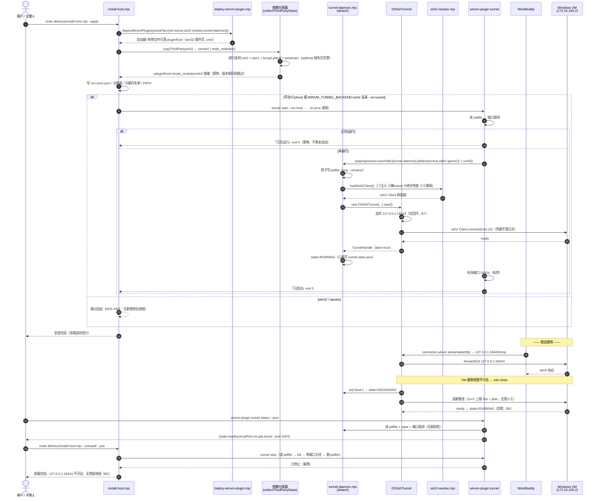
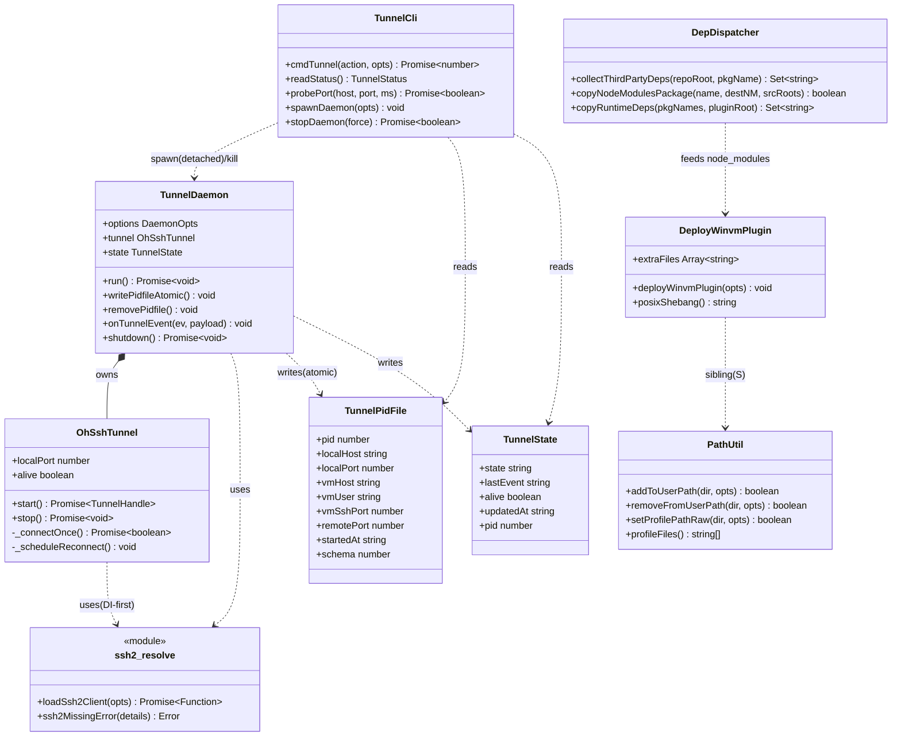
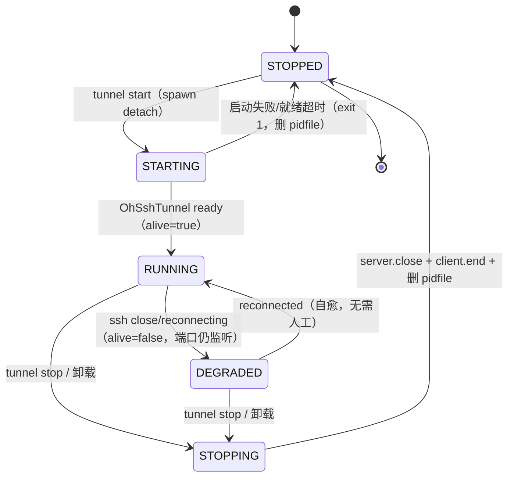
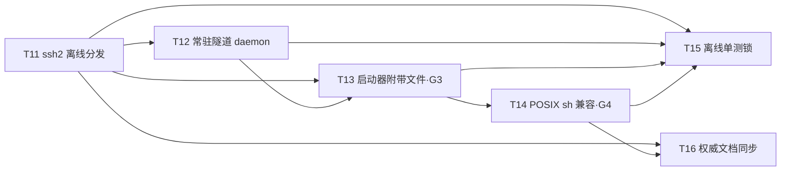

# CL-015 · 增量技术方案（最后一公里：依赖 / 常驻 / shell）

> **文档代号**：`ts:cl015` ｜ **作者**：架构师 高见远 ｜ **读者**：工程师、QA、PM、主理人
> **日期**：2026-09-14 ｜ **类型**：增量开发（DDD 场景 C/D）
> **上游**：`docs/changes/CL-015/REQUIREMENT.md`（PM 许清楚）＋ 主理人已拍板（Q1–Q5）
> **场景**：宿主 = **本机鸿蒙（HMOS）WorkBuddy**；VM = **本机 Windows 虚拟机（`ssh User@172.16.100.2`）**。
> **不变量**：VM 侧（Windows）**零改动**；Windows / macOS 宿主**零行为变化**（NFR-1 / NFR-2）；不改 MCP / A2A 契约（NFR-3）。
> **性质**：本文件只做设计与任务分解，**不含实现代码**（工程师职责）；`.dev/` 索引更新为主理人职责，本文件不碰。

---

## 0. 本轮要闭环的四处断点（引用锚点均已核对）

| 断点 | 事实 | 锚点 |
|---|---|---|
| **G1** ssh2 从未被分发 | `packages/core/package.json` 运行时依赖 `ssh2@^1.16.0`；但 `collectWinvmDeps` **显式跳过所有非 `@winvm` 依赖**，注释仍称「本仓库 @winvm 包运行时零第三方依赖」（**已过时且错误**） | `delivery/install-host.mjs:108,113-125`；`packages/core/package.json` |
| **G2** 无常驻隧道 | `connector:winvm` = `streamableHttp → http://127.0.0.1:18443/mcp` 要求端口常驻；现有仅**进程内临时隧道**（部署期 `setup.mjs` / 单命令期 `winvm-plugin`，用完即拆） | `delivery/setup.mjs:551-578`；`delivery/winvm-plugin.mjs:217-268` |
| **G3** `oh-tunnel.mjs` 未随启动器部署 | PATH 指向 `pluginCacheRoot(home)`，其下 `winvm-plugin.mjs` 会 `await import('./oh-tunnel.mjs')`，但 `deployWinvmPlugin` 只复制启动器本体 | `delivery/install-host.mjs:46-48,710-712`；`delivery/deploy-winvm-plugin.mjs:44-60`；`delivery/winvm-plugin.mjs:225` |
| **G4** POSIX 启动器与 PATH 不兼容 `sh` | 启动器 shebang = `#!/usr/bin/env bash`；PATH 只写 `~/.bashrc` / `~/.profile`（且用 bashism `source`）；鸿蒙宿主 shell 为 `/bin/sh` | `delivery/deploy-winvm-plugin.mjs:111-115`；`delivery/path-util.mjs:24-42,116` |

---

## 1. 实现方案总览 + 分层影响面

**一句话**：不新增产品能力，只把「鸿蒙宿主装完即可用」这条链上的三处断点（**依赖、常驻、shell**）补上——**安装期**把 `ssh2` 及其传递依赖离线复制到插件缓存、把隧道运行时文件随启动器一并部署；**安装后**默认以 detach 常驻进程拉起隧道（幂等守护 + 显式停止 + 卸载自停 + 断线自愈）；**启动器与 PATH** 改为纯 POSIX（`sh` 可跑、`sh` 登录会话 PATH 命中）；全部以 `process.platform` 守卫隔离，Windows/macOS 与 VM 侧**零行为变化**。

**分层影响面**

| 层 | 是否涉及 | 说明 |
|---|---|---|
| `delivery/` | ✅ **主战场** | `install-host.mjs`（依赖分发 + 拉起/停止 daemon + 过时注释订正）、`deploy-winvm-plugin.mjs`（附带文件清单 + shebang）、`path-util.mjs`（POSIX 块安全化）、`winvm-plugin.mjs`（新增 `tunnel` 子命令 + check 显示）、`oh-tunnel.mjs`（改用统一 ssh2 解析器）、**新增** `ssh2-resolve.mjs` / `tunnel-daemon.mjs` |
| `packages/core` | ❌ **不改源码** | `ssh2` 依赖已在 `package.json`；`ssh-tunnel-ssh2.ts` 逻辑同构，**本轮不动**（其上游 `ssh-tunnel.ts` 守卫已存在） |
| `packages/adapter-*` | ❌ 不改 | 连接器渲染/账户解析已在 T06/T09 落地，本轮零改动 |
| `packages/host-a2a-bridge` | ❌ 不改源码 | 仅其**产物缓存**多出 `node_modules/ssh2`（惰性、无害、NFR-2 允许的「数据落点」） |
| 测试 | ✅ 新增 4 个离线单测文件 | 见 §6 T15 |
| 文档 | ✅ | `oh-adaptation-plan.md`、`docs/05-peripherals/DEPLOYMENT.md`（见 §12 与文末「文档订正」） |

**关键架构决策（呼应主理人 Q1–Q5）**

- **Q1** ssh2 分发：**安装期从安装机 `<repoRoot>/node_modules/` 复制**（`setup.mjs` BUILD 已跑 `npm i`，源必然存在），**不入库**；**可选离线预置目录 `<repoRoot>/vendor/ssh2` 优先**（存在则作为复制源，用于无网/无 `node_modules` 场景）；二者皆无 → 抛「三要素」引导错误（不阻断安装主干，仅告警 + 该能力不可用）。
- **Q2** 不做系统级后台服务（鸿蒙无 systemd/launchd）。仅「安装器 detach 拉起 + pidfile 幂等守护 + 显式 stop」。
- **Q3** **默认拉起**（`--no-tunnel` 跳过；`winvm-plugin tunnel stop` 显式停止）；**win32/darwin 绝不自动拉起**。
- **Q4** **新增独立 `tunnel` 子命令**（不并入 `server`，对象不同：`server`=VM 侧服务，`tunnel`=宿主侧回环转发）；`check` 顺带显示隧道状态。
- **Q5** 索引合并一条汇总 + 关键缺陷单列（**主理人执行 `.dev/`，本文件不涉及**）。

---

## 2. 文件清单总表

> 「守卫」列取值：**OH** = `process.platform==='ohos' || process.env['WINVM_TUNNEL_BACKEND']==='ssh2'`；**nonWin** = `process.platform!=='win32'`；**win32** = `process.platform==='win32'`；**none** = 无平台分支（纯数据/纯逻辑）。

| # | 文件 | 改动性质 | 关键锚点 | 守卫 |
|---|---|---|---|---|
| F1 | `delivery/ssh2-resolve.mjs` | **新增** | 解析器 `loadSsh2Client()` + 三要素错误 `ssh2MissingError()` | none（纯逻辑，惰性、可注入） |
| F2 | `delivery/tunnel-daemon.mjs` | **新增** | daemon 入口：pidfile 原子写、state 心跳、detach 生命周期、退避自愈复用 `OhSshTunnel` | none（仅被 OH 路径 spawn） |
| F3 | `delivery/oh-tunnel.mjs` | 改 | `_connectOnce()` 内联 `import('ssh2')`（:311-318）→ 改调 `loadSsh2Client()`；保留 DI 优先 | OH（调用方守卫，见 §11） |
| F4 | `delivery/deploy-winvm-plugin.mjs` | 改 | 签名加可选 `extraFiles=[]`（:42）；附带文件复制循环（新增，复用 :53-60 自拷贝跳过）；shebang（:111-115）按平台生成 | **win32**（shebang 分支）/ none（extraFiles 默认空） |
| F5 | `delivery/path-util.mjs` | 改 | profile 标记块 POSIX 安全化（:116：`source`→`.`、引号 `$HOME`）；`profileFiles()`（:40-42）确保含 `~/.profile`；新增 `$ENV` 说明 | **nonWin**（win32 分支 :229/:245 不动） |
| F6 | `delivery/winvm-plugin.mjs` | 改 | 新增 `tunnel start\|status\|stop`：`parseArgs`（:825-850）、`main` switch（:894-928）、`USAGE`（:854-887）、`cmdCheck` 增隧道行（:415-452）；新增 `cmdTunnel` | OH（动作体）/ none（win32 输出说明后 0） |
| F7 | `delivery/install-host.mjs` | 改 | ①订正 :108 注释 + `collectWinvmDeps` 语义；②新增 `collectThirdPartyDeps`/`copyNodeModulesPackage`（ssh2 传递依赖）；③`deployWinvmPlugin` 传 `extraFiles`（:710-712）；④`--no-tunnel` 解析（:71-91）+ 安装尾拉起 daemon（:746 后）；⑤卸载停 daemon（:539-601） | OH（④⑤拉起/停止）/ none（②无害落地） |
| F8 | `tests/unit/ssh2-resolve.test.mjs` | **新增** | C3：无 ssh2 时加载不失败 + 三要素断言 | none |
| F9 | `tests/unit/tunnel-daemon.test.mjs` | **新增** | C4：状态机/幂等（fake，不真连网） | none |
| F10 | `tests/unit/launcher-posix.test.mjs` | **新增** | C5：生成启动器 → `sh` 执行退出码 0 + 参数透传 | nonWin（win32 跳过 shebang 断言） |
| F11 | `tests/unit/oh-tunnel.test.mjs` | 改（追加） | C2：哨兵值（password/privateKey/passphrase）不入日志/事件/异常 | none |
| F12 | `docs/changes/CL-015/TECHNICAL-SOLUTION.md` | **新增** | 本文件 | — |
| F13 | `docs/oh-adaptation-plan.md` | 改 | 新增 §7；§2 标注 P2-R10 升级；订正 §3.2 T07 第 3 点 | — |
| F14 | `docs/05-peripherals/DEPLOYMENT.md` | 改 | :226 订正「四个 @winvm 包运行时零第三方依赖」错误断言 | — |

---

## 3. 接口定义

### 3.1 CLI 参数表

#### A) `winvm-plugin tunnel <start|status|stop>`（用户面，薄客户端）

| 参数 | 类型 | 默认 | 必填 | 说明 |
|---|---|---|---|---|
| `start\|status\|stop` | enum | — | ✅ | 三动作；缺省等同 `status` |
| `--vm-host <ip>` | string | `vm-conn.json.host` → `.env VM_HOST` | ✅（start） | VM 地址 |
| `--vm-user <name>` | string | `vm-conn.json.user` → `.env VM_USER` | ✅（start） | VM 用户 |
| `--vm-ssh-port <n>` | int | `vm-conn.json.sshPort` → 22 | ✖ | VM SSH 端口 |
| `--vm-port <n>` | int | `vm-conn.json.servicePort` → 18443 | ✖ | VM 侧 winvm 服务端口（远端目标） |
| `--local-port <n>` | int | 18443 | ✖ | 宿主回环监听端口 |
| `--remote-port <n>` | int | = `--vm-port` | ✖ | 别名（与 `install-host` 一致） |
| `--key <path>` | string | `vm-conn.json.identityFile` → `WINVM_VM_KEY` | ✖ | 身份文件（**路径不属凭据**，可持久化） |
| `--foreground` | flag | off | ✖ | 前台运行（测试/调试；不 detach） |
| `--json` | flag | off | ✖ | 输出机器可读 JSON |
| `--force` | flag | off | ✖ | `stop`：连不通时仍按 pidfile 强杀 |

#### B) `delivery/tunnel-daemon.mjs`（内部，detach 子进程，**不对外暴露**）

| 参数 | 类型 | 默认 | 必填 | 说明 |
|---|---|---|---|---|
| `--vm-host` | string | — | ✅ | |
| `--vm-user` | string | — | ✅ | |
| `--vm-ssh-port` | int | 22 | ✖ | |
| `--local-port` | int | 18443 | ✖ | |
| `--remote-port` | int | 18443 | ✖ | VM 侧服务端口 |
| `--key` | string | — | ✖ | 身份文件路径 |
| `--pidfile` | string | `~/.workbuddy/winvm/tunnel.pid` | ✖ | |
| `--log` | string | `~/.workbuddy/winvm/tunnel.log` | ✖ | 追加写 |
| `--state` | string | `~/.workbuddy/winvm/tunnel.state.json` | ✖ | 心跳状态 |
| `--idle-exit-ms` | int | `0`（永不） | ✖ | 测试用：空闲自动退出 |

> 凭据来源：`tunnel-daemon` **不接收** `password`/`privateKey`/`passphrase` 命令行参数（避免进进程表/日志）；仅经 `WINVM_VM_PASSWORD` 环境变量或 `vm-conn.json`（当前仅落 host/user/sshPort/servicePort/identityFile）传递，且**永不打印**。

### 3.2 文件路径与格式

| 文件 | 路径 | 格式 | 写策略 |
|---|---|---|---|
| pidfile | `~/.workbuddy/winvm/tunnel.pid` | JSON `{ "pid":12345, "localHost":"127.0.0.1", "localPort":18443, "vmHost":"172.16.100.2", "vmUser":"User", "vmSshPort":22, "remotePort":18443, "startedAt":"<ISO8601>", "schema":1 }` | **原子写**：先写 `tunnel.pid.tmp` → `fs.renameSync` → 覆盖；退出时删除 |
| state（心跳） | `~/.workbuddy/winvm/tunnel.state.json` | JSON `{ "state":"RUNNING\|DEGRADED\|STARTING\|STOPPING", "lastEvent":"ready\|reconnecting\|reconnected\|closed\|listening", "alive":true\|false, "updatedAt":"<ISO8601>", "pid":12345 }` | 原子写；事件驱动更新（由 `OhSshTunnel` 的 `on(...)` 回调触发） |
| log | `~/.workbuddy/winvm/tunnel.log` | 文本行，前缀 `[winvm-tunnel] <ISO8601> <LEVEL> <msg>` | **追加**；**绝不**含 password/privateKey/passphrase |
| known_hosts | `~/.workbuddy/winvm/known_hosts` | OpenSSH 风格 `host:port <base64fp>` | 既有 TOFU（`oh-tunnel.mjs:127-153`） |

> 三个文件均在既有沙箱白名单 `~/.workbuddy/winvm`（`install-host.mjs:552-556,717-721`）内，无需新增白名单。

### 3.3 `winvm-plugin tunnel` 输出契约

**人读格式（`status`）**
```
隧道状态 : 运行中（可连）              # RUNNING / 运行中（不健康，重连中）DEGRADED / 未运行 STOPPED
监听     : 127.0.0.1:18443
目标 VM  : User@172.16.100.2:22 → 127.0.0.1:18443
进程     : pid 12345（独立进程组，终端关闭后仍存活）
启动于   : 2026-09-14T18:00:00.000Z
台账     : ~/.workbuddy/winvm/tunnel.pid
日志     : ~/.workbuddy/winvm/tunnel.log
```

**`--json` 字段**
```json
{
  "state": "RUNNING",
  "healthy": true,
  "localHost": "127.0.0.1",
  "localPort": 18443,
  "vm": { "host": "172.16.100.2", "user": "User", "sshPort": 22, "servicePort": 18443 },
  "pid": 12345,
  "since": "2026-09-14T18:00:00.000Z",
  "lastEvent": "ready",
  "pidfile": "/…/tunnel.pid",
  "logPath": "/…/tunnel.log"
}
```

**退出码（三动作统一语义，供脚本判定）**

| 动作 | 码 | 语义 |
|---|---|---|
| `start` | 0 | 已启动 **或** 已在运行（**幂等，非报错**，B3/B8）；stdout 追加「隧道已在运行（pid X），未重复启动」 |
| `start` | 1 | 启动失败（含缺 ssh2 → 打印三要素） |
| `stop` | 0 | 已停止 **或** 本就未运行（幂等）；stdout 「隧道未运行（无需停止）」 |
| `status` | 0 | RUNNING（健康，端口可连） |
| `status` | 4 | DEGRADED（运行中但不健康，**不谎报**，B6） |
| `status` | 3 | STOPPED（未运行 / pidfile 陈旧已清理） |

> `--json` **不改变退出码**（状态与退出码始终一致）。

### 3.4 ssh2 解析链（签名 + 错误契约）

**文件 `delivery/ssh2-resolve.mjs`**

```js
/** @returns {Promise<object>} ssh2 Client 构造器（不是实例） */
export async function loadSsh2Client(opts?: {
  ssh2Client?: any,        // ① 注入优先（测试/上层复用）
  moduleUrl?: string,      // 调用方 import.meta.url，用于推导兜底绝对路径
  extraCandidates?: string[] // 追加的绝对目录候选（如 vendor/ssh2）
}): Promise<any>;

/** 构造「三要素」错误（不含任何凭据） */
export function ssh2MissingError(details: {
  expectedPaths: string[], fixAction: string
}): Error;
```

**确定性解析顺序（唯一结论，逐步失败才降级）**

1. **注入**：`opts.ssh2Client` 存在 → 直接返回（`OhSshTunnel` 的 DI 约定保持）。
2. **裸 `import('ssh2')`**：以字符串变量 specifier 动态导入（**避免静态解析强依赖**）。真机（仓库/`pluginRoot/node_modules` 存在）由 Node ESM 向上查找命中。
3. **显式绝对路径兜底**（仅当第 2 步抛错时）——按序尝试下列**基目录**，每个用 `createRequire(join(base, '__winvm_resolver__.js')).resolve('ssh2')` 得真实入口后 `import(pathToFileURL(p).href)`：
   1. `<moduleDir>`（`oh-tunnel.mjs` 所在目录，覆盖 `pluginRoot/node_modules`、仓库 `delivery/node_modules`）
   2. `<moduleDir>/..`（覆盖 `pluginRoot` 本身）
   3. `opts.extraCandidates`（依次）
   4. `process.env['WINVM_SSH2_DIR']`（若设，**离线测试/部署逃生口**）
   另：若某候选是**包目录本身**（内含 `package.json`，如 `<repoRoot>/vendor/ssh2`）→ 读其 `exports`（字符串）或 `main` 得入口后直接 `import`。
4. **全部失败** → `throw ssh2MissingError(...)`。

**「三要素」错误消息（模板，NFR-5：绝不含凭据）**
```
[winvm] 缺少必需运行时依赖：ssh2（鸿蒙 ssh2 隧道的唯一通路依赖）
  ① 包名    ：ssh2
  ② 期望落点：<pluginRoot>/node_modules/ssh2
  ③ 修复动作：cp -R "<安装机>/node_modules/ssh2" "<pluginRoot>/node_modules/" \
             && cp -R "<安装机>/node_modules/bcrypt-pbkdf" "<pluginRoot>/node_modules/"
             （或：在安装机执行  node delivery/install-host.mjs --apply  重新分发依赖；
               亦可放置离线预置目录 <repoRoot>/vendor/ssh2 后重装）
```

**复制策略与 optional 原生依赖**
- ssh2 传递链：`ssh2` → `dependencies: { asn1, bcrypt-pbkdf }` → `bcrypt-pbkdf → tweetnacl`（**纯 JS**）。
- ssh2 含 `optionalDependencies`（`cpu-features` / `nan`）：**不复制、不编译**（`node-gyp` 需工具链且可能联网）。
- **optional 缺失行为（必须降级可用）**：ssh2 运行时对 `cpu-features` 走 `try/catch`，缺失即回落纯 JS 实现（仅性能差异，**功能不受影响**）。故复制器对 optional 缺失一律 `warn + continue`，**绝不让安装失败**（A4/降级要求）。
- 复制方式：按 `dependencies` **递归**解析每个包的真实目录，扁平复制到 `<pluginRoot>/node_modules/<name>`；**幂等**——目标已存在且 `package.json.version` 相同则跳过（A4：不重复/不嵌套）。源目录按优先级 `<repoRoot>/vendor/ssh2`（若为包目录）→ `<repoRoot>/node_modules/ssh2`。

---

## 4. 调用时序图



---

## 5. 数据结构 / 状态机

### 5.1 类图



### 5.2 daemon 状态机



**三态判定（无假阳性，B2）**

| 观测 | 判定 | 退出码 |
|---|---|---|
| 进程存活 **且** 127.0.0.1:18443 可连 **且** `state.alive===true` | **RUNNING**（真值：可连） | 0 |
| 进程存活 **且** 端口可连 **且** `state.alive===false` | **DEGRADED**（运行中但不健康，如实反映） | 4 |
| 进程不存活 **或** 端口不可连 | **STOPPED**（pidfile 若在则视为陈旧并清理） | 3 |

> 明确语义：**未运行 ⇒ 不可连**（真）；**运行中 ⇒ 可连**（真，RUNNING 态）；**RUNNING 不健康 ⇒ 如实报 DEGRADED，不谎报健康**（B6）。此三态定义是对 PM B2「运行中/未运行」二分法的**细化**（见 §12 建议）。

---

## 6. 任务列表（T11–T16，有序）

| ID | 任务名 | 源文件 | 依赖 | 优先级 | 覆盖验收 |
|---|---|---|---|---|---|
| **T11** | **ssh2 离线分发链路**：新增 `ssh2-resolve.mjs`（解析链 + 三要素）；`oh-tunnel.mjs` 改用之；`install-host.mjs` 增第三方依赖递归复制（ssh2+asn1+bcrypt-pbkdf+tweetnacl，optional 降级）+ 订正 :108 过时注释 | F1,F3,F7 | — | **P0** | A1–A5 / C3 / D1–D3 |
| **T12** | **常驻隧道 daemon**：新增 `tunnel-daemon.mjs`（pidfile/state/日志、detach、退避自愈）；`winvm-plugin.mjs` 增 `tunnel start\|status\|stop` + check 显示；`install-host.mjs` 安装尾默认拉起（`--no-tunnel` 跳过）、卸载自停 | F2,F6,F7 | T11 | **P0** | B1–B9 / D4–D9 |
| **T13** | **启动器附带文件部署（G3）**：`deploy-winvm-plugin.mjs` 增可选 `extraFiles=[]`，把 `oh-tunnel.mjs`/`ssh2-resolve.mjs`/`tunnel-daemon.mjs` 随启动器落 `pluginRoot`（含自拷贝跳过）；`install-host.mjs` 两处调用传该清单 | F4,F7 | T11,T12 | **P0** | B1 前置 / A1 |
| **T14** | **POSIX 启动器 sh 兼容（G4）**：`deploy-winvm-plugin.mjs` shebang 按平台（win32 保持 bash / 其它 `#!/bin/sh`）+ 纯 shell `dirname`；`path-util.mjs` profile 块 POSIX 安全化（`.` 而非 `source`、引 `$HOME`），确保覆盖 `~/.profile`（sh 登录） | F4,F5 | T13 | **P1** | D1–D6 |
| **T15** | **离线单测锁**：新增 `ssh2-resolve` / `tunnel-daemon` / `launcher-posix` 三个测试，追加 `oh-tunnel` 凭据哨兵断言；逐文件 `node --test`，不联网、不引新依赖、不 import 已编译 `@winvm/*` | F8–F11 | T11–T14 | **P0** | C1–C6 |
| **T16** | **权威文档同步（DDD 原则 7）**：`oh-adaptation-plan.md` 增 §7（T11–T16 表）+ §2 标注 P2-R10 升级 + 订正 §3.2 T07 第 3 点；`DEPLOYMENT.md:226` 订正错误断言 | F13,F14 | T11–T14（结论固化） | **P1** | E2/E5（文档部分）/ NFR-7 |

> **顺序**：T11 → T12 → T13 → T14 → T15；T16 紧随 T11–T14 结论固化后即可（无代码依赖）。
> **关于任务数**：主理人明确要求 T11–T16（6 条）以映射 PRD 五需求 + 文档收口。若需严格遵守「≤5 任务」模板上限，可将 **T13 折叠进 T11**（同为「把文件送到插件缓存」），或将 **T16 并入 T15**——二者均为低耦合小改动，折叠无技术障碍。



---

## 7. 依赖包

**不新增任何运行时依赖**（NFR-3）。本轮仅**分发**已声明的 `ssh2`（`packages/core/package.json`），并**顺带分发其已声明的传递依赖**：

```
ssh2@^1.16.0            （已声明；本轮落地到插件缓存，不入库）
├─ asn1@^0.2.6          （ssh2 运行时依赖，纯 JS）
└─ bcrypt-pbkdf@^1.0.2   （ssh2 运行时依赖，纯 JS）
   └─ tweetnacl@^0.14.3   （bcrypt-pbkdf 运行时依赖，纯 JS）
optional（不复制、缺失即降级）：
   cpu-features / nan     （原生，缺失 → ssh2 回落纯 JS，功能不受影响）
```

`devDependencies`（`typescript` / `@types/node`）不变；`package.json` diff **仅允许**出现上述 ssh2 传递链的**落地**（不是新增声明）。

---

## 8. 共享知识（跨文件约定）

1. **错误消息「三要素」格式**：任何「缺包/缺文件」引导错误必须**同时**含 ①包名（或文件标识）②期望绝对落点 ③一条可直接复制执行的修复动作。模板见 §3.4。**绝不含 password/privateKey/passphrase**（NFR-5）。
2. **日志前缀**：`[winvm-tunnel] <ISO8601> <LEVEL> <msg>`；daemon 追加写 `~/.workbuddy/winvm/tunnel.log`。凭据红线：任何日志/事件/异常均不得出现 `password`/`privateKey`/`passphrase` 内容。
3. **pidfile 原子写**：先写 `*.tmp` 再 `renameSync` 覆盖；删除用 `rmSync(force:true)`。读取失败/JSON 非法 → 视为「未运行」并清理（不抛）。
4. **守卫约定**：隧道相关**副作用**（spawn daemon / 监听端口 / 解析 ssh2）一律包在 `process.platform==='ohos' || process.env['WINVM_TUNNEL_BACKEND']==='ssh2'`。**win32/darwin 下同一命令必须打印说明并 exit 0，不做任何 spawn/kill**。
5. **回环红线**：监听地址**仅允许** `127.0.0.1` / `::1`（复用 `oh-tunnel.mjs:38-60` 断言）；出现 `0.0.0.0` 即 FAIL（B7）。
6. **幂等约定**：安装/启动/停止/依赖复制四者**皆幂等**——重复执行不产生第二实例、不嵌套副本、不重复写 PATH（B3/B4/B8/A4/D5）。
7. **数据落点（非行为）变化**：`ssh2` 落地到缓存对所有平台执行（best-effort，失败仅告警）；但**解析/使用**仅在守卫内——故 win32/darwin「无新增常驻进程、隧道后端仍系统 ssh」（NFR-2/A5/B9）。
8. **时间格式**：所有时间戳 ISO 8601 UTC（`new Date().toISOString()`）。

---

## 9. 待明确事项（≤3，每条给默认决策）

| # | 事项 | 默认决策（若无进一步输入即按其实现） |
|---|---|---|
| U1 | `vendor/ssh2` 是否入库（仓库体积 vs 离线便携） | **默认不入库**；仅约定路径 `<repoRoot>/vendor/ssh2` 为**可选离线预置源**（存在则优先作复制源）。仓库体积由主理人另行权衡，本方案对两种情形均成立。 |
| U2 | sh **非登录交互**会话 PATH（POSIX 仅读 `$ENV`） | **默认只保证「登录会话」**（写 `~/.profile`）：验证以 `sh -l -c 'command -v winvm-plugin'` 达标（D4「登录会话」即满足）。`$ENV` 为可选**非默认**增强（安装时若 `$ENV` 已设才追加，否则不写）。 |
| U3 | DEGRADED 是否计入 `status` 退出码 | **默认计入**（`status` exit 4 = 运行中不健康），并在 `--json` 给 `healthy:false`。若下游只接受 0/非 0，可按 `--json` 字段自行归一。 |

---

## 10. 三个「必须解决的设计问题」——唯一结论

### 结论 1 · ssh2 解析链（G1）
- **落点唯一**：`<pluginRoot>/node_modules/ssh2`（**顶层**）。已**实证复核 Node ESM 向上查找规则**：从 `<pluginRoot>/oh-tunnel.mjs` 与 `<pluginRoot>/a2a-bridge/node_modules/@winvm/core/dist/*` **两条路径均可命中**同一顶层副本（`npm` 语义下最近的 `node_modules/ssh2` 即此处）。→ **一条顶层副本覆盖两个消费者**，无需重复。
- **解析顺序唯一**：① 注入 `opts.ssh2Client` → ② 裸 `import('ssh2')` → ③ 显式绝对路径兜底（`createRequire` 指向 `moduleDir` / `moduleDir/..` / `vendor/ssh2` / `WINVM_SSH2_DIR`，支持「包目录直导」）→ ④ 抛**三要素**错误。签名与错误模板见 §3.4。
- **optional 原生依赖行为唯一**：**缺失即降级可用**（ssh2 回落纯 JS），复制器对 optional 缺失 `warn + continue`，**绝不因此让安装失败**；仅复制 `dependencies` 传递链（`asn1` / `bcrypt-pbkdf` / `tweetnacl`），扁平落地、版本相同则跳过（幂等）。

### 结论 2 · daemon 生命周期（G2）
- **语义唯一**：`start` 幂等（已在运行 → 「已运行」非报错，exit 0，**不 `EADDRINUSE`、不产生第二实例**）；`status` 三态（RUNNING/DEGRADED/STOPPED，退出码 0/4/3，**无假阳性**）；`stop` 幂等（本就未运行 → exit 0）。
- **路径唯一**：pidfile `~/.workbuddy/winvm/tunnel.pid`、state `~/.workbuddy/winvm/tunnel.state.json`、日志 `~/.workbuddy/winvm/tunnel.log`（格式见 §3.2，原子写）。
- **子进程拉起方式（鸿蒙无 systemd）唯一**：`spawn(process.execPath, [tunnelDaemonPath, ...args], { detached: true, stdio: 'ignore', windowsHide: true })` 后**立即 `child.unref()`**。要点与风险：`detached:true` 使子进程**自成进程组/会话**，父（安装器/CLI）退出后**不随其终止**（POSIX 下被 reparent 到 init/pid1）；`stdio:'ignore'` 断开关联管道，避免父退出时 SIGPIPE/背压；`unref()` 让父事件循环不因该子进程而滞留。风险：若父被**进程组级** kill（如 `kill -- -PGID`），子进程因已 detach 仍存活（符合预期）；反之若 OH 沙箱**禁止 spawn 长驻子进程**，属 OS 层限制（基线风险 4.1），此时以 `--foreground` 或用户手动 `tunnel start` 兜底并在日志显式报错。
- **「父进程退出后端口仍可达」验证手段**：`winvm-plugin tunnel start` → **关闭该终端/退出父进程** → 另开新 shell 执行 `winvm-plugin tunnel status --json`（应 `RUNNING`）**且** `node -e "require('net').connect(18443,'127.0.0.1').on('connect',()=>{console.log('OPEN');process.exit(0)}).on('error',()=>process.exit(1))"` 返回 `OPEN`；另可 `ps -o ppid= -p <pid>` 观察父进程已退出（pid 被 init 收养）。
- **卸载自动停止（B5）唯一**：`install-host.mjs --uninstall --yes` 在移动目录前调用 `tunnel stop`（读 pidfile → `SIGTERM` → 有界等待端口关闭 → 删 pidfile/state）；停止失败则 `--force` 强杀兜底并告警，确保端口无残留。
- **断线自愈（B6）唯一**：复用 `OhSshTunnel` 既有退避重连（`oh-tunnel.mjs:366-389`，1s×2 上限 30s + jitter、默认持续），daemon 仅把 `on('close'/'reconnecting'/'reconnected')` 映射为 state 心跳；期间 `status` 如实报 DEGRADED。

### 结论 3 · G3 修法唯一
**由 `deploy-winvm-plugin.mjs` 增加「附带文件」清单参数（`extraFiles`，默认 `[]`）**，而非在 `install-host.mjs` 显式复制。
- **理由**：`deployWinvmPlugin` 已是「启动器套装落目标目录」的**唯一职责点**（`.mjs` + `.cmd` + POSIX 启动器皆在此）；`oh-tunnel.mjs` / `ssh2-resolve.mjs` / `tunnel-daemon.mjs` 是启动器的**同目录运行时依赖**，属同一「套装」，集中在此符合高内聚；`install-host.mjs` 的**两处**调用（`pluginRoot` + 仓库 `delivery/`）自动都获得，无需重复维护路径清单。
- **VM 侧不变保证**：`extraFiles` 默认 `[]`；`install-vm.mjs:668` 的 `deployWinvmPlugin({ targetDir: deliveryDir, side: 'vm', dryRun:false, log })` **不传该参数** → VM 侧产物**逐字节不变**（NFR-1，已核对调用点）。
- **自拷贝跳过**：复用既有 `resolve(binSrc)===resolve(binDst)` 守卫——仓库 `delivery/` 目标与源同目录时跳过（`oh-tunnel.mjs` 本就在 `delivery/`）。

### 结论 4 · G4 修法唯一
启动器与 PATH **同时**改为 `sh` 兼容：
- **启动器**：shebang 按平台生成——`win32` 保持 `#!/usr/bin/env bash`（D6 产物一致）；**其它平台 `#!/bin/sh`**（POSIX）。脚本体**纯 POSIX**，用 shell 参数展开求目录（不依赖外部 `dirname`）：`case "$0" in */*) d=${0%/*};; *) d=.;; esac; exec "${WINVM_NODE:-node}" "$d/winvm-plugin.mjs" "$@"`。`#!/bin/sh` 脚本在 `bash` 存在时同样可执行（内核按 shebang 交 `sh`），**D1/D2 同时满足**。
- **PATH 注入**：把 profile 标记块改为 **POSIX 安全**——由 `source ~/.workbuddy/winvm/shell-init.sh` 改为 `. "$HOME/.workbuddy/winvm/shell-init.sh"`（`.` 是 POSIX 内建，`source` 是 bashism），并**确保写入 `~/.profile`**（`sh` 登录会话读）＋保留 `~/.bashrc`（bash 交互）。`sh` 交互非登录会话的 `$ENV` 现实：POSIX 规定交互 shell 读 `$ENV`，但其通常未设且不可强制——**默认只保证登录会话**（U2），验证以 `sh -l -c 'command -v winvm-plugin'` 达标；不误删用户既有 PATH 配置（沿用 `stripProfileBlock` 精确摘除标记块，D5）。

---

## 11. Windows / macOS 宿主「零行为变化」证明清单（NFR-2 / A5 / B9 / D6 / D13）

| # | 关注点 | 本方案实现 | 为何 win32/darwin 零变化 |
|---|---|---|---|
| 1 | 隧道后端 | 常驻 daemon 的 **spawn/监听/解析** 全部包在 OH 守卫内 | win32/darwin **不 spawn daemon** → **无新增常驻进程**（B9）；隧道仍由系统 `ssh`（`withTunnel` 默认分支 `winvm-plugin.mjs:251-268` / `ssh-tunnel.ts` 原逻辑） |
| 2 | `tunnel` 子命令 | 动作体在 OH 守卫内；否则打印说明并 exit 0 | win32/darwin 执行 `tunnel` **无任何副作用** |
| 3 | 启动器 shebang | `win32 → #!/usr/bin/env bash`（**字节不变**）；非 win32 → `#!/bin/sh` | win32 产物与本轮前**逐字节一致**（D6） |
| 4 | PATH 注入 | `addToUserPath`/`removeFromUserPath` 的 `if (process.platform!=='win32')` 分支（`path-util.mjs:229,245`）承载 profile 改动 | win32 仍走 PowerShell `[Environment]::SetEnvironmentVariable` + `WM_SETTINGCHANGE`（:212-237）**完全不变** |
| 5 | `deployWinvmPlugin` | 新增 `extraFiles` 默认 `[]`；shebang 按平台 | win32 输出 `.cmd` 分支（:80-105）不变；`extraFiles` 为空时行为等同旧版 |
| 6 | 依赖落地 | `ssh2` 复制对所有平台 best-effort 执行（失败仅告警） | 仅**新增数据文件**，**不改变安装成功判定、不改变连接器渲染**（A5 明确允许）；且 win32 不使用 ssh2 后端（守卫），文件惰性无害 |
| 7 | VM 侧产物 | `install-vm.mjs:668` 不传 `extraFiles` | VM 侧产物**逐字节不变**（NFR-1） |
| 8 | 协议契约 | 无 `packages/contracts` 改动 | MCP/A2A 契约不变（NFR-3） |

**结论**：全部新增行为经 `process.platform` 守卫或「数据落点（非行为）」隔离；win32/darwin 与本轮前**行为一致**，VM 侧零改动。

---

## 12. 对 PM 验收标准的意见（职责内提出，非沉默接受）

| 涉及 | PM 原文 | 我的意见 / 替代验收 |
|---|---|---|
| **B2** | 「查询」输出**运行中/未运行** + 真实端口可达性一致（无假阳性） | 二分法**不足以表达**「端口在监听但 ssh 断线」（B6 场景）。**建议细化为三态**：`RUNNING`（可连）/`DEGRADED`（运行中不健康，如实报告）/`STOPPED`（未运行）。判据：进程存活 ∧ 端口可连 ∧ `state.alive`。这样「无假阳性」与「不谎报健康」可同时成立。**替代验收**：`status --json.healthy` 与实际 `state.alive` 一致；注入 ssh 断开后 `status` 由 RUNNING→DEGRADED。 |
| **D4** | 新开 `sh` **交互/登录**会话 `command -v winvm-plugin` 有输出 | POSIX 下 `sh` **非登录交互**会话只读 `$ENV`，**不可强制注入**。**替代验收**：以 `sh -l -c 'command -v winvm-plugin'`（登录会话）判定；或明确要求 OH 终端以登录 shell 启动。`$ENV` 增强列为可选（U2），不作门禁。 |
| **C1** | 无 `node_modules`/无网下 `node --test <file>` **全部通过** | 现有基线 **97 pass / 10 fail**（10 项为环境性 `@winvm/*` 未构建）。故**「全部通过」须限定为「本轮新增/修改的测试文件」**（不得 import 已编译 `@winvm/*`，全部自包含）。**替代验收**：新增 4 文件（F8–F11）逐文件全绿；不改写基线既有 10 项环境性失败。 |
| **A3** | 「人为移走缓存内 `node_modules/ssh2` 触发降级」 | 若已安装 daemon 常驻，其进程**已加载** ssh2 于内存，移文件**不触发**运行中降级。**替代验收**：在**新建隧道**路径（`winvm-plugin tunnel start` 新进程 / `establishSsh2Tunnel`）验证三要素，而非在线移除已加载模块。 |
| **A1/A5** | A1「断网从插件缓存根解析 ssh2」/ A5 win32 零行为变化 | 二者**不冲突**：A5 限定「**行为**」（后端/连接器/常驻进程）不变，A1 是**数据落点**要求。建议措辞明确：win32 允许 ssh2 **落地**（无害），但**不使用**。 |

> 除上述外，PM 的 A2/A4/B1/B3/B4/B5/B6/B7/B8/D1/D2/D3/D5/D6、C2–C6、NFR-1…7 **均可实现**，本方案逐条给出技术达成路径（见 §6 覆盖列）。

---

## 13. 文档订正清单（本方案配套执行，DDD 原则 7：先改对文档逻辑）

| 文件 | 位置 | 订正内容 |
|---|---|---|
| `docs/oh-adaptation-plan.md` | **新增 §7**「CL-015 增量（T11–T16）」 | 表：任务 / 状态 / 文件 / 对应需求 ID（结构见下） |
| `docs/oh-adaptation-plan.md` | §2 需求池 | P2-R10 标注 **「已升级为 CL015-P0-02（P0）」** |
| `docs/oh-adaptation-plan.md` | §3.2 **T07 第 3 点** | 订正为代码现状：**ssh2 分发尚未落地**（原「安装器须把 ssh2 随插件 vendor 分发（预置 node_modules/ssh2…）」为**待办/未完成**表述）；并注明 `collectWinvmDeps` **显式跳过所有非 `@winvm` 依赖**（`install-host.mjs:119`）的事实与本轮 T11 收口 |
| `docs/05-peripherals/DEPLOYMENT.md` | :226 | 删除/订正错误断言「这四个 `@winvm` 包运行时**零第三方依赖**，仅彼此引用，故无需联网装包」→ 改为：「`@winvm` 包**并非零第三方依赖**：`@winvm/core` 运行时依赖 `ssh2`（及其传递依赖 asn1/bcrypt-pbkdf/tweetnacl），安装器由 T11 一并离线分发到插件缓存；其余 `@winvm` 包当前无第三方运行时依赖。」 |
| `delivery/install-host.mjs` | :108 注释 | 删除「本仓库 @winvm 包运行时零第三方依赖，故无需处理 npm 包」→ 改为「收集 `@winvm/*` 依赖；`@winvm/core` 的第三方运行时依赖（ssh2 等）由 `copyRuntimeDeps` 单独离线分发（见 CL-015 T11）」 |
| `docs/02-design/SPEC-HOST-AGENT-PLUGIN.md` / `ARCHITECTURE.md` | 全文 | **经 grep 核对：二者均无**「@winvm 包零第三方依赖」/「插件缓存自包含依赖仅 @winvm/*」类断言（`SPEC-HOST-AGENT-PLUGIN.md` 仅命中「依赖 VM 侧策略引擎」「渲染器反向依赖」两处无关语境；`ARCHITECTURE.md` 零命中）。故**无需订正**，特此说明。 |

**`oh-adaptation-plan.md` §7 建议结构**

```
## 7. CL-015 增量（T11–T16）· 最后一公里收口（2026-09-14）
| 任务 | 状态 | 文件 | 对应需求 ID |
| T11 ssh2 离线分发 | ⏳/✅ | delivery/ssh2-resolve.mjs(新)、oh-tunnel.mjs、install-host.mjs | CL015-P0-01 (A1–A5) |
| T12 常驻隧道 daemon | ⏳/✅ | delivery/tunnel-daemon.mjs(新)、winvm-plugin.mjs、install-host.mjs | CL015-P0-02 (B1–B9) |
| T13 启动器附带文件·G3 | ⏳/✅ | delivery/deploy-winvm-plugin.mjs、install-host.mjs | CL015-P0-02 B1 前置 |
| T14 POSIX sh 兼容·G4 | ⏳/✅ | delivery/deploy-winvm-plugin.mjs、path-util.mjs | CL015-P1-01 (D1–D6) |
| T15 离线单测锁 | ⏳/✅ | tests/unit/{ssh2-resolve,tunnel-daemon,launcher-posix,oh-tunnel}.test.mjs | CL015-P0-03 (C1–C6) |
| T16 权威文档同步 | ⏳/✅ | docs/oh-adaptation-plan.md、docs/05-peripherals/DEPLOYMENT.md | CL015-P1-02（文档部分；.dev/ 索引归主理人） |
```

---

> **交付说明**：本方案不含实现代码。关键结论均已**实证或核对**：ssh2 顶层落点的 ESM 向上查找（`oh-tunnel.mjs` 与 `core/dist` 双路径命中顶层 `node_modules/ssh2`）已用 Node v24 实测复核；`install-vm.mjs:668` 不传 `extraFiles` 已核对（VM 零改动）；过时断言已 grep 定位（`install-host.mjs:108`、`DEPLOYMENT.md:226`），`SPEC-HOST-AGENT-PLUGIN.md`/`ARCHITECTURE.md` 经核对无此类断言。真正的外部未决仅剩基线 4.1（HMOS 沙箱是否允许长驻子进程/出站 TCP），属 OS 层，已给出 `--foreground`/手动 `tunnel start` 兜底与验证手段。
