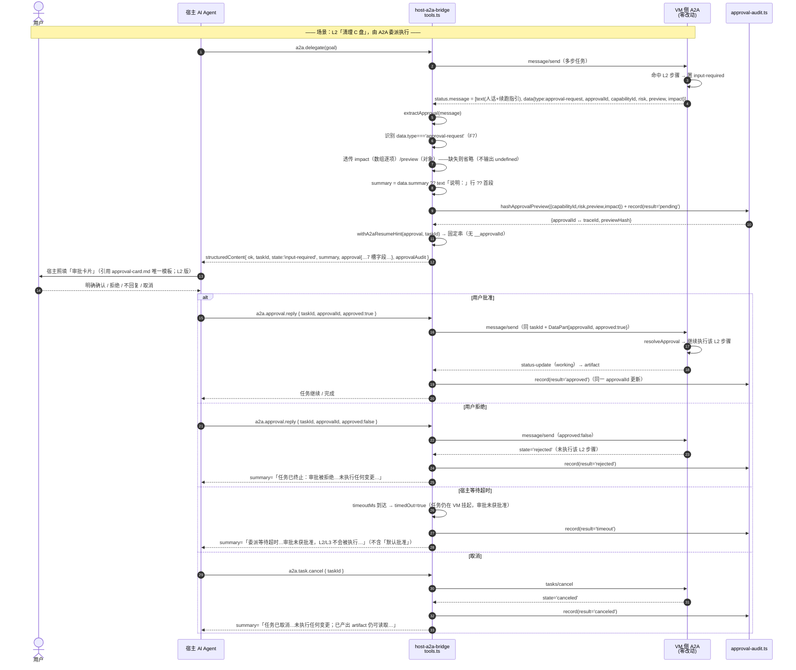
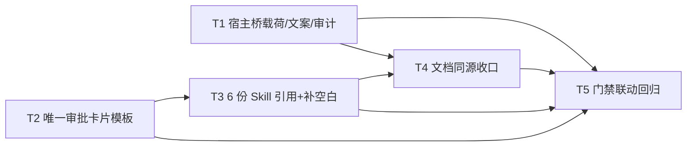

# CL-016 · 增量技术方案（审批闸 UX · L2/L3 两条通道拉平）

> **文档代号**：`ts:cl016` ｜ **作者**：架构师 高见远 ｜ **读者**：工程师、QA、PM、主理人
> **日期**：2026-09-15 ｜ **类型**：增量开发（DDD 场景 C，纯呈现层补齐）
> **上游**：`docs/changes/CL-016/REQUIREMENT.md`（PM 许清楚）＋ 主理人已拍板 Q1–Q6
> **不变量**：**VM 侧（Windows）零改动**（NFR-3）；Windows / macOS 宿主**零行为回归**（NFR-4）；不动 MCP / A2A 协议方法名/端点/既有字段语义（NFR-1）；审批闸不可绕过（NFR-2）。
> **性质**：本文件只做设计与任务分解，**不含实现代码**（工程师职责）；`.dev/` 索引与交付说明由对应角色处理。

---

## ① 变更标识与范围

| 项 | 内容 |
|---|---|
| 变更标识 | `CL-016`（审批闸 UX / 可理解性） |
| 一句话 | **不新增能力、不动协议**，只把「审批闸对用户说得清」在 **MCP 与 A2A 两条通道上拉平**：宿主 A2A 桥不再丢弃 VM 已下发的 `preview` / `impact`；给 6 份 Skill 一套**唯一**的文本审批卡片模板（L2/L3 分层、L3 二次确认 + dry-run 前置）。 |
| 需求清单 | P0-01（A2A 载荷补齐）、P0-02（统一卡片规格）、P0-03（L2/L3 分层）、P1-01（6 份 Skill 引用 + 补空白域）、P1-02（拒绝/超时/取消文案）、P2-01（审计留痕） |
| 主战场 | `packages/host-a2a-bridge/`（宿主桥）+ `skills/`（Skill 文档）+ `tests/unit/` + `docs/02-design/`（同源对齐） |
| **核心结论** | **CL016-P0-01 可 100% 落在宿主侧 → VM 侧零改动**（VM 侧 `task-store.ts:181-191` 已下发 `preview`/`impact`，缺口在宿主桥 `tools.ts:40-60` 读时丢弃，F4>F3 已二次核实） |

**范围边界（不做）**：VM 侧任何源码改造、协议字段语义变更、新增能力/改风险等级、MCP `pendingApprovals` 显式 TTL 回收、真实 dry-run「预演执行」、宿主图形界面渲染、索引/文档债收口。

---

## ② 实现方案与技术选型

**技术挑战（三处）**
1. **载荷透传缺口在宿主桥**：A2A data part 已含 `{ type:'approval-request', approvalId, capabilityId, risk, preview, impact }`，但 `extractApproval()` 只读 4 字段且仅凭「data part 存在 `approvalId`」判定 → 需**扩展类型 + 宽容透传 + 识别 `type` 标记**，且**不破既有极简 fixture 断言**（A6）。
2. **两条通道续跑语义不同**：MCP 用 `__approvalId` 重发；A2A 用 `a2a.approval.reply { taskId, approvalId, approved }`。必须**按通道给对提示**，A2A 结果**绝不得出现 `__approvalId`**（A3）。
3. **唯一模板的引用与核验**：模板正文逐字只存一份，6 份 Skill 引用而非复制；需可被 QA **机械核验**（B1）。

**选型（零新增依赖、纯增量）**
- 语言/工具链**不变**：宿主桥沿用现有 TypeScript（`@winvm/contracts` 只读引用），Skill 为 Markdown，测试沿用仓库既有 `node --test` **逐文件**离线执行约定（NFR-5）。
- 哈希计算用 **Node 内置 `node:crypto`**（`createHash('sha256')`）——**不引第三方**。
- 模板引用用**相对路径 + 固定引用行**（DDD 文档同源），**不引入模板引擎/构建步骤**。
- **架构模式**：宿主桥保持「薄翻译层」——只做**载荷透传 + 文案合成**，可逆性/分层等**领域语义判定留在 Skill 层**（见 §⑩ 结论 4/5/8），避免把能力语义硬编码进通用桥。

**分层影响面**

| 层 | 是否涉及 | 说明 |
|---|---|---|
| `packages/host-a2a-bridge` | ✅ 主战场 | `tools.ts` 扩展；**新增** `approval-audit.ts` |
| `packages/contracts` | ❌ **零改动** | 既有类型（`ApprovalRequest`/`AuditApproval`）本就含 `preview`/`impact`/`previewHash`，**只读引用**，不新增断言 |
| `packages/vm-service` / `vm-capabilities` / `a2a-framework` | ❌ **零改动** | VM 侧已下发全量载荷，缺口在宿主桥 |
| `skills/` | ✅ | **新增**唯一模板文件；6 份 Skill + `mcp-reference` 引用补齐 |
| `tests/unit/` | ✅ | 追加 1 份 + 新增 1 份，**逐文件**跑，既有 214 基线不破 |
| `docs/02-design` | ✅ | `INTERFACES.md §3.5` / `SECURITY-GOVERNANCE.md §3.3/§3.4` 同源对齐（NFR-7） |

---

## ③ 文件清单总表（F1..Fn）

> 均为相对 **仓库根** 路径。改动性质：**【新增】/【修改】**。

| # | 相对路径 | 性质 | 改动性质 / 关键点 | 对应需求 ID |
|---|---|---|---|---|
| F1 | `packages/host-a2a-bridge/src/tools.ts` | 【修改】 | 扩展 `ExtractedApproval`（+`kind?`/`summary?`/`impact?`/`preview?`/`resumeHint?`）；`extractApproval()` 宽容透传 + 识别 `type:'approval-request'`；新增 `buildA2aResumeHint()`/`withA2aResumeHint()`；`summary` 三元链改为**分级文案**（timeout/rejected/canceled/approval/进度） | CL016-P0-01 / P1-02 |
| F2 | `packages/host-a2a-bridge/src/approval-audit.ts` | 【新增】 | 宿主侧审计：`canonicalJson()` + `hashApprovalPreview()`（sha256）+ `HostApprovalAudit` 内存索引（`approvalId ↔ traceId` 双向）+ 四态 result；凭据断言不入 | CL016-P2-01 |
| F3 | `skills/winvm-orchestrator/approval-card.md` | 【新增】 | **唯一模板正文**：L2 版 / L3 版 / L3 阻断态 / 槽位↔字段对照表 / 可逆性判定规则 / **不弹卡清单** / 填充红线；含哨兵标记 | CL016-P0-02 / P0-03 |
| F4 | `skills/winvm-orchestrator/SKILL.md` | 【修改】 | §审批闸协议 章节加**固定引用行**指向 `approval-card.md`；L3「二次确认 + dry-run 前置」落成规则引用；**不复制正文** | CL016-P0-02 / P0-03 / P1-01 |
| F5 | `skills/winvm-system-admin/SKILL.md` | 【修改】 | 引用模板；把既有「现状/进程清单/旧值」要求归位到槽位对照（不新增能力） | CL016-P1-01 / D1 |
| F6 | `skills/winvm-storage-manager/SKILL.md` | 【修改】 | 引用模板；**可逆性规则**（删除默认回收站=可逆；`permanent:true`=不可逆）；`storage.volume.destructive` **未注册→无卡片**说明 | CL016-P1-01 / P0-03 |
| F7 | `skills/winvm-app-manager/SKILL.md` | 【修改】 | 引用模板；既有「应用名+版本+影响范围」归位到槽位 | CL016-P1-01 / D1 |
| F8 | `skills/winvm-app-operation/SKILL.md` | 【修改】 | 引用模板（原命中 4，形状对齐） | CL016-P1-01 / D1 |
| F9 | `skills/winvm-gui-automation/SKILL.md` | 【修改】 | 引用模板；**补齐**「本域最高 L1，但 A2A 委派多步任务可命中跨域 L2」说明 + 一个 GUI 示例卡片（导出并覆盖源文件） | CL016-P1-01 / P0-03 / D2 |
| F10 | `skills/winvm-mcp-reference/SKILL.md` | 【修改】 | **新增**「审批载荷排查」小节：缺 `impact` = 未透传/桥版本过旧 的判定 + 两通道续跑差异速查表 | CL016-P1-01 / D3 |
| F11 | `tests/unit/host-a2a-bridge.test.js` | 【修改】 | **追加**用例（impact/preview 透传逐项一致、续跑提示无 `__approvalId`、三终止文案、A6 极简 fixture 降级仍通过）；**不改**既有断言 | CL016-P0-01 / P1-02 / A1–A8 |
| F12 | `tests/unit/approval-audit.test.js` | 【新增】 | `previewHash` 稳定性/敏感性；`approvalId ↔ traceId` 双向；四态可辨；凭据哨兵值不落 | CL016-P2-01 / F1–F5 |
| F13 | `docs/changes/CL-016/TECHNICAL-SOLUTION.md` | 【新增】 | 本文件 | — |
| F14 | `docs/changes/CL-016/sequence-diagram.mermaid` | 【新增】 | L2 走 A2A 委派全链路时序图 | — |
| F15 | `docs/changes/CL-016/class-diagram.mermaid` | 【新增】 | 类型关系类图 | — |
| F16 | `docs/02-design/INTERFACES.md` | 【修改】 | §3.5 对齐：明写 A2A `status.message` data part 结构化影响清单**宿主桥须透传** | NFR-7 |
| F17 | `docs/02-design/SECURITY-GOVERNANCE.md` | 【修改】 | §3.3 审批记录含预览哈希（核对一致）；§3.4 超时默认拒绝文案与真实机制对齐（**无 TTL 回收**） | NFR-7 / P1-02 |
| F18 | `docs/changes/CL-016/DELIVERY.md` | 【新增】 | 交付说明：含**测试文件计数订正一行**（23 vs 20，Q5）；**不做索引收口** | Q5 / NFR-5 |

---

## ④ 数据结构与接口（TS 代码块）

### 4.1 `ExtractedApproval` 扩展（F1，`packages/host-a2a-bridge/src/tools.ts`）

```ts
/** 从 A2A Message 提取的审批闸请求（向后兼容：新增字段全部可选） */
export interface ExtractedApproval {
  readonly approvalId: string;
  readonly message: string;                    // 人话摘要（保留原字段语义）
  readonly risk?: RiskLevel;                    // 保留
  readonly capabilityId?: string;               // 保留
  // ---- 以下为 CL-016 追加（全部可选，不影响既有断言）----
  /** 识别 data part 的 type 标记（F7），仅当 data.type === 'approval-request' 时为该字面量 */
  readonly kind?: 'approval-request';
  /** 可读摘要：data.summary 优先，缺失回落到 text part「说明：」行 → 首段（A4） */
  readonly summary?: string;
  /** 结构化影响清单：VM 下发数组则**原样逐项透传**（A1，顺序/字符串全等）；缺失或非数组则**省略字段** */
  readonly impact?: readonly string[];
  /** dry-run 预览：VM 下发对象则**原样透传**（A2，深等）；缺失或非对象则**省略字段** */
  readonly preview?: Record<string, unknown>;
  /** 通道正确的续跑提示（A2A 专用，合成，**绝不出现 `__approvalId`**，A3） */
  readonly resumeHint?: string;
}
```

**「缺数据 → 省略 还是 空对象」唯一规则（不变量）**：
> **字段存在且类型合法 → 原样透传（含空数组 `[]` / 空对象 `{}`）；字段不存在或类型非法 → 省略该字段。**
> 实现统一用条件展开 `...(cond ? { k: v } : {})`，**全链路不得输出 `undefined` 字面量**（A2/A6）。

- 判定 `impact` 合法：`Array.isArray(x) && x.every(s => typeof s === 'string')`。
- 判定 `preview` 合法：`isRecord(x)`（复用现有守卫）。

### 4.2 续跑提示合成（F1）

```ts
/** 合成 A2A 通道续跑提示；**绝不包含 `__approvalId`**（A3 红线） */
export function buildA2aResumeHint(approvalId: string, taskId?: string): string;

/** 幂等补挂 resumeHint（不改动既有字段）；在 delegate / task.get 结果组装处调用 */
export function withA2aResumeHint(a: ExtractedApproval, taskId?: string): ExtractedApproval;
```

**合成模板（固定串，写入 §⑧ 共享知识）**：
```
（A2A 续跑）放行：a2a.approval.reply { taskId: "<taskId>", approvalId: "<approvalId>", approved: true }
```
`taskId` 缺失时只给 `a2a.approval.reply { approvalId, approved: true }`（仍不含 MCP 参数名）。

### 4.3 三终止路径文案（F1，`tools.ts` `summary` 分级）

```ts
// 原三元链（tools.ts:238-244）改为分级判定（顺序即优先级）：
//   timedOut → rejected → canceled → approval(挂起) → lastMsg → `任务状态：${state}`
const TERMINATION_TEXT = {
  rejected: '任务已终止：审批被拒绝（rejected），未执行任何变更。如需继续，请重新发起该操作并再次确认。',
  canceled: '任务已取消（canceled），审批通道已关闭，未执行任何变更。已产出的 artifact 仍可读取；如需继续，请重新发起。',
  timeout: (s: number) => `委派等待超时（>${s}s）：任务仍在 VM 侧挂起，审批未获批准，L2/L3 操作不会被执行。可用 a2a.task.get 查询后续结果。`,
} as const;
```

> **红线**：三处文案**均不得**出现「超时默认批准/继续/放行」（E2）；**MCP 侧不改**（无 TTL 回收，如实声明，E5/E6）。

### 4.4 宿主侧审批审计（F2，`packages/host-a2a-bridge/src/approval-audit.ts`）

```ts
export interface HostApprovalAudit {
  readonly approvalId: string;
  readonly traceId: string;
  readonly channel: 'mcp' | 'a2a';
  readonly capabilityId?: string;
  readonly risk?: RiskLevel;
  /** 审批呈现内容哈希（防「当时看的 ≠ 现在执行的」） */
  readonly previewHash: string;
  /** 四态可辨（F3）：pending / approved / rejected / timeout / canceled */
  readonly result: 'pending' | 'approved' | 'rejected' | 'timeout' | 'canceled';
  readonly at: string; // ISO 8601 UTC
}

/** 稳定序列化（键排序，排除凭据键），供哈希用 */
export function canonicalJson(v: unknown): string;
/** sha256(canonicalJson({ capabilityId, risk, preview, impact })) → hex */
export function hashApprovalPreview(input: {
  capabilityId?: string; risk?: RiskLevel;
  preview?: Record<string, unknown>; impact?: readonly string[];
}): string;

export function recordHostApprovalAudit(rec: Omit<HostApprovalAudit, 'previewHash' | 'at'> & { previewHash?: string }): HostApprovalAudit;
export function lookupByApprovalId(approvalId: string): HostApprovalAudit | undefined;
export function lookupByTraceId(traceId: string): readonly HostApprovalAudit[];
export function _resetAuditIndex(): void; // 测试用
```

- **凭据红线**：`canonicalJson()` 遇键名匹配 `password|privateKey|passphrase|token|secret`（大小写不敏感）**直接剔除**；`recordHostApprovalAudit()` 入口再断一次（NFR-6/D5）。

---

## ⑤ 程序调用流程（内嵌 mermaid 时序图源码）



---

## ⑥ 任务列表（T1–T5，有序）

> 上限遵循「≤5 任务、每任务 ≥3 相关文件、按模块分组」。依赖仅指向 T1/T2，避免线性长链。

| ID | 任务名 | 涉及文件 | 依赖 | 优先级 | 对应门禁 | 预估改动量 |
|---|---|---|---|---|---|---|
| **T1** | **宿主桥载荷/文案/审计**（核心代码 + 单测） | F1, F2, F11, F12 | — | **P0** | D1/D2/D3/D4/D5/D11/D12 | 中（~1 模块 + 2 测试） |
| **T2** | **唯一审批卡片模板**（P0 呈现规格） | F3 | — | **P0** | D6/D7/D8/D9 | 中（1 份文档，约 120 行） |
| **T3** | **6 份 Skill 统一引用 + 补空白域** | F4, F5, F6, F7, F8, F9, F10 | T2（模板先存在） | **P1** | D10 | 小×7（每份改审批章节） |
| **T4** | **文档同源收口 + 交付说明** | F16, F17, F18 | T1, T2, T3 | **P1** | D13(文档) / NFR-7 | 小 |
| **T5** | **门禁联动回归（D1–D13 全量复核）** | F11, F12（逐文件 `node --test`）＋ F3/F4–F10（三 grep 唯一性核验） | T1, T2, T3, T4 | **P0** | D1–D13 汇总 | 小（执行/复核） |



**实现顺序**：T1 ∥ T2 → T3 → T4 → T5。

---

## ⑦ 依赖包列表

**预期零新增。** 本轮不引入任何第三方运行时或开发依赖：

```
（无新增）host-a2a-bridge 现有依赖不变；哈希使用 Node 内置 node:crypto
（无新增）skills/ 为 Markdown 文档，无依赖
（无新增）tests/ 沿用仓库既有 node --test，无测试框架依赖
```

> 若实现期确需格式化/哈希辅助，**必须**用 `node:crypto` / 原生 `JSON.stringify`（键排序），**不得**引入 `lodash`/`object-hash` 等新包（NFR-1/NFR-5）。

---

## ⑧ 共享知识（跨文件约定）

1. **`approval-request` 标记常量**：A2A data part 的 `type` 值固定为 `'approval-request'`（F7）；识别时**同时**校验 `type === 'approval-request'` **与** `typeof approvalId === 'string'`；为**向后兼容**，若 `type` 缺失但存在 `approvalId`，仍按审批请求处理（保 A6 既有 fixture）。
2. **续跑提示固定串（A2A，绝不含 `__approvalId`）**：见 §4.2 模板；MCP 侧续跑提示由 VM 侧 `resumeHint` 原样提供（不改）。
3. **三终止文案固定串**：见 §4.3；**「超时 ≠ 批准」是红线**，任何文案不得出现「默认批准/继续/放行」。
4. **降级文案固定串**（模板内，不得留空/写 `N/A`）：
   - 目标缺失 → `目标：见影响清单`
   - 影响清单缺失 → `影响清单：VM 未提供（按参数推断：…）`（须标注**推断**）
   - 可逆性未知 → `可逆性：未知 —— 按不可逆处理`
   - 操作缺失 → `操作：<未提供>（请勿确认）`（**不得猜测**）
   - L3 缺预览 → **阻断**：`⛔ 高危操作已阻断：dry-run 预览未就绪，无法进入确认流程。`
5. **唯一模板哨兵**：`approval-card.md` 顶部含 `<!-- APPROVAL-CARD-TEMPLATE v1 · 唯一正文 · 不得复制 -->`；L2 卡首行固定 `🔐 需要你确认（L2 破坏性操作）`，L3 卡首行固定 `⛔ 高危操作，需要二次确认（L3）`。QA 以这三串做唯一性核验。
6. **唯一引用行（6 份 Skill 各写一次，不复制正文）**：
   ```
   > 审批卡片：统一模板见 [`../winvm-orchestrator/approval-card.md`](../winvm-orchestrator/approval-card.md)（§审批卡片模板 · 唯一正文；本文件不复制正文）
   ```
   orchestrator 自身写 `./approval-card.md`。
7. **可逆性判定仅在 Skill 层**（宿主桥不硬编码能力语义）：删除族默认「可逆（可进回收站还原）」；`preview.params.permanent === true` → 「不可逆」；`risk === 'L3'` → 「不可逆 / 无法自动回滚」；未知 → 「未知 —— 按不可逆处理」。
8. **凭据红线**：`password` / `privateKey` / `passphrase` / token / secret 类字段**永不进入**卡片、结构化审批输出、审计行；`canonicalJson()` 与 `recordHostApprovalAudit()` 双重剔除。
9. **时间格式**：所有时间戳 ISO 8601 UTC（`new Date().toISOString()`）。
10. **测试执行约定**：逐文件 `node --test <file>`，**禁止整批跑**（规避 `link-workspace` junction 崩溃）；新增测试不得 import 已编译 `@winvm/*` 产物。

---

## ⑨ 零改动证明

**A. VM 侧（Windows）零改动**
1. 本轮**改动清单不含**任何 `packages/vm-service` / `packages/vm-capabilities` / `packages/a2a-framework` 文件（F1–F18 逐条落在宿主桥 / skills / tests / docs）。
2. 载荷**无需 VM 侧新增**：`task-store.ts:181-191` 已下发 `{ type:'approval-request', approvalId, capabilityId, risk, preview, impact }`（F4，已二次核实）→ 宿主桥只是**读全**而非要求 VM 多发。
3. MCP 侧 `pendingApprovals` 无 TTL 的事实**保持不变**（Q2：本轮不补）。
4. A2A 续跑语义（`message/send` 同 `taskId` + DataPart `{approvalId, approved}`）**不变**。

**B. Windows / macOS 宿主零行为回归**
1. 改动只影响**宿主 Agent 可见的审批输出文本**（`structuredContent.approval` 追加可选字段、`summary` 文案）与 **Skill 文档**；**无平台分支逻辑新增/改动**。
2. 连接器渲染、隧道、启动器行为**不触碰**（不在改动清单内）→ 无新增常驻进程/端口。
3. `ExtractedApproval` 追加字段**全部可选**，既有调用方（读 `approvalId/message/risk/capabilityId`）行为不变。

**C. 契约零破坏**
1. `packages/contracts` **零改动**：`ApprovalRequest`（含 `preview`/`impact`）与 `AuditApproval`（含 `previewHash`）本就齐备，本轮**只消费不修改**。
2. 既有 `protocols.test.js` / `policy.test.js` 断言**不变**。

**D. 测试基线零破坏（214 项）**
1. F11 **只追加**用例，既有 `host-a2a-bridge.test.js:42-68` 极简 fixture 路径（仅 `approvalId`）经 A6 宽容降级**继续通过**。
2. 逐文件执行、不联网、不引新依赖。

---

## ⑩ 八条设计问题——唯一结论

**1. 「唯一模板」落点与引用机制**
- **结论**：模板正文唯一落在**独立同目录文件** `skills/winvm-orchestrator/approval-card.md`（PRD B1 明确允许「该章节直接引用的同目录文件」）；`SKILL.md §审批闸协议` 只放**引用行**不含正文；域 Skill 用相对路径 `../winvm-orchestrator/approval-card.md`，orchestrator 用 `./approval-card.md`。
- **理由**：正文与「规则章节」解耦，QA 只需 grep 哨兵；域 Skill 跨目录引 `SKILL.md` 内锚点易漂移，独立文件路径更稳。
- **落点**：`skills/winvm-orchestrator/approval-card.md`（F3）＋各 `SKILL.md` 引用行（F4–F10）。
- **QA 机械核验**：① `grep -rl "APPROVAL-CARD-TEMPLATE" skills/ | wc -l` == **1**；② `grep -rl "需要你确认（L2 破坏性操作）" skills/ | wc -l` == **1**；③ `grep -rl "approval-card.md" skills/ | wc -l` == **6**（6 份 Skill 各含引用行）。

**2. `extractApproval()` 扩展形状**
- **结论**：`ExtractedApproval` 追加**全部可选**字段 `kind?/summary?/impact?/preview?/resumeHint?`；缺数据规则见 §4.1——**存在且类型合法→原样透传（含空数组/空对象）；缺失或类型非法→省略字段**，全链路不输出 `undefined`。
- **理由**：可选字段 + 条件展开使既有极简 fixture（A6）**零改写**通过；「原样透传」保 A1/A2 逐项/深等一致。
- **落点**：`packages/host-a2a-bridge/src/tools.ts` `extractApproval()`（:40-60）。

**3. A2A 续跑提示合成**
- **结论**：**宿主侧合成**，新增纯函数 `buildA2aResumeHint(approvalId, taskId)`，在 **delegate / task.get 结果组装处**用 `withA2aResumeHint()` 幂等补挂；提示为 `a2a.approval.reply { taskId, approvalId, approved:true }`，**绝不出现 `__approvalId`**。
- **理由**：续跑协议属通道语义，MCP 的 `__approvalId` 混入 A2A 即串用（A3 FAIL）；合成需 `taskId`，故在**结果组装处**（拿得到 taskId）而非纯 `extractApproval` 内。
- **落点**：`tools.ts`（F1），组装点约 `:250-262` 与 `task.get` handler 内。

**4. 「可逆性」判定归属**
- **结论**：**归属 Skill 呈现层**，宿主桥**只保证 `preview.params` 可读**、不硬编码可逆性。规则：删除族默认「可逆（可进回收站还原）」；`preview.params.permanent===true` → 「不可逆」；`risk==='L3'` → 「不可逆 / 无法自动回滚」；未知 → 「未知 —— 按不可逆处理」。
- **理由**：可逆性是**领域语义**（回收站 vs 永久删除），通用桥无从得知；硬编码则新增能力须改桥，违模块化，且易触发 C5「一律标不可逆」FAIL。
- **落点**：`approval-card.md`「可逆性判定规则」小节（F3）+ 域 Skill 能力语义引用（F6 等）。

**5. L3「dry-run 缺失即阻断」执行位置**
- **结论**：**纯 Skill 文本规则**，**不新增代码守卫**。
- **理由**：NFR-1 不动协议、NFR-3 VM 零改动；审批闸已 by-protocol fail-closed（未批准即不执行），缺预览**只影响呈现**、无法导致执行；「缺则阻断」是呈现分叉，工程化为模板分支即可。
- **落点**：`approval-card.md`「L3 阻断态」+ orchestrator `SKILL.md §高危清单` 引用（F3/F4）；D8 以模板文本含阻断分支 + 运行时呈现判定。

**6. P1-02 三条终止路径文案**
- **结论**：**只改宿主桥一个文件** —— `packages/host-a2a-bridge/src/tools.ts` 约 **:238-244** 的 `summary` 三元链改为**分级判定**（timedOut / rejected / canceled / 挂起 / 进度），文案取 §4.3 固定串；**MCP 侧不改**（无 TTL，E5/E6 如实声明）。
- **理由**：三路径差异需要在「委派结果摘要」处区分 state / timedOut，此处是唯一汇合点。
- **落点**：`tools.ts:238-244`（F1）。

**7. P2-01 审计留痕最小实现**
- **结论**：`previewHash` **在宿主侧计算**（`node:crypto` sha256 over canonical JSON），**不改 VM 侧**；按 PRD F4 **降级为宿主侧记录**：新增 `packages/host-a2a-bridge/src/approval-audit.ts`，在桥内维护 `approvalId ↔ traceId` 内存索引 + 四态 result，并把 `approvalAudit` 挂到结果 `structuredContent`。**最小改动面 = 新增 1 文件 + 组装点附加 1 字段**。
- **理由**：呈现内容的哈希天然在**呈现侧**（宿主）可得；若放 VM 侧即触 NFR-3，故按 PRD 降级宿主侧。
- **落点**：`approval-audit.ts`（F2）+ `tools.ts` 组装点（F1）。

**8. P0-03「L1 不弹卡 / 未注册能力无卡」**
- **结论**：**纯 Skill 规则**（无需代码保证）；`approval-card.md` 增「不弹卡清单」——L0/L1 直接执行不发 `input-required`（桥天然无卡）；`storage.volume.destructive` V1 未注册 → 输出「本系统不提供该能力，需人工在 VM 内执行」而非卡片。
- **理由**：审批仅由 VM 侧 policy 在 L2/L3 触发；L1 路径根本不产生审批事件，桥无从弹卡；未注册能力不可调用、无审批事件——两者皆无需新代码。
- **落点**：`approval-card.md`「不弹卡清单」（F3）+ `winvm-storage-manager/SKILL.md`（F6）。

---

## ⑪ 待明确事项

- **无。** 主理人已裁定 Q1–Q6；八条设计问题均给出唯一结论；依赖零新增、VM 零改动、契约零破坏。若实现期出现与既有断言冲突，一律**以「不破 214 基线」优先**，本次变更内改为条件展开 / 可选字段即可，无需回退设计。
