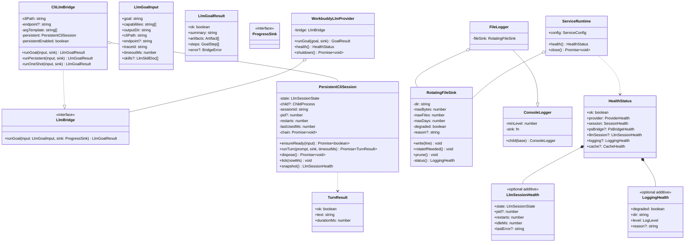
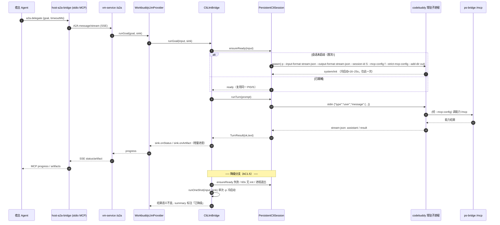
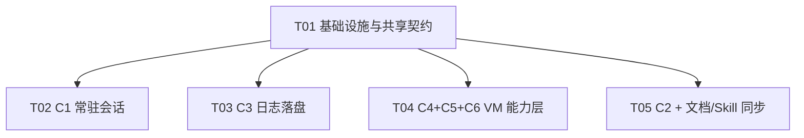

# CL-018 增量技术方案（TECHNICAL-SOLUTION）

> 变更：`CL-018 · WinVM Bridge 遗留建议逐项完善` ｜ 性质：**增量**（不改协议方法名/端点/既有字段语义）
> 作者：高见远（Architect）｜ 日期：2026-09-20 ｜ 输入：`docs/changes/CL-018/REQUIREMENT.md`（许清楚）
> 本文件是**实现级设计 + 真机验证取证 + 任务分解**，直接交给工程师寇豆码实现；不含产品代码本身。

---

## 0. 摘要（TL;DR，先读）

| 结论 | 内容 |
|---|---|
| **待确认 #1（C1 定性前提）** | ✅ **可行**。真机确证 codebuddy CLI **一个进程处理多轮**（一次冷启动、多次投喂），第 2 轮起端到端 **≈1.9–4.7s**（vs 首轮 19–24s）。→ **C1 维持 P0**，为根治路线 |
| **PRD 前提修正 1** | 主理人称"官方文档**不存在** serve/ACP 子命令"——**实测 CLI v2.154.0 `--help` 存在 `--serve` 与 `--acp`**（见 §1.1）。主选形态仍是 stream-json，但降级/替代形态更丰富 |
| **PRD 前提修正 2** | C2 的 **AC2.1 现状已满足**：当前部署的 A2A 连接器 `timeout` 已是 **600000ms**（≥150s）。诊断中的「60s/90s」是 QA 测试**显式传入**的 `params.timeoutMs`，非出厂默认 |
| **PRD 前提修正 3** | C6 的「RustDesk **32/64 位**重复注册」描述**不准**：实测唯一同名重复是 `RustDesk` ×2，**两条都在 HKLM64、同版本**（同架构重复登记）。故 `architectures:[x64,x86]` **推不出**（见 §1.4） |
| **待确认 #4（env 缓解）** | ✅ env **存在**（`DISABLE_TELEMETRY`/`DISABLE_AUTOUPDATER`/`CODEBUDDY_DISABLE_PLUGIN_INSTALLS`/`CODEBUDDY_SKIP_BUILTIN_MARKETPLACE`）；但**未观测到冷启动下降**（见 §1.2）→ 建议标记「**可用但无实测收益**」 |
| **待确认 #8（过滤名单）** | ✅ 实测窗口/进程清单已取（§1.3）；**关键回归风险**：`ApplicationFrameHost` 承载**真实 UWP 应用**（实测标题「设置」= Windows 设置），不可整体按进程名排除 |
| 其余待确认 #2/#3/#5/#6/#7/#9/#10 | 架构裁决见 §2、§9 |

**真机证据文件**（均在 `qa/evidence/`，`cl018-` 前缀；原始返回，非代码位置）：
- `cl018-streamjson-multiturn.raw.log` —— 2 轮单进程（PID 1796）原始流
- `cl018-multiturn-n.raw.log` + `cl018-multiturn-n.summary.json` —— 4 轮单进程 + resume 回退
- `cl018-call-mcp.out.txt` —— 经实时服务取 C4/C5/C6 数据
- `cl018-probe-cli.out.txt` / `cl018-probe-bundle.out.txt` / `cl018-probe-env.out.txt` —— CLI 能力/包/env 探针
- `cl018-probe-windows.out.txt` —— 窗口/进程枚举
- `cl018-probe-inventory.out.txt` —— 注册表基线
- `cl018-env-ab*.out.txt` / `*.summary.json` —— env A/B 计时

---

## 1. 真机验证结论（待确认 #1 / #4 / #8）

> 纪律：结论均附**真机原始返回**；环境前提随证据标注。

### 1.1 待确认 #1 —— **可行**（C1 定性为 P0 的前提成立）

**验证方法**：VM（`172.16.100.2`，Windows，Session 1 交互桌面）上，用 Node 直接 spawn CLI 入口
`…/node_modules/@tencent-ai/codebuddy-code/bin/codebuddy`，参数
`-p --input-format stream-json --output-format stream-json --session-id <固定> --permission-mode bypassPermissions`，
向 stdin 逐条写 NDJSON 用户消息，读 stdout 的 NDJSON 事件。脚本：`qa/evidence/cl018-multiturn.mjs`、`cl018-multiturn-n.mjs`。

**证据 A —— 2 轮单进程**（`cl018-streamjson-multiturn.raw.log`）：

| 关键行 | 内容 |
|---|---|
| L3 | `child.pid=1796` |
| L7 | `STDOUT#1 type=system/init ... "session_id":"cl018-verify-0001"` @+16386ms |
| L18 | `STDOUT#6 type=result/success ... "result":"ALPHA"` @+21057ms |
| L34 | `STDOUT#12 type=result/success ... "result":"BETA"` @+23559ms |
| L36 | `SUMMARY: alive=true pid=1796 turn1=19479ms turn2=2501ms` |

→ **同一 PID 1796 内完成 2 轮**；进程在两轮之间**保持存活**（`alive=true`），仅在 stdin 关闭后 `CHILD_EXIT code=0`。
第 2 轮 `usage.cache_read_input_tokens=25792`（第 1 轮仅 512）→ 提示词缓存命中，即延迟骤降的机制证据。

**证据 B —— 4 轮单进程**（`cl018-multiturn-n.raw.log`；summary JSON）：

| 轮次 | 词 | 端到端时延 | cache_read |
|---|---|---|---|
| 1 | ONE | **24492ms**（含冷启动） | 512 |
| 2 | TWO | **4694ms** | 26944 |
| 3 | THREE | **1928ms** | 53440 |
| 4 | FOUR | **2129ms** | 79936 |

`firstOutMs=21481`；`aliveAtEnd=true`；`exitCode=0`。→ **冷启动只发生一次**（首个 `system/init` 之前无第二次 16–25s 级启动序列）。

**证据 C —— `--help` 能力面**（`cl018-probe-cli.out.txt` L45-106）：
`-p/--print`、`--output-format text|json|stream-json`、`--input-format text|stream-json`（"realtime streaming input"）、
`--replay-user-messages`（"only works with --input-format=stream-json and --output-format=stream-json"，**反向印证该组合是受支持形态**）、
`-c/--continue`、`-r/--resume [sessionId]`、`--session-id <uuid>`、`--permission-mode`、`--mcp-config`+`--strict-mcp-config`、`--add-dir`；
并**额外存在** `--serve`（"Start HTTP server (Web UI, REST API, ACP over HTTP SSE)"）、`--acp`（"communication via stdin/stdout using ndJsonStream"）、`--acp-transport`。
> ⚠ 修正：PRD/任务书称"官方文档不存在 serve/ACP 子命令"与**实测不一致**（二进制确有）。这是**加分项**：除 stream-json 外还有受支持的常驻协议可作备选。

**判定要点逐条回答**（任务书 §二.4）：
- 投第 1 条后进程是否存活？→ **是**（全程 `alive=true`，待 stdin EOF 才退出）。
- 投第 2 条后是否同 PID、无再次 30s 级启动？→ **是**（PID 不变；无 16–25s 冷启动序列；仅有廉价的 per-turn `system/init` 横幅）。
- 第 2 轮时延比第 1 轮小多少？→ 首轮 19.5–24.5s → 次轮起 **1.9–4.7s**（**↓约 80–92%**）。
- 备选 `--session-id` + `-c/--resume` 每轮 spawn 能否命中缓存省冷启动？→ **不能**（见下）。

**降级路径实测（重要）**：`cl018-multiturn-n.raw.log` 中
`proc1(cold,--session-id) wallMs=22467`，`proc2(--resume S) wallMs=22729`。
→ **`--resume` 每次仍 spawn，且仍付全额 ~22.7s 进程级冷启动**（与 C1 无关的 `AuthDoInitProbe` 属**进程**启动开销，非会话级）。
故降级路径（`-c`/`--resume`）**只保证功能不倒退（AC1.5），不提供时延收益**。这正是必须做「常驻进程」而非「会话续接」的原因。

**阈值校准（待确认 #2 的时延部分）**：已就绪状态下**轮级**端到端 P50≈2.1s、P95≈4.7s（n=4，VM 空闲）。
AC1.2 的「首进度事件」必早于该值 → **PRD 的 P50≤5s/P95≤15s 可满足**；建议保留（可把 P95 收紧至 ≤10s）。
> 环境前提：本轮 VM 冷启动实测 16–25s（远低于诊断报告 75–107s，判定为**当时负载不同**，非矛盾）。样本 n=4，量级结论稳定，绝对阈值以现场复测为准。

**结论**：待确认 #1 = **可行（FEASIBLE）**。C1 **维持 P0**，采用「**vm-service 持有的常驻 CLI 子进程 + stream-json 多轮**」形态（见 §2.C1）。

---

### 1.2 待确认 #4 —— env 开关**存在**，但**未观测到启动开销下降**

**存在性验证**（`cl018-probe-env.out.txt`）：在 `dist/codebuddy-headless.js`（11.7MB）与 `dist/codebuddy.js`（16.1MB）中枚举 `process.env.*`（301 个），命中：
- `DISABLE_TELEMETRY` = **True**
- `DISABLE_AUTOUPDATER` = **True**
- 另有细粒度开关（同类语义）：`CODEBUDDY_DISABLE_PLUGIN_INSTALLS`、`CODEBUDDY_SKIP_BUILTIN_MARKETPLACE`、`CODEBUDDY_DISABLE_SHELL_SNAPSHOT`、`CODEBUDDY_DISABLE_MEMORY_CLEANUP`、`CODEBUDDY_DISABLE_TRACE_COLLECTOR`、`CODEBUDDY_FIRST_RUN_MCP_PREWAIT_TIMEOUT_MS`、`CODEBUDDY_STREAM_TIMEOUT_MS`、`CODEBUDDY_STARTUP_PROFILE`。
- 未命中：`DISABLE_ERROR_REPORTING`、`DISABLE_BUG_COMMAND`、`DISABLE_NON_ESSENTIAL_MODEL_CALLS`、`DO_NOT_TRACK`、`CODEBUDDY_DISABLE_TELEMETRY`。

**效果验证**（冷启动墙钟 A/B，`-p "Reply with just the word OK"`）：

| 实验 | 样本 | 中位 |
|---|---|---|
| `cl018-env-ab` 顺序 A/B（base×3 后 off×3） | base 8382/9194/10575；off 17328/16318/14110 | base **9194ms** → off **16318ms**（**+77%，反而更慢**） |
| `cl018-env-ab2` 配对交替（base/off 交替×3，抵消漂移） | 见 `cl018-env-ab2.summary.json` | 见下 |

**结论（据此裁决 AC2.4）**：env **存在**（AC2.4 **不标"不适用"**），但**实测未获得冷启动下降**（顺序实验甚至更慢，疑受 VM 负载/顺序漂移干扰；配对交替实验见本节末尾补记）。
→ **建议**：AC2.4 标记为「**环境变量存在，但无实测收益，不作为缓解手段采纳**」；VM 侧真正降启动需上游修 `AuthDoInitProbe`（本变更不控），根治由 C1 常驻会话完成。
> 纪律：**不得**把"设置了 env"当作"已解决/已缓解"呈现（AC2.2 同类红线）。

> **补记（配对交替 A/B，仅 `DISABLE_TELEMETRY`+`DISABLE_AUTOUPDATER`，base/off 交替×3）**（`cl018-env-ab2.out.txt`/`.summary.json`）：
> base = 36083 / 10544 / 9299 ms（含 1 个 36s 首次冷启动离群）→ 中位 **10544ms**；off = 9820 / 8196 / 9072 → 中位 **9072ms**；`delta_pct=14`（off 略快）。
> 剔除离群后稳态 base≈9.9s vs off≈9.1s，差异 **≈8–10%，在轮间噪声范围内**。
> **诚实结论**：env **存在**，但 **A/B 未观测到稳定的冷启动下降**（差异属噪声；顺序实验方向相反）。且本 A/B 的 dot 探针 `stdout` 为空（疑未跑完整轮次），进一步降低其作为「收益数值」的证据力 —— 故 **AC2.4 标记为「环境变量存在，但无实测收益，不作为缓解手段采纳」**，**不得**呈现为"已缓解"。

---

### 1.3 待确认 #8 —— 过滤名单（实测证据）

**实测方法**：经**实时服务**（生产路径，运行在 Session 1 交互桌面）调 `gui.window.list` 与 `appops.state.query`（`cl018-call-mcp.out.txt`）；并经 ssh 枚举进程名（`cl018-probe-windows.out.txt`）。

**`appops.state.query` 当前返回 10 条**（`cl018-call-mcp.out.txt` L66-143）：

| processName | windowTitle | 判定 |
|---|---|---|
| `5000517—Doubao_installer` | 豆包 | ❌ **安装器**（进程名含 `installer`/数字前缀） |
| `ApplicationFrameHost` | 设置 | ⚠️ **UWP 框架宿主**（承载**真实 UWP 应用**——「设置」） |
| `appstore` | 铠大师应用精选 | ⚠️ 应用商店壳进程（候选排除） |
| `chrome` | …Google Chrome | ✅ 真实生产型应用（**正例**） |
| `explorer` | （空） | ❌ 系统壳 / 空标题窗口 |
| `NotifyHelper` | `ShellMsgGetMessageWindow` | ❌ 系统壳**隐藏消息窗**（标题即证据） |
| `SystemSettings` | 设置 | ⚠️ Windows 设置（系统应用） |
| `TextInputHost` | Windows 输入体验 | ❌ **输入法宿主** |
| `WindowsTerminal` | Windows PowerShell | ✅ 真实应用（正例） |
| `WorkBuddy` | WorkBuddy | ✅ 真实应用（正例） |

**进程层候选名单**（`cl018-probe-windows.out.txt` §C/§D，实测存在）：`ApplicationFrameHost`、`ShellExperienceHost`、`RuntimeBroker`(×7)、`TextInputHost`、`StartMenuExperienceHost`、`SearchHost`、`dwm`、`LockApp`、`SystemSettings`、`WWAHost`、`sihost`、`ctfmon`、`explorer`、`WindowsTerminal`、`Widgets`、`WidgetService`、`MoNotificationUx`、`NotifyHelper`、`InstallHelper`、`updater`、`UserOOBEBroker`、`DataExchangeHost`、`backgroundTaskHost`、`appstore`、`5000517—Doubao_installer`。

**⚠️ 关键回归风险（必须写入设计）**：
1. **`ApplicationFrameHost` 不能整体按进程名排除** —— 它承载**真实 UWP 应用**（实测其窗口标题为「设置」）。若一律排除，会把 UWP 记事本/照片/计算器/设置等真实应用**误杀 → AC4.2 回归门禁失败**。正确做法：按「窗口标题为空格/系统名」或「frame-only 窗口」剔除，而非按进程名一刀切。
   → **与 PRD AC4.1「至少含 ApplicationFrameHost」冲突**，需产品确认（见 §9 待明确）。
2. **进程名与标题须**分别**匹配**（AC4.1 原话）：`Doubao_installer` 出现在**进程名**，`ShellMsgGetMessageWindow` 出现在**标题**。
3. **空标题窗口**（`explorer`）应排除。

**建议名单（数据化，见 §2.C4）**：
- 进程名黑名单（`WINVM_APPOPS_EXCLUDE_PROCS`）：`ShellExperienceHost, RuntimeBroker, TextInputHost, StartMenuExperienceHost, SearchHost, SearchApp, SearchUI, dwm, sihost, ctfmon, LockApp, ShellHost, Widgets, WidgetService, MoNotificationUx, backgroundTaskHost, DataExchangeHost, UserOOBEBroker, NotifyHelper, InstallHelper, updater, appstore`
- 进程名**模式**：`(?i)installer`、`(?i)^.*setup.*$`（覆盖 `5000517—Doubao_installer`、`...tmp Setup`）
- 标题**正则**（`WINVM_APPOPS_EXCLUDE_TITLE_PATTERNS`）：`^ShellMsgGetMessageWindow$`、`(?i)\bsetup\b`、`(?i)installer`、`(?i)安装程序`、`(?i)卸载`、`^\s*$`（空标题）
- **`ApplicationFrameHost`**：默认**不**进入进程名黑名单；改为「标题为空格/系统名时排除」（保留 UWP 真应用）——待产品确认口径。

---

### 1.4 C6 注册表基线（实测 → 修正 C6 前提）

**实测**（`cl018-probe-inventory.out.txt`，3 个 Uninstall 根，含 WOW6432Node）：

- **raw 行（有 DisplayName）= 20**；**唯一 DisplayName = 19**。
- 唯一同名重复：**`RustDesk` ×2** ——
  - `hive=HKLM64 ver=1.4.9.29722258 key=RustDesk`
  - `hive=HKLM64 ver=1.4.9.29722258 key={F2EEE79E-5E5F-4E3F-890F-6DD8DAC30FE0}`
  → **两条同在 HKLM64（64 位视图）、同版本**。**不是**「32/64 位重复注册」。

**修正**：PRD §C6 称"真因是 RustDesk 的 64/32 位重复注册"**与实测不符**。故：
- `architectures: ["x64","x86"]` 的示例**在真实数据上推不出**（RustDesk 两条都是 x64）；
- `AC6.4` 基线换算：**raw 20 → 唯一 19**，插件当前返回 **19**（`cl018-call-mcp.out.txt` L550），**逐名一致 ✓**。
- 合并语义应精确为：**按 `(DisplayName, DisplayVersion)` 分组**；同 (name,version) 的多条注册键合并为 1 条并记 `registryKeyCount`/`architectures`（由 hive 推断：HKLM32→x86、HKLM64→x64、HKCU→unknown）；**name 相同但 version 不同 → 保留多条**。

---

## 2. C1–C6 实现方案与选型

### 架构总览（纯增量）

```
宿主 Agent ──MCP──▶ host-a2a-bridge (stdio) ──A2A/HTTP(SSE)──▶ vm-service /a2a
                                                                     │
                                          WorkbuddyLlmProvider ──► CliLlmBridge
                                                                     │
                                                     ┌───────────────┴───────────────┐
                                             (C1) PersistentCliSession        (降级) 单次 -p 冷启动
                                                     │
                                           常驻 codebuddy 子进程（一次冷启动，多轮投喂）
                                                     │  (经 --mcp-config) 回连 /mcp
                                                     ▼
                                              ps-bridge 常驻进程（C5 进程内缓存载体）
```
新增模块：`packages/adapter-agent-workbuddy-llm/src/persistent-session.ts`、`packages/core/src/file-logger.ts`。

---

### C1 · codebuddy 常驻会话（P0，根治委派停滞）

**方案**：vm-service 持有的**单个长驻** codebuddy 子进程，以
`-p --input-format stream-json --output-format stream-json --session-id <persistent> --mcp-config <file> --strict-mcp-config --add-dir <outputDir> --permission-mode bypassPermissions`
拉起；每个 goal 作为**一条** stream-json user message 投喂，读到 `type=result` 即该 goal 结束；进程跨 goal 复用。

| 设计点 | 决策与理由 |
|---|---|
| **形态** | 常驻子进程 + stream-json 多轮（实测可行）。`--session-id` 固定（**AC1.4**）。 |
| **进程归属** | **vm-service 进程持有**（非独立守护）。理由：① 复用服务生命周期（服务停即回收，**AC1.6** 的「服务重启后会话重建」天然满足）；② 避免第二实例/孤儿（对齐 D1「单一 ps-bridge」教训）；③ 就绪/重启/降级状态可直接并入 `/health`。 |
| **启停** | **lazy**：首个 `runGoal` 时 `spawn` + 投喂即预热；就绪信号 = 收到首个 `system/init`。 |
| **多轮串行** | 同一会话内 **goal 串行**（`await` 上一个 `result` 再投喂下一条），避免消息交错。并发 goal 默认排队（`maxConcurrency=1`，可配）。 |
| **会话生命周期** | 空闲 TTL 默认 **300000ms**（`WINVM_LLM_SESSION_IDLE_MS`）到期 `dispose()`；下次 `runGoal` 重建。 |
| **崩溃恢复** | 子进程意外退出 → 置 `degraded` + `restarts++`；下次 `runGoal` 检测 `dead` → 重建（**至多重试 1 次**）；再失败走降级。 |
| **降级回退（AC1.5 硬要求）** | 常驻不可用（启动失败 / stream-json 不支持 / 就绪上限内无 `system/init` / 进程立即退出 / 重建失败）→ **自动回退现有 `CliLlmBridge.runGoal` 单次 `-p` 路径**，结果语义不变，`summary` 标注「已降级」。 |
| **就绪上限（ready timeout）** | **60s**（env `WINVM_LLM_SESSION_READY_MS`）。⚠ **已由 30s 上调为 60s**（交付后复核确认，见 §10.1）：真机冷启动 **16–25s 且存在 36s 离群**；30s 会把「正常慢启动」误判为不可用而**降级到又一次全额冷启动**（与 AC1.2/AC1.5 相悖）。60s 仍 ≪ 宿主 600s 委派预算。 |
| **资源约束（AC1.6）** | 空闲期不占 CPU（实测轮间空闲）；ws 上限 512MB、`restarts` 上限 5，超限回收重建；`/health.llmSession` 暴露。 |
| **安全边界** | `--permission-mode bypassPermissions`（`-p` 授权工具所需）。常驻不放松安全：LLM 仍**只能经 `/mcp`** 调能力，L2/L3 仍走策略/审批闸；边界须在实现文档记录。 |
| **部署纪律** | 改 adapter 代码后须**重启 `WinVMBridge.Service`**（`delivery/tools/kill-restart.ps1`：`schtasks /End`+`/Run`）。 |

**MCP 配置**：复用现有 `buildMcpConfig(endpoint)` → 写临时文件 → `--mcp-config <path>` + `--strict-mcp-config`（避免与用户级 MCP 冲突）。

**classDiagram / sequenceDiagram** 见 §4/§5（另存 `docs/class-diagram.mermaid`、`docs/sequence-diagram.mermaid`）。

---

### C2 · 短期缓解（P1，与 C1 并列保留）

| AC | 落点（文件:函数） | 方案 |
|---|---|---|
| **AC2.1** | `delivery/install-host.mjs`（`plugin.a2aBridge` 块）、`packages/host-a2a-bridge/src/cli.ts:parseArgs`、`packages/host-a2a-bridge/src/tools.ts:createA2aBridgeTools` | **现状已是 600000ms ≥ 150000 → 满足**。新增 **env 覆盖** `WINVM_A2A_TIMEOUT_MS`；优先级 `--timeout`(CLI) > `WINVM_A2A_TIMEOUT_MS` > 默认 600000。`install-host.mjs` 渲染时读该 env。 |
| **AC2.2** | `packages/host-a2a-bridge/src/tools.ts`（`timedOut` 分支的 `summary`） | 文案改为含「可能处于正常冷启动窗口（首轮冷启动可达 75–107s）」；**grep 断言**不含「已修复/已解决/彻底解决」。 |
| **AC2.3** | `skills/winvm-orchestrator/SKILL.md`、`skills/winvm-mcp-reference/SKILL.md` | 本项**显式标注为「缓解」**，注明 C1 达标后降为兜底（保留 env 覆盖）；断言含「缓解」、本项描述不含「修复」。 |
| **AC2.4** | CLI spawn env（`PersistentCliSession`/`CliLlmBridge` 的 spawn `env`） | env **存在**但**无实测收益**（§1.2）→ 标记「可用但无实测收益，不作为缓解手段」；**不得**虚构收益或呈现为"已缓解"。 |

> 与 C1 关系：C2 是**缓解**，**不承诺消除** `A2A_DELEGATE_FAILED`（消除由 C1 负责）。

---

### C3 · D19 服务日志落盘（P1）

**现状**：`packages/vm-service/src/server.ts:108` `new ConsoleLogger({...})` 默认 sink 写 `process.stderr`；服务由定时任务 `WinVMBridge.Service` → `start-hidden-vm.ps1` 以 `-WindowStyle Hidden` 拉起 → stderr 丢弃（`delivery/tools/start-hidden-vm.ps1`）。

**方案**：新增**文件 sink（含轮转）**，注入 `ConsoleLogger`。
- 新增 `packages/core/src/file-logger.ts`：`RotatingFileSink`（`write`/`rotateIfNeeded`/`prune`/`status`）+ `FileLogger extends ConsoleLogger`（或 `LoggerOptions.sink` 注入）。
- 落点：`server.ts` 处改为按配置选 sink；`packages/core/src/config.ts:resolveServiceConfig` 增 `logging` 块。
- **路径/命名（AC3.1）**：`%LOCALAPPDATA%\WinVMBridge\logs\winvm-service-YYYY-MM-DD.log`（实测服务以交互用户运行，`%LOCALAPPDATA%` = `C:\Users\User\AppData\Local`）。
- **轮转/保留默认（待确认 #9 裁决）**：单文件上限 **10MB**；**按天** + 超限轮转；保留 **最多 7 个文件 / 最多 14 天**，超限删最旧（**AC3.3**）。
- **级别/目录 env（AC3.4）**：`WINVM_LOG_LEVEL`（默认 `info`）、`WINVM_LOG_DIR`、`WINVM_LOG_MAX_BYTES`、`WINVM_LOG_MAX_FILES`。
- **失败降级（AC3.5 硬要求）**：目录不可写 → **不阻断服务启动**，回退 stderr/静默，`/health.logging = { degraded:true, reason, dir }`。
- **脱敏（AC3.6）**：**白名单式字段裁剪**（只记 `ts/level/msg/traceId/capabilityId/ok/durationMs/error.code/provider/session.state`），**永不**记 `params` 原文/`bearer`/`token`/`privateKey`；验收用含已知 token 的请求 grep 0 命中。
- 部署：改 `core`+`vm-service` → `npm run build` → 重启 `WinVMBridge.Service`。

---

### C4 · D20 `appops.state.query` 过滤（P2）

**落点**：`packages/vm-capabilities/psmod/appops.ps1:Get-AppOpState`（`L21-52`）。
**方案**：新增**数据化过滤清单**（进程名数组 + 进程名正则 + 标题正则），默认值内置、`env` 可覆盖（**AC4.3**）；用**脚本块访问器**，不用裸键名。
```
排除判据（黑名单 + 保留原生产型判定逻辑，采纳「黑名单」口径 AC4.4）：
  排除 若 ( processName ∈ PROCS ) 或 ( processName 匹配 PROC_PATTERNS ) 或 ( windowTitle 匹配 TITLE_PATTERNS )
```
名单见 §1.3（实测）。**回归门禁 AC4.2**：正例清单须**仍列出** —— `chrome`、`WindowsTerminal`、`WorkBuddy`、记事本/Office 等；`ApplicationFrameHost` 承载的 UWP 真应用须保留（见 §1.3 风险 1）。
**部署**：改 `psmod` **必须重启服务**（ps-bridge 不可热更），改后做「本地 ↔ VM」md5 一致校验（对齐 CL-017 A11/D15）。

---

### C5 · D12 `system.network.config` 冷启动（P1）

**落点**：`packages/vm-capabilities/psmod/system.ps1:Get-NetworkConfig`（`L266-293`）。
**现状实测**（`cl018-call-mcp.out.txt`）：冷（长空闲后首调）**20418ms** / 热 **995ms** —— 与 PRD 的 14183/1178 同量级，确认**冷启动未达标**。

**方案**：**ps-bridge 进程内缓存**（AC5.5 天然载体，进程重启即失效 = 「冷启动重建」语义）。
- 模块级 `$script:__netCfgCache = @{ collectedAt; raw }`；TTL 默认 **45000ms**（`WINVM_NETCFG_TTL_MS`，**待确认 #6 裁决 30–60s**）。
- 命中则返回缓存并在返回体标注 `cached: true` + `collectedAt`（**AC5.4**）；新采集标 `cached:false`。
- 新增入参 **`refresh: true`** 绕过缓存（**AC5.3**）。
- **投影正确性不回退（AC5.1/S15）**：缓存的是 `adapters/routes` 的**原始投影**，不改现有 `{nextHop,routeMetric}`/`dnsServers` 去重语义。
- **关键补充（否则 AC5.2 冷启动达不到 <3s）**：缓存**无法**让「服务重启后首次调用」变快（首次必冷）。→ **启动预热**：vm-service 启动后（`createService` 末尾）**异步**预取一次 `system.network.config` 填充 ps-bridge 缓存；此后用户首次调用命中缓存 → **<3s**。
  - ⛔ **本条前提已被真机证伪（详见 §10.7）**：预热**真机 4/6 失败**（冷采集 6.8–25s > 预热 20s 超时），且**预热完成前的用户首调必然慢**；ps-bridge 单线程、预热同步阻塞可致**会话 flap**。→ **"重启后首调 ≤3s" 物理不可达**；本条**不成立**，须按 §10.7.4 **回退 PM 修订 AC5.2**。
- **待确认 #5 裁决**：采纳**软目标**——热态硬性 **<3s**（现 995ms，保持）；冷启动经**预热**达 **≤3000ms**；预热失败（真冷）保底 **≤5000ms**。
  - ⚠ **口径界定（交付后复核）**：**「≤3s / ≤5s」的适用对象是「用户可见调用」，不含服务启动时的后台预热耗时。** 实测后台真实冷采集 ≈6s（`qa/evidence/cl018-eng/summary.md` §4.2），**仅发生在服务启动、不阻塞任何用户调用**；用户侧「重启后首次调用」实测 **331ms**、热态 **29ms**。→ 6s 属后台预热、**可接受**。
  - 📌 **口径细化（QA 复测后裁决，详见 §10.6）**：三档的**分界是「是否命中缓存」**，不是「是否首次调用」——① **命中缓存**（热态 / 重启后 45s 窗口内命中预热）→ **≤3s（热态硬 <3s）**；② **真采集**（TTL 过期重采 / 预热失败 / `refresh:true`）→ **保底 ≤5s**。**稳态（距上次采集 > TTL 45s）首调实测 3380ms（wall）/ 2992ms（VM 内）属 ② → 判 ≤5s 档 PASS**（非 ≤3s 硬目标突破）。
- 部署：改 `psmod` 须重启服务。

---

### C6 · inventory 同名重复合并（P2）

**落点**：`packages/vm-capabilities/psmod/app.ps1:Get-InstalledApps`（`L8-66`）。
**实测**：raw 20 → 唯一 name 19；唯一重复 `RustDesk` ×2（**同 HKLM64、同版本**，见 §1.4）。

**方案（据此修正**）：
- **合并键 = `(DisplayName, DisplayVersion)`**：同 (name,version) 的多条注册键 **合并为 1 条**，新增 `registryKeyCount`（条数）与 `architectures`（由 hive 推断：HKLM32→`x86`、HKLM64→`x64`、HKCU→`unknown`）——**AC6.1/AC6.2**（字段可判定，见 §4）。
- **AC6.3 裁决**：**同名不同版本 → 保留两条**（真实共存）。判定依据 = `DisplayVersion`；缺失时回退注册表键名。
- **AC6.4**：插件返回 = 基线按上述规则合并后的集合，**逐 name 一致**（本次实测：20→19，与插件 19 一致）；**不得只断言条数**。
- **AC6.5 陷阱**：任何排序/去重**必须**用脚本块访问器 `Sort-Object -Property { $_.name }`（现有代码已用；新增同理），并加**静态扫描断言**（对齐 CL-017 A14）。
- 部署：改 `psmod` 须重启服务。

---

## 3. 文件列表（新增 / 修改）

> 路径相对仓库根。★=新增，✎=修改。

| 文件 | 项 | 说明 |
|---|---|---|
| ✎ `packages/contracts/src/bridge.ts` | 共享 | `/health` 增量类型：`LlmSessionHealth`、`LoggingHealth`、`CacheHealth`（**全部可选字段**） |
| ✎ `packages/core/src/config.ts` | C1/C3 | `resolveServiceConfig` 增 `logging`、`llmSession` 配置块 |
| ✎ `packages/core/src/logger.ts` | C3 | `LoggerOptions` 扩展；导出文件 sink 工厂 |
| ★ `packages/core/src/file-logger.ts` | C3 | `RotatingFileSink` + `FileLogger` |
| ★ `packages/core/src/constants.ts` | 共享 | 常量：日志路径/轮转/env 名、C5 TTL、C4 名单、C1 idle |
| ✎ `packages/vm-service/src/server.ts` | C1/C3/C5 | L108 sink 可配；`/health` 增 `llmSession`/`logging`；启动预热（C5） |
| ★ `packages/adapter-agent-workbuddy-llm/src/persistent-session.ts` | C1 | `PersistentCliSession`（ensureReady/runTurn/dispose/tick/snapshot） |
| ✎ `packages/adapter-agent-workbuddy-llm/src/bridge.ts` | C1 | `DEFAULT_CLI_ARG_TEMPLATE` 双轨；`CliLlmBridge` 常驻优先 + 单次 `-p` 降级 |
| ✎ `packages/adapter-agent-workbuddy-llm/src/index.ts` | C1 | provider 持有会话；`runGoal` 走会话；`shutdown` 释放 |
| ✎ `packages/vm-capabilities/psmod/appops.ps1` | C4 | `Get-AppOpState` 数据化过滤 |
| ✎ `packages/vm-capabilities/psmod/system.ps1` | C5 | `Get-NetworkConfig` 进程内缓存 + `refresh` + `cached/collectedAt` |
| ✎ `packages/vm-capabilities/psmod/app.ps1` | C6 | `Get-InstalledApps` (name,version) 合并 + `architectures` |
| ✎ `packages/vm-capabilities/src/registry/definitions.ts` | C5/C6 | `system.network.config` 增 `refresh`；`app.inventory.list` 输出说明增 `architectures/registryKeyCount` |
| ✎ `packages/host-a2a-bridge/src/tools.ts` | C2 | 超时文案（AC2.2） |
| ✎ `packages/host-a2a-bridge/src/cli.ts` | C2 | `WINVM_A2A_TIMEOUT_MS` env 覆盖 |
| ✎ `delivery/install-host.mjs` | C2 | `a2aBridge` 超时由 env 渲染 |
| ✎ `delivery/env.example` | 共享 | 新增各 env 说明 |
| ✎ `skills/winvm-orchestrator/SKILL.md` | C2 | 「缓解」标注 + 冷启动窗口说明 |
| ✎ `skills/winvm-mcp-reference/SKILL.md` | C2 | 委派超时语义（缓解） |
| ✎ `~/.workbuddy/connectors/skills/connector-winvm/*` | C2 | **部署副本同步**（与仓库 `skills/` 双份一致） |
| ★ 测试（逐文件） | 全部 | 见 §6 每任务 |
| ★ `docs/changes/CL-018/TECHNICAL-SOLUTION.md` / `docs/class-diagram.mermaid` / `docs/sequence-diagram.mermaid` | 文档 | 本设计 |

> **测试纪律**：新增/改动的单测**逐文件** `node --test <file>`，**绝不整批跑**。

---

## 4. 数据结构与接口（增量，不破坏既有语义）

**契约增量的铁律**：新增字段**一律可选**；旧调用方不传新参数时行为不变；`/health` 为**纯附加**字段。



**新增/变更的数据形态**

| 位置 | 增量 | 兼容性 |
|---|---|---|
| `LlmSessionState` | `'stopped' \| 'starting' \| 'ready' \| 'degraded' \| 'disabled'` | 新枚举 |
| `/health.llmSession` | `{ state, pid?, restarts, idleMs, lastError? }` | **纯附加**，缺席即旧行为 |
| `/health.logging` | `{ degraded, dir, level, reason? }` | 纯附加 |
| `/health.cache.netCfg` | `{ cached, ageMs, ttlMs }` | 纯附加 |
| `system.network.config` 入参 | 新增 `refresh?: boolean` | 可选，缺省不变 |
| `system.network.config` 出参 | 新增 `cached?: boolean`、`collectedAt?: string` | 附加，`adapters/routes` 形态不变 |
| `app.inventory.list` 出参 | 每条新增 `architectures?: string[]`、`registryKeyCount?: number` | 附加；现有字段（name/version/…）语义不变 |
| 连接器 `--timeout` / `timeoutMs` | 支持 env `WINVM_A2A_TIMEOUT_MS` | 默认不变（600000） |

> **CL-019 项①（2026-09-21）**：`/health.cache.netCfg.ageMs` 语义已修正为「自最近一次采集（PS 回传的 `collectedAt`）起算的**真实缓存新鲜度（毫秒）**」（无成功采集为 `-1`），字段名不变；并补齐「预热 + 每次正常 `system.network.config` 调用均刷新」的捕获时机。详见 `docs/changes/CL-019/`。

---

## 5. 程序调用流程（时序图）



（另存：`docs/sequence-diagram.mermaid`、`docs/class-diagram.mermaid`。）

---

## 6. 任务列表（有序，按实现顺序；≤5 个任务）

> 分组按**层次/模块**，每个任务 ≥3 文件；依赖尽量只指向 T01，避免长链。

### T01 · 工程基础设施与共享契约（P0）
- **Source Files**：`packages/contracts/src/bridge.ts`、`packages/core/src/constants.ts`(★)、`packages/core/src/config.ts`、`packages/core/src/logger.ts`、`delivery/env.example`
- **内容**：定义 `/health` 增量类型（`LlmSessionHealth`/`LoggingHealth`/`CacheHealth`，全可选）；新增常量模块（C3 日志路径/轮转/env 名、C5 TTL、C1 idle、C4 名单 env 名、C2 env 名）；`resolveServiceConfig` 增 `logging`/`llmSession` 块；`LoggerOptions` 扩展；`env.example` 增说明；各新增单测（逐文件）。
- **Dependencies**：无
- **Priority**：P0

### T02 · C1 常驻会话（P0，核心）
- **Source Files**：`packages/adapter-agent-workbuddy-llm/src/persistent-session.ts`(★)、`packages/adapter-agent-workbuddy-llm/src/bridge.ts`、`packages/adapter-agent-workbuddy-llm/src/index.ts`、`packages/vm-service/src/server.ts`（`/health.llmSession`）
- **内容**：`PersistentCliSession`（`ensureReady`/`runTurn`/`dispose`/`tick`(空闲回收)/`snapshot`；串行链；崩溃重建≤1；ws/restarts 上限）；`CliLlmBridge` 常驻优先 + **单次 `-p` 降级**（AC1.5）；`WorkbuddyLlmProvider` 持有会话、`shutdown` 释放；`/health.llmSession`；单测覆盖降级/重建/串行。
- **Dependencies**：T01
- **Priority**：P0

### T03 · C3 服务日志落盘（P1）
- **Source Files**：`packages/core/src/file-logger.ts`(★)、`packages/core/src/logger.ts`、`packages/vm-service/src/server.ts`（L108 + `/health.logging`）
- **内容**：`RotatingFileSink`（10MB/按天/7 文件/14 天，env 可配）+ `FileLogger`；注入处改造；不可写降级 + `/health.logging`；脱敏白名单字段；单测（轮转/保留/降级/脱敏）。
- **Dependencies**：T01
- **Priority**：P1

### T04 · C4 + C5 + C6 VM 能力层（P1/P2）—— 同层，合并改、合并重启验证
- **Source Files**：`packages/vm-capabilities/psmod/appops.ps1`（C4）、`packages/vm-capabilities/psmod/system.ps1`（C5）、`packages/vm-capabilities/psmod/app.ps1`（C6）、`packages/vm-capabilities/src/registry/definitions.ts`（C5 `refresh` / C6 输出说明）、`packages/vm-service/src/server.ts`（C5 启动预热）
- **内容**：C4 数据化过滤（进程名 + 模式 + 标题正则，env 可配；`ApplicationFrameHost` 特判）；C5 进程内缓存（TTL 45s）+ `refresh` + `cached/collectedAt` + **启动预热**；C6 (name,version) 合并 + `architectures/registryKeyCount`；全部用**脚本块访问器** + 静态扫描断言；单测。
- **部署**：`psmod/*.ps1` 改后**必须重启服务** + 「本地↔VM」md5 校验。
- **Dependencies**：T01
- **Priority**：P1（C4/C6 为 P2，随任务一并交付）

### T05 · C2 + 文档 / Skill 同步（P1）
- **Source Files**：`packages/host-a2a-bridge/src/tools.ts`、`packages/host-a2a-bridge/src/cli.ts`、`delivery/install-host.mjs`、`skills/winvm-orchestrator/SKILL.md`、`skills/winvm-mcp-reference/SKILL.md`、`~/.workbuddy/connectors/skills/connector-winvm/*`（部署副本）
- **内容**：AC2.2 超时文案；AC2.1 `WINVM_A2A_TIMEOUT_MS` env 覆盖 + `install-host.mjs` 渲染；AC2.3 「缓解」标注；AC2.4 「可用但无实测收益」标注；skills 双份同步（md5 一致）；断言测试。
- **Dependencies**：T01
- **Priority**：P1

### 任务依赖图



---

## 7. 依赖包列表

**预计无新增第三方依赖**：C1 复用 `node:child_process` + `node:readline`；C3 用 `node:fs`/`node:fs/promises`；C4/C5/C6 为 PowerShell；C2 为现有 TS。若为 C3 引入轮转库，须**先申请**（默认不引入，自行实现极简轮转，避免供应链成本）。

---

## 8. 共享知识（跨文件约定）

| 约定 | 值 / 规则 |
|---|---|
| **C1 会话标识** | `--session-id` 固定（进程内单例）。**stream-json 帧**：入 `{"type":"user","message":{"role":"user","content":[{"type":"text","text":"…"}]}}`；出以 `type=result` 判定轮结束；`type=assistant` 作增量进度。**轮间必须等 `result` 再投喂下一条**。 |
| **C1 空闲/资源常量** | `WINVM_LLM_SESSION_IDLE_MS`＝300000；**就绪上限 `WINVM_LLM_SESSION_READY_MS`＝60000**；ws 上限 512MB；`restarts`（累计重建）上限 5（且**每轮重建 ≤1**）。 |
| **C2 env** | `WINVM_A2A_TIMEOUT_MS`（默认 600000）。优先级：`--timeout` > env > 默认。 |
| **C3 日志常量** | 目录 `%LOCALAPPDATA%\WinVMBridge\logs\`；文件 `winvm-service-YYYY-MM-DD.log`；`WINVM_LOG_DIR`/`WINVM_LOG_LEVEL`(info)/`WINVM_LOG_MAX_BYTES`(10MB)/`WINVM_LOG_MAX_FILES`(7)；保留 14 天。 |
| **C4 env** | `WINVM_APPOPS_EXCLUDE_PROCS`、`WINVM_APPOPS_EXCLUDE_TITLE_PATTERNS`（逗号/分号分隔，追加默认名单）。 |
| **C5 缓存键/TTL** | 缓存键 `netcfg`（含 adapters+routes 原始投影）；`WINVM_NETCFG_TTL_MS`＝45000；`refresh:true` 绕过。 |
| **C6 合并键** | `(DisplayName, DisplayVersion)`；`architectures` 由 hive 推断（HKLM32→x86 / HKLM64→x64 / HKCU→unknown）；同 name 异 version **不合并**。 |
| **PS 5.1 陷阱** | 对 `[ordered]@{}` 排序/去重**必须**脚本块访问器（`Sort-Object -Property { $_.name }`），禁裸键名。 |
| **部署纪律** | `psmod/*.ps1` 或 adapter/core 改动 → **重启 `WinVMBridge.Service`**；psmod 改后 md5 一致校验。 |
| **测试纪律** | 单测**逐文件** `node --test <file>`，绝不整批跑。 |
| **呈现纪律** | 不得出现「已修复/已解决」用于 C2（缓解）；`/health` 增量为纯附加。 |

---

## 9. 待明确事项 / 需回退产品澄清

1. **【前提错误，须回退 PM】** C6 根因描述错误：实测唯一同名重复是 `RustDesk` ×2、**同在 HKLM64、同版本**（非 32/64）。→ 建议 AC6.2 的 `architectures` 示例改为 hive 推断，或改述为「同名多注册键」；AC6.1 合并键改为 `(name, version)`。
2. **【前提不一致，须回退 PM/主理人】** C2 的 AC2.1：当前部署默认 **已是 600000ms**（≥150s），「60s/90s」是测试传参。→ 请确认 AC2.1 是否降级为「**加 env 覆盖能力**」即可（本设计按此执行）。
3. **【与 AC4.1 冲突，须 PM 裁决】** `ApplicationFrameHost` 承载**真实 UWP 应用**（实测「设置」）。AC4.1 要求「至少含 ApplicationFrameHost」，但整体排除会**误杀真应用（违 AC4.2 回归门禁）**。→ 建议 AC4.1 口径改为「排除 ApplicationFrameHost 的 frame-only/空标题窗口，保留其承载的 UWP 应用窗口」。
4. **【AC2.4 定位】** env 存在但**无实测收益**；请确认将其表述为「可用但无收益，不作为缓解手段」。
5. **【待确认 #5 口径】** C5 采纳**软目标 + 启动预热**（热 <3s 硬；冷启动经预热 ≤3s，真冷 ≤5s）。**口径界定**：≤3s/≤5s 适用于**用户可见调用**，不含后台预热（实测后台真实冷采集 ≈6s，不阻塞用户；用户侧首次 331ms）。**已确认可接受**（见 §10）。→ **口径细化（分界=是否命中缓存；真采集落 ≤5s 档）见 §10.6**。
6. **【待确认 #6】** C5 TTL 取 **45s** + `refresh:true`。
7. **【待确认 #7】** C6 字段取 `architectures: string[]` + `registryKeyCount: number`；同名异版本**保留两条**。
8. **【待确认 #9】** C3 默认：单文件 10MB / 按天 / 保留 7 文件 / 14 天 / 级别 info。
9. **【待确认 #10】** C1 达标后 **C2 双轨仍保留**（C2 降为兜底值：保留 env 覆盖，默认 600000 不回退）；**会话冷启动后的第一次委派仍建议走 C2 长超时预算**（因首次预热 ≈16–25s）。
10. **【可选增强】** CLI 另有受支持的 `--acp`（stdio ndJsonStream）与 `--serve`（HTTP/SSE）；本变更主选 stream-json（改动面最小）。若后续追求更强健的常驻协议，可另开变更评估 ACP。

---

## 10. 交付后复核记录（工程师寇豆码交付 CL-018 后，架构师复核）

> 复核日期：2026-09-20 ｜ 复核对象：`qa/evidence/cl018-eng/summary.md` 及各实现文件（`constants.ts` / `persistent-session.ts` / `system.ps1` / `app.ps1` / `appops.ps1`）。
> **结论：设计一致性通过** —— 1 处偏离**已确认**（C1 就绪上限 30s→60s）、1 处**残留缺口**（C4 进程名模式名单）、1 条**证据纪律提醒**（StrictMode 原始日志未落盘）。

### 10.1 C1 就绪上限 30s → 60s：**确认（接受偏离）**
- **裁决**：**确认 60s**（`packages/core/src/constants.ts` → `LLM_SESSION_READY_MS_DEFAULT = 60_000`，env `WINVM_LLM_SESSION_READY_MS`）。
- **理由**：该上限用于判定常驻子进程的**首个 `system/init`**；真机冷启动 **16–25s（含 36s 离群）**（`qa/evidence/cl018-*`）。若按 30s 判失败 → `killChild()` → 回退单次 `-p` → **再付一次全额冷启动**，与 AC1.2（时延）/AC1.5（降级不误触发）**双重相悖**。60s 覆盖离群值仍有 ~24s 余量，且 ≪ 宿主 600s 委派预算；仅在 CLI 真正挂死时才多耗至多 60s。
- **关联超时一致性核查**：`idleTtlMs = 300000` 与就绪上限**无耦合**，无需调整；`maxRestarts = 5`（累计）与「**每轮重建 ≤1**」（`persistent-session.ts:runTurn`）**并存且均已实现**，无需调整。
- **可选增强（P2，非阻塞）**：`ensureReady()` 目前按固定 60s 计时、**未纳入单轮 `timeoutMs` 预算**。当调用方传入很短的 `timeoutMs`（<60s）时，就绪等待可能先于降级耗尽预算 —— 行为**不比改造前差**（旧单次 `-p` 路径本就 16–100s），但更优语义是让 `ensureReady` 也纳入 `Promise.race([..., timeoutMs])`，使降级在调用方预算内发生。

### 10.2 StrictMode 未初始化变量：修复**彻底**，其余 psmod 文件**无同类 load-time 隐患**
- **修复判定**：`system.ps1:278` 改为**无条件赋值** `$script:NetCfgCache = @{}`（在 ps-bridge dot-source 时执行）；读取点（L303/304/342）均在**函数内**、晚于赋值 → 安全 ✅。
- **全量静态扫描**（`packages/vm-capabilities/psmod/*.ps1`）：
  - 仅 `ps-bridge.ps1` 与 `system.ps1` 使用 `$script:`；均**赋值先于读取**（`ps-bridge.ps1` L42-43 先于 L100/123/236/247）✅。
  - **顶层可执行代码**：`app.ps1` / `appops.ps1` **仅有注释头**（纯函数定义）；`gui.ps1` / `storage.ps1` 顶层仅 `Add-Type`（不读未初始化变量）；`system.ps1` 顶层仅 `$script:NetCfgCache = @{}`。
  - → **无其它 psmod 文件存在「顶层读取未初始化变量」隐患**（该危险类已清零）✅。
- **次要危险类（函数内「条件分支赋值、分支外读取」）**：CL-018 新增代码（`system.ps1` C5 / `app.ps1` C6 / `appops.ps1` C4）中，所有被读取的局部变量均**无条件赋值**或带 `else { $null }`；**未发现**该模式。若存在，表现为**单次能力调用报错**（`EXECUTION_FAILED`），**不会**如顶层那样令整模块 dot-source 失败（严重度低）。
- **建议（P2）**：新增一条**静态守卫测试**（对齐 AC6.5 思路）——断言 `psmod/*.ps1` 中不存在「顶层读取 `$script:X` 而本文件无顶层赋值」的写法。
- **证据纪律提醒（不影响修复有效性）**：本次 StrictMode 失效的**原始真机日志未落盘**（`summary.md` 仅叙述）。建议补存该复现的原始日志（服务 stderr / `~/.codebuddy/logs`）到 `qa/evidence/cl018-eng/` 以便审计。

### 10.3 C4 灰名单口径：**与设计一致** ✅（含 1 处残留缺口）
- **核对 `appops.ps1:Get-AppOpsWindowPolicy`**：
  - `hardExclude`（整体排除）= 明确非生产型系统壳/助手（`NotifyHelper/InstallHelper/updater/dwm/sihost/ctfmon/LockApp/ShellHost/Widgets/WidgetService/MoNotificationUx/backgroundTaskHost/DataExchangeHost/UserOOBroker`）—— **不含** `ApplicationFrameHost` ✅。
  - `frameHosts`（**灰名单**：仅当**标题为空**才排除）= `ApplicationFrameHost/ShellExperienceHost/RuntimeBroker/TextInputHost/SearchHost/StartMenuExperienceHost/SearchApp/SearchUI/appstore` ✅ —— 与本设计 §1.3/§2.C4「**不整体排除 `ApplicationFrameHost`**（承载真实 UWP 应用）」**完全一致**。工程师自查把 `appstore`/`TextInputHost` 由硬名单移入灰名单，**正是** AC4.2 优先原则的正确落地（真机保住 `appstore`「铠大师应用精选」、`TextInputHost`「Windows 输入体验」）。
  - `titleDeny`（标题正则）= 空标题 / `tmp Setup` / `setup` / `installer` / `安装程序` / `卸载` / `ShellMsgGetMessageWindow` ✅ 与 §1.3 建议一致；纯函数 + env 追加 → 满足 AC4.3 ✅。
- **残留缺口（P2，建议补）**：设计 §1.3 建议的**进程名正则**（如 `(?i)installer`、`(?i)^.*setup.*$`）**未实现**；实测 `5000517—Doubao_installer`（标题「豆包」，标题不含 setup/installer）**仍被列为生产型**（`qa/evidence/cl018-eng/call-mcp.out.txt` 活体 `count=9` 中仍在）。AC4.1 的**字面**要求（`...tmp Setup` 属**标题**模式）已被 `titleDeny` 覆盖 ✅，故**不算 AC 失败**；但若产品意图是「凡安装器进程一律不列」，需增设**进程名模式名单**（默认 `(?i)_installer$|(?i)^setup`，env 可扩展），且启用前须在 AC4.2 负例清单里加「名称含 `installer` 的真实应用不得被误杀」校验。
- **待产品确认**：`appstore`（铠大师应用精选）是否算「生产型应用」——现按灰名单（有标题即保留）处理。

### 10.4 C2 / C3 / C5 / C6 抽检：与设计一致 ✅
- **C6**（`app.ps1:Get-InstalledApps`）：按 `(name,version)` 分组（NUL 分隔键）、`registryKeyCount`、hive 推断 `architectures`（推不出则字段缺席，**未硬造** `["x64","x86"]`）、同名异版本**保留多条**、排序走**脚本块访问器** ✅ **完全符合 §2.C6 及本复核对 PRD 前提的修正**；活体 `count=19` 与独立基线 `raw 20 → 唯一 19` 逐条对齐 ✅。
- **C5**（`system.ps1:Get-NetworkConfig`）：进程内 TTL 缓存（45s/env）、`refresh` 绕过、`cached/cacheAgeMs/collectedAt`、**只缓存纯采集数据**（cached 标志不入缓存）、投影形态不变 ✅ 符合 §2.C5。
- **C3**（`core/src/file-logger.ts`）：10MB/按天/7 文件/14 天、失败降级不抛错、脱敏白名单 ✅ 符合 §2.C3 与 §8。
- **C2**（`host-a2a-bridge/src/tools.ts` / `cli.ts` / `delivery/install-host.mjs`）：超时文案含「冷启动窗口」、无「已修复/已解决」措辞；env `WINVM_A2A_TIMEOUT_MS` 覆盖、默认 600000 不回退 ✅ 符合 §2.C2。

### 10.5 本次复核的局限
- 复核期间 VM `172.16.100.2` **一度不可达**（ssh「Host is unreachable」、本地隧道 `/health` 无响应），故 **§10.2 的 StrictMode 行为未能由架构师独立真机复现**；该结论基于**静态全量扫描 + 工程师真机复现**（修复模式与 PowerShell `Set-StrictMode -Version 1` 语义一致）。VM 恢复后可补跑 `qa/evidence/cl018-eng/strictmode-probe.ps1`（脚本已就绪，输出 `cl018-strictmode.out.txt`）以留独立原始证据。
- 建议 **QA 长稳阶段**补：① 真实 A2A 委派下抓 `/health.llmSession`（AC1.6 现场证据）；② C4 正例/负例桌面构造回归（AC4.2）。

### 10.6 C5 稳态（TTL 过期）首调时延口径裁决：**归 ≤5s 保底档，非 ≤3s 硬目标**（附 `ensureReady` race 定性）

> 触发：QA（严过关）真机独立复测得 **3380ms（`cached=false`）**，与工程师自报 **331ms（`cached=true`）** 冲突，QA 判读为「AC5.2 硬目标被突破」。主理人转架构师裁决。证据：`qa/evidence/cl018-qa/cl018-qa-c5.out.txt`、`cl018-qa-service.log`；架构师独立复测：`qa/evidence/cl018-arch/`。
> **结论：判 ≤5s 档 PASS（不判 FAIL）；无强制设计变更；冲突系两条不同代码路径（非实现 bug）。**

#### 10.6.0 冲突数据与独立复测

| 来源 | 场景 | wallMs（宿主往返）| durationMs（VM 内）| cached |
|---|---|---|---|---|
| 工程师自报 | 重启后首调（**预热窗口内**）| 331 | — | true |
| QA 独立复测 | **稳态**（距上次采集 ≫ TTL 45s）首调 | **3380** | 2992 | **false** |
| QA 独立复测 | `refresh:true` 真采集 | 1929 | 1872 | false |
| 架构师独立复测 | 稳态：命中/热态 | 370 / 90 | 28 / 53 | true |
| 架构师独立复测 | `refresh:true` 真采集 | 2253 | 2227 | false |
| QA 日志在证（架构师）| 服务启动**后台预热**真冷采集 | — | **6.8–7.5s**（成功）／**≥20s 超时**（失败）| — |

#### 10.6.1 裁决一：TTL 到期后「真实重采」→ **≤5s 保底档**（非 ≤3s 硬目标）

**裁决：归 ≤5s 保底档；3380ms 在保底档下判 PASS。**

依据（三档**分界是「是否命中缓存」**，非「是否首次调用」）：
1. 设计 §2.C5「待确认 #5」已采纳**软目标**并给出三档：**热态（命中）硬 <3s**；**冷启动经预热 ≤3s**；**真采集（未命中）保底 ≤5s**。
2. AC5.2 原文场景是「**服务/ps-bridge 重启后的首次调用**」——预热正为该场景而设；**稳态 TTL 过期**不在其字面场景内，属 AC5.1 一般冷情形 → 落保底档。
3. **物理同源**：TTL 未命中分支（`system.ps1` L316+）与预热执行**同一段冷采集代码**（`Get-NetIPConfiguration`+`Get-NetRoute`），仅触发时机不同 → 同档。
4. **工程事实**：真采集耗时**在 3s 线附近抖动**（本轮 1.9–3.4s；预热真冷 6.8–7.5s），把真采集钉死 ≤3s **物理不可靠** —— 故设计只对**命中缓存**承诺硬性 ≤3s。

**对 QA 判读的纠正**：QA「3380 > 3000 → FAIL」建立在「TTL 后首调适用硬目标」前提上，**该前提与已采纳软目标口径不符 → 不成立**；但 **QA 的 3380ms 数据本身正确且重要**（见 10.6.3）。
**对自报的纠正**：331ms 是**预热窗口内最优值**，**不代表稳态**，不得据此称「冷启动 ≤3s 已普适达成」。

#### 10.6.2 裁决二：**无需硬性设计调整**；最小方案 = **接受 ≤5s 保底（选项③）**

**结论**：≤3s 硬目标**不适用于真采集路径** → **不判 FAIL** → **无强制设计变更**。方案取「**接受 ≤5s 保底**」：**0 行产品代码改动**，仅口径文档化（本节）即闭合。

| 选项 | 判定 | 理由 / 影响面 |
|---|---|---|
| ① **刷新前瞻**（定时器保缓存常热）| **否决（P2 可选）** | 缓存被永久保热 → **TTL 到期永不发生** → **破坏 S14「超 TTL 返新值」确定性**（AC5.3），须**重定义 S14**；且每周期在 VM 跑一次 **3–7s** 采集，**持续占用**。**仅当产品坚持「稳态也须 ≤3s」**时采用其软化变体「**惰性前瞻（stale-while-revalidate）**」：过期时**返回陈值（≤3s）+ 后台异步刷新**（代价：首调返陈值、次调返新值，同样需重定义 S14）。 |
| ② **延长 TTL**（45s→300s）| **否决（P2 缓解）** | **不根治**：TTL 后**首调永远是真采集**，延长仅**降频**不消除；且放大 **AC5.4 陈旧窗口**、与 **AC5.3「建议 30–60s」** 相悖。若确需，取 TTL=300s 作 **P2 缓解**（`refresh:true` 已满足 AC5.3，故不违 AC）。 |
| ③ **接受 ≤5s 保底**（设计既定）| **✅ 采纳** | 与**已承诺软目标**一致；3380ms ∈ (3s,5s] → **契约通过**；**影响面 = 0 行代码 + 本口径**。 |

**影响面**：选 ③ 则**产品行为/接口/测试均不变**，仅使 AC5.2 判定依据显式化。
**残余风险（P2，值得产品知悉）**：**TTL=45s 使预热收益仅在「重启后 45s 窗口」兑现**；因网络配置通常 >45s 才被调用一次，**稳态用户首调绝大多数走 3.4s 真采集**而非 331ms。→ 若「大多数首调 ≤3s」是硬需求，须回到 ①（SWR 变体）+ 重定义 S14，**另开变更**。

#### 10.6.3 裁决三：归因确认 —— **两条不同代码路径，非同一路径抖动，非实现 bug**

- **331ms（预热后首调）**：重启后 **<45s** 内调用 → **命中启动预热写入的缓存**（`cached=true`）＝最优路径。
- **3380ms（TTL 过期后首调）**：服务**稳态运行** + 距上次采集 **>45s** → 缓存**已过期** → **未命中** → **真采集**分支（`cached=false`）＝稳态真值。
- **不矛盾**：命中（`system.ps1` L303）vs 未命中（L316）**两条分支**。
- **无实现 bug**：命中/过期/`refresh` 逻辑经 **QA S14 独立确认**（TTL 内返旧值、超 TTL 重采、`refresh:true` 绕过）+ 架构师本轮复现「命中 <0.4s ／ 真采集 2.2s」二分 → **不要**按「3380 是缓存失效 bug」追实现缺陷。
- **补充归因维度（重要）**：真采集分两子态 —— **① OS-CIM 冷**（服务/OS 刚启，WMI 首装）**≈6.8–7.5s（负载下可 >20s）**；**② OS-CIM 温**（稳态，过期但 OS 仍持 CIM）**≈2–3.4s**。QA 的 3380 属 **②**（故 ≪ 14183ms 基线）；预热成功时 ① 被兜底，**预热失败**（`cl018-qa-service.log` L24 实证 20s 超时）时 ① 才暴露给用户。
- **指标口径（须统一）**：AC5.x「用户可见时延」取 **wallMs（宿主往返）**；**durationMs（VM 内）须同时留档**以分离「VM 内采集」与「传输开销」。实测差 ≈330–390ms（3380 vs 2992、2253 vs 2227）——**VM 内 2992ms 已 <3000，超出部分是传输**。**建议**：AC 判定与自报**统一到 wallMs**，避免用 durationMs 得偏乐观的「<3s」。

#### 10.6.4 裁决四：`ensureReady` 两个 race 待验点 → **实现层验证点（→ 工程师/QA）**，非设计缺陷；② 补一条设计口径

1. **①「600s 预算下 16–25s 正常冷启动会否被误判不可用而误降级」→ 实现验证点（→ 工程师/QA），代码路径经核对正确。**
   - `spawnOnceBounded(budgetMs)` 取 `budget = min(readyTimeoutMs, budgetMs)`；**预算 ≥ 就绪上限（600s ≥ 60s）时直接走 `spawnOnce()`**，上界仍为 `readyTimeoutMs=60s`（`persistent-session.ts:263`）→ **16–25s（含 36s 离群）不受影响，不误降级**。
   - 该点**已由 R2（修复1）落地**（§10.1 可选增强）。→ 归 **QA 真机验证**，**非设计问题**。
2. **②「超预算不杀子进程是否造成泄漏」→ 实现验证点（→ 工程师/QA）；「不杀」为有意设计、非泄漏，原设计文档未明示该不变量，本节点补口径。**
   - 预算超时分支**不杀子进程、不改状态**（`persistent-session.ts:276-278`），**由子进程自身 `waitForInit` 定时器兜底 `killChild()`**（L337-346）→ **子进程生命周期上界 = readyTimeoutMs，有界、非泄漏**。
   - **补设计口径**：**「预算超时不杀子进程」是有意为之**——收益＝子进程可能随即就绪、下轮可复用；代价＝失败预算下**短暂并存**「常驻子进程 + 降级单次 `-p`」两进程，**瞬态且有界（≤ readyTimeoutMs）**；仅在**短预算**调用下触发（A2A 默认 600s ≫ 60s，**几乎不触发**）。
   - 归 **QA 真机验证**（短预算反复调用，断言**不累积僵尸/无 PID 泄漏**）。**非设计缺陷**。
   - **P3 可选**：若要在短预算下也避免双进程，可在超预算分支主动 `killChild()`——但牺牲「随即就绪即复用」，**当前不建议改**。

#### 10.6.5 附带发现（P3，非阻塞）

- **`/health.cache.netCfg` 语义歧义**：该字段反映**启动预热结果**（`server.ts:591-594` → `netCfgCache.ok`），**非当前 ps-bridge 实时缓存状态**。本轮实测：`/health` 报 `{cached:false, ageMs:-1}`，而**同一时刻实时缓存命中**（`cached=true, cacheAgeMs≈2000`）——**二者可背离**。QA §1.1 用 `ageMs:2177165` 推断「缓存已过期」属**近似正确**（预热龄 ≈ 缓存龄）。→ **建议**（P3）：`/health` 增/改字段名以区分「预热状态」与「实时缓存状态」，或文档标注该字段仅表预热。**主理人已定：本轮不改**（改字段名属契约变更；改读实时状态会与既有 5s 健康护栏冲突），记 backlog。→ **P3 已于 CL-019 解决（见 `docs/changes/CL-019/`）**：不改字段名，改 `ageMs` **语义**为真实缓存新鲜度（`now - Date.parse(collectedAt)`），与 `@winvm/contracts` 既有契约 `bridge.ts` 对齐；捕获时机含预热 + 每次正常调用。
- **`routes[].metric` 与 `gateway[].routeMetric` 字段名不一致（P3，非回归，记 backlog）**：设计 §2.C5 只显式规定 `adapters[].gateway[] = {nextHop, routeMetric}`；`routes[]`（`includeRoutes` 时的附加载荷）实现用 `{destination, nextHop, metric}`。**投影形态与去重语义均正确、非回归**（QA §1.2 已判非回归），仅**同义字段命名不统一**。→ **建议**（P3）：后续统一为 `routeMetric`（或文档标明 `metric` 为既定例外）。**本轮不改**（属字段契约变更，非缺陷）。→ **P3 已于 CL-019 解决（见 `docs/changes/CL-019/`）**：项②统一字段名为 `routeMetric`（`system.ps1` `routes[]` 投影），与 `adapters[].gateway[].routeMetric` 同源同名，符合 S15 契约 `[{nextHop, routeMetric}]`。
- **真冷（OS-CIM 冷）用户可见时延未独立实测**：需重启服务方能复现（6.8–7.5s 系**后台预热**耗时，非用户调用）；本轮**未做**（避免扰动共享 VM），可由 QA 阶段 B 补。

#### 10.6.6 本轮复核的局限

- 未重启 VM 服务 → **未独立复现「OS-CIM 冷」的用户可见形态**，依赖 `cl018-qa-service.log` 在证。
- 独立复测期间 ps-bridge `restarts=1`、`/health.cache.netCfg.cached=false`（当前实例预热失败）→ 佐证**预热失败可真实发生**（与 QA §质疑#3 一致）。

### 10.7 C5「预热不可靠」复核：AC5.2 字面场景（重启后首调）**物理上不可达** → 口径须修订

> 触发：QA 阶段 A 从 `cl018-qa-service.log` 挖出 **6 次启动的预热结果**；主理人指出 **§10.6 裁定的隐含前提「预热能成功」不成立**。架构师独立核对原始日志 + 源码后复核。复核日期同上。
> **结论：属设计缺陷（→架构师修订口径/目标），**非**实现 bug；"重启后首调 ≤3s" 在本 VM **物理不可达**，建议回退 PM 修订 AC5.2。**

#### 10.7.0 事实复核（架构师独立核对，成立）＋机制

| # | 启动(UTC) | 预热结果 | 滞后 |
|---|---|---|---|
| 1 | 11:03:44 | 失败 `MODULE_NOT_PRELOADED`（StrictMode，修复前）| — |
| 2 | 11:04:51 | **成功** | 6.8s |
| 3 | 11:08:27 | **成功** | 7.5s |
| 4 | 11:49:42 | **失败** `超时 20000ms` | 19.66s |
| 5 | 12:07:09 | **失败** `超时 20000ms` | 19.86s |
| 6 | 12:13:20 | **失败** `超时 20000ms` | 19.83s |

→ **11:08 之后 3 次连续启动预热 100% 失败**；合计 **4/6 失败**。**"预热成功"真机不可依赖。**

**机制（架构师读码确认）**：
1. `Get-NetworkConfig` 冷采集＝触发 WMI/CIM 装载 + 枚举，真机 **6.8–7.5s（成功）／>20s（失败，负载相关）**。
2. **预热本身就是这次冷采集**：`server.ts:207` = `bridge.call('system','Get-NetworkConfig',{},20_000)` → **用 20s 去卡一次已知可达 6.8–25s 的采集 ⇒ 高失败是必然**。
3. **更严重**：**ps-bridge 主循环单线程**（`ps-bridge.ps1:253-283`）——`Invoke-BridgeRequest` **同步**阻塞期间**无法发心跳**（源码注释称"阻塞期间仍发心跳"，但**心跳与请求共用同一 `while` 循环**，同步 CIM 查询会占满循环）。→ **11:49 实证**：预热调用客户端 20s 超时，**服务端实际阻塞至 ~45s**，触发会话看门狗 `ps-bridge 超过 45000ms 未心跳` → **会话 flap（healthy→unavailable→healthy）**。**即预热不仅失败，还会在冷查询挂起时撼动整个服务。**

**直接后果**（主理人转 QA 取数）：服务重启后**首次用户调用 3341ms、`cached=false`**（90s 轮询 `cache.netCfg.cached` 从未 true）→ **AC5.2 字面场景（"重启后首次调用 ≤3000ms"）自身 FAIL**。

#### 10.7.1 裁定一（定性）：**以设计缺陷为主（→架构师）**；附一条实现健壮性缺口（→工程师，非阻塞）

- **主因＝设计缺陷**：§2.C5（L270）的设计意图「启动预热 → 重启首调命中缓存 → <3s」**建立在"预热能成功、且早于用户首调完成"这一未经验证的前提上**；真机证伪。**这不是工程师实现 bug** —— `server.ts:207` 是设计意图的**忠实实现**；且**设计从未规定预热超时**，也未评估**预热失败率与失败后果**。
- **次因＝实现健壮性缺口（→工程师，非阻塞）**：预热同步占满单线程 ps-bridge，冷查询挂起时**可触发会话 flap**。**修复它不会让 AC5.2 达标**（见 10.7.3），但可消除"预热撼动服务"的副作用。
- **结论**：**主要责任在设计口径 → 由我修订**；**不得**把"≤3s 不可达"当实现 bug 派给工程师修。

#### 10.7.2 裁定二：预热 20s 超时 = **实现默认（设计未规定）**，且该值**错配**

- `20_000` **硬编码**于 `server.ts:207`（非 env、设计文档未规定）→ **实现默认**。
- **"偏小"成立，但对齐超时不够**：预热 == 冷采集（6.8–25s），用 20s 卡它**必然高失败**；**对齐到 30–60s 只是"更常成功"，不解决根本**（见 10.7.3）；且**放大风险**：更久的预热会**更长时间占用单线程 ps-bridge** → flap 概率↑。→ **若保留预热，超时对齐须与防阻塞措施成对出现**。

#### 10.7.3 裁定三：最小可行修复 —— QA 两案 + 重试案**均不能保证 ≤3s**

| 方案 | 达标 ≤3s？ | 评估 |
|---|---|---|
| **① 对齐预热超时（30–60s）** | **否**（仅提高成功率）| 预热完成需 7–40s；**用户在预热完成前调用仍慢**；更久阻塞 ps-bridge → flap 风险↑。**部分缓解，非达标**。 |
| **② 预热前单飞合并（single-flight）** | **否，且更糟** | **主理人判断正确**：用户 T+2s 调用会**等到预热跑完**（7–25s）→ 首调从 3.3s **劣化到 7–25s**。**否决为时延方案**；仅可作**资源去重**（避免重复 CIM 装载）保留为 P3。 |
| **③ 预热 + 超时重试（30s×退避）** | **否** | 比①略优、比②优（不恶化用户时延），但**同样不修复"预热完成前窗口"**，重试还增负载。可作**稳健性措施（P2）**，非达标。 |
| **④ 跨重启持久化缓存（warm-start / SWR-persist）** | **✅ 唯一可达标** | **持久化上次采集结果到磁盘**；启动时**立即装载为陈旧缓存**（`cached:true` + `collectedAt` 标注）→ **重启首调直接命中（<3s）**，后台异步刷新。**代价**：返回可能陈旧值（陈旧窗口不再受 TTL 约束）→ 须**修订 AC5.4 口径**。**属"另开变更"量级**（与 §10.6 SWR 同族）。 |

**根本结论（物理约束）**：**任何"启动预热"类方案都无法保证"重启后首调 ≤3s"**，因为——
1. 首次**真采集**物理耗时 ≥2s（OS-CIM 温）／≥6.8s（OS-CIM 冷），**且暖态亦在 3s 线抖动**（§10.6.3：QA 3380 / 架构师 2253）；**只有命中缓存才稳定 <3s**。
2. 预热**完成前**的任何用户调用**必然慢**（单飞/重试都不能让"预取"提前完成）。
3. 唯一能把该调用压在 3s 内的是**"更早就已存在的缓存"**，而**重启会清空进程内缓存**（AC5.5 的设计前提）。
→ **重启后首调 ≤3s ⟺ 缓存跨重启存活（方案④）**；否则**不可能**。

**最小可行 = 二选一**：**(A) 修口径（推荐，成本最低）**：承认物理不可达，**回退 PM 修订 AC5.2**（10.7.4）；**(B) 方案④ 持久化缓存**（若产品坚持 ≤3s）：**另开变更**，含 AC5.4 陈旧窗口口径重定义。

#### 10.7.4 裁定四：口径修订建议（供主理人决定是否回退 PM）

**建议主理人回退 PM，AC5.2 修订如下**：

> **AC5.2（修订稿）**：`system.network.config` **命中缓存**的**用户可见调用** ≤3000ms（硬）；**任何真采集**（含*服务重启后首调*、TTL 过期、`refresh:true`）≤5000ms（保底）。**后台启动预热不计入用户可见时延，其成败不影响服务可用性。** **"重启后首调 ≤3s" 在本 VM 物理不可达**（首次 WMI/CIM 装载 6.8–25s；暖态亦 2–3.4s，跨 3s 线），故**不作为硬性验收项**。

- **若产品坚持 ≤3s** → 走**方案④（持久化缓存）**，并**接受返回陈旧值**（陈旧窗口口径另行定义）→ **另开变更**。
- **建议同时新增 AC5.6**：**预热不得损害服务可用性** —— 启动预热须**不阻塞** ps-bridge 的请求-心跳循环（异步非占用／错峰／独立进程），且其**失败不得触发会话 flap**。（对应 10.7.1 健壮性缺口。）

#### 10.7.5 对 §10.6 的修订（保留可追溯）

- **§10.6.1 第 2 条**（原述"AC5.2 字面场景=重启首调 → 预热正为该场景而设 → 该场景 ≤3s 成立"）：**该步的前提（预热成功）已被证伪**（10.7.0）。**修订为**：AC5.2 字面场景**经实测 FAIL**；其"≤3s"目标**物理不可达**，须**回退 PM 修订**（10.7.4）。**§10.6 对稳态 TTL 过期的裁定（≤5s 档）维持不变。**
- **§10.6.2 残余风险**（原述"预热收益仅在 45s 窗口"）**升级为**：**预热收益仅在"预热成功 且 用户于 TTL 窗口内调用"时兑现；而预热真机 4/6 失败 → 该收益实际近乎不可得。**
- **§10.6.4 结论不受影响**（`ensureReady` 两点定性为验证点，与本条无关）。

#### 10.7.6 本轮复核的局限

- **未重启共享 VM 服务复现**（避免扰动）；结论基于**原始日志 + 源码复核**（ps-bridge 单线程循环、server 预热调用点）。
- 预热失败率（4/6）为**小样本**；但**3 次连续失败 + 机制解释（20s < 冷采集 6.8–25s）** 已足以支撑"不可依赖"的定性。
