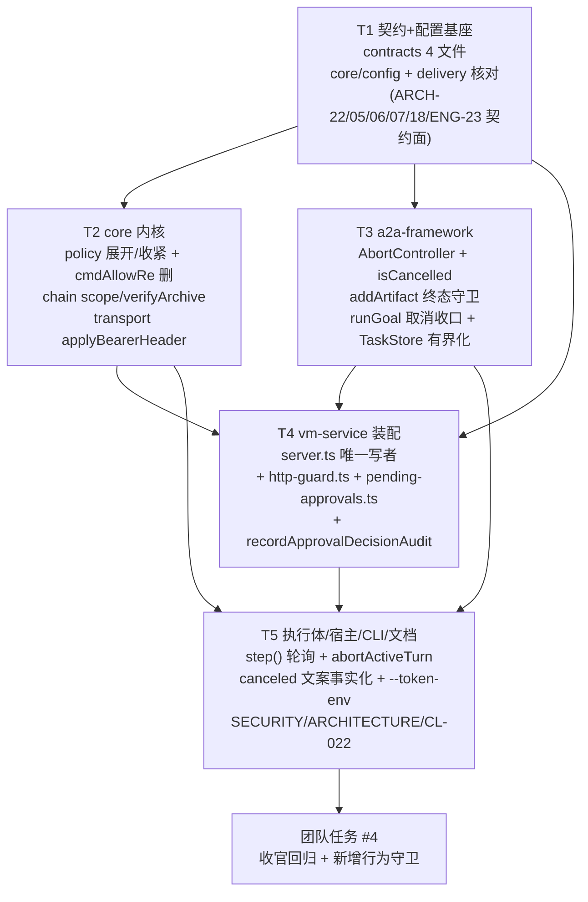

# Phase 1 · 安全边界兑现批 —— 增量架构设计与任务分解

> 作者：高见远（Architect）｜团队：software-winvm-phase1｜日期：2026-10-08
> 基线：Phase 0 已合入 `1e1d867`（`normalizePath` win32 段消解 + dry-run A1 服务端声明制 + `bypassTagSink` 注入范式）
> 需求源：`docs/audit/2026-10-08-comprehensive-assessment.md` §4 Phase 1 清单；
> 设计依据：架构审计 ARCH-05/06/07/17/18/22 + §4.4 缺口表 G1–G3 / §7.3 批次 A2、B1、B4、B5、B7；
> 实现运维审计 ENG-01/05/08/23。
> 本文只做**设计与分解**，不含实现代码与测试代码。

## 0. 范围与硬纪律

| 纪律 | 内容 |
|---|---|
| 增量性 | 全部新字段一律 **纯附加可选**（对齐 CL-018/K-N1 的「缺席即旧行为」铁律）；链上写入一律条件展开 `...(x ? { ext: x } : {})`，禁止显式 `undefined`（`chain.ts:284-289` 的假断链教训） |
| 锚点保护 | 不得改动 `engine.ts:769-778`（`if (riskAtLeast(req.risk,'L2') && !req.approved)` + `req.params['dryRun'] === true` 字面量切片）—— 它是 `tests/unit/assembly-guard.test.js` 的锚点；不得删改 Phase 0 的 `supportsDryRun` 双条件块 |
| 依赖方向 | `contracts`(L0) ← `core`(L1a) ← `a2a-framework`/`mcp-framework`(L1b/L1c) ← `vm-capabilities`/`adapters`(L2) ← `vm-service`(L3)。框架层**永不** import 审计语义（`a2a-framework/src/server.ts:54-76` 的 observer 回调范式是唯一合法补审计通道） |
| 取证面/执行面分离 | 审计写入 best-effort + catch-warn，绝不影响拦截/拒绝/取消结果（`approval-replay.ts:111-114` 纪律逐字复用） |
| server.ts 单写者 | `packages/vm-service/src/server.ts` **只允许一个任务**写（T4），其余任务在框架/契约/适配器层落地，见 §7 冲突边界表 |

---

# Part A · 系统设计

## 1. 实现方案（按问题逐项）

### 1.1 ARCH-22 —— `tasks/cancel` 外观性取消 → 协作式真取消

**病灶定位（已核验）**

| 层 | 事实 | 位置 |
|---|---|---|
| 写侧 | `requestCancel` 置 `cancelRequested=true` + `resolve(false)` 挂起审批 + `updateStatus('canceled')` | `a2a-framework/src/task-store.ts:183-195` |
| 读侧 | `cancelRequested` **全仓零读取**（仅声明 `:51` / 初始化 `:116` / 赋值 `:188`） | 同上 |
| runner | `runGoalWithLifecycle` 唯一 await 是 `this.handler.runGoal(...)`，取消无从插入 | `a2a-framework/src/server.ts:323-387` |
| 副作用 | `addArtifact` 无终态守卫 → 已取消任务继续向宿主推 artifact | `task-store.ts:165-176` |
| 证据面 | 壳条目 terminalState 只反推 `failed+rejected`，`canceled` **永不出现在链上** | `vm-service/src/server.ts:933-935` |
| 呈现面 | 宿主文案断言「已取消（canceled），审批通道已关闭，未执行任何变更」——与实际相反 | `host-a2a-bridge/src/tools.ts:415,432-433` |

**设计：三层协作式取消（AbortSignal 主干 + 边界轮询 + 终态收口）**

取消不是"抢占"，而是**在每个可安全中断的边界上让执行体主动退出**。框架不拥有执行体（provider 可替换），因此必须走「框架提供信号 → provider 消费信号」的契约化通路，与既有 `DelegationObserver` 同构。

1. **契约层新增（纯附加）** — `packages/contracts/src/bridge.ts`
   ```ts
   export interface ProgressSink {
     onStatus(state, message?): void;
     onArtifact(artifact): void;
     onApprovalRequired(req): Promise<boolean>;
     /** ARCH-22（纯附加可选）：宿主已请求取消 ⇒ true。执行体在每个能力边界轮询。 */
     isCancelled?(): boolean;
     /** ARCH-22（纯附加可选）：取消信号，供能 kill 子进程的执行体消费（LLM 常驻会话 / spawn）。 */
     cancellationSignal?: AbortSignal;
   }
   ```
   `GoalResult.error.code` 增加约定值 `'TASK_CANCELED'`（用既有 `makeError`，无需改 `BridgeError` 形状）。

2. **框架层** — `packages/a2a-framework/src/task-store.ts`
   - `InternalTask` 增 `readonly cancelController: AbortController`（`create()` 内 `new AbortController()`）；保留 `cancelRequested: boolean` 不删（读侧兼容 + 既有断言）。
   - `requestCancel()`：先 `rec.cancelRequested = true` → `rec.pendingApproval?.resolve(false)` → **`rec.cancelController.abort('canceled')`** → `updateStatus('canceled')`。顺序纪律：abort 必须在 `updateStatus` 之前，保证订阅者看到 canceled 时信号已置位。
   - 新增 `isCancelled(id): boolean`（读 `task.status.state === 'canceled' || cancelRequested`）与 `cancellationSignal(id): AbortSignal`。
   - `addArtifact()`：加终态守卫 —— `isTerminalTaskState(rec.task.status.state)` ⇒ **不落 artifact、不 emit**，返回 `false`（旧签名 `void` → 改 `boolean` 属附加：调用方不读返回值即逐字节旧行为）。这一处单独就把「已取消任务继续推 artifact」的未授权副作用关死。
   - `createProgressSink(store, taskId)`：补 `isCancelled: () => store.isCancelled(taskId)`、`cancellationSignal: store.cancellationSignal(taskId)`。
   - `TaskStoreOptions` 增 `maxTasks?: number` / `terminalTtlMs?: number`（ENG-08，见 §1.6）。

3. **框架层** — `packages/a2a-framework/src/server.ts`
   - `runGoalWithLifecycle`（`:323-387`）：把传给 handler 的 sink 换成带取消探测的版本（现有 `:340-347` 已在包装 `onStatus`，同一处扩展 `isCancelled`/`cancellationSignal`）。
   - handler 返回后（`:351-358` 之后、写 artifacts 之前）插入取消收口分支：
     `if (recNow && this.tasks.isCancelled(id))` → **不落 artifacts、不调 `updateStatus`**（canceled 已是终态，`:138-143` 本就拦住），并 `observe(() => onGoalTerminal(id, goalWithTask, { state: 'canceled', result }))` → `return`。
   - `DelegationTerminalSnapshot['state']` 联合增 `'canceled'`（`:62-69`，附加枚举成员，非 LLM/旧实现不读即无感）。
   - catch 分支（`:379-386`）：若 `this.tasks.isCancelled(id)` 则同样回调 `state:'canceled'`（provider 抛取消错时不误报 failed）。

4. **执行体消费（provider 侧，两个真实 runner 循环）**
   - 确定性 provider：`packages/adapter-agent-workbuddy/src/index.ts:395-426` 的 `step()` 是**全部步骤的唯一咽喉**（模板 1/2/3 都经它）→ 在 `step()` 入口加 `if (sink.isCancelled?.()) return <取消哨兵>`，模板层用既有 `goalFail(...)` 形状返回 `makeError('TASK_CANCELED', ...)`，`ok:false`。深度：粒度=一次能力调用，符合"协作式"。
   - LLM provider：`packages/adapter-agent-workbuddy-llm/src/bridge.ts:818-866`（`runGoalInner`/`runGoalCore` turn 边界）+ `maybeResume:1046` 的 `await coordinator.raise(req)`。
     · `raise` 已因 `requestCancel` 的 `resolve(false)` 立即返回 `{approved:false}`（`server.ts:240-252`）→ 取消时不再空等 TTL，此路**已通**，无需改；
     · 新增：每轮 `sink.onStatus` 前轮询 `isCancelled`；命中则调用常驻会话的 abort 钩子（`persistent-session.ts:649-679` 已有 `activeAbort(reason)` 机器，经 `bridge.ts` 暴露一个 `abortActiveTurn(reason)` 内部方法即可，零新结构）；单次 `-p` 路径经 `cancellationSignal` 直接 `kill` 子进程（`launchCliProcess` 已传 env，需把 signal 透传进去 —— 附加参数）。
   - **不**在本批接通 `ToolContext.signal`（ARCH-29 / ENG-17 的「HTTP 断连即中止」是另一条链路，P2，留待 Phase 2+，避免与真取消混淆）。

5. **证据面（vm-service，T4 内）** — `packages/vm-service/src/server.ts:926-979`
   `onGoalTerminal` 的 terminalState 反推扩展为三分支（`snap.state` 已可能是 `'canceled'`，优先直取；保留既有 failed+rejected 反推）：
   ```
   terminalState = snap.state === 'canceled' ? 'canceled'
                 : (snap.state === 'failed' && storedState === 'rejected') ? 'rejected'
                 : snap.state
   ```
   `buildDelegationAuditEntry`（`delegation-audit.ts`）的 `terminalState` 是 `string` 透传，无需改；但**必须**确认 `ok` 计算（`:931`）在 canceled 下为 `false`（`snap.state!=='completed'` 天然 false ✅）且 `errorCode` 落 `'TASK_CANCELED'`（`:940-947` 的兜底链会把 `EXECUTION_FAILED` 盖上来 → 需显式：canceled ⇒ errorCode=`'TASK_CANCELED'`）。

6. **呈现面（宿主桥，T5）** — `packages/host-a2a-bridge/src/tools.ts:415-442`
   `canceled` 文案「未执行任何变更」改为**事实化**两态：
   - `artifacts.length === 0 && progress 内无 executed` → 「任务已取消（canceled），取消点之前的操作未执行。」
   - 否则 → 「任务已取消（canceled）；**取消前已有 N 个操作执行、M 个产物**，请逐项核对 artifacts。」并在 `structuredContent` 增 `executedBeforeCancel: { steps: number, artifacts: number }`（附加字段）。
   同时 `a2a.task.cancel`（`:628-652`）返回体补 `cancelObserved: boolean`（= VM 侧回包的 task.status.state 是否 canceled）。

**向后兼容**：`ProgressSink` 两个新成员全部可选 ⇒ 第三方 provider 不实现即退回旧行为（外观性取消），但框架层 artifact 守卫 + 链上 canceled 终态**无条件生效**，证据面矛盾即被消除。

---

### 1.2 ARCH-05 —— 审批否定决策（rejected / timeout / canceled）入链

**病灶**：§4.4 G1/G2/G3 三条决策路径（`a2a-framework/src/server.ts:305-308`、`task-store.ts:228-244`、`:183-195`）均**无 sink**（框架零审计依赖是纪律，不改）；结论只进 `logger`。链上「谁拒的、拒哪个 approvalId、何时拒」不可证；timeout 与普通 failed 折叠。

**设计：服务端侧落链（复用 `recordPolicyDeniedAudit` 的形状与纪律），框架不动**

1. **新纯函数** — `packages/vm-service/src/approval-replay.ts`（与 `recordBlockedApprovalAudit` 同文件、同 try/catch/void 纪律）：
   ```ts
   export type ApprovalDecision = 'approved' | 'rejected' | 'timeout' | 'canceled';
   export interface ApprovalDecisionAuditInput {
     readonly traceId: string; readonly approvalId: string;
     readonly capabilityId: string; readonly risk: RiskLevel;
     readonly decision: ApprovalDecision;
     readonly actor: string;            // 'host' | 'approval-ttl' | 'cancel-request'
     readonly taskId?: string; readonly delegationId?: string;
     readonly hostApproved?: boolean;   // decision==='approved' 时为 true（批准也落一条，见下"取舍"）
     readonly ttlMs?: number;           // decision==='timeout' 时给生效 TTL
     readonly startedAtMs: number;
   }
   export async function recordApprovalDecisionAudit(audit, logger, input, newAuditId, opts?: BlockedAuditOptions): Promise<{ok:boolean; error?:string}>
   ```
   条目形态（**唯一权威定义**，工程师照此写）：
   | 字段 | 值 |
   |---|---|
   | `policyDecision` | `{ allowed:false, matchedRule:'approval-decision:'+decision }`（approved 用 `allowed:true, 'approval-decision:approved'`） |
   | `approval` | `{ approvalId: input.approvalId, approvedBy: input.actor, approvedAt: <ISO now>, previewHash:'' }` |
   | `result` | `{ ok:false, errorCode:'APPROVAL_'+decision.toUpperCase(), summary:'approval-decision:<decision>（未执行）' }` |
   | `ext` | `{ kind:'approval-decision', decision, taskId?, delegationId?, channel }`（条件展开） |
   | `principal.channel` | `opts.channel ?? 'mcp'`（与既有两函数同口径） |

2. **契约** — `packages/contracts/src/audit.ts:73` `AuditExt.kind` 联合增 `'approval-decision'`；新增可选成员 `readonly decision?: 'approved'|'rejected'|'timeout'|'canceled'`。均为附加。

3. **调用点（全部在 vm-service，即 T4）**
   | 触发 | 位置 | decision / actor |
   |---|---|---|
   | 宿主显式拒绝 / TTL 超时 | `server.ts:243-252`（`raise` 的 `!approved` 分支，reason 已能细分） | `timedOut ? 'timeout'/'approval-ttl' : 'rejected'/'host'` |
   | 挂起中被取消 | 同上分支内先判 `this.tasks.tryGet(taskId)?.task.status.state === 'canceled'` | `'canceled'/'cancel-request'`（优先级高于 rejected —— 取消导致的 resolve(false) 不是宿主拒绝） |
   | 批准并放行 | `server.ts:256`（`token.hostApproved = true` 之后） | `'approved'/'host'` |
   | TTL 回调兜底 | `server.ts:544-557`（`onApprovalTimeout`） | 不重复落（见去重） |
   | MCP 直调令牌过期 | ENG-01 清扫器（§1.6） | `'timeout'/'mcp-ttl-sweep'` |

   **判据顺序（写死在 `raise` 内）**：`canceled`（任务态）> `timeout`（`timedOutApprovals` 或 metadata）> `rejected`。

4. **去重（必须做，否则一次超时落两条链上记录）**：`VmApprovalCoordinator` 增 `private readonly decidedApprovals = new Set<string>()`（与既有 `timedOutApprovals:153` 同风格、同生命周期），`recordDecision()` 内部 `if (this.decidedApprovals.has(id)) return; this.decidedApprovals.add(id)`；`pendingApprovals.delete` / 重放完成后不清（决策一次性，天然幂等）。集合规模由 §1.6 的清扫器一并限界。

5. **"approved 也落一条"的取舍**：批准后**已有一条 executed 记录**（重放段天然落，`server.ts:720-729`）。再落 approved 决策条会与 executed 条语义重叠。**推荐：本批只落三态否定决策，`approved` 分支不落链**（保持链体积与既有 K5 取证线不动），但函数签名预留 `'approved'` 枚举以便 ARCH-09（previewHash）批次复用。此点列入 §5 待明确第 2 条请 owner 确认。

---

### 1.3 ARCH-06 A2 —— 链校验范围显式化 + 归档校验落条目

**病灶**：`vm-service/src/server.ts:378-383` 硬写 `freshChainOnStart: true`；`chain.ts:310-313` `verifyChain` 在 freshChain 模式**只读本轮 `activeShards`** ⇒ 历史分片永久退出校验面，而 `/health.audit` 只报 `chainValid`（`server.ts:1342-1348`），把"校验了什么范围"藏起来了。

**设计：三处最小透出 + 一条启动归档校验，不改 `freshChainOnStart` 行为（根治另立项）**

1. **`core/src/audit/chain.ts`**
   - `ChainVerification`（`:87-95`）附加成员：
     ```ts
     readonly scope?: 'session' | 'full';   // freshChain ⇒ 'session'，否则 'full'
     readonly shardsVerified?: number;      // 参与判定的分片数
     readonly shardsTotal?: number;         // 目录下全部分片数
     readonly shardsArchived?: number;      // = shardsTotal - shardsVerified
     ```
   - `verifyChain()`（`:311-364`）：入口处 `const all = await this.listShards()`（已存在的方法，`:176-197`，代价 = 一次 `readdir`），计算 `shardsTotal`；返回体补上述四字段。freshChain 模式 `files = this.activeShards`、`scope='session'`；否则 `files=all`、`scope='full'`。**判定逻辑一字不改。**
   - **新方法 `verifyArchive(): Promise<ArchiveVerification[]>`**：对 `all.filter(f => !activeShards.includes(f))` **逐片独立**跑一次「片内 seq 单调 + 片内 prevHash 链式」校验（注意：历史片之间与新片无链关系，故**只能片内校验**，跨片首条 prevHash 不比对，否则全红）。返回 `{ shard, entries, valid, brokenAt?, reason? }`，有界：最多处理 `maxShards`（默认 30，超出只计数不校验，防 `/health` 级长阻塞）。全程 `try/catch`，绝不抛。
2. **契约** — `contracts/src/bridge.ts`
   - `AuditSink.verifyChain()` 返回形状（`:369`）附加同四字段（`scope/shardsVerified/shardsTotal`）；
   - `HealthStatus.audit`（`:131-138`）附加同四字段（全部可选 ⇒ 旧读者零影响）；
   - `AuditExt.kind` 增 `'chain-archive-verify'` + 新可选成员 `readonly archive?: { shardsTotal:number; shardsVerified:number; broken:string[] }`。
3. **`vm-service/src/server.ts`（T4）**
   - `buildHealth`（`:1274` 取 chain、`:1343-1348` 落 audit）：把新四字段透传进 `audit` 块。**这是本批把 P0 转成"可见事实"的关键一行。**
   - 启动归档校验：`createService` 内 provider 就绪之后（`:489-491` warmup 附近同风格）`void` fire-and-forget 调 `audit.verifyArchive()`，结果经 `audit.append` 落一条 `ext.kind:'chain-archive-verify'` 条目（`capabilityId:'meta.audit.chain'`、`risk:'L0'`、`policyDecision:{allowed:true, matchedRule:'internal:chain-archive-verify'}`、`result.ok = 无断裂`）。落链目标用**原始 `audit`**（不经 `wrapAuditSink`），与 `delegation.start/complete` 的"壳条目不得自成活动证据"同一纪律（`server.ts:904-907`）。异常只 `logger.warn`。
4. **文档同步（T5）**：`SECURITY-GOVERNANCE.md` §4.3 / `ARCHITECTURE.md:292,340` 把「任一改动即校验失败」限定为「**本轮运行期内**（`/health.audit.scope='session'`），跨轮历史由启动归档校验条目提供证据」；并把 D30 权衡显式登记（体检 U-P0-2 点名"权衡未登记于 SECURITY 文档"）。

---

### 1.4 ARCH-07 / ENG-05 / ENG-23 —— 服务端鉴权与信任边界兑现

**病灶（已核验）**：`core/src/transport/http-channel.ts` 全文 183 行**无任何 Authorization 语义**（只在 `headers` 里透传客户端给的 header）；服务端 `server.ts:1065` `createServer` 之后到路由分发（`:1077-1212`）**零凭据消费**；`cfg.security.tokenEnv` 全仓唯一读取点仍是 `validateServiceConfig` 的回环检查文案（`config/index.ts:205-216`），**值本身从未被读出来用**；`requireLoopbackBind` 是可关配置项；客户端 `ssh-tunnel` 分支（`transport/index.ts:45-70`）不消费 `tokenEnv`，`host-a2a-bridge/src/cli.ts:96-104` 默认不带 token。

**两条既有合法通路（决定了方案取舍，必须写进设计前提）**
| 通路 | 是否带 bearer | 位置 |
|---|---|---|
| 宿主 → VM `/a2a`（SSH 隧道回环） | ❌ 默认不带（`--token-env` 未给 ⇒ `tokenEnv:''` ⇒ 无 `tokenEnv` 键 ⇒ `establishTransport` 不发 header） | `cli.ts:96-104` + `transport/index.ts:72-94` |
| VM 内 codebuddy CLI → 本服务 `/mcp?dtid=`（回连） | ❌ 不带 —— `buildMcpConfig` 生成的 mcpServers 条目只有 url | `adapter-agent-workbuddy-llm/src/bridge.ts:159-175` |

⇒ **任何"tokenEnv 一旦配置就无条件强制校验"的实现，都会当场打断委派执行主链路（回连 401）与宿主直连**。这是 B 路存在的事实依据，也是纯 A 路的真实代价。

**推荐方案（见 §2 裁断）：B 为硬基线 + A 为"配置即生效"的条件加固 + ENG-23 补齐客户端凭据通路**

1. **`core/src/config/index.ts`（T1）**
   - `SecurityConfig`（`:65-70`）附加成员：`readonly enforceBearer?: boolean`（**默认 false**；true 时要求所有非豁免端点带正确 bearer）。文档注释写清「false = 信任边界由回环+SSH隧道承担，SECURITY §2 已声明」。
   - `requireLoopbackBind` **不可关**的实现方式（择一，推荐 ①）：
     ① 保留字段但在 `validateServiceConfig`（`:201-231`）把「非回环」从 `errors` 升级为**恒定 error**：`!isLoopback(host) ⇒ errors.push(...)`（不再看 `requireLoopbackBind` 值），并把 `requireLoopbackBind:false` 变成 warnings（"该开关已无效，V1 服务端只允许回环绑定"）。改动面 4 行、语义单调（更严），旧配置仍可解析、不会启动失败（除非真的在非回环上跑，那正是我们要拦的）。
     ② 把字段从 `SecurityConfig` 删除 —— 会打断 `delivery/vm-service.config.json:59` 与文档，破坏性更大。**不推荐**。
   - `resolveServiceConfig` 增一步：`security.tokenEnv` 存在但 `process.env[tokenEnv]` 为空 ⇒ warning（"配置了 tokenEnv 但环境无值 ⇒ 鉴权不会生效"），避免"以为开了"。
2. **服务端守卫（`vm-service/src/server.ts`，T4，占路由区 `:1065-1077` 之前）**
   新增纯函数到既有兄弟模块 `vm-service/src/health-probe.ts`？不 —— **新建** `packages/vm-service/src/http-guard.ts`（导出 `createBearerGuard(opts): (req)=>{verdict, reason}` 纯函数，可脱离 ps-bridge 单测，与 `approval-replay.ts` 的"纯逻辑件单独成模块"纪律一致）：
   - 生效条件：`cfg.security.enforceBearer === true && process.env[cfg.security.tokenEnv] 非空`；
   - 校验：`authorization` header 严格 `Bearer <token>` + **常时比较**（`crypto.timingSafeEqual`，长度不等先拒）；
   - 豁免清单（`GET`）：`/health`、`/.well-known/agent-card.json` —— 文档化；`/admin/llm-session/reset` **不豁免**（它有能力效果）；
   - 失败响应：`401 { error:'unauthorized', code:'AUTH_REQUIRED' }`；
   - **不新增审计**（HTTP 层不入链是既有设计口径，ARCH-23 单列 P2），只 `logger.warn`（含 remoteAddress，便于探测可见）。
3. **`/health` 透出信任边界事实（T4）** —— `HealthStatus` 附加 `security?: { loopbackOnly:boolean; boundLoopback:boolean; authMode:'loopback-only'|'bearer-enforced'|'bearer-configured-missing'; endpointAllowlist?: never }`，让"信任模型是什么"成为机器可读事实（与 ARCH-06 的 scope 透出同一手法）。
4. **ENG-23 客户端通路（T5）**
   - `core/src/transport/index.ts:45-70` `ssh-tunnel` 分支：接受 `decl.tokenEnv`？`SshTunnelTransport` 契约无该字段 ⇒ 在 `contracts/src/transport.ts:11-29` 给 `SshTunnelTransport` 增可选 `tokenEnv`，`transport/index.ts` 的 ssh-tunnel 分支按 streamable-http 同款逻辑拼 header（复用一个小工具 `applyBearerHeader(headers, tokenEnv)` 抽出 `:72-81` 现有代码，避免两份实现漂移）。`tokenEnv` 已配但 env 无值 ⇒ 维持现有抛错语义（fail-loud，与 `:74-78` 一致）。
   - `host-a2a-bridge/src/cli.ts:96-104` `buildTransport`：`args.tokenEnv` 非空 ⇒ 现在同时给 `streamable-http`（已支持）与（若 endpoint 是隧道场景）透传；补 `--token-env` 生效路径的 usage 文案（`:43`）+ README/INSTALL-GUIDE。
   - **VM 内回连**（`bridge.ts:159-175 buildMcpConfig`）：生成条目时把 `security.tokenEnv` 的名字写进 mcpServers 的 env/url 参数（仅当服务端 enforceBearer=true 才需要）⇒ 列入 §5 待明确第 3 条（需要确认回连侧使用哪个 token 分发机制，属部署契约）。

**向后兼容**：`enforceBearer` 默认 false ⇒ 现网行为逐字不变（但 `requireLoopbackBind` 的"不可关"是**刻意的破坏性收紧**，需在 changed-log 明写）。ENG-23 的 tokenEnv 全为可选 ⇒ 未配置的部署零变化。

---

### 1.5 ARCH-17 —— 默认路径白名单收紧到 VM 用户目录

**病灶**：`core/src/policy/defaults.ts:54-60` 写 `C:\Users\**`（全体账户），而 SECURITY §3.2 承诺 `C:\Users\<vmuser>\**`。`storage.file.read` 是 **L0 免审批**（`definitions.ts:284`）⇒ 跨账户 Profile/桌面/下载在策略层直接放行。

**设计（关键：不要在默认值里硬拼用户名，要走既有 env 展开通路）**

1. `defaults.ts:54-60` 改为
   ```ts
   pathAllowlist: [
     '%USERPROFILE%\\**',        // ← 唯一权威：VM 当前用户目录（运行时展开）
     'C:\\Users\\Public\\**',    // 共享落点，显式保留（SECURITY §3.2 文档里就有它）
     'C:\\Temp\\**', 'C:\\tmp\\**', 'D:\\Data\\**',
     'C:\\WinVMWorkspace\\**',   // 生产工作目录，注释已说明必须全域放行
   ]
   ```
2. **`core/src/policy/engine.ts` 模式侧新增展开**（这是本项的真正技术核心）。**模式侧编译点共 4 处，必须全部走同一通路**（已逐处核验）：

   | 行 | 编译点 | 现写法 | 改为 |
   |---|---|---|---|
   | `:536` | 全局 `pathDenylist` | `globToRegex(normalizePath(p))` | `globToRegex(expandPolicyPathPattern(p))` |
   | `:537` | 全局 `pathAllowlist` | 同上 | 同上 |
   | `:594-595` | 能力级 `pathDenylist` | 同上 | 同上 |
   | `:638-639` | 能力级 `pathAllowlist` | 同上 | 同上 |

   `expandPolicyPathPattern = (p) => normalizePath(expandEnvPath(p))`（**先展开后归一**，与 `:533-535` 注释的「模式侧与入参侧同一条归一通路」纪律一致；deny 侧同批加上，否则运维写 `%USERPROFILE%` 到黑名单会静默失效 —— 那是新的漏，不是修漏）。
   - `expandEnvPath` 在 `core/src/config/index.ts:140-142`，**同包 L1a 内可引用**，但 `engine.ts` 从 `../config/index.js` import 会形成 policy→config 的包内边（无循环：config 只 import `policy/defaults` 的**类型**）。为避免"配置层与策略层互相牵"，更干净的做法是把 `expandEnvPath` 下沉到 `core/src/constants.ts`（L1a 叶，`config/index.ts` 与 `policy/engine.ts` 都从它引）并在 `core/src/index.ts` 保持既有导出名不变（再导出）。**T2 落实，列入文件表。**
   - 入参侧（`:599`/`:645` 的 `normalizePath(candidate)`）本就展开过吗？**没有** —— `collectStringValues` 的值是调用方给的裸路径（已是真实 `C:\Users\...`，不含占位符），故无需改；但**能力级** `CapabilityPolicy.pathAllowlist`（`:638-640`）**也走同一条 `globToRegex(normalizePath(p))`**，`appops.cli.invoke` 的 `%USERPROFILE%\WinVMWorkspace\out`（`definitions.ts:~371`）此前**恒不匹配**（占位符未展开）→ 模式侧展开一并把这个潜伏缺陷修掉。**这是 ARCH-17 修复的附带收益，必须写进交付说明**（否则收紧后 `appops.cli.invoke` 的行为会因这条恒-miss 而意外收紧）。
3. **风险与回归点**：收紧后所有 `C:\Users\<其他用户>\**` 读写在策略层变 DENY（`matchedRule:'pathAllowlist:miss'`）；`%USERPROFILE%` 在 VM 上 = `C:\Users\winvmuser`，与 `outputDir: %USERPROFILE%\WinVMWorkspace\out`（`config/index.ts:107`、`delivery/vm-service.config.json:28`）一致 ⇒ 生产工作流不破。测试面：`tests` 内凡以 `C:\Users\` 开头断言 ALLOW 的用例需复核（Phase 0 的穿越用例用的是 `C:\Users\a\..\..\Windows\System32\x.dll` → 仍 DENY，方向不变）。
4. **文档同步**：SECURITY §3.2 条目从"待对齐"改为与代码逐字一致，并加一句"跨账户路径访问在策略层恒 DENY，需运维显式配置追加"（`mergePolicy` 数组并集语义 `defaults.ts:130-131` 保证只能加不能减 ⇒ 收紧默认值即永久生效）。

---

### 1.6 ENG-01 / ENG-08 —— 长跑资源有界化（审批令牌表 / TaskStore）

1. **ENG-01 `pendingApprovals` TTL 清扫**
   - **新文件** `packages/vm-service/src/pending-approvals.ts`：`PendingApprovalRegistry`（内部 `Map<string, PendingApproval>` + `ttlMs` + 懒清扫）
     API：`set/get/delete/size/values()`（保持与现 Map 调用点同签名，`server.ts` 三处 `pendingApprovals.get/set/delete`（`:227/:549/:757`…）与 `collectApprovalFacts(pendingApprovals, …)`（`:449`，形参是 `ReadonlyMap`）⇒ Registry 必须 `implements ReadonlyMap<string, PendingApproval>` 的窄子集（提供 `entries()`/`forEach`），避免改 `approval-replay.ts` 的入参形状）。
     新增 `sweepExpired(nowMs): PendingApproval[]` —— 返回被逐出的条目供调用方落 `timeout` 决策审计（接 §1.2 表末行），`expired = createdAtMs + ttlMs < now`（**不**扫 `hostApproved===true` 的在途重放条目 —— 重放是有界的 await，误删会打断真实执行）。
     定时器：`startTimer(intervalMs = max(60_000, ttl/4))` + `unref()`；`close()` 停表，接 `server.ts:1386-1394` 的 `close()`。
   - TTL 取值：**复用 env `WINVM_APPROVAL_TTL_MS`**（`resolveApprovalTtlMs()`，`task-store.ts:92-97` 已用它）⇒ MCP 与 A2A 两通道同一旋钮、同一语义（30min）。**不**用 `policy.approvalTimeoutMs`（默认 120s，语义与"人工审批等待"冲突且过短）—— 该字段仍是死字段，处置见 §2 裁断 ARCH-18 附注与 §5 待明确第 1 条。
2. **ENG-08 TaskStore 上限**
   - `TaskStoreOptions` 增 `maxTasks?: number`（默认 200；`0`/非有限 ⇒ 不设限，保住既有单测与 fixture）、`terminalTtlMs?: number`（默认 1h）。
   - `InternalTask` 增 `terminalAtMs?: number`（`updateStatus` 进入终态时盖上，`:145-156` 内一行）。
   - `evictIfNeeded()`：在 `create()` 尾部调用（**只在 create 时**，避免 list/get 路径的意外语义变化）—— 驱逐候选 = **终态 && 无 pendingApproval && !cancelRequested-pending** 的 `terminalAtMs` 最旧者；超出 `maxTasks` 则删至 `maxTasks`；`terminalTtlMs` 过期的终态任务一并删。删除时 `subscribers.clear()`（防 SSE 闭包泄漏）。
   - `size()` 语义不变；`/health` 附加透出 `tasks: { live, maxTasks }`？—— 列为可选（T5 文档项，不阻塞）。
   - 注意：`LedgerRegistry`(maxLive 有界) / `ReceiptCache`(200 有界) 已合规，不动。

---

### 1.7 ARCH-18 —— `cmdAllowRe` 死字段（推荐：删除，见 §2.1）

推荐 **删除全局 + 能力级 `commandAllowlist` 字段**，并把 `appops.workflow.run` 的解释器约束改建为**登记时静态校验**（不进运行时字符串正则）。删除动作落在：
| 文件 | 动作 |
|---|---|
| `contracts/src/capability.ts:26-27` | 删 `CapabilityPolicy.commandAllowlist` |
| `core/src/policy/defaults.ts:17-18, 83-84, 137` | 删 `PolicyConfig.commandAllowlist` / 默认值 / merge 行 |
| `core/src/policy/engine.ts:526, 539` | 删 `cmdAllowRe` 声明与编译 |
| `packages/vm-capabilities/src/registry/definitions.ts`（`appops.workflow.run` 的 `policy.commandAllowlist`） | 删该键；解释器集合改为 `appops.cli.invoke` 已有的 `input.app` enum（`definitions.ts:~362`）+ 新增 `workflowInterpreters` 常量供注册表校验 |
| `contracts/schemas/capability.schema.json:50` | 删 `commandAllowlist` 属性 |
| `docs/02-design/CAPABILITY-MODEL.md:201`、SECURITY §3.2 | 口径改为「命令面只有黑名单；解释器准入由注册表枚举 + 登记校验把守」 |

理由与利弊见 §2.1。

## 2. 两个待裁断问题：明确推荐

### 2.1 ARCH-18 `cmdAllowRe`：实现 vs 删除 → **推荐删除（B）**

| | (A) 实现白名单消费 | (B) 删除死字段 + 文档承认黑名单 |
|---|---|---|
| 安全增益 | 表面增益大，**实际增益不确定**：判据只能落在"命令式字符串"上，而引擎的命令式识别是启发式（`COMMAND_KEY_RE:108` = `command\|cmd\|script\|expression\|powershell\|shell\|exec\|args\|arguments`；`looksLikeCommandValue:793-800` = 以 `$`/`>` 开头、含 `-x` 开关、含 `get/set/install…` 动词）⇒ **同一张网既漏又误** | 零增益，但**消除虚假安全感**（D-3 明写"看起来有防护"是最危险的一类） |
| 误杀风险 | **高**。白名单一旦非空即"未命中→硬 DENY"，而命中面覆盖 `arguments`/`script`/`goal` 等所有 commandish 串：`appops.cli.invoke` 的 `arguments`（ffmpeg 任意参数）、`appops.workflow.run` 的 `goal`/脚本正文、`storage` 里带 `-` 的文件名都可能被判命令式 → 生产三域（巡检/卸载/生产）现有可跑流程面临随机 DENY | 无 |
| 口径完备性 | 需先定义"命令类参数口径"（哪些键算命令、是否只看首 token、脚本体怎么处理）—— 这是**新语义设计**，不是一行 `if`；且 `appops.workflow.run` 的限制对象（9 个解释器）本质上约束的是"脚本里调什么"，运行时字符串匹配**根本管不到**（脚本内容由 LLM/用户预置） | 不需要 |
| 与真机验收的关系 | 必须配一轮真机（误杀只能在真机暴露），Phase 1 真机窗口只有一轮 | 不需要 |
| 与 Phase 2 门禁的协同 | 若实现，则 Phase 2 的"死字段 lint"要新增"字段消费点白名单"复杂度 | 与 Phase 2 的契约字段消费计数 lint 天然一致（删了就不再是欠账） |
| 解释器约束的真实落地 | —— | `appops.cli.invoke` **已有** `input.app` 枚举（provider `validateParams` 拒未知键/非法 enum，`adapter-agent-workbuddy/src/index.ts:265,751-800` 已核验）⇒ 枚举就是可执行的白名单；`workflow.run` 的脚本落盘前由注册表/部署期校验首行解释器（新增一条 registry 校验，属 Phase 2/3 小项） |

**结论**：**(B) 删除**。理由三条：① 它今天的"未生效"是**沉默的**，实现它带来的增益要靠新语义设计才能兑现，而风险（误杀合法生产流程）由用户承担；② 解释器约束在 `appops.cli.invoke` 上**已有更强的机制**（JSON Schema enum + validateParams 早于执行），运行时正则反而是降级；③ Phase 1 的真机窗口应留给 ARCH-22/07/17 这三项会改变执行行为/部署配置的修复。
**若 owner 选 (A)**，最小可实现口径（我已备好）：只对 `COMMAND_KEY_RE.test(key)` 为真的键生效、`cmdAllowRe` 非空才启用、判定放在 `cmdDenyRe` 之后（`:634` 与 `:636` 之间）、`appops.workflow.run` 的默认能力级白名单需同步落 `defaults.ts`（否则 union 语义下运维无法覆盖）。

### 2.2 ARCH-07 服务端鉴权：A（bearer 校验）vs B（回环不可关 + 信任边界文档化）→ **推荐 B 为基线 + A 做成"配置即生效"的可选加固 + 必做 ENG-23**

| | (A) 消费 tokenEnv 做强制 bearer | (B) `requireLoopbackBind` 不可关 + SECURITY §2 明写信任边界 |
|---|---|---|
| 与部署事实的匹配 | ❌ 冲突。两条既有合法通路都不带 token：宿主 `a2a-bridge` 默认 `tokenEnv:''`（`cli.ts:61,96-104`）；VM 内 codebuddy 回连 `/mcp?dtid=` 的 mcpServers 条目不含凭据（`bridge.ts:159-175`）⇒ **强制校验会当场打断委派主链路（401）**，需要配套改部署脚本发 token + 回连配置注入，跨 4 个包 + 部署链，本批做不完 | ✅ 匹配。现状即"SSH 隧道 + 仅回环 + 审批闸"（ARCHITECTURE:336 风险表已如此描述缓解），B 只是把这个**部署事实升格为代码不变量**（不可关）+ 文档事实（明写信任边界） |
| 承诺诚实度 | ✅ 兑现文档原文"强制 TLS + bearer + Origin" | ⚠️ 需要**修改文档承诺**（把"服务端 bearer"改为"信任边界=回环+隧道，服务端不承担鉴权"）。诚实化本身就是修复 |
| 攻击面收敛 | 强（VM 内任意本地进程不能再裸调 L2/L3）—— 这正是 ENG-05 的痛点 | 中（VM 内本地进程仍在信任域内；但 `requireLoopbackBind` 不可关消除了"配置漂移导致裸 HTTP 对外可达"这一更大风险） |
| 改动量/风险 | 大：需 token 生成/分发/轮换 + 宿主/回连两侧客户端 + 部署脚本 + 真机回归 | 小：`validateServiceConfig` 4 行 + 文档 |
| 可演进性 | —— | ✅ 好：B 落地后 A 是**纯配置动作**（前提是 ENG-23 把客户端通路补齐） |

**推荐组合（本批实现口径）**：
1. **B 的两项硬约束**：非回环 ⇒ 启动 `error`（`requireLoopbackBind` 不再能放宽）；SECURITY §2 明写"回环 + SSH 隧道即信任边界，服务端不承担身份鉴权"，并把 `freshChainOnStart`/审计保留期两个既有未登记权衡一并补齐在这一节（体检 §2 点名"权衡未登记"）。
2. **A 的可选形态**：`security.enforceBearer`（默认 false）+ 存在 tokenEnv 值才生效的守卫 + `/health.security.authMode` 透出。**承诺由"无条件强制"改为"条件可验证"**，文档如实描述 → 既不撒谎，又给出升级路径。
3. **ENG-23 必做**：客户端 `ssh-tunnel`/`streamable-http` 两条分支统一支持 `tokenEnv`（抽 `applyBearerHeader` 单一实现），`cli.ts --token-env` 文案生效 —— 这样第 2 步在真上一键可用。

**不推荐纯 A**（打断两条合法通路、超出本批容量、真机风险最高）；**不推荐纯 B**（`tokenEnv` 继续是死配置，ENG-23 继续缺通路，未来仍需返工）。

## 3. 数据结构与接口（Mermaid classDiagram）

见 `docs/changes/phase1-arch-class-diagram.mermaid`。★ 标 Phase 1 新增/变更成员。

图内要点（工程师读图前须知）：

| 类/接口 | 归属包 | Phase 1 变更性质 |
|---|---|---|
| `ProgressSink` | contracts | +`isCancelled?()` +`cancellationSignal?`（附加可选） |
| `AuditExt` | contracts | +`kind:'approval-decision'` +`kind:'chain-archive-verify'` +`decision?` +`archive?` |
| `HealthStatus` | contracts | +`audit.scope/shardsVerified/shardsTotal/shardsArchived` +`security?` |
| `CapabilityPolicy` / `PolicyConfig` | contracts / core | −`commandAllowlist`（ARCH-18 删除，见 §5 第 7 条） |
| `SshTunnelTransport` | contracts | +`tokenEnv?`（ENG-23） |
| `SecurityConfig` | core/config | +`enforceBearer?`；`requireLoopbackBind` 语义转为「不可关」 |
| `ChainVerification` | core/audit | +4 个可选范围字段 |
| `HashChainAuditSink` | core/audit | +`verifyArchive()` |
| `InternalTask` / `TaskStore` | a2a-framework | +`cancelController` +`isCancelled()/cancellationSignal()` +`maxTasks/terminalTtlMs/terminalAtMs` +`evictIfNeeded()` |
| `A2AServer` | a2a-framework | `DelegationTerminalSnapshot.state` +`'canceled'`；`runGoalWithLifecycle` 取消收口 |
| `VmApprovalCoordinator` | vm-service | +`decidedApprovals:Set` +`recordDecision()`；`raise` 判据顺序 |
| `PendingApprovalRegistry` | vm-service（新文件） | `ReadonlyMap` 窄实现 + `sweepExpired()` + `startTimer()/close()` |
| `createBearerGuard` | vm-service（新文件，纯函数） | `(req) => {verdict, reason}` |

## 4. 程序调用流程（Mermaid sequenceDiagram）

见 `docs/changes/phase1-arch-sequence-diagram.mermaid`，含四条主链：
**S1 真取消端到端**（宿主 `tasks/cancel` → `requestCancel` → provider 边界退出 → 框架取消收口 → 链上 canceled → 宿主事实化文案）、
**S2 审批否定决策落链**（`raise` 三分支判据 → 去重 → `recordApprovalDecisionAudit` → 原始 sink；含 MCP TTL 清扫兜底路径）、
**S3 服务端信任边界**（`validateServiceConfig` 启动期硬拦非回环 → 运行期 bearer 守卫短路 → `/health.security.authMode` + 归档校验落条目 → 客户端 `establishTransport` 带凭据）、
**S4 资源有界化**（TaskStore `create()` 尾部驱逐 + Registry TTL 清扫，说明"长跑不涨"的机制落点）。

下表是流程中**必须逐字遵守的顺序纪律**（图的注释版，工程师按此实现）：

| 编号 | 纪律 | 出处（设计） |
|---|---|---|
| O-1 | `requestCancel` 内 `abort()` **必须先于** `updateStatus('canceled')` | §1.1-2 |
| O-2 | `runGoalWithLifecycle` 的取消收口分支 **不落 artifacts、不调 updateStatus**，只 `observe` | §1.1-3 |
| O-3 | 证据面 `terminalState` 三分支：`canceled` 优先直取；`errorCode` canceled ⇒ `'TASK_CANCELED'`（不得被 `EXECUTION_FAILED` 兜底覆盖） | §1.1-5 |
| O-4 | 决策判据顺序 **canceled > timeout > rejected**（取消导致的 `resolve(false)` 不是宿主拒绝） | §1.2-3 |
| O-5 | 决策审计 best-effort：`try/catch` + `logger.warn`，**任何情况下不回改拒绝/取消结果** | §0 / §1.2 |
| O-6 | 去重 `decidedApprovals` 只在 `recordDecision` 内判存即返回；重放完成后不清（决策一次性幂等） | §1.2-4 |
| O-7 | 壳/内部条目写链用**原始 `audit`**，不经 `wrapAuditSink`（防审计自证） | §1.3-3 |
| O-8 | `verifyArchive` 只校验**片内**链（跨片首条 prevHash 不比对）；有界 `maxShards`；`void` 异步不阻塞启动 | §1.3-1 |
| O-9 | 守卫生效条件为「`enforceBearer===true` **且** `process.env[tokenEnv]` 非空」双条件（与 dry-run bypass 双条件同构，防"以为开了"） | §1.4-2 |
| O-10 | `sweepExpired` **跳过** `hostApproved===true` 的在途重放条目 | §1.6-1 |
| O-11 | TaskStore 驱逐**只在 `create()` 尾部**触发，且只驱逐终态 + 无挂起审批者 | §1.6-2 |

## 5. 待明确事项（实施期需 owner 拍板）

| # | 事项 | 我的默认取值（未获指示即按此实现） | 若不同选的影响面 |
|---|---|---|---|
| 1 | `policy.approvalTimeoutMs`（默认 120s，死字段）本批如何处置 | **不动、只登记**为 Phase 2 死字段清扫项（避免与 ARCH-18 删除混在一张 diff 里） | 若要接成 MCP 令牌 TTL：120s 远短于人工审批等待 ⇒ 会在真人反应之前批量落 `timeout` 决策条，强烈不建议 |
| 2 | `approved` 决策是否也落一条链上记录 | **不落**（重放段已有 executed 条目，避免语义重叠与链膨胀）；函数签名预留 `'approved'` 枚举 | 若要落：`result.ok:true` 与既有 executed 条形成双写，需在 ARCHITECTURE §审计条目类型表补口径 |
| 3 | `enforceBearer=true` 时 VM 内**回连**（`buildMcpConfig` 生成的 `/mcp?dtid=` mcpServers 条目）如何拿到 token | 本批**不实现**（默认 false ⇒ 通路不启用）；文档明写「开 enforceBearer 前必须先把回连凭据通路补齐，否则委派执行必 401」 | 若要本批做：需定 env 名（建议复用同一 `tokenEnv`）+ mcpServers 条目 `headers`/`env` 注入 + 部署脚本发 token ⇒ 跨 T4/T5 + delivery 链，需追加真机窗口 |
| 4 | 真机验收窗口是否覆盖本批全部行为变更 | 建议**必须**覆盖 6 项：①跨账户路径 DENY ②`%USERPROFILE%` 生产输出目录仍可写 ③`tasks/cancel` 后无新 artifact 且链上有 canceled ④审批拒绝/超时链上可查 ⑤`/health.audit.scope='session'` 与归档校验条目存在 ⑥非回环绑定启动失败 | 不覆盖 ⇒ ARCH-17/07 属"部署可验证但未验证"，交付说明需降级为「代码完成、待真机」 |
| 5 | `/health` 是否透出 `tasks:{live,maxTasks}` | 透出（附加可选字段） | 不透出 ⇒ ENG-08 的有界性不可观测，回归清单第 ⑦ 项取消 |
| 6 | 归档校验 `maxShards` 默认 30 是否 env 可调 | 先写死常量 + 注释；Phase 2 若分片规模上来再开 env | — |
| 7 | ARCH-18 的 `commandAllowlist` **删除**属契约破坏性变更，是否需要"读取但忽略"的过渡期 | **直接删**（全仓唯一写入点是 `appops.workflow.run` 的能力声明，同批删除 ⇒ 无残留消费方；schema/文档同批改） | 若要过渡期：T1 保留字段 + 标注 `@deprecated`，T2 保留编译但不读取 ⇒ 死字段延续一个版本，与 Phase 2 门禁冲突 |

---

# Part B · 任务分解

## 6. 所需第三方包

**无新增运行时依赖、无新增 devDependencies。** 本批全部能力落在 Node 内建与既有依赖上：

| 需要的能力 | 用什么 | 备注 |
|---|---|---|
| 常时比较 bearer token | `node:crypto.timingSafeEqual` | 需先比长度（长度不等直接拒），否则抛 |
| 链式校验 / canonicalJson / 分片枚举 | 既有 `core/src/audit/chain.ts` + `node:fs/promises` + `node:crypto` | 无外部库 |
| 路径/env 展开 | 既有 `expandEnvPath`（下沉 `core/src/constants.ts`） + `normalizePath` | Phase 0 已就位 |
| AbortController / AbortSignal | Node ≥ 18 内建 | 框架层已在用 `setTimeout` 家族 |
| 测试 | 既有 node:test 装载方式（`tests/unit/*.test.js`） | 不引新 runner |
| 构建 | 既有 tsc ESM + workspace 脚本 | 不改 `tsconfig`/`package.json` |

⇒ **`package.json` 全部不动**（这条本身就是给 owner 的风险收益：无供应链引入、无 lockfile diff）。

## 7. 严格串行任务列表

### 7.1 排序原理

ARCH-22 / 05 / 06 / 07 / 17 与 ENG-01 / 05 / 08 / 23 **共 10 个问题里有 6 个的最终落点都在 `packages/vm-service/src/server.ts`**（coordinator `raise`、`pendingApprovals`、`TaskStore` 构造、observer 终态反推、`buildHealth`、HTTP 路由、`close()`）。该文件 1484 行、单 `createService` 闭包内装配，两人/两任务同时改必然产生语义冲突（不只是文本冲突）。因此：

- **`server.ts` 唯一写者 = T4**（其余任务一律不得触碰）；
- 顺序按**依赖层次**排：契约(L0) → core(L1a) → framework(L1b) → 装配(L3) → 适配器/宿主/文档(L2+面)；
- 上游任务的产出**必须编译级自洽**才能交给下游：T1 交付后 T2/T3/T4/T5 才有所属新字段的类型可引用；T3 交付后 T4 的 observer 才能收到 `'canceled'`；T4 交付后 T5 才有 sink 形状与 guard 行为可对接与写入文档。

### 7.2 `server.ts` 区域占用表（冲突边界）

| 区域（行区间为基线 `1e1d867` 读数） | 内容 | 本批动作 | 归属 | 其它任务禁令 |
|---|---|---|---|---|
| `:141-284` | `VmApprovalCoordinator`（`raise:204-283`、`timedOutApprovals:153`、token 删除 `:280-281`） | ARCH-05：+`decidedApprovals`、+`recordDecision()`、判据顺序、canceled 优先；绑定 `tasks.tryGet` 读任务态 | **T4** | T1/T2/T3 不得改；T5 不得改 |
| `:378-383` | `HashChainAuditSink` 创建（`freshChainOnStart:true`） | 不动值；仅在其后追加启动 `verifyArchive` 调用点（属 `:489-491` 区） | **T4** | 禁止任何人"顺手"改 freshChain（P0 根治另立项） |
| `:399-401` | `bypassTagSink(wrapAuditSink(...))` 装配 | 不动（范式参照） | **T4** | 只读参照 |
| `:489-491` | provider warmup 附近 | +启动归档校验 fire-and-forget | **T4** | — |
| `:535` | `pendingApprovals = new Map()` | 替换为 `new PendingApprovalRegistry(...)` | **T4** | — |
| `:544-558` | `TaskStore` 构造 + `onApprovalTimeout` | +`maxTasks`/`terminalTtlMs`（来自 `service.limits` 或 env）；timeout 回调接 `recordDecision` 去重 | **T4** | 选项定义在 T3，构造点在 T4 |
| `:589-690` | `executeCapability` 策略段（`recordPolicyDeniedAudit:611`、`receiptCache:672`） | 不动（Phase 0 已闭合；ARCH-17 改的是 defaults/engine，非此处） | — | 任何任务不得改；ARCH-18 删除若波及须回 T2 单点 |
| `:696-730` | 重放段（`replay`） | 仅 +`approved` 分支的预留注释（默认不落链） | **T4** | — |
| `:752-882` | MCP 审批块（`recordBlockedApprovalAudit:796-822`） | 不动语义；令牌 `set` 走 Registry（同签名） | **T4** | — |
| `:908-980` | `delegationObserver`（`terminalState:933-935`、`errorCode:940-947`） | ARCH-22 证据面三分支 + `TASK_CANCELED` | **T4** | 依赖 T3 的 `'canceled'` 枚举 |
| `:1065-1218` | HTTP 路由（零鉴权） | 入口前挂 `createBearerGuard`（守卫实现在新文件 `http-guard.ts`） | **T4** | T2 只提供客户端侧 header，不碰路由 |
| `:1261-1359` | `buildHealth`（`audit:1342-1348`、`providerApprovalTruth:1338`） | ARCH-06 audit 四字段透出 + ARCH-07 `security` 块 +（可选）`tasks` 块 | **T4** | — |
| `:1386-1394` | `close()` 生命周期 | +`registry.close()`、+`tasks.close?()`（驱逐定时器为 unref，可不显式停） | **T4** | — |
| `:1400-1481` | `buildPreview` / `hasDryRunParam` / `collectImpact` | **不动**（dry-run 锚点相关） | — | 全员只读 |

### 7.3 任务卡

| ID | 名称 | 覆盖问题 | 涉及文件 | 依赖 | 优先级 | 预估规模 |
|---|---|---|---|---|---|---|
| **T1** | 契约与配置基座（纯附加字段 + 一处破坏性删除） | ARCH-22(契约)、ARCH-05(契约)、ARCH-06(契约)、ARCH-07(`enforceBearer`)、ENG-23(契约)、ARCH-18(契约/schema) | `packages/contracts/src/bridge.ts`（`ProgressSink:315-320`、`AuditSink.verifyChain:366-370`、`HealthStatus.audit:131-138`、`BridgeErrorCode` 约定串）<br>`packages/contracts/src/audit.ts`（`AuditExt.kind:73` + `decision?`/`archive?`）<br>`packages/contracts/src/capability.ts`（−`commandAllowlist:26-27`）<br>`packages/contracts/src/transport.ts`（`SshTunnelTransport:11-29` +`tokenEnv?`）<br>`packages/contracts/schemas/capability.schema.json`（−`commandAllowlist:50`）<br>`packages/core/src/config/index.ts`（`SecurityConfig:65-70` +`enforceBearer?`；`validateServiceConfig:201-231` 非回环恒 error；`requireLoopbackBind:false` 转 warning；tokenEnv 有名无值 ⇒ warning）<br>`delivery/vm-service.config.json`（注释性核对 `:58-61`，不改值） | 无 | **P0** | 7 文件 / ~120 行增、~15 行删 |
| **T2** | core 执行内核：策略展开 + 链范围 + 客户端凭据 | ARCH-17、ARCH-06(链侧)、ARCH-18(引擎侧)、ENG-23(transport 侧) | `packages/core/src/constants.ts`（接收 `expandEnvPath` 下沉）<br>`packages/core/src/config/index.ts`（改为再导出，**仅** import 调整 —— 与 T1 同文件不同区块：T1 只动 `SecurityConfig`/`validateServiceConfig`，T2 只动 `:140-142` 迁出；串行执行故不冲突）<br>`packages/core/src/policy/engine.ts`（−`cmdAllowRe:526`/`539`；`globToRegex(expandPolicyPathPattern(p))` **四处** `:536`/`:537`/`:594-595`/`:638-639`）<br>`packages/core/src/policy/defaults.ts`（`pathAllowlist:54-60` 收紧；−`commandAllowlist:17-18/83-84/137`）<br>`packages/core/src/audit/chain.ts`（`ChainVerification:87-95` +4 字段；`verifyChain:310-364` 填 scope/shards*；+`verifyArchive()`）<br>`packages/core/src/transport/index.ts`（抽 `applyBearerHeader`；ssh-tunnel 分支 `:45-70` 消费 `tokenEnv`）<br>`packages/core/src/index.ts`（再导出核对：`expandEnvPath`、`ArchiveVerification`） | T1 | **P0** | 7 文件 / ~200 行 |
| **T3** | a2a-framework 取消与有界化（框架不涉审计） | ARCH-22(框架侧)、ENG-08 | `packages/a2a-framework/src/task-store.ts`（`InternalTask.cancelController:51/116`、`requestCancel:183-195` O-1 顺序、`isCancelled()/cancellationSignal()`、`addArtifact:165-176` 终态守卫返 boolean、`waitApproval:211-262` 不动、`updateStatus:139-156` +`terminalAtMs`、`create():` 尾 +`evictIfNeeded()`、`TaskStoreOptions` +`maxTasks/terminalTtlMs`、`createProgressSink:437-456` +两成员）<br>`packages/a2a-framework/src/server.ts`（`DelegationTerminalSnapshot.state:62-69` +`'canceled'`；`runGoalWithLifecycle:323-387` sink 包装扩展 + 取消收口分支 + catch 分支；`cancelTask:427-434` 不动）<br>`packages/a2a-framework/src/index.ts`（导出核对） | T1 | **P0** | 3 文件 / ~140 行 |
| **T4** | vm-service 装配层（**server.ts 唯一写者**）+ 两个新纯模块 | ARCH-05、ARCH-06(透出)、ARCH-07(守卫挂载)、ARCH-22(证据面)、ENG-01、ENG-05、ENG-23(服务端侧无改动，仅文档核对) | `packages/vm-service/src/http-guard.ts`（**新**：`createBearerGuard` 纯函数，可脱 ps-bridge 单测）<br>`packages/vm-service/src/pending-approvals.ts`（**新**：`PendingApprovalRegistry`，`implements` 窄 `ReadonlyMap`，`sweepExpired`，`startTimer/close`）<br>`packages/vm-service/src/approval-replay.ts`（+`recordApprovalDecisionAudit`，复用 `:111-114` try/catch 纪律与 `BlockedAuditOptions`）<br>`packages/vm-service/src/delegation-audit.ts`（`terminalState` 注释口径核对，若需 `TASK_CANCELED` 文案则改此）<br>`packages/vm-service/src/server.ts`（**只动 §7.2 标 T4 的 10 个区域**）<br>`packages/vm-service/src/index.ts`（新模块再导出，便于纯函数单测） | T1, T2, T3 | **P0** | 6 文件 / ~330 行（其中 server.ts ~130 行散点） |
| **T5** | 执行体消费 + 宿主呈现 + 客户端 CLI + 文档兑现（面与文） | ARCH-22(provider/host)、ENG-23(cli/文档)、ARCH-06(文档)、ARCH-07(文档 SECURITY §2)、ARCH-17(文档 §3.2)、ARCH-18(文档口径) | `packages/adapter-agent-workbuddy/src/index.ts`（`step():395-426` 取消轮询 + `TASK_CANCELED` 失败形状）<br>`packages/adapter-agent-workbuddy-llm/src/bridge.ts`（turn 边界轮询、`abortActiveTurn` 暴露、`launchCliProcess` signal 透传、`buildMcpConfig:159-175` 注释 + 待明确第 3 条挂钩）<br>`packages/adapter-agent-workbuddy-llm/src/persistent-session.ts`（`activeAbort:649-679` 接内部钩子）<br>`packages/host-a2a-bridge/src/tools.ts`（`canceled` 文案事实化 `:415,432-433`、`structuredContent.executedBeforeCancel`、`a2a.task.cancel:618-653` +`cancelObserved`）<br>`packages/host-a2a-bridge/src/cli.ts`（`--token-env` 生效路径与 usage `:43/:61/:96-104`）<br>`docs/02-design/SECURITY-GOVERNANCE.md`（**仓库内唯一安全权威文档，无独立 SECURITY.md** —— §2 纵深分层 + §6.1 双层认证模型处写入信任边界声明与 `freshChainOnStart`/审计保留期两项权衡登记；§3.2 默认策略基线与 `defaults.ts` 逐字对齐；§4.3 哈希链加校验范围限定语；§7 安全默认值汇总加"回环不可关"一行）<br>`docs/02-design/ARCHITECTURE.md`（`:292/:340` 校验范围限定语、`:336` 风险表缓解改述）<br>`docs/02-design/CAPABILITY-MODEL.md:201`（命令面白名单口径移除）<br>`docs/changes/CL-022/`（**三件套** REQUIREMENT / TECHNICAL-SOLUTION / QA-REPORT，沿用 CL-021 形态；含**刻意破坏性**三条：默认白名单收紧、`commandAllowlist` 移除、`requireLoopbackBind` 不可关）<br>`docs/05-peripherals/DEPLOYMENT.md` / `README.md` / `overview.md`（`--token-env` 与 bearer 配置样例核对） | T2, T3, T4 | **P1** | 9 文件（4 码 + 5 文）/ ~180 行码 + 文档 |

> 任务数 5，符合"≤5 任务、每任务 ≥3 文件、按层次分组"的硬约束；`server.ts` 集中到一个任务；文档与代码分置于 T4（纯码）/T5（面+文），避免"文档改动散进每个任务"造成 diff 交叉。

### 7.4 每个任务的验收测试点（T4 完成后由团队任务 #4 统一落守卫测试；此处为设计侧「何谓通过」）

| 任务 | 必须通过的判据（不写实现，仅验收口径） |
|---|---|
| **T1** | ① `tsc` 全 workspace 通过（新字段皆可选 ⇒ 下游未消费也编译）。② 既有 `tests/unit/policy.test.js`、`cl018-config.test.js`、`protocols.test.js` 全绿。③ 手工：`{security:{requireLoopbackBind:true}, bind.host:'0.0.0.0'}` ⇒ `validateServiceConfig` 返回 **error**（原为 warning 场景须复核并写明差异）；`{bind.host:'127.0.0.1'}` ⇒ 无 error。④ `capability.schema.json` 删属性后既有能力注册表校验通过（`r19b-s1-registry-forms.test.js`）。 |
| **T2** | ① `p0-path-traversal.test.js` 方向不变（`C:\Users\a\..\..\Windows\...` 仍 DENY）。② 新判据：`C:\Users\other\x.txt` ⇒ DENY(`pathAllowlist:miss`)；`%USERPROFILE%` 实际值下（POSIX 单测用 `HOME`/注入 env 的方式模拟，或 `expandPolicyPathPattern` 纯函数直测）⇒ ALLOW。③ `appops.cli.invoke` 的 `outputDir: %USERPROFILE%\...` **能匹配**（附带缺陷修复的证据点，`cl017-param-value.test.js`/policy 用例需覆盖）。④ `verifyChain()` 返回含 `scope:'session'` + `shardsTotal/shardsVerified/shardsArchived` 且 `valid` 判定与旧版逐字一致。⑤ `verifyArchive()` 对构造的断裂历史分片返回 `brokenAt` 且不抛。⑥ `applyBearerHeader` 单测：无 tokenEnv ⇒ header 不变；有 env ⇒ `authorization: Bearer x`；有 tokenEnv 无值 ⇒ 抛（fail-loud）。 |
| **T3** | ① `requestCancel` 后 `sink.isCancelled()===true`、`cancellationSignal.aborted===true`。② `addArtifact` 对 canceled/failed/completed 任务返回 `false` 且不 emit（`r19c-*` 既有 SSE 用例不破）。③ `runGoalWithLifecycle` 在 provider 返回但任务已 canceled 时 **不写 artifacts、observer 收到 `state:'canceled'`**。④ `maxTasks` 驱逐只删终态最旧者，活动任务/挂起审批任务必留；`maxTasks:0/undefined` ⇒ 完全不驱逐（旧测试逐字绿）。⑤ `assembly-guard.test.js` 锚点仍绿（T3 不得触碰 engine —— 天然满足）。 |
| **T4** | ① 拒绝/超时/取消三态各产出一条链上条目，`matchedRule='approval-decision:<d>'`、`ext.kind='approval-decision'`、`actor` 正确；一次超时**只一条**（去重）。② 审计 sink 抛错 ⇒ 决策结果不变、仅 warn（纪律 O-5）。③ `/health.audit.scope` 可读且 `chainValid` 语义不变。④ 启动落一条 `chain-archive-verify` 条目（写原始 sink）。⑤ 守卫：`enforceBearer=false` ⇒ 路由逐字旧行为（**关键回归**：现网配置 `delivery/vm-service.config.json` 无该键）；`enforceBearer=true`+env 有值 ⇒ 非豁免端点 401、`/health`+agent-card 200、`/admin/llm-session/reset` 401；错误 token 与正确 token 走 timingSafeEqual。⑥ `registry.sweepExpired` 不扫 `hostApproved:true` 在途条目；`close()` 后无定时器残留。⑦ 链上出现 `terminalState:'canceled'` 且 `errorCode:'TASK_CANCELED'`。 |
| **T5** | ① 确定性 provider：取消后模板不再发起下一次能力调用（`step()` 咽喉断言）。② LLM provider：取消时常驻会话 `abortActiveTurn` 被调、单次 `-p` 子进程被 kill。③ 宿主文案两态可分（有/无 `executedBeforeCancel`）。④ `--token-env` 真给值时隧道请求带 header（可与 `oh-tunnel.test.mjs`/`tunnel-mode.test.js` 同层断言）。⑤ 文档：SECURITY §2 含信任边界与两条权衡登记；§3.2 与 `defaults.ts` 逐字一致；ARCHITECTURE 校验范围限定语；CL-022 列出 3 条刻意破坏性变更。⑥ `host-a2a-bridge.test.js` 若含旧文案断言需同步（先 grep 再改，见 §10 R3）。 |

## 8. 共享知识（工程师必须知道的横切约定）

- **依赖方向不可逆**：`contracts`(L0) ← `core`(L1a) ← `a2a-framework`/`mcp-framework`(L1b/L1c) ← `vm-capabilities`/`adapters`(L2) ← `vm-service`(L3)。框架层需要服务端语义时**只用回调注入**（`DelegationObserver` / `bypassTagSink` / `bind/setReplay/noteTimeout` 四例同范式），禁止 import `vm-service`。
- **纯附加可选铁律**：新字段一律 `?:`；缺席 = 旧行为逐字节复现。写链/写 JSON 时一律条件展开 `...(x ? { ext: x } : {})`；`canonicalJson` 会把显式 `undefined` 序列化成 `null` 而 `JSON.stringify` 会丢键 —— 这个差异曾经造成假断链（`chain.ts:284-289`）。
- **取证面与执行面分离**：任何审计写入 `try { void append } catch { logger.warn }`，绝不上抛、绝不回改拦截/拒绝/取消结论。
- **锚点不可动**：`core/src/policy/engine.ts:769-778` 的字面量切片是 `tests/unit/assembly-guard.test.js` 的守卫锚点；`server.ts:1400-1481` dry-run 三函数不动；`freshChainOnStart:true`（`server.ts:378-383`）本批**保持真值**。
- **ESM/TS 规范**：包内相对 import 必须带 `.js` 后缀；TS strict（禁 `any`、`exactOptionalPropertyTypes` 风格按现有代码）；构建 = `tsc`，无新增依赖、不改 `package.json`/lockfile。
- **env 旋钮既有名字**：审批等待 TTL = `WINVM_APPROVAL_TTL_MS`（`resolveApprovalTtlMs()`，`task-store.ts:92-97`）；bearer 变量名 = `security.tokenEnv`（默认约定 `WINVM_BEARER_TOKEN`，见 `delivery/vm-service.config.json:60`）。**不要新造同义旋钮**。
- **错误码风格**：大写下划线串，经 `makeError`；本批新增约定值 `'TASK_CANCELED'`、`'AUTH_REQUIRED'`（后者仅 HTTP 层 JSON 体，不进 `BridgeError` 枚举）。
- **changed-log 规范**：`docs/changes/CL-0NN/` 目录 + `docs/03-delivery/CHANGES.md` 索引行；刻意破坏性变更必须单列并给出运维动作。
- **测试风格**：`tests/unit/*.test.js`（node:test），命名沿用既有前缀（`r19c-*`、`cl0NN-*`、`k4/k5-*`）；纯函数模块单独成文件以便脱离 ps-bridge 直测（`approval-replay.ts`、`http-probe` 为既有范例 → `http-guard.ts`/`pending-approvals.ts` 照此）。
- **本机执行环境**：`export PATH=/data/storage/el1/bundle/libs/arm64/node/bin:$PATH` 后用 `node`；`git` 在沙箱不可用 ⇒ 全程不做版本控制写操作。

## 9. 任务依赖图（Mermaid）



**关键路径**：`T1 → T2 → T4 → T5 → QA`（`T3` 挂在 `T1` 之后，与 `T2` 是**唯一可并行的一对**，见 §10 R8）。

**与团队任务板的映射**（板任务按问题分组，本表按层次串行；两者是同一批工作的两个切面）：

| 团队板任务 | 由哪些 T 覆盖 | 备注 |
|---|---|---|
| #1 ARCH-22 真取消 + ARCH-05 审批三态 | T1(契约) + T3(框架) + T4(coordinator/observer) + T5(provider/host 面) | 跨 4 层 ⇒ 必须按层次串行，不可并给两人 |
| #2 ARCH-06 A2 + ARCH-07/ENG-05/23 + ARCH-17 | T1(契约/配置) + T2(chain/policy/transport) + T4(health/guard/archive) + T5(文档/CLI) | 同上 |
| #3 ENG-01 + ENG-08 | T3(TaskStore 有界化) + T4(PendingApprovalRegistry) | 与 #1/#2 共用 T3/T4 ⇒ **不能三个板任务并行开工**，这是本批最重要的排期结论 |
| #4 收官回归 + 守卫测试 | T5 之后统一落 | 建议新增守卫：取消后无 artifact 上链、三态决策可查、`/health.audit.scope` 存在、默认白名单不含 `C:\Users\**`、`cmdAllowRe` 全仓零出现（死字段 lint 前移） |

## 10. 风险清单（设计侧已识别，供 owner 与 QA 定回归强度）

| ID | 风险 | 触发条件 | 缓解（已在设计内） | 残留 |
|---|---|---|---|---|
| R1 | **ARCH-17 收紧后跨账户/系统路径访问变 DENY**，个别既有运维流程（如读其他账户 Profile）被拦 | 生产 VM 上存在多账户或历史脚本依赖 `C:\Users\**` | `matchedRule:'pathAllowlist:miss'` 审计可定位；`mergePolicy` 并集语义（`defaults.ts:130-131`）保证运维可显式追加；CL-022 明写 | 需真机回归清单 ①② |
| R2 | `addArtifact` 返回类型 `void → boolean` 属签名变更 | 有 mock/断言依赖 void 的测试 | 调用方不读返回值即旧行为；`r19c-*` 用例覆盖 emit 路径 | 低 |
| R3 | 宿主 `canceled` **文案改动**可能撞既有测试断言 | `host-a2a-bridge.test.js` 若断言旧句 | T5 执行前先 grep 旧文案再改；文案只增不改语义 | 低 |
| R4 | `enforceBearer` 被误开 → 委派主链路 401（回连无 token） | 运维手写配置 / 文档误读 | 默认 false；`/health.security.authMode` 透出三态；SECURITY 明写"开前须补回连凭据通路"（§5 第 3 条） | **中** —— 通路本批未实现，必须在文档里写黑 |
| R5 | TaskStore 驱逐打断仍在轮询/SSE 订阅的历史任务，或 `tasks/get` 查不到刚完成的任务 | `maxTasks` 过小或 `terminalTtlMs` 过短 | 只驱逐终态 + 无挂起审批；默认 `200 / 1h`；`subscribers.clear()`；可用 `maxTasks:0` 关死驱逐回旧行为 | 中（A2A 历史查询语义属**行为变更**，需 CL 登记） |
| R6 | `PendingApprovalRegistry` 替换 `Map` 后 `collectApprovalFacts` 的 `ReadonlyMap` 入参形状不匹配 | Registry 少实现 `entries/forEach` | 设计强制"窄 `ReadonlyMap` 实现"；`r19c-a5-approval-coordinator.test.js` 直接构造 `Map` 的用例需复核 | 低 |
| R7 | 启动 `verifyArchive()` 在分片多时拖慢启动 / 与 `freshChainOnStart` seq 基线交互 | 审计目录分片 > 数十 | `maxShards=30` 有界、`void` fire-and-forget、只 warn；校验只读，写入走 `doAppend` 独立路径 | 低 |
| R8 | 5 任务严格串行 ⇒ 关键路径长（`T1→T2→T4→T5`），交付节奏慢 | 按板任务 #1/#2/#3 并行派工会在 `server.ts`/`task-store.ts` 上互相踩 | **排期结论**：`T2` 与 `T3` 可并行（不同包、零共享文件）；其余必须串行；三个板任务不要同时开工 | 中（吞吐 vs 冲突的取舍，交 owner） |
| R9 | 契约删除 `commandAllowlist` 与 T5 文档口径同步之间存在窗口 | T1 删完但文档未改 ⇒ 读者按旧契约配置 | 同一批（T1→T5）内闭环；schema 校验会拒未知键（若 `additionalProperties:false`）—— 需工程师核该 schema 的严格性 | 低 |
| R10 | 真取消"只到能力调用边界"，非抢占 ⇒ 用户观感仍是"等当前那一步跑完" | provider 单步耗时长（如 winget 卸载） | 审批等待路径已被 `resolve(false)` 立即解锁；文案事实化（不承诺"未执行任何变更"） | 中（产品预期管理，非技术缺陷） |

## 11. 交付自检

- [x] 每个问题给出：改哪些文件:行、数据流、新契约字段、审计条目形态、向后兼容策略、与 Phase 0 代码的接合点。
- [x] 两个待裁断问题（ARCH-18 / ARCH-07）给出**明确推荐 + 对比表 + 若 owner 反选的备选口径**。
- [x] 严格串行任务列表 + `server.ts` 区域级冲突边界表 + 每任务文件/验收点/规模。
- [x] 待明确事项带"默认取值"，避免实施期空转等待。
- [x] 未写任何实现代码与测试代码；未做任何 git 写操作。
