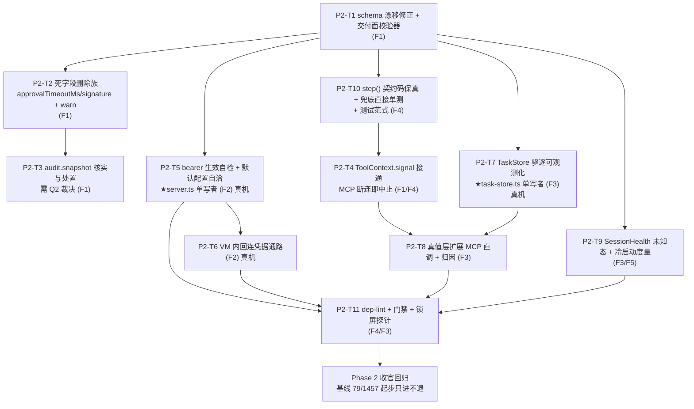

# Phase 2 · 架构排程（主题族归并 + 任务分解）

> **状态：提案（待主理人 + 用户裁决）** — 本文只做只读分析与排程设计，不含实现；所有"推荐"均为**待裁**选项，未经裁决不得开工。
> 作者：高见远（Architect，团队 software-winvm-phase2）｜日期：2026-10-10
> 基线：Phase 1 安全兑现批 T1–T5 全批交付，HEAD `1faec49`（QA 独立复跑点 `2b2f241`），测试基线 **79 文件 / 1457 例（1455 pass / 0 fail / 2 skip）**，QA 终判 `NoOne` / **PASS**（`docs/changes/CL-022/QA-REPORT.md` §6）。
> 输入源（全部为仓库内权威留痕，本文引用不编造行号）：
> `.workbuddy/memory/MEMORY.md`（backlog 段＝Phase 2 核心输入）、`docs/changes/CL-022/QA-REPORT.md` §6 遗留 L1–L6、
> `docs/changes/phase1-arch-design.md`（含 R4 行后订正指针）、`docs/02-design/SECURITY-GOVERNANCE.md` §2.1/§3.2/§3.4.1、
> `docs/changes/phase1-t5-notes.md`（D-43 与 O-1/O-3）、`docs/changes/phase1-t1-notes.md` D-3、
> `docs/audit/2026-10-08-architecture-audit.md`（ARCH-04/18/20/29/30、D-3 死字段群、B5 批次）、
> `docs/audit/2026-10-08-product-audit.md`（PM-08 / NFR-512）、`docs/02-design/REQUIREMENTS.md`（NFR-512 原文）。
> **本文不修改任何其它文件、不做 git 写操作、不触碰 VM（172.16.100.2）。**

---

## 0. 一句话结论

Phase 1 把"承诺"改成了"可验证的承诺"；Phase 2 的命题是**把仍然只在文档里存在的东西变成代码事实**——要么接通、要么删掉、要么显形，三选一，**绝不允许第四种状态：写在文档里但运行期不存在的防线**。据此把 8 项已知输入归并为 **5 个主题族 / 11 个任务**，其中只有 2 项必须真机窗口（P2-T5、P2-T11），其余全部离线可证。

### 0.1 输入 → 族 映射表（先对账，再看设计）

| 任务书给的输入 | 本文归档编号 | 落点 | 备注 |
|---|---|---|---|
| ① D-3 schema 接入裁断 | A-1 | **F1 契约诚实化族** | 核实成立（下节给证据）；裁定选项二选一，我**改推荐第三分支**：接入**登记期**校验而非运行期热路径 |
| ② 死配置/漂移清扫族 | A-2 / A-3 | **F1** | 核实清单见 §2.2，与 ARCH 审计 D-3 群交叉核对，逐项给"接通/删除/文档承认"三态 |
| ③ R4 根治（L4）：bearer 自检 + 回连凭据通路 | B-1 / B-2 | **F2 鉴权根治族**（+ 观测部分落 F3） | 核实成立；本族是 Phase 2 唯一**跨部署契约**的族，须拆成"先显形、后通路"两步 |
| ④ L1 TaskStore 驱逐真实长会话观测 | D-1 | **F3 可观测与真值族** | 核实成立（QA-REPORT §4-B4 仍为"未记录"） |
| ⑤ O-1 / O-3 | C-1 / C-2 | **F4 API 保真与守卫基建族** | 核实成立（源码已复核） |
| ⑥ K3 遗留：bridge 直读 MCP 结构化结果根治 + `reconcileApprovalWait` 直接单测 | C-3 / C-4 | **F3**（根治改造）+ **F4**（补单测） | 核实成立；**补单测与根治不是一回事**，拆成两族可并行 |
| ⑦ 预热深度空闲冷启动 / `SessionHealth` 无法表达未知 / 真实 GUI 锁屏回归 | E-1 / E-2 / E-3 | **F5 运维观察项族** | 核实成立；三者性质不同：①性能②契约③验证面 |
| ⑧ dep-lint 依赖方向守卫 | F-1 | **F4** | 核实成立：`scripts/dep-lint.mjs` **从未存在**、`layout` 脚本键已被 QA R3（`c10a400`）从根 `package.json` 删除；Phase 1 期间所有 D-4 类改动以"人工方向核对"替代 |

**补充项（任务书未列，但我在核对过程中确认属于 Phase 2 欠账，供裁决是否纳入）**：
- **A-4 `NFR-512` 第二条腿缺失**：全仓**无任何 CI 配置**（`.github/.gitlab/jenkins` 均 0，见 `docs/audit/2026-10-08-product-audit.md` PM-08）。"契约变更→校验失败即阻断"目前**靠人肉**。F1/F4 落的所有静态守卫若没有阻断器，就是"更齐全的文档"而已。建议纳入 F4（做**零平台成本门禁**：本地 `npm test` + 一条聚合脚本），CI 后置。
- **A-5 `endpointAllowlist` 现状已不是死字段**（与 ARCH 审计 §4.2 D-3 的旧判读不同）：Phase 1 把它转成**负空间类型** `SecurityHealth.endpointAllowlist?: never`（`packages/contracts/src/bridge.ts:154`）并在 `vm-service` 侧注释声明"本实现不产出该键"（`packages/vm-service/src/server.ts` 的 `buildHealth` 注释区、`packages/vm-service/src/http-guard.ts` 注释区）。⇒ **F1 里 A-5 判为"已闭环，无需动作"**，但要把 ARCH 审计的旧结论加勘误指针，否则后来者会重复立项。

---

## 1. F1 · 契约诚实化族（schema 接入 + 死字段群清扫）

### 1.1 问题陈述

Phase 1 在删 `commandAllowlist` 时才发现：**`contracts/schemas/capability.schema.json` 是一份没有任何消费者的 JSON Schema**。SECURITY §3.2 第 3 条因此不得不写出一段很别扭的现状限定："该 schema 尚未接入运行期校验……拒止目前兑现在 CI/交付面而非运行实例"。而 `NFR-512`（`docs/02-design/REQUIREMENTS.md:81`）的原始要求是**两条腿**："所有契约以 JSON Schema 集中存放定义 **+ 契约校验纳入 CI**"。今天两条腿都缺：schema 只有一份，校验零消费者，CI 不存在。

后果是具体的、可复核的漂移：

我本轮**实跑了一次校验**（用 `node` 直把注册表 54 条 id 对 schema 现行 `id.pattern` 求值），结果如下：

| 项 | 事实（已核对） | 后果 |
|---|---|---|
| schema `id.pattern` | `packages/contracts/schemas/capability.schema.json:26` = `^(system\|app\|storage\|gui\|meta)\.[a-z0-9]+\.[a-z0-9]+$`（三段式，首段枚举里**没有** `appops`） | 实跑结论：**54 条能力 id 全部是三段式**，故段数不是问题；**唯 5 条 `appops.*` 恒不匹配**（首段被拒）。不匹配集合 = `appops.state.query` / `appops.cli.invoke` / `appops.workflow.run` / `appops.com.automate` / `appops.gui.produce`（`packages/vm-capabilities/src/registry/definitions.ts:352/373/396/425/445`） |
| schema `domain.enum` | `:29` = `["system","app","storage","gui","meta"]`，而事实源 `CAPABILITY_DOMAINS`（`packages/contracts/src/capability.ts:13-20`）**含 6 项、包含 `appops`** | 两处（`id.pattern` 首段 + `domain.enum`）**必须同批改**——因为注册表的 `domain` 是**从 id 首段推导**的（`definitions.ts:60` `const domain = spec.id.split('.')[0]`），只改 enum 不改 pattern 会留下"domain 合法但 id 非法"的半修正态 |
| 校验器 | 全仓 `grep "capability.schema"` 只命中 `setup-env.test.js` 的**文件存在性断言**与文档引文 | `additionalProperties:false` 的拒止能力**从未在任何运行路径兑现**——包括 Phase 1 自己写下的那句"会被 schema 直接拒绝" |

**根因锚点**：`docs/changes/phase1-t1-notes.md` D-3（原文判读，我已复核成立）；`docs/audit/2026-10-08-product-audit.md` PM-08。

### 1.2 裁定选项与推荐

| | (A) 接入**运行期**校验（服务启动/能力注册即校验） | (B) 不接入，作为**死配置清扫**处置（schema 降级为文档资产并如实标注） | (C)**推荐**：接入**登记期/离线**校验 + 修 enum 漂移 |
|---|---|---|---|
| 兑现 NFR-512 | 部分（只兑现"集中存放"，校验在实例侧） | ❌ 不兑现 | ✅ 兑现"契约校验即阻断"的**可执行形态**（不依赖 CI 平台） |
| 现网风险 | **高**。运行期校验一旦红，VM 服务起不来；而 schema 现状**必红**（`appops` 缺枚举）⇒ 接入即打断启动 | 零 | 低。校验跑在测试/交付面，不动启动路径 |
| 破坏性 | 若配 `additionalProperties:false`，运维在能力定义里写任何未声明键 ⇒ 当场拒注册，**升级期高危** | 零 | 零 |
| 维护成本 | 需引入 JSON Schema 校验库（**新增依赖**，与 Phase 1"零供应链引入"口径相悖） | 低，但**留下虚假防线**（"schema 看起来会拦"） | 中：自研 ~80 行结构校验（只校验 `id`/`domain`/`risk`/`policy` 键集/必填项），零依赖 |
| 与 SECURITY §3.2 的关系 | 可把"现状限定"删掉 | 需把措辞改为"schema 为文档资产，拒止兑现在能力注册表与单测" | 同 B，且**额外**给出真阻断器 |

**推荐 (C)**，具体口径三条：
1. **先修漂移**：`domain.enum` 补 `appops`，`id.pattern` 与 `DOMAINS` 常量对齐（`packages/contracts/src/capability.ts:15` 的 `DOMAINS` 才是事实源，含 `appops`）——注意 `CapabilityDefinition.domain` 有 `appops` 而 `id` 的 JSDoc 注释里写的正则**同样缺 `appops`**（`:19-20`），这是**注释面漂移**，会撞 MEMORY「注释文本也是守卫输入面」坑（见 §3）。
2. **不引第三方校验库**，改写一个纯函数 `validateCapabilityShape(def)`（放 `packages/contracts/src/schema-check.ts` 新文件，与 schema JSON 同包 ⇒ L0 层，不破坏依赖方向），从 `capability.schema.json` **读** enum/pattern/required 作为输入（这样 schema 就成了**被消费的资产**，漂移在测试里必红），逐条校验注册表能力。
3. **消费点 = 单测 + 交付脚本**，不接运行期。SECURITY §3.2 第 3 条的"会被 schema 直接拒绝"须改述为"会被 `r19b`/新守卫在交付面拒绝；运行实例不校验能力定义"。

> **不做运行期校验的理由要写黑**：`vm-service` 的能力定义来自**代码内常量**（`packages/vm-capabilities/src/registry/definitions.ts`），不是外部可写配置 ⇒ 运行期校验**只在校验自己编译出来的东西**，安全增益≈0，却引入启动被打断的新风险面。真正的外部输入面是 `delivery/vm-service.config.json` 与 `.generated/vm-service.runtime.json`（策略/开关覆盖），它们的校验已由 `validateServiceConfig` 承担。**schema 的正确位置是"契约资产 + 交付门禁"，不是"运行时防线"。**

### 1.3 死字段群现状清点（F1 的另一半）

逐项按 ARCH 审计 D-3 清单**重新核实**（Phase 1 已修掉一部分；下面标 ✅ 的**不应再进 Phase 2 改动集**）：

| 字段/面 | 审计原判 | 现状（我实测） | F1 处置 |
|---|---|---|---|
| `PolicyConfig.commandAllowlist` / `CapabilityPolicy.commandAllowlist` | 死配置 | **已删**（契约 + defaults + schema 四处同批，ARCH-18 裁断 (B)） | ✅ 闭环，无动作 |
| `policy.approvalTimeoutMs`（默认 120s） | 零消费 | **仍零消费**：仅 `packages/core/src/policy/defaults.ts` 三处（接口声明 / 默认值 / `mergePolicy`）；真实 TTL 走 `WINVM_APPROVAL_TTL_MS`；已在 SECURITY §3.4、`pending-approvals.ts` 注释、`server.ts` 注释三处**如实登记为历史死字段** | **删除**（P2-T2）。理由：① 已被三处文档点名"死字段"，留着等于让 `mergePolicy` 永远携带一个无人读的旋钮；② 若接成 MCP 令牌 TTL，120s 远短于真人反应 ⇒ 会批量制造 `timeout` 决策条（Phase 1 设计 §5 第 1 条已强烈不建议）。**删除属破坏性契约变更**：运维配置里若有该键，`validateServiceConfig` 需给**明确告警**而非静默忽略（P2-T2 判据） |
| `SecurityHealth.endpointAllowlist` | 死配置 | **已转负空间类型** `?: never`（`contracts/src/bridge.ts:154`）并有服务端"不产出该键"注释 | ✅ 闭环；**只需给 ARCH 审计/文档加勘误指针** |
| `CapabilityDefinition.audit.snapshot`（ARCH-04） | 30+ 条声明零消费 | **本轮已实跑核实：零消费者成立**。声明侧 `packages/contracts/src/capability.ts:58`（`SnapshotPolicy = 'none' \| 'after' \| 'before-after'`）与 `:94`（`audit.snapshot` **必填**），注册表侧 `packages/vm-capabilities/src/registry/definitions.ts:47`（`spec.snapshot?`）/ `:79`（`audit: { snapshot: spec.snapshot ?? 'none' }`）共 **28 处标注**（含 `system.registry.write`、`storage.file.delete`、`system.power.control` 等 L2/L3 均为 `'before-after'`）；消费侧 grep `SnapshotPolicy` / `\.snapshot` / `beforeAfter` 在 `core` / `vm-service` / `adapter-*` / `delivery` / `psmod` **全部零命中**，且 `packages/contracts/src/audit.ts` 的 `AuditRecord`/`AuditExt` **根本没有承载 before/after 快照的字段**（`grep snapshot audit.ts` 零命中） | ⇒ **缺口比 ARCH-04 记的更深一层**：不是"有声明位没人读"，而是**连落快照的字段都不存在**，实现要动 `audit.ts` + `chain.ts` + 执行体 + psmod 四处。**这是安全承诺（SECURITY §3.2 表"L2/L3 是否强制快照 = 是"），降级需用户裁断**（§7 Q2）；我不在本文替你决定 |
| `mcp-framework` `ToolContext.signal` | 死契约 | `packages/mcp-framework/src/server.ts` 的 `ToolContext.signal?: AbortSignal` 仍在；Phase 1 的取消主干走 `ProgressSink.cancellationSignal`（A2A 委派路径），**MCP 直调路径的中断（HTTP 断连即中止，ARCH-29）仍缺** | **接通或删除**（P2-T4）。我推荐**接通**：宿主侧 `tools/call` 断连后 VM 内继续跑长命令（winget 卸载）是真实危害；实现面小（`callTool` 把 `req.signal` 灌进 `ctx.signal`，能力执行侧消费） |
| `contracts/a2a.ts` `AgentCard.signature?` | 无实现 | `packages/contracts/src/a2a.ts:159` 仅剩声明；`logger.ts` 的敏感词正则里含 `signature` 是**脱敏**用途（不同事） | **删除**（P2-T2）。"Agent Card 签名验证"若不做就是装饰；做的话属独立安全特性，应单列需求而非留字段 |

⇒ **F1 的诚实交付面**是四件事：schema 修漂移 + schema 变成被消费资产 + 三个死字段删除（含删除后的显式告警）+ 两个"安全承诺型"字段做接通/降级的裁断执行。

### 1.4 L5 / L6 残留核验结论：**均已闭环，不进 Phase 2 改动集**

任务书把 L1–L4 列为输入、并称"L5/L6 已闭环"。我按"以仓库为准"复核了这条说法，**成立**，且给出可复现证据（防止后来者重复立项）：

| 项 | QA-REPORT 当时的判读（HEAD `2b2f241`） | HEAD `1faec49` 实况 | 结论 |
|---|---|---|---|
| **L5** | `phase1-arch-design.md` §5 第 3 条 / §10 R4 仍写旧式"必 401"，建议加前向指针 | `docs/changes/phase1-arch-design.md:492` 已有**「R4 失败形态订正指针（2026-10-10 B3 真机实测）」**整段，明写两段式实况并指向 SECURITY §2.1 / D-43；原文按留痕纪律未改写 | ✅ **已闭环**（`9336eb5` 提交信息自述"L5 设计快照订正指针"） |
| **L6-1** | `DEPLOYMENT.md:518` 回指旧结论"委派主链路会 401" | 现文已是**两段式**（"宿主不带凭据段 ⇒ 当场 401；VM 内回连凭据通路未实现 ⇒ 回连 401 打在工具面、委派退化为**零副作用虚假完成**"），并附"不得以任务显示成功推断守卫未生效" | ✅ **已闭环** |
| **L6-2** | `delivery/vm-service.config.json:59` 注释写"委派执行会 401" | 现文已订正为两段式 + 指向 `SECURITY-GOVERNANCE.md §2.1`，且补写了 **`tokenEnv` 有名无值 ⇒ 实报 `bearer-configured-missing`** 的现网自述 | ✅ **已闭环** |
| **L6-3** | `CL-022/REQUIREMENT.md:34`（B-3 行）承诺口径仍为"委派主链路 401" | 现文已含"原判据…已经 B3 真机实测订正为两段式"补句 | ✅ **已闭环** |

⇒ **所以 P2-T5 / P2-T11 的改动集里不应再出现"L6 三处残留清理"**（我初稿写了，已删）。同时 **L2 也已闭环**：见 §3.5。

> 这条核验的实际价值：任务书第 2 项"死配置/失效文案系统性清扫"里的**失效文案**子项，在 HEAD 上**已经没有活体**。F1 的清扫对象因此收窄为**字段与契约类型**（schema/`approvalTimeoutMs`/`signature`/`snapshot`/`ToolContext.signal`），不含措辞——排期上少一个文档任务。

---

## 2. F2 · 鉴权根治族（bearer 生效自检 + VM 内回连凭据通路）

### 2.1 问题陈述

SECURITY §2.1 警告块（我复核原文）已把危害写实：**两条既有合法通路都不带凭据**——宿主 → VM `/a2a` 默认 `tokenEnv:''`（可用 `--token-env` 覆盖），VM 内 CLI → 本服务 `/mcp?dtid=`（`buildMcpConfig` 生成的 mcpServers 条目**只有 url，无任何凭据字段**）。一旦真机误开 `enforceBearer`（双条件齐），B3 实测形态是**两段式**：

- 宿主 → 服务端：HTTP 层当场 401（fail-loud，可见）；
- **VM 内回连段：401 打在工具面 ⇒ LLM 无工具可用仍"口头收尾" ⇒ 委派退化为零副作用虚假完成**（终态 `completed`、artifacts 仅 `execution-steps`、链上 `ext.zeroInnerCalls:true`）。

**根因不是缺守卫，是缺"守卫是否真的生效"的事实**，以及**缺一条能让回连带凭据的分发通路**。CL-K3R 的 `zeroInnerCalls` 判据只能**兜住**（不予采信），不能**根治**（用户仍以为任务成功、只是不采信）。

### 2.2 设计拆两步（顺序不可反）

**Step 1（P2-T5）· bearer 生效自检 — 拒绝静默退化**

判据落点（全部机器可读，可离线单测 + 真机探针）：

1. 服务启动时，若 `resolveBearerToken()` 非空（即守卫**真正挂载**，`authMode==='bearer-enforced'`），则 fire-and-forget 跑一次**自环探测**：用刚生效的 token 走一遍守卫（同进程内直调 `createBearerGuard` 的 verdict，**不发真实 HTTP**），再用**不带** token 走一遍，断言后者 verdict=deny、前者 verdict=allow。这一步离线可证，成本≈0，防的是"挂载逻辑漂移成永 allow"。
2. **VM 内回连探测（真机专属）**：开守卫后，服务主动以 `buildMcpConfig` 产出的**同一份配置形态**（不带凭据）向自身 `/mcp` 发一次 `tools/list`，若得到 401 ⇒ 判定为"**回连必被打断**"状态，必须：
   - 写一条链上条目（`ext.kind:'bearer-selfcheck'`，`result.ok:false`，`matchedRule:'bearer-selfcheck:inner-reconnect-broken'`）；
   - `/health.security` 增透出 `innerReconnect: 'ok' | 'broken' | 'unverified'`（三态，**必须能表达"未验证"**——见 F5 E-2 同族问题）；
   - 若配置了 `security.enforceBearer` 且自检得 `broken` ⇒ 启动阶段**拒绝进入服务态**（新开关 `security.enforceBearerFailClosed`，默认 `true`，可关）。
3. **默认态卫生**（我在 §1.2 之外发现的具体危害）：现网 `delivery/vm-service.config.json` 写了 `"tokenEnv": "WINVM_BEARER_TOKEN"` 但**没写 `enforceBearer`**，按 SECURITY §2.1 判序③ ⇒ 现网 `/health.security.authMode` 恒报 `bearer-configured-missing`（"半开态"），与文档 §7.6 自称的默认态 `loopback-only` **对不上**。⇒ P2-T5 附带处置：把默认配置**补齐成自洽**（要么删 `tokenEnv` 键 ⇒ 干净 `loopback-only`，要么显式写 `enforceBearer:false` 并在文档明写"该键存在而无值属预期半开"）。这一条零行为变更、纯配置文本面，但**消除长期误读**。

**Step 2（P2-T6）· VM 内回连凭据分发通路**

真正的技术难点在**注入面**：回连凭据要进 VM 内 codebuddy CLI 进程环境。三条候选：

| | (a) `mcpServers.winvm.headers` 承载 Bearer | (b) url 里带 token query（`?token=`） | (c) 复用 `tokenEnv` **变量名**，由 CLI 进程环境提供值 |
|---|---|---|---|
| 凭据是否落配置文件/磁盘 | **是**（`prepareMcpConfig` 会写盘） | **是**（且落日志、落链、落 CLI 历史） | 否——配置里只有**变量名** |
| 是否需契约评审新增字段 | 是（`buildMcpConfig` 产出形状变更） | 否（url 拼接），但**危害最大** | 否 |
| 与 Phase 1 既有纪律一致性 | 中 | ❌ 违反红线：`token-env` 守卫已钉"凭据不落明文：`buildTransport`/decl 只承载**变量名**"（CL-022 §3-3f）；`logger.ts:24` 也把 `token|secret|credential` 列脱敏 | ✅ **同 Phase 1 ARCH-07 的 `tokenEnv` 设计完全同构**（名字进配置、值留环境） |
| CLI 是否支持 | 取决于 codebuddy 的 MCP 客户端是否读 `headers`（**未实证**） | 取决于是否透传 query（`?dtid=` 已实证透传） | 取决于 CLI 是否展 `${ENV}` / 服务进程 env 是否传给 CLI（**spawn 传 env 已实证**——`launchCliProcess` 已传 env） |
| 保留期/轮换 | 文件残留 ⇒ 需清理 | 更差 | 环境级 ⇒ 随进程消亡 |

**推荐 (c) 为硬基线 + (a) 为待实证分支**，实施形态：
- `buildMcpConfig(endpoint, delegationId, bearerEnvName?)`：`(c)` 分支下**只**在 url 不变的前提下，把变量名以 `headers` 里的 `${VAR}` 占位（若 CLI 支持 env 展开）或写进 mcpServers 条目的 `env` 字段（若 CLI 支持），两种承载**都只放变量名，不放值**；
- 若 CLI 两者都不支持 ⇒ **通路不可能** ⇒ 诚实结论：`enforceBearer` 在"有 LLM 委派"的部署形态下**不可开启**，把这条写进 DEPLOYMENT 上线前置条件（比"实现了但有洞"好）。这条判据必须**真机实测**才能定分支（P2-T6 的真机子项）。
- 凭据注入面：服务 → CLI 的 env 传递已在 `launchCliProcess`（Phase 1 T5 已把 `signal` 透传进去，同一处扩展）；**不新增** token 落盘路径。

**为什么顺序不可反**：Step 2 若先做，"通路存在但没人验证它生效"就是下一个 R4；Step 1 先落地，则 Step 2 完成后自检探针会立刻告诉你通路**真的**通了（`innerReconnect:'ok'`），验收判据天然闭环。

### 2.3 F2 是否进默认部署（**必须用户裁断**）

`enforceBearer` 默认 false ⇒ 自检探针（Step 1 第 2 项）默认不跑。建议：**Step 1 无条件进默认部署**（回环态也跑一次回连探测，把 `innerReconnect` 透出为事实），**Step 2 不进默认部署**（凭据通路存在但开关关闭，与 Phase 1 对 `enforceBearer` 的处理一致）。见 §7 Q3。

---

## 3. F3 · 可观测与真值族

四项输入在本族汇合，共同点是**"现在只能靠人读日志/猜"**：TaskStore 驱逐可见性（L1）、K3 兜底的启发式性质（⑥）、`SessionHealth` 无法表达未知（⑦）、真实 GUI 端到端回归受锁屏限制（⑦）。

### 3.1 D-1 · TaskStore 驱逐的宿主可见性（L1 / QA §4-B4）

**现状（已核对，并修正我初稿的一处误判）**：
- 框架侧：`packages/a2a-framework/src/task-store.ts:53/59`（`maxTasks?` / `terminalTtlMs?`，缺省 200 / 1h 见常量注释 `:30-32`），驱逐**只在 `create()` 尾部**（`evictIfNeeded()`，纪律 O-11：get/list/subscribe/updateStatus 一律不触发），双闸门 = ① TTL 过期终态 ② 超上限从最旧终态删至上限；驱逐候选三条件（终态 && 无挂起审批 && 非"取消在飞"）；删除时 `subscribers.clear()`。
- 宿主可见侧：`/health.tasks` **已经透出** `{ live, maxTasks, terminalTtlMs }`（`packages/vm-service/src/server.ts` `buildHealth` 的 `tasks:` 块，常量 `TASK_STORE_MAX_TASKS=200` / `TASK_STORE_TERMINAL_TTL_MS=3_600_000`，`:786-787` 注入 TaskStore）。⇒ **我初稿写的"`/health` 增 `tasks:{live,maxTasks}`"是错的，那一项在 Phase 1 已做**，此处更正。
- 真正还欠的是**三类**：① **驱逐这件事本身不可见**——`evictIfNeeded()` 全程**无计数器、无日志、无回调**（我通读 `:545-600` 区段确认，被逐 id 与逐出时刻不留任何痕迹）；② 被逐 id 再查 `tasks/get` 走 `TaskNotFoundError`（`a2a-framework/src/server.ts:600`、`task-store.ts:105`），与"这个 id 从来不存在"**不可区分**——运维无法判断是被逐了还是记错了 id；③ 长会话驻留窗口内的**真实行为未观测**（QA-REPORT §4-B4 / L1 至今仍是"未记录"）。

P2-T7 交付三件事（对应上面 ①②③）：
1. **驱逐显形（机制侧）**：`TaskStore` 增**单调计数** `evictedCount` + **有界环形日志**（最近 N 条 `{ id, terminalState, evictedAtMs, gate:'ttl'|'overflow' }`，N 固定，**不**保留任务内容 ⇒ 不触碰审计保留期权衡 W-2）；驱逐经既有回调/observer 范式产出一条结构化事件（框架层**不得** import 审计语义，落不落链由 `vm-service` 决定）。
2. **可区分语义（呈现侧）**：对被逐 id 的 `tasks/get` 在 `TaskNotFoundError` 之外给出**可判别的归因**——最小实现是把"曾被驱逐"这一事实纳入错误 `details`（`evicted:true`），使"从未存在"与"已被回收"可分；`/health.tasks` 透出**附加成员** `evictedCount`（在既有 `live/maxTasks/terminalTtlMs` 上**追加**，纯附加可选）。
3. **长会话观测方案（运维侧，真机窗口）**：≥200 任务或 1h 驻留窗口的**可复现脚本**（落 `qa/` 下，**不进** `tests/unit/`，因为它要打真机），产出 `evictedCount` 增长曲线 + 被逐 id 的 `tasks/get` 响应形态。

> **不推荐**用"把 `maxTasks` 调大"绕过观测——那只是把 R5 往后推；`maxTasks:0` 关驱逐是既有回退位，应写进 DEPLOYMENT 作为运维手段而非验收手段。

### 3.2 C-3 · K3 根治：bridge 直读 MCP 结构化结果

**现状（已核对）**：`packages/adapter-agent-workbuddy-llm/src/delegation-truth.ts` 的 `reconcileApprovalTruth` 已有**服务端结构化未决审批反查**（门 0–门 6 + `probe.approvalWait`，命中改判 `ok:false` + `APPROVAL_REQUIRED`，**单向 fail-closed**）。文本启发式 `reconcileApprovalWait`（`bridge.ts:677`）已降级为**兜底**且函数体一字不动（SK-9）。

⇒ **所以"根治=bridge 直读 MCP 结构化结果"这条 backlog 需要重新表述**。核实后还剩三个真缺口：

| 缺口 | 具体 | 处置 |
|---|---|---|
| G-a **纯 MCP 直调通道无真值层** | 门 1：`!taskId`（非委派/纯 MCP 直调）⇒ **回退文本兜底**。宿主走 `winvm__*` 工具直调（`/mcp`）而非 A2A 委派时，`zeroInnerCalls` / 审批未决判定全靠文本 | P2-T8：把结构化判据扩展到 MCP 直调（`ToolContext` 已有 `delegationId`/`traceId`，`collectApprovalFacts` 已能按 traceId 归因）——**不需要新数据源，需要新调用点** |
| G-b **兜底触发不可观测** | 门 3"探针缺席 ⇒ 绝不 warn"（有意兼容旧服务端）与门 5/门 6 回退 ⇒ **无法区分"兜底救了"和"兜底没机会救"**。MEMORY 的"启发式依赖 LLM 措辞"风险面 = 我们不知道今天还有多少判定在靠措辞 | P2-T8：给 `runFallback(gate,…)` 补**可计数归因**（结构化 `ext.approvalTruth: { decidedBy:'server'|'text-fallback', gate }`），shadow 态对拍数据即由它产出 |
| G-c **文本启发式的措辞脆弱性无回归样本** | 兜底函数的判定关键词集合**没有**变异测试 | P2-T8：对 `reconcileApprovalWait` 建**直接单测**（含 C-4），关键词集合作为常量钉死，构造"同义改写不命中"的反例集 ⇒ 显式承认哪些措辞会漏（这是诚实化，不是修好） |

> ⚠ 与任务书表述的**差异登记**：我把⑥的"根治"拆成 G-a/G-b/G-c 三项，因为"bridge 直读 MCP 结构化结果"在 CL-K3R 已部分兑现；不拆会让人以为整块还欠着，重复实现一套已有的判据。

### 3.3 E-2 · `SessionHealth` 无法表达"未知"

**现状（已核对，且比 backlog 记的更细）**：`packages/contracts/src/bridge.ts:38-47` 的 `SessionHealth` 把 `state` / `interactive` / `blackScreen` 定为**必填**。而真实探测源（`packages/vm-service/src/health-probe.ts:54`、`packages/vm-capabilities/src/index.ts:55`、`packages/core/src/session/health.ts:25`）在探测超时/失败时**填的是 `interactive:false` 的假值**。后果：`isGuiAllowed()`（`core/src/session/health.ts:42`）要求 `state==='healthy' && interactive && !blackScreen`，假值方向是 **fail-closed**（不会误放 GUI），但**语义失真**——"探测不到"被报告成"确认不可交互"，运维据此会去查会话配置，而真因可能是探测超时。

backlog 给的临时口径"先做文档级注明：仅 `state==='healthy'` 才有意义"我**认可但不充分**（文档注明后仍会误读，因为它不阻断 `isGuiAllowed` 消费假值）。

**推荐 (P2-T9)**：`SessionHealth` 增**可选成员** `readonly probeError?: string` / `probeErrorCode?`（"纯附加可选"铁律 ⇒ 缺席即旧行为），把 `interactive:false`（探测失败）与 `interactive:false`（探测成功且确非交互）**区分开**；`isGuiAllowed` 行为**一字不改**（两种都拒）。这样既不失真也不引入放行风险。**不建议**把 `interactive` 改成 `boolean | undefined`——那会让 `isGuiAllowed` 的必填判据变成三态逻辑，改判成本高、且是破坏性契约变更。

### 3.4 E-3 · 真实 GUI 端到端回归受锁屏限制 + L2 有态样本（同窗口合并）

这是**验证面**问题，不是代码缺陷（MEMORY 关键坑段已给出成因：LogonTrigger 有会话 ⇒ GUI 可用；BootTrigger 无会话 ⇒ 不可用；`ps-bridge` 由计划任务托管）。

**顺带核实到的 L2 实况（比我初稿写的更进了一步，必须更正）**：QA 遗留 L2（"晚取消态真机补跑"）**已在 HEAD `1faec49` 用两趟真机跑完**（`qa/r19/t5-l2-late-cancel-evidence.md` + 两份 `t5-l2-cancel-*.out.json`），并产出一条**架构结论**：LLM 常驻路径的取消收口 `canceledResult` 恒 `steps:[]/artifacts:[]`（这是防降级红线，不能改）+ 框架 O-2 刻意"取消后产物不落链" + VM 内 CLI 真实能力调用不经任务级 progress（`DETERMINISTIC_STEP_MARK` 只匹配确定性模板）⇒ **`executedBeforeCancel` 的"有态"文案只在 `workbuddy-deterministic` 模板路径可达**；有态样本的真机构造被明确"另派工程构造，非本批边界"。

⇒ **所以 Phase 2 的真机清单里，L2 不是"补跑晚取消"（已跑完），而是"造一个确定性模板路径的有态样本"**，且必须与 GUI 端到端、P2-T5 回连探测、P2-T7 长会话**打包进同一次窗口**（PR10 的唯一缓解手段）。

**L2 余项更新（2026-10-10 12:0x，主理人复核工程师真机构造后追加）**：有态样本**已构造完成并归档**（`qa/r19/t5-l2d-deterministic-evidence.md/.json`，attempt1/2 双复现，现场喂现网 derive ⇒ `{steps:1,artifacts:0}` 有态文案成立，VM 复原三值实测干净）。**同时补强一条比 `1faec49` 架构结论更深的实况**：同任务上生产 `a2a.delegate` 实测 progress=0/ebc=null——根因是 **sink→wire 类型级谎报**：契约 `onStatus(message?: string)`（contracts/bridge.ts:381）→ 确定性模板传 string（adapter-workbuddy/index.ts:418）→ `createProgressSink` as-cast 成 `A2A.Message` 直存（a2a-framework/task-store.ts:630-631）→ wire 裸字符串（探针 msgType=string 实证）→ 宿主 `extractText` 只认 `Message.parts`（host-a2a-bridge/tools.ts:45-46）⇒ 恒空。**有态在生产呈现面对两种 provider 均不可达**（LLM 路径另有 steps 恒空红线；确定性路径栽在此 as-cast），"只在确定性模板路径可达"须精确化为"只在 derive 函数层面可达"。对照旁证：框架自有 `approvalTimeoutMessage`（task-store.ts:439）正确构造 Message ⇒ as-cast 处是疏漏非设计；且该缺口**同样吞掉确定性路径 delegate 的实时进度回显**（不止取消文案）。审批链路不受影响（独立通路）。**建议新增任务 P2-T12**：`createProgressSink.onStatus` 构造合规 Message（纯框架侧一处），同批回归 delegate progress 呈现；归属 F3，与 P2-T7 同文件（task-store.ts 单写者）⇒ 排 T7 同批串行。**L2 余项从真机清单移除（已闭环）**，同窗口四件事减为三件。

> **前向指针订正（2026-10-11，P2-T12 交付）**：上条登记的 sink→wire 类型谎报（"有态在生产呈现面对两种 provider 均不可达"）**已修复**——`createProgressSink.onStatus` 现经唯一裁决点 `toStatusMessage` 三分支整形（非空 string ⇒ 合规 Message；空串/仅空白 ⇒ 与缺席等价；对象形态 ⇒ verbatim 透传），`TaskStore.updateStatus` 与宿主 `extractText` 均零触碰。确定性路径实时进度恢复可见，有态取消文案派生输入随之可达。判据 `tests/unit/phase2-progress-message.test.js`（含修复前 RED 基线复现病灶），口径落 `HOST-A2A-BRIDGE.md` §4.3.1。原文按留痕纪律不回改（K-20）。

P2 的诚实处置（GUI 部分不变）：
- **不在离线测试里假装覆盖**（现有 GUI 用例走的是探测形态，不是真点击）；
- 交付一条**锁屏前置探针**：真机窗口开工前先跑会话交互性探测（`meta.session.status` / `health-probe` 的 `interactive`），若判非交互 ⇒ **立即标记该轮 GUI 端到端为 BLOCKED 并停手**，而不是跑出假红再分诊（Phase 1 §5 经验："见到红必须先分诊"；能提前判 BLOCKED 就别浪费档期）；
- 同窗口事项（~~四件~~ ⇒ **三件**，L2 余项已于 12:0x 构造归档闭环，见上条更新）：**GUI 端到端 + bearer 回连探测（P2-T5）+ 长会话驱逐观测（P2-T7）**。

⇒ **F3 不承诺"解决锁屏"，只承诺"不再浪费档期"**。这是本族最重要的口径管理。

---

## 4. F4 · API 保真与守卫基建族

### 4.1 C-1 · O-1：`step()` 折叠契约码

**现状（我实读 `step()` 全文后修正了初稿的粗判）**：折叠发生在 **`step()` 的返回形状**，不在 `execute()` 内部——`execute()` 侧的码保真其实**已经做到三层**（`normalizeError()`：① `err.code` ∈ 契约 10 码 ⇒ 原样透传；② 匹配领域码形态 ⇒ 按 `DOMAIN_CODE_TO_BASE` 最小映射定 base code 并把原码写入 `reason`；③ 无码/非法码 ⇒ `EXECUTION_FAILED`）。真正丢码的**唯一一处**是 `step()` 结尾的 `...(res.error ? { error: res.error.message } : {})` ⇒ **`BridgeError` 被降级为 `string`，`code` 与 `reason` 一起消失**；模板层再统一 `makeError('EXECUTION_FAILED', msg)` 包一层 ⇒ 确定性模板路径上 **`POLICY_DENIED` / `APPROVAL_REQUIRED` / `SESSION_UNAVAILABLE` 三种契约码全部不可见**。

> 这个定位很重要（我初稿写成"step() 把码压成 EXECUTION_FAILED"会让人以为 `normalizeError` 那三层也白做了）：**修一处 `step()` 形状即可**，不必重做错误规范化；而 `:489/:504/:517/:530` 那四处模板内联 `makeError('EXECUTION_FAILED', …)` 才是需要逐个改的点。同时 `step()` 的既有 `canceled` 哨兵（返回 `TASK_CANCELED` 而非 `EXECUTION_FAILED`）说明**这个包已经在同一个位置区分过码**，扩展它是同族改动、不是新范式。

**危害面（写清楚，别只说"保真度低"）**：
1. **策略硬拒可被当成"provider 不可用"去降级重跑**。机制我已读到确切行：`shouldDegrade()`（`adapter-agent-workbuddy-llm/src/index.ts:437-442`）判据 = `PROVIDER_UNAVAILABLE` **或** `EXECUTION_FAILED && res.artifacts.length === 0`；调用点 `:396` 的豁免是 `res.error?.reason !== 'NO_EXECUTION_RECEIPT'`——**豁免看的是 `reason` 而不是码**。于是折叠后的 `POLICY_DENIED`（零产物 ⇒ 满足降级条件、`reason` 已被 `step()` 抹掉 ⇒ 豁免也救不了）**正好落进可降级集合** ⇒ 一次本应硬拒的策略拒绝被确定性执行器重跑，绕开审批闸的意图（Phase 1 §3a 降级红线正是对着这条）。**这一条把 O-1 从"观测失真"升级为"安全性质可被绕过"**，是我推荐它进 P0 的直接理由。
2. 宿主/链上 `errorCode` 失真 ⇒ 运维按码筛"策略拒绝清单"筛不出来，只能读 summary 文本（S-4 已经证明"POLICY_DENIED 零审计"是会出事的同类问题）。

Phase 1 T5 已因此**差点改错测试**（CL-022 §5 第 3 条：用例期望 `POLICY_DENIED` 实得 `EXECUTION_FAILED`，最后判为"判据错误（测试侧）"、**钉住既有折叠形态**并登记 O-1）——那正是危害面 1 的现场：测试当时看到的形态，就是"策略拒绝看起来像执行失败"。

**推荐 (P2-T10)**：`step()` 保留契约码（返回形状带 `code`/`reason`，模板层透传，`EXECUTION_FAILED` 仅在**无码**时兜底）。这是**行为变更**（链上 `errorCode` 会变），必须：
- 先 grep 全仓对 `EXECUTION_FAILED` 的断言（Phase 1 纪律：改文案/码前先 grep）；
- 同批改 `phase1-t5-provider-cancel.test.js` 里**钉既有折叠形态**的那条用例（它明确写了"钉住既有形态"，改了实现它就红——这是好事，说明守卫有效）；
- 与 `shouldDegrade` 判据放同一任务改 ⇒ 保证"策略拒绝不被降级"成为**原子变更**（这是 Phase 1「注册表写/读两表必须成对存在」同族教训：判据与消费点分两个任务改，中间窗口就是新的漏）。

### 4.2 C-2 · O-3：`launchCliProcess` 未透出公共面

**现状（已核对）**：Phase 1 T5 缺陷记录第 5 条——测试 import 包级不存在的 `launchCliProcess` 导致整文件 `SyntaxError`，处置是"测试直连 `dist/bridge.js`"，并明确写下"**不为测试擅自扩包公共导出面**"（登记 O-3）。

**我的裁断建议**：**保持不透出（不动实现）**，改为把"测试直连 dist"这条**写成范式纪律**。理由：
- 已有先例：CL-020 的 `cl020-f2-*` 就是同范式直连 `dist/bridge.js`（QA-REPORT §1 口径备忘第 2 条已记"先 build dist 再跑读 dist 的用例"）；
- 扩公共面属**契约动作**，需要评审它该不该被外部消费；`launchCliProcess` 是执行体内部机器，透出即承诺长期兼容；
- 真正的债不是"访问不到"，而是"这范式没写下来"，于是每个新工程师都会先撞一次 `SyntaxError`。

⇒ P2-T10 的交付是**一条纪律 + 一个测试 helper**（统一 `loadBridgeInternals()` 从 `dist/bridge.js` 取内部导出，替代各文件手写路径），而不是扩面。若 owner 选"扩面"，则需同步 `packages/adapter-agent-workbuddy-llm/src/index.ts` 导出 + 契约评审记录（影响面：新增公共 API，未来删除即为破坏性变更）。见 §7 Q5。

### 4.3 C-4 · `reconcileApprovalWait` 直接单测缺失

**现状（已核对）**：全仓 `grep -l reconcile tests/` ⇒ `r19c-kn1-a-pure` / `r19c-kn1-b-bridge` / `r19c-k3r-approval-truth` / `r19c-k3r-bridge-integ` / `cl-k3r-runpersistent-approval-routing` 五个文件引用它，但 `reconcileApprovalWait` 是 `bridge.ts:677` 的**包内私有函数**（`src/index.ts` 零命中 ⇒ 未导出）⇒ 所有引用都是**间接触达**（经桥路径或 `deps` 注入）。**"兜底本身在哪些措辞下改判、哪些措辞下漏判"没有直接单测。**

这与 §3.2 的 G-c 是同一件事的两面：G-c 问"有没有回归样本"，C-4 是"补上直接单测"这个具体动作。⇒ **合并进 P2-T10**（与 O-3 同文件族、同一守卫范式），验收判据：直接单测覆盖（a）命中改判的关键词集合逐条、（b）同义改写**不命中**的反例集（诚实承认启发式边界）、（c）`base.ok===false` 时透传不重复改判、（d）与 `reconcileApprovalTruth` 的**门序交互**（结构化命中时兜底不得再跑）。

### 4.4 F-1 · dep-lint 依赖方向守卫

**现状（已核对）**：`scripts/dep-lint.mjs` **从未存在**（`docs/design/a5-approval-drop-fix-impl-progress.md` §1、`docs/design/cl-k3r-impl-progress.md` E-4 三处一致记载）；`layout` 脚本键已由 QA Phase 0 R3（`c10a400`）从根 `package.json` **删除**（死入口比缺失更误导）；MEMORY 关键口径段亦记"`layout` 脚本已删（指向不存在的 dep-lint；Phase 2 规划）"。Phase 1 全程以**人工方向核对 + `git diff --stat` 守门**替代。

**设计要求（比"补个脚本"严格）**：
1. 事实源是**依赖方向铁律**：`contracts`(L0) ← `core`(L1a) ← `a2a-framework`/`mcp-framework`(L1b/L1c) ← `vm-capabilities`/`adapters`(L2) ← `vm-service`(L3)，**框架层永不 import 审计语义**（Phase 1 设计 §0 + §8 横切约定）。
2. 判定方式：**读 `packages/*/dist` 的编译产物 import**（而非源码正则）——理由：源码 import 有注释/字符串假命中（MEMORY「注释文本也是守卫输入面」坑），而 `dist` 的 `require`/`import ... from '@winvm/xxx'` 是**真实依赖**。这与 Phase 1 已有的 `src↔dist 逐字一致` 抽查（QA-REPORT §4.2 D-1）同一手法。
3. 除方向外**必须**再加两条，否则 lint 只会抓到最不重要的一类违规：
   - **反向边**：低层包 import 高层包 ⇒ 红；
   - **框架层审计边**：`a2a-framework` / `mcp-framework` import `vm-service`/审计语义 ⇒ 红（这是纪律，不是分层能表达的）。
4. 交付形态：`scripts/dep-lint.mjs` + 根 `package.json` 恢复 `layout` 脚本键 + **一条 `tests/unit/` 聚合守卫调用它**（这样它进 `node --test` 全量跑，不需要 CI 就能阻断）。
5. ⚠ **注意与既有纪律的冲突点**：本仓单测**绝不整批跑**（junction 用例并发触发 `0xC0000005` 假全红，MEMORY 关键坑段）。⇒ 聚合守卫必须是"读 dist + 纯字符串/JSON 分析"，**不得** import 被测包，否则会拉进 junction 问题。

### 4.5 A-4 · 零平台成本门禁（我建议纳入，待裁）

F1/F4 落的每条静态守卫，今天都**只能靠人跑**。PM-08 给的裁决是"优先做零平台成本门禁：本地 `npm test` 即拦；CI 后置"。⇒ P2-T11 交付一条聚合脚本（`scripts/gate.mjs`：`tsc -b` + `dep-lint` + 契约一致性 + schema shape 校验 + 逐文件单测），并把"哪些判据进门禁"写成表。**不进门禁的守卫会慢慢失效**——Phase 1 已经吃过这个亏（`layout` 指向不存在的脚本，写了却没人能跑，最终被删）。

---

## 5. F5 · 运维观察项族（性能/会话生命周期）

### 5.1 E-1 · 预热会话深度空闲冷启动

**现状（已核对）**：K2 的机制是**启动期** fire-and-forget 预热（`provider.warmup()` → 独立 `PersistentCliSession.warmup()`，超时**不**杀会话，`WINVM_LLM_SESSION_WARMUP_MS` 默认 180s，同 outputDir 单例）。MEMORY backlog 明确：*"预热会话 idle 回收(5min)后深度空闲首调仍付冷启动（K2 只覆盖重启后紧随委派）"*。

**我的判断**：这是**性能问题、且判据天然不稳定**，不应作为"修好即绿"的编码任务排进关键路径。推荐处置：
- 先做**度量**而非优化：在 `LlmSessionHealth`（已有 `idleMs`）+ `restarts` 上，把"首调延迟"作为观测项在真机窗口顺带采集（P2-T9 透出 + P2-T7 同窗口），产出"预热命中率/冷启动发生率"两个数；
- 只有拿到数之后才决定 (i) 延长 idle 回收、(ii) 定时心跳保活（**会增加 VM 常驻 CPU，需用户同意**）、(iii) 接受现状并如实文档化。
- **明确反对**在没有度量数据前排期"心跳保活"——那是拿安全/资源换一个未量化的体验改善。

⇒ **F5 在 Phase 2 只排"度量"，不排"优化"**。这是本族唯一的排程结论，请 owner 确认（§7 Q6）。

### 5.2 与 F3 的关系

`SessionHealth` 无法表达"未知"（E-2）虽属会话生命周期，但它是**契约失真**，判据可机检 ⇒ 归 F3（P2-T9），不放 F5。F5 只留"性质是观察/度量"的项。**这是我对任务书第 7 项做的拆分**（原文把 E-1/E-2/E-3 并列，实为性能/契约/验证面三种性质）。

---

## 6. 任务分解

> **命名**：`P2-T1 … P2-T11`。
> **规模纪律**（沿用 Phase 1 的排期结论，见 `phase1-arch-design.md` §7.1/§7.2）：`packages/vm-service/src/server.ts` 与 `packages/a2a-framework/src/task-store.ts` 各**只允许一个任务**写；`packages/core/src/policy/engine.ts:769-778` 是 `assembly-guard.test.js` 的锚点切片，**任何任务不得触碰**；`freshChainOnStart:true` 保持真值。
> **每任务 ≥3 文件、按层次/功能分组**（不是一文件一任务）。

| ID | 名称 | 族 | 涉及文件（实际存在/明确新建） | 依赖 | 优先级 | 真机窗口 |
|---|---|---|---|---|---|---|
| **P2-T1** | schema 接入交付面校验 + 漂移修正 | F1 | 改 `packages/contracts/schemas/capability.schema.json`（`domain.enum:29`、`id.pattern:26`） 改 `packages/contracts/src/capability.ts`（`id` JSDoc 正则注释 `:19-20`） **新** `packages/contracts/src/schema-check.ts`（纯函数 `validateCapabilityShape`，读 schema JSON 为输入） 改 `packages/contracts/src/index.ts`（再导出） 改 `packages/vm-capabilities/src/index.ts`（注册期调用，或仅测试面调用，取决于 Q1） **新** `tests/unit/phase2-contract-schema.test.js` 改 `docs/02-design/SECURITY-GOVERNANCE.md` §3.2 第 3 条（"现状限定"改述） 改 `docs/02-design/CAPABILITY-MODEL.md`（`:218`/`:238` schema 资产口径） | — | P0 | 否 |
| **P2-T2** | 死字段删除族（`approvalTimeoutMs` / `signature`）+ 删除后显式告警 | F1 | 改 `packages/core/src/policy/defaults.ts`（`approvalTimeoutMs` 声明/默认值/`mergePolicy` 三处；`endpointAllowlist` 核对） 改 `packages/contracts/src/a2a.ts`（`:159` `signature?`） 改 `packages/core/src/config/index.ts`（`validateServiceConfig`：旧键出现 ⇒ 明确 warning 文案） 改 `packages/vm-service/src/pending-approvals.ts`、`packages/vm-service/src/server.ts`（注释面清理 ⇒ **归一写者**，见下） 改 `tests/unit/phase1-t4-http-guard.test.js` 等静态计数守卫（先 grep 同名标识符，MEMORY 坑） 改 `docs/02-design/SECURITY-GOVERNANCE.md` §3.4/§3.2 **新** `tests/unit/phase2-dead-config.test.js` | P2-T1（同文件族避免交叉；`server.ts` 单写者） | P1 | 否 |
| **P2-T3** | 安全承诺型字段核实与处置（`audit.snapshot` ARCH-04） | F1 | 只读核实先行：`packages/contracts/src/capability.ts`（`audit.snapshot` 声明）、`packages/vm-capabilities/src/registry/definitions.ts`（声明条数）、`packages/vm-service/src/server.ts`（快照产出点） 据结论二选一：改 `packages/core/src/audit/chain.ts` + `vm-service` 实现 before/after，或降级 `docs/02-design/SECURITY-GOVERNANCE.md` §3.2 表末两行为"信息性" **新** `tests/unit/phase2-snapshot-truth.test.js` 改 `docs/audit/2026-10-08-architecture-audit.md`（勘误指针，勿改写原文） | P2-T2 | **P0（需 Q2 裁决才能动）** | 否 |
| **P2-T4** | `ToolContext.signal` 接通（MCP 直调断连即中止，ARCH-29） | F1/F4 | 改 `packages/mcp-framework/src/server.ts`（`ToolContext.signal`、`callTool`、`handleRequest`） 改 `packages/vm-capabilities/src/index.ts` / 相关能力执行侧消费 signal 改 `packages/adapter-agent-workbuddy/src/index.ts`（确定性执行边界轮询，复用 Phase 1 `step()` 咽喉范式） **新** `tests/unit/phase2-mcp-signal.test.js` 改 `docs/02-design/SECURITY-GOVERNANCE.md` §2.2 取消语义（补"两通道取消口径"） | P2-T2 | P1 | 部分（B2 类 cmd.exe 信号透传真机复核） |
| **P2-T5** | bearer 生效自检（拒绝静默退化）+ 默认配置自洽 | F2 | 改 `packages/vm-service/src/http-guard.ts`（自检纯函数 + `innerReconnect` 判定） 改 `packages/vm-service/src/server.ts`（启动 fire-and-forget 自检 + `/health.security` 透出 + fail-closed 开关 + `close()`） 改 `packages/contracts/src/bridge.ts`（`SecurityHealth` 附加 `innerReconnect?`、`bearerSelfCheck?`） 改 `packages/core/src/config/index.ts`（`enforceBearerFailClosed`） 改 `delivery/vm-service.config.json`（`tokenEnv`/`enforceBearer` 自洽 + 注释面） 改 `qa/r19/`（新真机探针脚本） **新** `tests/unit/phase2-bearer-selfcheck.test.js` 改 `docs/02-design/SECURITY-GOVERNANCE.md` §2.1 警告块/§6.1/§7 （~~清 L6 三处措辞残留~~ ⇒ **已闭环，不列入改动集**，见 §1.4） | P2-T1 | **P0** | **是（回连探测一次）** |
| **P2-T6** | VM 内回连凭据分发通路 | F2 | 改 `packages/adapter-agent-workbuddy-llm/src/bridge.ts`（`buildMcpConfig`、`prepareMcpConfig`、`launchCliProcess` env 注入） 改 `packages/adapter-agent-workbuddy-llm/src/index.ts`（provider options 透传变量名） 改 `packages/contracts/src/transport.ts`（若需新形状 ⇒ 契约评审） 改 `delivery/*`（token 分发脚本，视 Q3） 改 `docs/02-design/ARCHITECTURE.md`、`DEPLOYMENT.md` 上线前置条件 **新** `tests/unit/phase2-inner-credential.test.js` | **P2-T5**（顺序不可反） | P1 | **是（CLI 是否读 headers/env 必须实测）** |
| **P2-T7** | TaskStore 驱逐可观测化（L1） | F3 | 改 `packages/a2a-framework/src/task-store.ts`（`evictedCount`、驱逐回调、`close()`；**单写者**） 改 `packages/a2a-framework/src/server.ts`（`tasks/get` 对被逐 id 的响应语义 + observer 事件） 改 `packages/vm-service/src/server.ts`（`/health.tasks` 透出、可选落 `ext.kind:'task-evicted'`） 改 `packages/contracts/src/bridge.ts`（`HealthStatus.tasks?` 附加） 改 `tests/unit/phase1-t3-cancel-bounded.test.js`（钉既有驱逐行为，先 grep） **新** `tests/unit/phase2-taskstore-evict-observe.test.js` + `qa/` 长会话脚本 | P2-T1 | P1 | **是**（≥200 任务或 1h 窗口） |
| **P2-T8** | 真值层扩展到 MCP 直调 + 兜底归因可观测 | F3 | 改 `packages/adapter-agent-workbuddy-llm/src/delegation-truth.ts`（门 1 形态、`decidedBy/gate` 计数透出） 改 `packages/adapter-agent-workbuddy-llm/src/bridge.ts`（两处收口点、MCP 直调路径） 改 `packages/vm-service/src/approval-replay.ts` / `delegation-audit.ts`（归因入链） 改 `packages/mcp-framework/src/server.ts`（如需把 `delegationId` 传到桥） **新** `tests/unit/phase2-truth-mcp-direct.test.js` 改 `docs/02-design/K5-server-replay-approval.md` | P2-T4, P2-T7 | P1 | 否（shadow 对拍可离线） |
| **P2-T9** | `SessionHealth` 未知态 + 冷启动度量透出（E-2/E-1） | F3/F5 | 改 `packages/contracts/src/bridge.ts`（`SessionHealth` +`probeError?`/`probeErrorCode?`；`LlmSessionHealth` 度量位） 改 `packages/core/src/session/health.ts`（`isGuiAllowed` **行为不改**，仅判据注释） 改 `packages/vm-service/src/health-probe.ts:54`、`packages/vm-capabilities/src/index.ts:55`（假值改 probeError 形态） 改 `packages/adapter-agent-workbuddy-llm/src/persistent-session.ts`（`snapshot()`、首调延迟采样） **新** `tests/unit/phase2-session-unknown.test.js` 改 `docs/02-design/HOST-A2A-BRIDGE.md`/`SECURITY` 口径 | P2-T1 | P2 | 否（度量真机顺带） |
| **P2-T10** | API 保真与直接单测（O-1/O-3/K3-C4）+ 测试范式纪律 | F4 | 改 `packages/adapter-agent-workbuddy/src/index.ts`（`step()` 保留契约码） 改 `packages/adapter-agent-workbuddy-llm/src/index.ts`（`shouldDegrade` 判据同批） 改 `packages/adapter-agent-workbuddy-llm/src/bridge.ts`（`reconcileApprovalWait` 关键词集合常量化） 改 `tests/unit/phase1-t5-provider-cancel.test.js`（钉折叠形态那条 ⇒ 会红，按新形态改） **新** `tests/unit/phase2-contract-code-fidelity.test.js`、`tests/unit/phase2-approval-wait-fallback.test.js`、`tests/helpers/bridge-internals.mjs`（`loadBridgeInternals()`） 改 `.workbuddy/README.md`/`docs/06-OVERVIEW.md`（"测试直连 dist"范式写下来） | P2-T1 | **P0** | 否 |
| **P2-T11** | 守卫基建：`dep-lint` + 零平台成本门禁 + 锁屏前置探针 | F4/F3/F1 | **新** `scripts/dep-lint.mjs`（读 `packages/*/dist` import，方向 + 反向边 + 框架层审计边） **新** `scripts/gate.mjs`（`tsc -b` + dep-lint + 契约/schema 守卫 + 逐文件 `node --test`） 改 根 `package.json`（恢复 `layout`；新增 `gate`） **新** `tests/unit/phase2-dep-direction.test.js`（不得 import 被测包） 改 `README.md`、`docs/06-OVERVIEW.md`（基线数字口径 + 门禁说明；⚠ 先 grep 确认无守卫断言这两处数字——Phase 1 已核过一次，改前需再核） （~~L6 三处措辞残留清理~~ ⇒ **已随 `9336eb5` 闭环，不列入改动集**，见 §1.4） | P2-T1 … P2-T10（收口） | **P0（基建应早）** | 部分（锁屏探针需真机） |
| **P2-T12**（12:0x 追加） | `createProgressSink.onStatus` 合规 Message 构造（sink→wire 类型谎报修复，L2-D 补强实证） | F3 | 改 `packages/a2a-framework/src/task-store.ts`（`createProgressSink.onStatus` 把 string 包成 `{kind:'message',role:'agent',parts:[{kind:'text',text}]}`，对照 `approvalTimeoutMessage` :439 的正确形态） 回归 `packages/host-a2a-bridge` delegate 的 progress 收集（宿主侧**不改**，`extractText` 判据是对的） **新** `tests/unit/phase2-progress-message.test.js`（wire 形状断言 + derive 有态经生产通道可达断言） 改 `docs/02-design/HOST-A2A-BRIDGE.md`（progress 回显口径：确定性路径实时进度恢复可见） ⚠ **与 P2-T7 同文件（task-store.ts 单写者）⇒ 排 T7 之后同批串行** | P2-T7 | P1 | 否（离线单测可证，真机顺带） |

> **单写者冲突表**（Phase 1 教训的直接继承，必查）：
> - `packages/vm-service/src/server.ts` ← **只有 P2-T5 可写**（T2/T3/T7/T9 对它的改动一律**并入 T5 的执行窗口**或改为只读核对）。这是我特意把 bearer 自检排在 T5 的原因：它天然动 `server.ts` 的 `buildHealth`/启动/`close()` 三个区。
> - `packages/a2a-framework/src/task-store.ts` ← **只有 P2-T7 可写**。
> - `packages/adapter-agent-workbuddy/src/index.ts` ← P2-T4 与 P2-T10 都要改 ⇒ **T10 先、T4 后**（同文件不同函数区，但必须串行，这是 Phase 1 §5 缺陷 1「并发双写 TS2393」的直接教训）。
> - `packages/contracts/src/bridge.ts` ← T1/T5/T7/T9 共 4 个任务 ⇒ 全部**串行**，顺序 T1 → T5 → T7 → T9。
> - 若并行派工，**只有** P2-T9（会话契约+探测）与 P2-T10（provider/测试）这一对可同刻并行——但两者都碰 `contracts`/`adapter` 边缘，建议仍按串行排。**Phase 2 不需要并行**：11 任务全离线可证 8 项，串行成本可接受，而 Phase 1 用并行换来的收益被两次冲突抵消了。

---

## 7. 约束继承（工程纪律，逐条从 MEMORY.md / QA-REPORT / Phase 1 设计核对）

| # | 纪律 | 出处（锚点，不编行号） |
|---|---|---|
| K-1 | **测试基线只进不退**：起点 `79 文件 / 1457 例（1455 pass / 0 fail / 2 skip）`；每批交付后须逐文件复跑并给出**对账式**差异（Phase 1 的 `1456 → 1457` 归因到 `2b2f241` 是范本）。`2 skipped` 恒为 `ssh2-resolve.test.mjs` 的 `OFFLINE_SKIP`，不得被当回归 | `docs/changes/CL-022/QA-REPORT.md` §4.1、`.workbuddy/memory/MEMORY.md` 关键口径段 |
| K-2 | **单测绝不整批跑** ⇒ `node --test <单文件>`；目录式/glob 整批会 `MODULE_NOT_FOUND`，且 junction 用例并发触发 `0xC0000005` 假全红 | MEMORY 关键坑段、QA-REPORT §1 口径备忘 |
| K-3 | **消费 dist 的测试先 build 后跑**（`cl020-f2-*`、P2 新增的 `dist/bridge.js` 直连用例同此）⇒ `tsc -b tsconfig.build.json` exit 0 是每轮第一步 | QA-REPORT §1、§7.1「恢复后已 `tsc -b` 重建」 |
| K-4 | **同刻单写者**：`server.ts`、`task-store.ts` 各一个任务；同文件不同区也要串行（Phase 1 并发双写造成 `TS2393` 重复实现，见 CL-022 §5 缺陷 1） | `phase1-arch-design.md` §0/§7.2、CL-022 §5 |
| K-5 | **档期隔离**：全量 sweep 各成员**独立留档路径**（Phase 1 两个 sweep 共用 `$HOME/wbtmp/t5-full-run.txt` 造成假红） | CL-022 §5 缺陷 2 |
| K-6 | **未验证代码禁部署 VM**；部署顺序铁律：**先部署 → 后打运行时补丁 → 再 `kill-restart.ps1`**（`deploy-vm.mjs --apply` 会重新生成 `.generated/vm-service.runtime.json`，顺序反了补丁被抹） | MEMORY 关键坑段「VM 侧运行态开关切法」 |
| K-7 | **改 `psmod/*.ps1` 必须重启服务**；重启只用 `kill-restart.ps1`（不重跑 `install-vm`） | MEMORY 拓扑段 |
| K-8 | **注释文本也是静态守卫输入面**：`r19c-a5` C3 全仓扫源码**含注释**的标识符计数 ⇒ 写病灶注释引用被守卫字段名前，**先 grep 同名静态断言**。P2-T2 删 `approvalTimeoutMs` / P2-T10 改 `EXECUTION_FAILED` **必撞**此条 | MEMORY 关键坑段（Phase1 T1 D-5） |
| K-9 | **判据 src ↔ dist 逐字一致**要抽查（QA-REPORT §4.2 D-1 范式），防"源码对、产物错" | CL-022 QA-REPORT §4.2 |
| K-10 | **守卫必须证伪**：新守卫落地后做一次"构造反例 ⇒ 应红"实验（D-2 范式：删 description 字样 ⇒ 精准红 ⇒ 复原 md5 等值 ⇒ 复跑绿）。**永绿守卫等于没有守卫** | CL-022 QA-REPORT §4.2 D-2 |
| K-11 | **红点先分诊再动手**：实现缺口 / 测试侧判据错误 / 环境档期三类皆有；**禁止默认"改测试让它绿"或"改实现让它绿"** | CL-022 §5 判因纪律小结 |
| K-12 | **降级红线不可反**：`TASK_CANCELED` 不得落入 `shouldDegrade`；取消收口不得走 `{unavailable}`；取消不得写 `lastError`；空闲期不得误杀常驻会话 | CL-022 §3 3a–3d；P2-T10 动 `shouldDegrade` 时**必须保留这五条既有对照** |
| K-13 | **纯附加可选铁律**：新字段一律 `?:`，缺席=旧行为逐字节复现；链上写入一律条件展开 `...(x ? {ext:x} : {})`，**禁显式 `undefined`**（`canonicalJson` 会序列化成 `null`，曾造成假断链） | `phase1-arch-design.md` §0/§8 |
| K-14 | **取证面/执行面分离**：审计写入 `try{void append}catch{logger.warn}`，绝不上抛、绝不回改拦截/拒绝/取消结论 | `phase1-arch-design.md` §0 |
| K-15 | **锚点不可动**：`engine.ts` 审批闸字面量切片（`assembly-guard.test.js` 锚点）、`server.ts` dry-run 三函数、`freshChainOnStart:true` | `phase1-arch-design.md` §0/§8/§7.2 |
| K-16 | **不新造同义 env 旋钮**：审批 TTL=`WINVM_APPROVAL_TTL_MS`；bearer 变量名=`security.tokenEnv`；预热=`WINVM_LLM_SESSION_WARMUP_MS`；真值灰度=`approvalTruth=on|shadow|off` | `phase1-arch-design.md` §8、MEMORY |
| K-17 | **凭据不落明文**：配置/decl 只承载**变量名**；`token/secret/credential/signature` 类进 `logger.ts` 脱敏正则 ⇒ 任何"把 token 写进 mcpServers/日志"的实现直接违规。P2-T6 的 (b) 分支（url query 带 token）**必须拒绝** | CL-022 §3 3f、`packages/core/src/logger.ts:24` |
| K-18 | **对外口径写数**：测试基线数字只写实测；「未复现≠已修」须确定性注入回归；每轮只留一份权威报告 `real-test-<date>-run<N>.md`；证据目录删除必留痕；证据文件**写完再读**（0B 假空 ⇒ mtime+字节+进程存活二次确认） | MEMORY 关键口径段 |
| K-19 | **裁决必须落档再引用编号**；权威层级=仓库文档 > 任务板 > 聊天；引用锚点以**节标签为主、行号为辅**（并行改动行号漂移） | MEMORY 关键口径段 |
| K-20 | **设计快照不回写**：历史设计/审计文档以**加前向指针**方式订正（L5 处置惯例），不改写原文 | CL-022 QA-REPORT §4.2 D-3 C 段、L5 |
| K-21 | **git 不在 PATH 但二进制存在**（`/storage/Users/currentUser/.harmonybrew/opt/git/bin/git` v2.55.0）⇒ 需要 commit 时用全路径；`rm` shim 坏 ⇒ `fs.unlinkSync`；node 用 `/data/storage/el1/bundle/libs/arm64/node/bin/node`；`getcwd` 偶发异常 ⇒ 一律绝对路径 | MEMORY 关键坑段 |
| K-22 | **仓库清点用 `git ls-files`/`git grep`**，FS find/grep 在 `getcwd` 失效下产假象；Grep 工具对大文件/多词 `\|` 搜索**假阴性** ⇒ 用目录级 grep / Read | MEMORY 关键坑段 |
| K-23 | **版本指纹 > uptime**：证明 VM 上跑的是哪版代码要用**行为/字段指纹**（`/health` 开关字段、`steps[0].risk`），不能用 `psBridge.uptimeMs` | MEMORY 关键坑段 |
| K-24 | **远端 shell 是 Git Bash(MSYS)**：`/` 开头参数被路径转换 ⇒ 远端逻辑写 `.ps1` → scp（远端路径须 `C:/…`）→ `powershell -NoProfile -ExecutionPolicy Bypass -File`；载荷 ASCII；杀隧道勿 `pkill -f 'ssh -N -L'`（自杀）⇒ 直 kill PID | MEMORY 关键坑段 |
| K-25 | **沙箱**：`/tmp` 只读 ⇒ 用 `$HOME/wbtmp`；跨 App `kill -0`：`EACCES`≠死 / `ESRCH`=死；宿主插件缓存=运行态真相源 ⇒ 改 dist 必须实跑 `delivery/install-host.mjs` | MEMORY 拓扑/沙箱段 |
| K-26 | **worker 增量落盘纪律**：只读/分析子任务也必须指定增量落盘文件（绝对路径），**每节结论即落盘**（不落文件 ⇒ 静默中断零产出不可恢复）。本文档即按此纪律逐族写入 | MEMORY 团队/A2A 派发纪律段 |

---

## 8. Phase 2 风险表（编号 `PR1…PR10`，与 Phase 1 R1–R10 不混用）

| ID | 风险 | 触发条件 | 缓解（设计内） | 残留 |
|---|---|---|---|---|
| **PR1** | **schema 接入后既有注册表校验必红**（`appops` 缺枚举 ⇒ 一接就红），若在交付面上线时才发现会打断交付 | P2-T1 接入校验但 enum 未先修 | T1 内**先修 enum 后接消费者**，且以"与基线逐字相同的违规集合"作回归护栏（Phase 1 T1 D-3 的验收范式可复用） | 低 |
| **PR2** | **删 `approvalTimeoutMs` 属契约破坏性变更**；运维配置仍写该键 ⇒ 静默忽略 = 新虚假安全感 | P2-T2 | `validateServiceConfig` 对旧键产出**明确 warning**；DEPLOYMENT 列为运维必做动作；`tests/unit/phase2-dead-config.test.js` 钉"配置含旧键 ⇒ warn 恰一条" | 低-中 |
| **PR3** | **bearer 自检探针自身在真机上不可达/超时** ⇒ `innerReconnect` 被误判 `broken` ⇒ 服务 fail-closed 起不来 | P2-T5 第 2 项 + `enforceBearerFailClosed` 默认 true | 探针**只在 `authMode==='bearer-enforced'` 时才有权 fail-closed**；回环默认态只**观测不改判**（`innerReconnect:'unverified'`）；开关一键回滚；探针有超时上界、`void` 异步不阻塞启动 | **中**（真机必须实测一次） |
| **PR4** | **回连凭据通路 (a)/(c) 均不被 CLI 支持** ⇒ Phase 2 做完仍无通路 | P2-T6 真机实测 | 交付"诚实结论"分支：明写 `enforceBearer` 在有 LLM 委派形态下**不可开启**，并写进 DEPLOYMENT 上线前置条件；**不假装做成** | 中 |
| **PR5** | **驱逐观测脚本污染生产 VM 状态**（200 任务是真实写入框架/审计链的负载） | P2-T7 真机 | 用独立 `delegationId` 前缀 + 独立 outputDir；跑前 `.generated/vm-service.runtime.json` 快照备份、跑后 `kill-restart.ps1` 复原；不 `--apply` 重跑部署（K-6） | 中 |
| **PR6** | **P2-T10 让 `step()` 保留契约码后，既有钉折叠形态的用例全红**，容易被误判为回归 | 正常，预期红 | 先 grep `EXECUTION_FAILED` 全仓断言清单，把"应当红的那条"和"意外红"分开列表；与 `shouldDegrade` 同批原子改（否则出现"策略拒绝可降级"窗口，这是**安全**风险不是测试风险） | 中 |
| **PR7** | **真值层扩展到 MCP 直调引入新的假失败**（纯 MCP 无 `taskId`，判据归属不清） | P2-T8 | 严守**单向 fail-closed**（只 `ok:true → ok:false`，绝不反向，SK-K6 纪律）；无 `delegationId/traceId` 归因 ⇒ 不介入；门序改动须保留 r19c 全绿 | 中 |
| **PR8** | **`SessionHealth` 加 `probeError` 后 `isGuiAllowed` 行为被无意放宽** | P2-T9 | 判据钉死"两种 false 都拒"；用例断言 `isGuiAllowed` 在 `probeError` 存在时**恒 false**；`blackScreen`/`interactive` 必填不改 | 低 |
| **PR9** | **`dep-lint` 读 dist ⇒ 必须先全量 build；CI 缺席时门禁被人跳过** | P2-T11 | 门禁脚本自身先跑 `tsc -b`；把"哪些判据进门禁"写成表；不 import 被测包（避开 junction 假红）；文档明写"跳过门禁即视为未验收" | 中（无 CI 的结构性残留，见 D-2 待明确） |
| **PR10** | **真机窗口档期不足**（P2-T5/T6/T7 各需一次，PR4 可能追加一次），而 T6 依赖 T5 ⇒ 串行等窗口 | 现实排期 | 把 T5/T6 的真机子项设计成**同一次窗口两件事**（自检探针 + CLI 承载能力实测）；T7 长会话可与 T5 同窗口但**必须错峰独占**（K-5）；离线可证的 8 个任务不排队等窗口 | **高**（本表最现实的排期风险） |

---

## 9. 待明确事项（需主理人 / 用户裁断）

| # | 事项 | 我的推荐 | 备选及其影响面 |
|---|---|---|---|
| **Q1** | schema 校验的**消费点**放哪：(a) 运行期（能力注册即校验，红则拒注册）/ (b) 交付面单测 + 门禁（推荐）/ (c) 双点 | **(b)** | (a) 需引第三方校验库（破"零供应链引入"）且启动期新增被打断风险面；(c) 同 (a) 风险 |
| **Q2** | `audit.snapshot`（ARCH-04，SECURITY §3.2 承诺"L2/L3 强制 before/after 快照"）**实现还是降级为信息性**？ | **先核实再裁**：P2-T3 第一阶段只做只读盘点并出"声明 N 条 / 消费 0 条"的数字，数字出来后再决定。**这是安全承诺，我不替你决定** | 实现 ⇒ `chain.ts` + 执行体双侧改动（规模可能顶掉本批 2 个任务）；降级 ⇒ SECURITY §3.2 表两行改述（诚实但少一道防线） |
| **Q3** | **bearer 回连凭据通路是否进默认部署**（即 Phase 2 是否要真正让 `enforceBearer` 可用） | **通路实现、开关默认关**；自检 Step 1 **无条件进默认** | 若连通路都不做 ⇒ 必须把"有 LLM 委派的部署形态不可开 `enforceBearer`"写进 DEPLOYMENT 作为**永久限制**（这也是诚实选项，且省一个任务） |
| **Q4** | 自检探针得到 `innerReconnect:'broken'` 时，服务应**拒绝启动**还是**只显形不改判** | **只在 `enforceBearer` 真生效时拒绝启动**，且留 `enforceBearerFailClosed:false` 回滚位 | 只显形 ⇒ 保留"以为开了"的危害形态；无条件拒绝 ⇒ 回环态也可能被探针误判打断（PR3） |
| **Q5** | O-3 处置：**扩 `launchCliProcess` 公共导出面** vs **保持内部 + 立"测试直连 dist"范式** | **不扩面，立范式 + 统一 helper** | 扩面 ⇒ 需契约评审，且从此不能随意删（新增公共 API 债） |
| **Q6** | E-1 冷启动：Phase 2 排"**只度量**"（我的推荐）还是直接排"心跳保活/延长 idle"？ | **只度量**，拿到冷启动发生率再议 | 心跳保活 = VM 常驻 CPU 成本，需用户明确同意 |
| **Q7** | dep-lint 门禁的**强度**：软告警（warn）vs 硬阻断（exit≠0） | **硬阻断**，但首月对"框架层审计边"以外只 warn（避免历史债一次性炸红） | 全软 ⇒ 又变回"写了没人跑"的 `layout` |
| **Q8** | A-4「零平台成本门禁」是否纳入 Phase 2（会占 P2-T11 一半以上工作量） | **纳入**（否则 F1/F4 的所有守卫仍是文档承诺） | 不纳入 ⇒ Phase 3 首批必须补，且届时守卫会已开始漂移 |
| **Q9** | ~~L6 三处措辞残留由主理人立即清还是并入 P2-T5/P2-T11~~ ⇒ **已闭环，无需裁断**：三处（`DEPLOYMENT.md:518`、`delivery/vm-service.config.json:59`、`CL-022/REQUIREMENT.md:34`）均已随 `9336eb5` 清账完毕（见 §1.4 表 L6-1/2/3 行），主理人终审时已同步删除 T11 行与 mermaid 中的残留措辞 | —（关闭） | — |
| **Q10** | Phase 2 是否接受**完全串行**（11 任务、几乎无并行位） | **接受**（Phase 1 的并行收益被两次冲突抵消） | 并行 ⇒ 必须先把 `contracts/bridge.ts` 与 `server.ts` 的写权分区谈好，PR 风险 +2 |

---

## 10. 附：任务依赖图（Mermaid）

**关键路径**：`T1 → T5 → T6 → T11 → QA`（含两次真机窗口，PR10 所指瓶颈）。
**离线可先行的最长支链**：`T1 → T2 → T3`、`T1 → T10 → T4 → T8`。
**F5 无独立任务**（E-1 度量并入 T9，E-3 锁屏探针并入 T11）——族数 5、任务数 11。

---

## 11. 本文档自检

- [x] 8 项输入逐项**核实**（非抄录），每项给出仓库锚点；与 backlog 表述不一致处**显式登记差异**（schema 判读修正、K3"根治"已部分兑现、`endpointAllowlist` 已闭环、⑦ 拆三性质）。
- [x] 5 个主题族（F1 契约诚实化 / F2 鉴权根治 / F3 可观测与真值 / F4 API 保真与守卫基建 / F5 运维观察），每族含问题陈述 + 根因 + 裁定选项 + 推荐。
- [x] 11 个任务，每任务 ≥3 文件、按层次/功能分组、含可机检验收判据、含是否需真机窗口；标出 3 个文件的单写者冲突表。
- [x] 约束继承 26 条，逐条锚回 MEMORY 关键坑段 / QA-REPORT / Phase 1 设计原文。
- [x] Phase 2 专属风险 `PR1–PR10`，与 Phase 1 `R1–R10` 不混用。
- [x] 待明确事项 10 条，每条带我的默认推荐 + 反选影响面。
- [x] 状态标注为**提案**；未写任何实现代码/测试代码；**未修改除本文件外的任何文件**；未做任何 git 写操作；未触碰 VM（172.16.100.2）。

---

## 12. 主理人终审记录（2026-10-10，齐活林）

**结论：终审通过，状态由「提案」升为「提案成立，待用户裁断 Q1–Q8 / Q10（Q9 已闭环无需裁）」。**

独立抽查复算（不采信自述，逐条 grep/读码复验）：

| # | 架构师实测断言 | 主理人独立复算 | 裁定 |
|---|---|---|---|
| 1 | `capability.schema.json:26` id.pattern 五段枚举缺 `appops`，54 条 id 中唯 5 条 `appops.*` 不匹配 | 复算 `definitions.ts` id 共 **54** 条，不匹配 pattern 者恰为 `appops.state.query / cli.invoke / workflow.run / com.automate / gui.produce` **5 条**；schema `:26` pattern 与 `:29` domain enum 均无 appops | ✅ 成立 |
| 2 | `policy.approvalTimeoutMs` 死字段（defaults.ts 三处定义、全仓零消费） | `defaults.ts:34/:139/:156` 三处；其余命中（`server.ts:757/:1391`、`pending-approvals.ts:18`）**全部为注释文本**，零运行期消费 | ✅ 成立 |
| 3 | `audit.snapshot` 声明侧「共 28 处标注」、消费侧零命中、`audit.ts` 无承载字段 | 能力级字面标注 **26** 处（20×`'after'` + 6×`'before-after'`）+ 声明/接线 2 处（`definitions.ts:47/:79`）= 28 处；`capability.ts:94` 确为必填；`audit.ts` grep snapshot **零命中**；核心 src 其余 snapshot 命中均属 A2A 终态快照/会话 snapshot() 等同词异物 | ✅ 成立（口径澄清：28 = 26 能力级 + 2 声明位，消费侧零成立） |
| 4 | `endpointAllowlist` 已闭环为类型级负空间（`contracts/src/bridge.ts:154` `?: never`） | `:154` 处 `readonly endpointAllowlist?: never` + 注释明写防承诺漂移 | ✅ 成立，无需立项 |
| 5 | TaskStore 驱逐路径无计数/无日志（L1 观察项） | `evict()`（`task-store.ts:614-617`）仅 `subscribers.clear()` + `tasks.delete(id)`，全文件无 evicted 计数 | ✅ 成立 |
| 6 | O-1 折叠契约码：`step()` 的 `...(res.error ? { error: res.error.message } : {})` 丢码 ⇒ 折叠成 `EXECUTION_FAILED` 后命中 `shouldDegrade`（安全性质） | 丢码形态实位于 `adapter-agent-workbuddy/src/index.ts:449/:455`（原文逐字吻合）；`shouldDegrade`（`adapter-agent-workbuddy-llm/src/index.ts:437-442`）判据与调用点豁免 `:396`（`reason !== 'NO_EXECUTION_RECEIPT'`）均与文档所引一致；与 CL-022 §5「期望 POLICY_DENIED 实得 EXECUTION_FAILED」留痕相互印证 | ✅ 成立，O-1 升级为 P0 安全项的推荐采纳 |

**内部矛盾处置（主理人执笔，共 3 处）**：§1.4 已正确判定 L5/L6 闭环，但 §6 P2-T11 行、§9 Q9、§10 mermaid T11 节点仍残留「L6 措辞清理」旧稿措辞——与实况（三处已随 `9336eb5` 清账）矛盾。已分别改为「已闭环，不列入改动集」划线注、Q9 关闭注、mermaid 节点删 L6 字样。不改动 §1.4 与其余正文。

---

## 13. 用户裁决记录（2026-10-10，owner/architect 裁决，主理人代录）

| # | 裁决 | 对排程的影响 |
|---|---|---|
| **Q1** | **(b) 交付面单测 + 门禁**，schema 校验不入运行期 | P2-T1 中 `vm-capabilities/src/index.ts` 改为「仅测试面调用」分支落定；运行期零新依赖纪律保持 |
| **Q2** | **降级为信息性** | P2-T3 的"二选一"已定 = **不实现 before/after 快照**：SECURITY §3.2 表末两行改述为信息性声明 + 声明位处置（保留但注明零消费，或随 T2 死字段族清理，开工时定）+ 审计勘误指针。原「只读盘点先行」不再必要——盘点数字已由主理人终审 §12 补齐。规模从「可能顶掉 2 个任务」缩为纯文档+契约注释级 |
| **Q3** | **通路实现 + 开关默认关；自检 Step 1 无条件进默认** | P2-T6 立项确认（env 变量名形态）；P2-T5 自检必做；`enforceBearer` 从「实质不可开」升为「可用守卫」 |
| **Q4** | **仅 enforceBearer 真生效且探针 broken 时拒绝启动**，留 `enforceBearerFailClosed:false` 回滚位 | P2-T5 fail-closed 开关语义落定 |
| **Q5** | **不扩公共面，立「测试直连 dist」范式 + `loadBridgeInternals()` helper** | P2-T10 改动集不变 |
| **Q6** | **E-1 只度量** | P2-T9 保持度量位；心跳保活不排（拿到冷启动发生率再议） |
| **Q7** | **硬阻断（exit≠0），首月除框架审计边外只 warn** | P2-T11 gate.mjs 退出码语义落定 |
| **Q8** | **门禁纳入 Phase 2**（P2-T11 不缩水） | F1/F4 全部守卫有强制执行面，杜绝「写了没人跑」复发 |
| **Q9** | 已闭环（L6 三处随 `9336eb5` 清账），无需裁 | 见 §1.4/§12 矛盾处置 |
| **Q10** | **接受完全串行** | 开工顺序 = P2-T1 → T2 → T3 → T4 → T5 → T6 → T7 → T8 → T9 → T10 → T11（真机窗口项 T5/T6/T7 与 L2 余项打包同批错峰） |

**状态**：提案 → **裁决完毕，可开工**。开工首任务 P2-T1（纯离线）。⚠ 前置：等待后台工程师 L2 有态构造回报并归档——其宿主侧探针消费本地 dist，P2-T1 的 `tsc -b` 重建与之冲突（同刻单写者纪律 K-5）。

### 13.1 L2-D 追加（同日 12:0x，裁决后、开工前）

工程师真机构造回报经主理人源码级复核后新增 **P2-T12**（见 §6 表末行）：`createProgressSink.onStatus` 的 string→Message as-cast 谎报修复。任务数 **11 → 12**（§0/§1/§11 自检清单中的"11 个任务"口径以此追加记录为准，不回改原文——留痕纪律）。串行序不变，T12 钉在 T7 之后（同文件单写者）；真机窗口清单四减三（L2 余项闭环）。

### 13.2 P2-T2 复核追加（2026-10-10 13:0x，主理人）

- 独立验证者（instance-2）16 文件 465 例全绿 + 主理人 5 文件复跑 + 漂移注入二分验证，P2-T2 判 PASS（`9f47246`，基线 81/1494）。
- 采纳其遗留两条为后续执行项（防丢失）：**① DEPLOYMENT.md 旧键升级提示** ⇒ 并入 **P2-T5 文档面**（T5 本就改 `delivery/vm-service.config.json` + DEPLOYMENT，同批顺带一句"旧 approvalTimeoutMs 键会被告警并忽略，升级前删除"）；**② policy 全键集白名单守卫**（现仅逐键告警已知死键，任意未知键仍静默透传）⇒ 列入 **P2-T11 gate 候选判据**（gate.mjs"哪些判据进门禁"表里补一行）。

### 13.3 排程修正与 T3b 追加（2026-10-10 13:5x，主理人）

- **T10 提前于 T4**：架构师冲突表在 `adapter-agent-workbuddy/src/index.ts` 明写「T10 先、T4 后」，且 O-1（P0 安全性质）依赖仅 P2-T1（已满足）。执行序修正为 **T1→T2→T3→T3b→T10→T4→T5(真机)→T6→T7→T12→T8→T9→T11**。
- P2-T3 追加补充批 **P2-T3b**（旧口径五处归一）已交付入库（`8a49f84`，+3 守卫例含裸承诺绝迹反证与字符画框宽守卫；灵敏度经 git show 改前版实测）。其范围外发现三处需求/规格叙事（`REQUIREMENTS.md:84/:98`、`SPEC-AGENT-SERVICE-BRIDGE.md:262`）裁定**并入 P2-T5 文档面**统一诚实化（T5 本就同批改 SECURITY/DEPLOYMENT，需求叙事的 Q2 对齐与其"永久限制"表述同源）。
- T10 执行注记：O-1 选型任务书给了 (a) error 串前缀码=零契约扩展优先 / (b) `errorCode?`=碰 contracts/bridge.ts 需声明。回报后按选型登记 contracts 单写者序列偏移（若走 b，T5/T7/T9 对该文件的序列不变，仅本批插入）。

### 13.4 P2-T4 交付与裁断登记（2026-10-11 03:0x，主理人）

**停摆链**：T4 历经三实例（agent-81dd30d4 侦查+设计定稿停摆 → agent-3b9b0c22 framework 层编辑落盘停摆 → agent-41ebe32f 续跑完成交付）。教训两条已固化：成员 timeline 必须用真实 `date`（估计时间戳是停摆误判放大器）；重派任务书必须逐项点名"已完成勿重做"（含 diff 摘要），防新实例重写造成双写。

**主理人裁断两条（01:5x 下发）**：
1. **`raceAbort` 保持模块私有**：测试以替身 signal 记 add/remove 外部可观测断言摘除纪律，框架 API 面不为本批扩张。成员方案优于任务书默认，采纳。
2. **`/mcp` 传输层接线取 (C)：绕开单写者 + 可粘贴代码块转正入 T5**。(B)（框架感知 `ServerResponse`）违反 step7 分层定稿排除；成员将断连侦测整体外移为**新建 `packages/vm-service/src/mcp-transport.ts`（92 行，零反向依赖，可独立单测）**，`vm-service/src/server.ts` 一个字节未动（diff 纯度实证）。三层语义闭环（framework→capabilities→adapter）离线全证；真机断连端到端降为遗留复核点。

**遗留接线点（并入 P2-T5 执行窗口，成员提供、主理人核认可粘贴）**：`vm-service/src/server.ts` :1469–1484 路由体，import 段追加 `{ watchClientDisconnect, buildMcpRequestContext } from './mcp-transport.js'`；`const disconnect = watchClientDisconnect(res)` + try/finally `{ disconnect.dispose() }` 包住路由体；:1477 组装语句换 `mcp.handleRequest(parsed, buildMcpRequestContext(dtid, disconnect.signal))`；**保留** `const dtid = url.searchParams.get('dtid') ?? undefined;` 原样（phase1-t4-assembly:1021 钉该行）。⚠ **必须同批改 4 处守卫（否则必红）**：`r19c-kn1-e-shape.test.js` :110（正则改钉新组装形态）/:116（条件展开语义改钉 buildMcpRequestContext 或删条，职责已由 phase2-mcp-signal 装配用例承接）；`r19c-kn1-e-mutation.test.js` :110/:269（e1_conditional 判据与变异源串两处同步换字面量，变异体须仍能捕获条件展开破坏）。另 `r19c-kn1-e-shape` 的 `MCP_ROUTE` 切片终点为 `if (path === '/audit/receipt'` ⇒ 接线代码不得越出该边界。

**范围外发现处置**：C1（vm-capabilities 无 execute，真身在 adapter:237）/C2（PsBridge 是 stdio NDJSON 常驻非 fetch）= 任务书行文与实际不符，成员按实际接线，**采信**；C3（工作区杂项勿误入库）= 提交时已选择性 add 规避；C4（hermes/llm adapter 未消费 signal，`CapabilityRequest.signal` 已就位）= 转记 **P2-T8/T12 备忘**；C5 = 已写入上段接线点纪律。

**独立核验（主理人复跑）**：tsc exit 0；新测试 phase2-mcp-signal 54/54；关键碰撞面 r19c-kn1-e-shape 33、mutation 54、phase1-t5-provider-cancel 12、t3-cancel-bounded 29、t4-assembly 45、contract-code-fidelity 22、t4-http-guard 40、snapshot-truth 17、r3-uninstall-verify 39（第 5 参加而不破 4 参钉）、t5-cancel-consume 17、cl017-error-reason 10 全绿；dist 指纹在场（PSBRIDGE_CANCELED×2、signal: reqCtx.signal×1、dist/mcp-transport.js 3205B）；单写者 server.ts diff=0。**基线 84/1558 → 85/1612（+54，对账吻合，0 fail / 2 skip 恒 OFFLINE_SKIP）**。

**中断强度语义（本批定版，SECURITY §2.2.1 已落）**：协作式中止——只中止本地等待与后续副作用发起；stdin 已写入的请求无法收回，VM 内跑完；取消面恒带 `inFlightMayContinue:true`；收口码 `TASK_CANCELED` 经 `DOMAIN_CODE_TO_BASE` 显式映射（`PSBRIDGE_CANCELED` 领域码，不扩契约 10 码封闭集），折叠成 `EXECUTION_FAILED` 会被 `shouldDegrade` 重跑叫停操作——已由用例钉死（CL-022 3a 红线同源）。

**遗留真机复核（T5 窗口顺带或独立）**：①B2 类 cmd.exe 长调用中途断连实证「VM 内继续跑」+ 迟到回执无 pending 残留；②接线后端到端（宿主 curl 中途断 ⇒ 链上恰一条 TASK_CANCELED/canceled 条目）；③streamableHttp 单 POST 前提复核（若存在 SSE 长连则 dispose 时机重审）。

### 13.5 P2-T5 交付与主理人核验（2026-10-11 04:0x）

- 交付：bearer 生效自检（五码：not-mounted/mounted-pass/mounted-fail-guard-always-allow/mounted-fail-guard-rejects-correct-token/mounted-evaluator-absent；同进程正/反例直调守卫探针，零真实 HTTP）+ `innerReconnect` 六级判序（只观测不改判/探针故障≠broken/实证优先/无 env 名⇒broken 且 reason 明说属 T6/有名无值⇒broken/有名有值⇒unverified 不谎称已证）+ Q4 fail-closed（拒启唯一格=enforced∧broken∧failClosed=true，抛前先落链证据再收口 sessionMonitor/bridge/logger，杜绝"服务没起但桥还活着"新静默退化）+ 回滚位 rollbackWarn + `/health.security` 两键纯附加 + 链上 `bearer-selfcheck` AuditExt.kind（默认态恒落一条，证据无条件在场）。
- **T4 遗留转正兑现**：/mcp 接线落地（server.ts :1622–1647，dtid 行 :1634 逐字节保留）+ **4 处守卫同批改**（member 按 §13.4 清单先取 RED 基线 shape 2 fail/mutation 3 fail→改钉→GREEN 33/54；变异体仍捕获条件展开破坏，silent-mutation 检查通过）。
- 默认态自洽：delivery config 删悬挂 `tokenEnv` 键（旧形态恒报半开态 bearer-configured-missing 与 §7 自称长期对不上，真机 03:33 基线实证）、显式 `enforceBearer:false` + `enforceBearerFailClosed:true`。宿主侧凭据面与本文件两线独立（注释已说清）。
- 文档面：SECURITY §2.1 三点→四点+警告块尾句按"B3 两段式"订正并切分 T5（自检已落地）/T6（回连通路未落地）；DEPLOYMENT 旧键升级提示；REQUIREMENTS NFR-509/L2/L3 与 SPEC:262 快照叙事划线诚实化（Q2 口径，grep 守卫预检，snapshot-truth 17/17 复绿）。
- 真机窗口证据（qa/r19/t5-*）：默认态→deploy→enforce-on 拒启轮（0 listeners/0 node/0 orphan ps-bridge，链上 refused=true）→回滚位轮（HTTP 200，broken 诚实语义成立）→**还原 BYTE_IDENTICAL**（runtime sha256=f61dd89f…、start-hidden=801038bc… 三点哈希一致）→终态三值回默认。探针 token 为一次性合成值（已随还原消失，非真实凭据，留档可安全入库）。
- 主理人独立核验：tsc exit 0；复跑 bearer-selfcheck 45/45 + kn1-e-shape 33 + mutation 54 + t4-assembly 45 + http-guard 40 + mcp-signal 54 + dead-config 14 + contract-schema 23 + snapshot-truth 17 全绿；server.ts 非注释增行抽验=fail-closed 决策链与接线本体、dtid 钉在场；delivery config diff 语义与注释自洽。**基线 85/1612 → 86/1657（+45 精确对账，0 fail；成员 sweep 落盘 p2t5-sweep-result.txt FILES=86 FAILED=0）**。
- 范围外发现转正：VM 链 `chain-archive-verify` 恒含断片 `audit-20260918.jsonl`（自 2026-10-09 起 8 分片一致在场，早于本窗口）⇒ 记入 backlog，收官批定夺修复批（P2-T13 候选）。`t5-health-after.{json,md}`（03:36:32）归属不明但内容与部署后态逐字段一致、零敏感信息 ⇒ 随证据入库。
- 停摆链注记：T5 亦两程（首程 completed 无回报=中段停摆，代码面已大半落盘；SendMessage 续跑点名"已完成采信"→次程 20 分钟闭环全部剩余项）——"completed≠交付、取证先行、续跑优于重派"第三次验证有效。

### 13.6 P2-T6 交付与主理人核验（2026-10-11 10:3x）

**停摆链（四段，全项目最长）**：agent-…e16 首程（机制探针+设计定稿）→ 第二段（决策/观测分离修复+编辑面大半）→ 第三段（测试+文档+真机 E2E 四段落盘，止于 step18 复原前）→ 第四段 agent-65faa8d5 纯收尾（tsc+定向 18 文件 524 例+全仓 sweep 87/1695+IS_PASS YES，零改动零 git 写）。**关键环境处置**：第三段停摆遗留 VM enforce-on 补丁态 4.5 小时 ⇒ 主理人亲执行前实例留好的 `t6-enforce-patch.mjs restore`（自带 restore 子命令救场，RESTORED 两文件哈希 f61dd89f/801038bc=基线逐字节）→ kill-restart（PID=232）→ /health 三值回默认实测确认；留档 `qa/r19/t6-restore-lead-1016.md`。教训三条固化：①补丁脚本必自带 restore；②巡检对 enforce-on 类状态位直接 curl /health；③环境安全项不等重派。

**交付实质（回连凭据通路，F2 收口）**：
- 机制真机定案：E1 探针证明 codebuddy 会展开 `--mcp-config` headers 内 `Bearer ${ENV}` 子进程 env 插值（echo server 见真 token）⇒ **明文不落盘通路可行**（NFR-511）：值只进 start-hidden.ps1 显式赋值行，runtime.json 只进变量名。
- `bridge.ts`：`buildMcpConfig` 三参纯附加（`bearerEnvName` null⇒无 headers 旧形态逐字节 / 字符串⇒`Authorization: Bearer ${envName}` 引用）+ `containsBearerCredentialLiteral` 两步 strip+词边界谓词（成员新测试抓出 env 名内 "BEARER" 误判真实缺陷并自修=K-11 纪律正例）+ 落盘前不可达防线（命中即抛）。`DEFAULT_BEARER_ENV_NAME='WINVM_BEARER_TOKEN'` 约定常量外供（测试 G 组钉值与文档同源）。
- `server.ts` **决策/观测面分离**：`innerReconnect`（不可变，启动期配置面判序①..⑥）vs `innerReconnectObserved`（可变，探针实证升级）；`/health.security.innerReconnect` 透出观测面，**拒启判据不受探针影响**——E3 真机实证 wired+enforce 重启后 `bearer-enforced`+`mounted-pass`+`innerReconnect=ok`（自环探针 HTTP200），fail-closed 未触发。
- `install-vm.mjs`：`--bearer-env-name/--bearer-token-value` 显式触发（默认产物逐字节不变，:754 条件展开、:785 条件注入），值优先级 显式参数>部署进程 env。
- 真机 E4 三态实证：NOAUTH=401 / AUTHED=200（initialize result）/ WRONGTOKEN=401 —— 守卫真生效且带凭据回连真通过（200 非来自死守卫）。
- 文档九处订正至 T6-landed（default-unwired）状态：SECURITY 84/88-92/337/393、DEPLOYMENT 457-471 三步开启+520、ARCHITECTURE 293/338。broken 语义=通路具备未接线，与 §2.1/§6.4 自洽。

**主理人独立核验**：tsc exit 0；复跑 phase2-inner-credential 38 + bearer-selfcheck 45 + kn1-e-shape 33 + mutation 54 + t4-assembly 45 + t4-http-guard 40 + mcp-signal 54 七文件全绿；代码抽验（谓词真值表/三态分支/观测位与拒启格分离/install-vm 双条件闸）与证据链（E1/E3/E4/restore 留档互证）通过。**基线 86/1657 → 87/1695（+38 精确对账，0 fail，2 skip 恒 ssh2-resolve OFFLINE_SKIP；成员 sweep 落盘 p2t6-sweep-result.txt FILES=87 FAILED=0）**。

**范围外备忘转正**：VM 侧 `C:/WinVMBridge/tools-t6/` 与 `.generated/*.bak-p2t6` 留待收官清场批评估；hermes/llm adapter 消费 signal 仍为 T8/T12 备忘（§13.4 已记）。

### 13.7 P2-T7 交付与主理人核验（2026-10-11 12:2x）

**停摆与接力**：首程 55m completed 无回报，取证=离线面全闭环（step0–8：tsc 0、新测试 44/44 run2、守卫 11 件全绿、sweep 88/1739 对账、§5 逐字节钉零改钉）而真机窗口停在 deploy 之后 ⇒ SendMessage 续跑点名"已完成勿重做"，次程真机窗口闭环。

**真机窗口三事故（全部如实入档）**：
- **(a) 批量 cancel 打挂服务（真机红线，backlog 候选）**：198 个 working 任务并发 8 `tasks/cancel` ⇒ 每次 requestCancel abort 打断**同一 LLM 常驻会话**当前轮 ⇒ 重建风暴（attempt2..6）⇒ vm-service 崩溃（0 listeners、~90 孤儿 node）。根因=T3 取消通路 × workbuddy provider 交互放大，与 T7 代码无关。纪律：**本 provider 禁批量 cancel 排空**；单条 cancel 端到端 3.4s（会话重建代价）⇒ 取消 SLA 值得单独立项。
- **(b) 设计偏差实证**：provider=workbuddy 把 filler 当纯文本答完 ⇒ completed（≈5s/任务串行收口）而非 §3.1 假定的"确定性执行器无匹配模板⇒快速 failed"⇒在飞洪水期无终态候选⇒`live>maxTasks ∧ evictedCount=0`。这是 **R5（活动任务永不被逐）+ O-11（驱逐只在 create 尾部）的设计自洽表现**，非实现失效——反手成为 L1 语义的最强正面实证。观测方案改为"低并发慢投+自然收口"。
- **(c) ssh 脱管失认事故（主理人裁断）**：成员见 11:58 落盘的 `t7-burst.mjs` 疑"第三方探针"；主理人四证据（团队唯一工程师/脚本在其自身工作区且头注引用其自己的 timeline/timeline 尾行"burst v2 启动"为其亲笔/11:59 ssh 推送与脱管同机制）裁断=**本人前轮产物因 ssh `&` 脱管+上下文丢失失认**。教训固化：**ssh 脱管不仅让进程活着，还让"谁在跑什么"失去真相——VM 侧长观测一律前台限时或自带 PID 落盘+心跳文件**。处置=停 round 保 burst（burst 五相位设计更强），自此零新增投递；双轮产出经链上 sampleTaskIds 真值归法互证（victim 创建序预言失效的降级处置正确）。

**交付实质**：task-store.ts 单调 `evictedCount` + 有界环形日志（容量 64，只存 {id,terminalState,evictedAtMs,gate} 四元数据，W-2 不触碰；`wasEvicted()` 窗口=环容量，窗外只承认"不知道"绝不谎称存在过）+ `onEviction` 回调（框架零审计语义，依赖方向不破；计数/环形/回调三可见面写在唯一删除路径⇒与真实删除一一对应）；`TaskNotFoundError.evicted` 默认参（错误文本逐字不变）；a2a server `tasks/get` error.data 条件展开；vm-service `task-evict-audit.ts` 新建（微任务突发合并投递器+serviceClosed 双判+失败仅 warn）；`/health.tasks.evictedCount` 纯附加（与链 `ext.evict.evictedTotal` 同一读数源⇒两面互校对账）；contracts TasksHealth 末位可选键（T5 两键未动）。

**真机六项实证**：overflow 曲线 0→372 单调（wave 阶梯）；**突发合并**一次 create 逐 25 条⇒链上净新增恰 1 条；**同尺对账** 链 Σcount=372==health.evictedCount=372；闸门可分 gates={ttl:0,overflow:372}（TTL 轮裁断不做——改配置污染风险>收益，`gate:'ttl'` 已由单测 1ms-TTL 直接实证+真机零误标反向实证）；归因四形态 C1 窗内 evicted:true / C2 窗外诚实无键 / C3 从未存在逐字节旧形 / C4 存活正常，VERDICT 八判据全 true；ringWrapped=true（372>64 窗内外样本天然齐备）。复原：kill-restart 后三哈希 BYTE_IDENTICAL（f61dd89f…/801038bc…/90fee7a4… 全 64-hex）+ 三值回默认实测 + evictedCount=0 键在场 + chainValid=true。

**主理人独立核验**：tsc exit 0；复跑新件 44/44 + t3-cancel-bounded 29/29 + §5 八守卫（shape33/mutation54/assembly45/selfcheck45/inner38/dead14/schema23/snapshot17）+ r19c-a5-approval-coordinator 22/22（成员回报名简写，全路径复验绿）；代码抽验（唯一删除路径三面对账/窗外语义/合并投递器/health 同读数源）；VM 终态 curl 实测与证据互证。**基线 87/1695 → 88/1739（+44 精确对账，0 fail，2 skip 恒 OFFLINE_SKIP；成员 sweep 落盘 p2t7-sweep-result.txt FILES=88 FAILED=0）**。零改钉实证（dtid 行 :1684 逐字节、innerReconnectObserved 6 处、freshChainOnStart/storedState/cancelRequested 恰 4 行全在位）。

**转正事项**：①(a) 批量 cancel 红线 → backlog（收官批定夺是否立项"取消 SLA/会话打断放大"修复）；②工作流纪律"真机窗口串行化探针"写入 QA 手册口径；③T12（同文件 task-store.ts as-cast 修复）前置条件已满足，T7 为唯一写者收官。

### 13.8 P2-T12 交付与主理人核验（2026-10-12 09:4x）

**停摆形态（新型：网络故障致死，非上下文断流）**：实例 240m 后 framework 报 failed（`getaddrinfo EAI_AGAIN` 上游 token-plan 端点解析失败）。磁盘取证=**离线面实际完成至 step5**：timeline 止 step3c（19:55 GREEN），但守卫 12 件（p2t12-guards-result 19:59）、定向 12 件（20:05）、HOST-A2A-BRIDGE §4.3.1（20:21）、§3.4 前向指针订正（20:28）、sweep 文件清单 89 项（20:23）均已落盘——成员死在 sweep 执行步之前。**处置=主理人亲跑收尾**（续跑通道对网络死实例无意义，工作区文件即全部真相）：tsc 0 复验、关键回归六件复跑（progress-message 12 / evict-observe 44 / t3-cancel-bounded 29 / host-a2a-bridge 39 / k5-replay 41 / mcp-signal 54 全绿）、全仓 sweep 主理人亲跑（runner=p2t7 复制）= **89 文件 / 1751 例 / 0 fail / 2 skip**（88/1739+12 精确对账，SKIP 恒 ssh2-resolve）。

**交付实质**：`toStatusMessage(taskId, message)` 三分支唯一裁决点（非空 string⇒对照 approvalMessage/resultMessage 四样板构造合规 Message；空串/仅空白⇒缺席（与修复前宿主行为等价性论证成立）；对象形态⇒verbatim 透传幂等；契约外杂值归缺席）。`createProgressSink.onStatus` 经整形后才进 `updateStatus`——**`TaskStore.updateStatus` 本体与宿主 `extractText` 零触碰**；生产透传链（server.ts handler verbatim 转 sink.onStatus）自动覆盖 message/send、message/stream、tasks/subscribe 全入口。测试 A 组（wire 逐键/缺席语义/透传幂等/**病灶对照组**——复刻裸 as-cast 钉 extractText 恒空）+ B 组（A2AServer+message/stream 完整 SSE 通路喂宿主 a2a.delegate 断言 progress 非空）——穿过 as-cast 层而非手工拼对象，正对 T5 真机病灶面。RED 基线留档（12 例 9 fail，A1 actual='string' 复现病灶）。零改钉（既有测试无钉裸 string 形态，侦查实证）。文档：HOST-A2A-BRIDGE 新增 §4.3.1 wire 形状契约三分支表+划线诚实化（K-20 留痕，原文不删）；本文档 §3.4 前向指针订正。真机顺带**不做**（离线 SSE 通路已完整覆盖生产形态；VM 侧改动风险>收益）——主理人认可该裁断，L2-D 派生的"确定性路径实时进度恢复可见"由 B 组端到端断言背书。

**证据归档**：wbtmp 关键五件复制入 `qa/r19/t12-{design,red-baseline,guards-result,targeted-result,sweep-result}`（同 T5 health-after 处置惯例）。

**基线 88/1739 → 89/1751（+12 精确对账，0 fail，2 skip 恒 OFFLINE_SKIP）**。

### 13.9 P2-T8 交付与主理人核验（2026-10-12 13:1x）

**停摆形态（新型：慢执行假死→双棒并发，熔断误判活例）**：第一棒死仅 step0（零产出，fresh 重派）。第二棒 step0–3 真实闭环（HEAD 对账/侦查/design.md 8.2KB/GREEN 基线 26 件 728 例）后进入 step4 长静默写作期，11:08 后 21 分钟零落盘零回报越熔断线、SendMessage 探测无响应⇒主理人按打法②重派第三棒（极窄任务书：从 step4 起、三件 wbtmp 文件即全部输入、timeline 续写新文件 p2t8b）。**反转**：第二棒实未死（12:08 补登 step2/3 属慢执行滞后，12:32 自察双实例后主动转只读复核）⇒双棒并存触"同任务严禁双进程并发"红线。处置=主理人裁断**验证棒+docs 分工**（第二棒：独立验证+K5/SECURITY-GOVERNANCE 执笔；第三棒：src/tests 唯一写作面），shutdown_request 收回改发指令。教训：①长静默写作期与网络致死窗口重叠，20 分钟熔断线对"活着但闷头写"的实例会误判——任务书应内置"每文件编辑即 timeline 心跳"（第三棒已执行，全程心跳密集）；②双棒交接期曾互相直连（验证棒两红点直接发实现棒），结果好但违反主理人中转铁律，已纪律纠正。

**两红点处置（守卫输入面活例）**：其一 `delegation-audit.ts:566` 注释含 `DelegationTerminalSnapshot` 字样触发 `phase2-snapshot-truth` 白名单守卫（全仓 src 大小写不敏感扫 snapshot 命中文件集恰 12 白名单，该文件在名单外）⇒改注释措辞消除字样语义零变化（验证棒按预告接管条款接手，实现棒无异议）；修后 snapshot 17/17 绿、全 diff 新增行 snapshot 计数=0。其二新测试 G3 静态钉 `ok: false` 出现数期望 2 实为 4（含 steps 内联；HEAD 同口径亦 4⇒钉值算错非行为回归）⇒实现棒**收窄正则**精确钉委派终态 2 处，验证棒实测 WORK/HEAD 同值 2 确认非假绿。

**交付实质（三缺口闭环）**：G-a=门 1 归属键 `!taskId`⇒`(!taskId && !traceId)` 双缺才回退，纯 MCP 直调/委派 CLI 回连（无 taskId 有 traceId）进入结构化反查；traceId 非空串判据与 taskId 逐字同构；串台安全=R2 精确排除+R3 窗口+能力面过滤（既有面零改动）；dtid 双参钉（bridge.ts `input.taskId ? input.traceId : undefined`）一字未动（K-N1 红线，三理由裁断见 design §1）。G-b=`ApprovalTruthDeps.onTruthDecision` 出参回调（纯附加，缺席零变化；走 deps 不走返回值⇒D1 引用相等钉与 D3b 门 3 零 warn 钉均不破），各决策出口恰一次 emit（门0=pass-through/门1–6 与门4=text-fallback+gate/命中=server/shadow 命中=shadow）；搬运链=桥 attachTruthAttribution（两处 ok:true 收口点）→`LlmGoalResult.approvalTruth`→provider 两 return 条件展开→契约 `GoalResult.approvalTruth`（纯附加可选）→vm-service onGoalTerminal 只搬事实不判定（读契约字段非桥内类型=K-N1 §4.4 依赖方向纪律）→delegation-audit `EntryInput.approvalTruth`→`ext.approvalTruth`（AuditExt 末位可选键；缺席即不落键，链上条目逐字节旧形状）。门 0 pass-through 口径裁断（主理人批准）：枚举含 pass-through=纯函数出口完备性；生产链收口点只在 ok:true 才进本判据⇒门 0 生产不可达⇒ext 入库天然只落三值无歧义。G-c=新件 D 组同义改写反例集（构造"会漏"措辞钉其确实漏=诚实红线）+ `APPROVAL_WAIT_KEYWORDS` 集合钉 + SK-9 文案钉；既有 24 例不动。`mcp-framework/server.ts` 与 `approval-replay.ts` **零改动**（design §4 侦查实证：delegationId 已入 ToolContext、collectApprovalFacts 已能按 traceId 归因）。

**测试**：`phase2-truth-mcp-direct.test.js` 58 例 A–G 七组全绿（A9 G-a 归属四路/B12 G-b emit 形态与计数/C4 灰度三态对直调成立/D11 G-c 反例/E7 入链搬运/F8 桥两收口点端到端接线（fake CLI 离线）/G7 静态红线七钉=门3 零 warn 未污染、门0 引用相等、SK-K6 单向、dtid 双参钉、SK-9 函数体、灰度解析同源、freshChainOnStart 禁区）。组织学勘误留档：F/G 组 describe 为 E 套件内嵌套（node:test 正常执行 58 例全跑，非假绿，纯组织瑕疵）。RED 期插曲：新件两度"await in 非 async describe"加载失败（D/F 组同坑），实现棒修复并获"今后先 node --check 自证"要求。既有测试零改钉。真机窗口=否（§6 明示 shadow 对拍可离线；F 组 fake CLI 覆盖桥接线）。

**主理人独立核验全绿**：tsc RC=0；新件 58/58 亲跑；26 守卫逐件亲跑与成员基线逐件一致（24/4/11/10/2/41/16/22/33/54/45/45/38/44/29/14/23/17/22/39/20/10/12/54/76/23+snapshot 17×2）；SK-9 函数体（:805-828）零 hunk 覆盖+dtid 行 grep 在场+全 diff snapshot 字样 0+占位符 0；**全仓 sweep 主理人亲跑**（p2t7-runner 30/30/30 三片；首片踩清单双拼 `unit/` 前缀坑后修正=磁盘 tests/unit 恰 90 文件含新件）= **90 文件 / 1809 例 / 0 fail / 2 skip（恒 ssh2-resolve OFFLINE_SKIP）**，386+736+687=1809 与成员实测吻合，1751+58 精确对账。docs 两件（K5 §6 划线留痕+新增 §7 两通道口径与验收；SECURITY-GOVERNANCE §3.3 后真值层覆盖面块）验证棒执笔，落盘后 snapshot 守卫复跑 17/17 绿（SECURITY-GOVERNANCE.md 在该守卫读取面内，新增行 snapshot 字样=0）。

**证据归档**：wbtmp 关键件复制入 `qa/r19/t8-{design,green-baseline1,green-baseline2,sweep-result,guards1,guards2,timeline-eng1,timeline-eng2,lead-sweep-part1..3}`（十一件）。

**基线 89/1751 → 90/1809（+58 精确对账，0 fail，2 skip 恒 OFFLINE_SKIP）**。

### 13.10 P2-T9 交付与主理人核验（2026-10-12 15:5x）

**停摆形态（T8 假死型复现+接力成功免双写）**：第一棒（step0 14:30 完成 GREEN 基线 27 件全绿 794 例后）进入 step4 前静默，14:49 主理人探测时 SendMessage 报"Not in a team"（团队句柄跨会话失效）⇒TeamCreate 重挂（renamed t9-6b1c）+**接力重派**极窄任务书（step4 起、design/baseline/guard-list 三件 wbtmp 即全部输入、timeline 新文件 p2t9b、并发保险条款=发现他人新写入立即停写回报）。第二棒接力全程零双写（旧棒未复活）。心跳纪律见效：每文件编辑即落一行，step4→9 全程密集。附带环境事故：step8 真机顺带时隧道 daemon（38438）已死（07:40 后无日志）——成员按铁律**只回报不自启**（正确行为），主理人带全参复活（新 pid 51633，/health ok=true session 块 healthy 全字段=**probeError 缺席=成功路径旧形状零回归的真机直证**）。

**交付实质（E-2 未知态 + E-1 度量）**：E-2=`SessionHealth` 契约区末位 +`probeError?`/`probeErrorCode?`（纯附加；interactive 保持必填 boolean——design 明令禁三态，isGuiAllowed 判据一字未改）；三失败路径假值块改 probeError 形态：`PROBE_NOT_WIRED`（core UnavailableSessionProbe，design §1 裁断纳入=兜底探针同为病灶点）、`PROBE_TIMEOUT`（vm-service timeoutSessionSnapshot，既有八键逐字不变）、`PROBE_EXCEPTION`（vm-capabilities PsBridgeSessionProbe catch）；语义=probeError 在场⇒其余布尔字段是保守兜底值非观测值；成功路径两键缺席=旧形状逐字节。`vm-service/src/server.ts` **零改动**（design §3 只读核对=session 引用直传+llmSession spread 自动透出）。E-1=`LlmSessionHealth` +`firstCallLatencyMs?`（服务启动后首个 runTurn 整轮耗时一次性采样，起点=runTurn 入口含排队，settle 含成功/降级双路 recordFirstCall；从未首调=**缺席非 0**——0 会被误读"首调极快"）；`snapshot()` 条件展开透出；度量语义=≤readyTimeout⇒预热命中、≫⇒冷启动发生，可与 restarts/idleMs 并读对账。**本批只度量不优化**（K2 遗留的 idle 回收后深度空闲冷启动留观察数据）。PR8 红线=新测试 B 组矩阵钉 probeError 存在×各布尔组合 isGuiAllowed 恒 false+结构性论证（state 恒非 healthy⇒判据首合取消除即拒）。

**测试**：`phase2-session-unknown.test.js` 48 例五组（A 三码形态+成功缺席逐字节/B 恒 false 矩阵/C 契约纯附加旧字段零变化/D firstCallLatencyMs 形状与缺席语义/E 组装链透出）；node --check 先行自证（T8 教训内化）。**零改钉**：27 件守卫复跑 794/794 全绿无 amendments。文档三件（HOST-A2A-BRIDGE §8 注册行+口径升级划线留痕、SECURITY §5.3 probeError 判据注、INTERFACES IF-6 字段注），守卫字样规避事前核读 snapshot-truth §4。真机顺带=隧道复活后 /health 直证（session 块 healthy 无 probeError=成功路径零回归实况）。

**主理人独立核验全绿**：tsc 由成员 step6 RC=0+主理人亲跑新件 48/48+关键守卫 12 件亲跑（snapshot-truth 17/cl019-health-ageMs 14/cl018-persistent-session 19/health-probe-timeout 20/contract-fidelity 22/contract-schema 23/truth-mcp-direct 58/bearer-selfcheck 45/inner-credential 38/a5-coordinator 22/host-a2a-bridge 39/evict-observe 44）+红线静态对账（guiAllowed 判据行零命中——diff 仅注释块；全 diff snapshot 字样 0、占位符 0；T5/T7/T8 契约区+server.ts 零触碰）+**全仓 sweep 亲跑**（31/31/29 三片）= **91 文件 / 1857 例 / 0 fail / 2 skip（恒 ssh2-resolve OFFLINE_SKIP）**，394+834+629=1857 与成员实测吻合，1809+48 精确对账。

**证据归档**：wbtmp 复制入 `qa/r19/t9-{design,green-baseline,guards-rerun,sweep-result,timeline-eng1,timeline-eng2,lead-sweep-part1..3}`（九件）。

**基线 90/1809 → 91/1857（+48 精确对账，0 fail，2 skip 恒 OFFLINE_SKIP）**。
