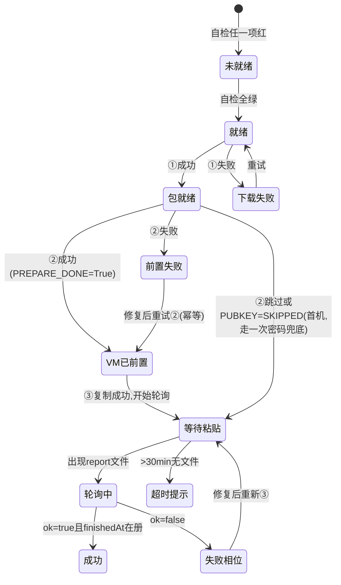

# 铠大师 App · WinVM 部署助手功能规格书（K1–K3）

> 状态：**V1.3 实施规格**（2026-10-20；已纳入主理人对 §10 Q-1~Q-6 的全部裁决。V1.3 订正 E5/D-5 歧义表述：「执行链已就绪」明确为**包内执行脚本已实现并真机验证**，真正执行者是新机 WorkBuddy agent 按粘贴 prompt 驱动，非 WB 内置功能、亦非铠大师实现范围）· 交付对象：铠大师 App 开发团队
> 输入依据：`docs/deploy/通过铠大师app安装部署.md`（方案 V1，下称「方案」）、`docs/05-peripherals/DEPLOYMENT.md` §9（下称「DEPLOYMENT §9」）
> 关联任务：REL-12；仓库侧并行依赖：REL-11（publish-release.mjs 一键上架 GitHub Release）、`tools/winvm-prepare.ps1`（单一真相源，工程侧落地中）
> 语言：全中文规格；技术栈不限定（鸿蒙 ArkTS/由 App 团队自定），本规格只约束行为与契约。

---

## 1. 概述与目标

**一句话价值**：让一台全新鸿蒙机（已建好 Windows VM、GitHub 仓库/发布已就绪）通过铠大师 App，以 **≤3 次点击 + 1 次粘贴** 完成 WinVM Bridge 发布版（版本缺省 **latest**，Q-5；当前示例 V1.4.0）的安装、部署与验证。

**前提事实更新（相对方案 V1 的增补，本规格以此为准）**：

| # | 事实 | 对设计的影响 |
|---|---|---|
| E1 | GitHub 仓库 `athronix/workbuddy-virtual-win-plugin` **已转 public** | K1 的「获取发布包」= **匿名 HTTPS 下载 GitHub Release zip 资产**，无需 token；取消方案中「内置/复制本地包」的主路径假设，本地选包仅作兜底 |
| E2 | 发布包以 zip 上架：`https://github.com/athronix/workbuddy-virtual-win-plugin/releases/download/V1.4.0/winvm-overall-V1.4.0.zip`（资产命名 `winvm-overall-<version>.zip`） | 下载 URL 可由 `版本` 单参数模板化生成；Q-2 裁决：同 Release **旁挂第二资产 `winvm-overall-<version>.zip.sha256`**（`sha256sum -c` 兼容单行格式） |
| E3 | zip 内含 `MANIFEST.txt`（逐文件 sha256 + 总体指纹，见 DEPLOYMENT §9）；Release 旁挂 `.zip.sha256`（Q-2） | **两级校验（C-2）**：解包前整包 sha256 对旁挂文件 + 解包后 MANIFEST 逐文件复检 |
| E4 | 铠大师 App 代码库尚未建立 | 本文 = 从零实施规格，非增量改造 |
| E5 | **发布 zip 包内自带的执行脚本已实现并真机验证**（`delivery/bootstrap.mjs check/env/prepare-vm`、`setup.mjs` 七相位、`deploy-all.sh --wipe`、验证矩阵步骤；run1–run4 真机通过）。注意：脚本"就绪"≠部署"完成"——**真正执行它们的是新机 WorkBuddy agent 按粘贴 prompt 的驱动**（§3 阶段 B/C、方案 §5.2 模板）；写 `deploy-report.json` 同样是 prompt 第 7 步指示 WB 完成的动作，非 WB 内置功能 | 铠大师**不重复实现任何部署逻辑**（部署实现=包内脚本+prompt 驱动，均已存在）；App 只做落包/VM 前置/生成 prompt/读回 report 四件事。WB 侧唯一前置=该机已安装并登录 WorkBuddy（G11，一次性人工） |

**成功度量**：

| 指标 | 目标 |
|---|---|
| 用户动作数（从打开铠大师页面到看到「✅ 部署成功」） | **3 次点击（①②③）+ 1 次粘贴（WorkBuddy 内）**，状态读回为自动轮询不计入 |
| 端到端时长 | 阶段 A（铠大师侧）≤ 3 分钟（含下载，典型包体百 MB 级、局域网/公网 HTTPS）+ 阶段 C（WorkBuddy 自动执行）6–8 分钟 → **总 ≤ 12 分钟** |
| 零密码率 | 公钥常驻 hmdfs 后（Q-1：prompt 第 1 步 WB 自动建钥+摆渡），**自第二次部署起** K2 注入、全链零密码；首机首次允许一次 `bootstrap trust` 密码兜底（方案 G2） |
| 首机首用成功率 | 一次粘贴即达 `deploy-report.json` `ok=true`；任何失败均能在状态面板定位到**失败相位 + traceId** |

---

## 2. 用户故事与验收标准

### US-1 首次部署（主路径，P0）

> As a 新鸿蒙机用户, I want 在铠大师「WinVM 部署」页点三个按钮、去 WorkBuddy 粘贴一条指令, so that 十分钟内获得经验证的 WinVM Bridge 部署。

**Given** 新机已建好 Windows VM 且与宿主网络互通、WorkBuddy 已安装登录、GitHub Release 已上架（版本缺省 latest，Q-5）；
**When** 用户填表（VM 地址/用户/provider）→ 点①获取发布包 → 点② VM 环境准备 → 点③复制安装指令 → 切 WorkBuddy 粘贴发送；
**Then** ①在 hmdfs 生成校验通过的包目录；②KV **八核心键**恒定输出（Q-3/Q-6，未知附加键忽略）并逐项打勾——首机 hmdfs 尚无公钥时 `PUBKEY_*_AK=SKIPPED` 属正常态；③剪贴板得到含 `WINVM_DRY_RUN=0` 与 `bash deploy-all.sh --wipe`（Q-4）的完整 prompt；WorkBuddy 自动跑完后，铠大师状态面板在 ≤10s 轮询间隔内显示 `✅ 成功` + 七相位耗时 + checks 7/7。
**时序叙事（Q-1 裁决）**：首机流程 = K2 先跑（公钥 SKIPPED）→ 粘贴 prompt（prompt 第 1 步由 WB 自动建钥并摆渡公钥到 hmdfs 固定路径，第 4 步免密失败则 trust 允许**一次**密码）→ 公钥此后**常驻 hmdfs** → **二机/二次部署起 K2 注入、全链零密码**。

### US-2 重装 / 升级（P1）

> As a 已部署用户, I want 选新版本重新走同一三按钮流程, so that 按发布纪律清空重装到新版本。

**Given** 页面已存在上次部署记录（包目录/report 在册）；
**When** 用户把版本从 V1.4.0 改为 V1.4.1 并重复 ①②③；
**Then** ①下载新包不覆盖旧包目录（按版本分目录）；prompt 中版本号同步更新；步骤 6 的 `bash deploy-all.sh --wipe`（Q-4）保证先清场（方案 G9，铁律不可省略）；状态面板展示新一轮 report（以 `finishedAt` 晚于本轮点击③的时间戳判定为「新结果」）。

### US-3 失败可观测（P0）

> As a 用户, I want 任何一个环节失败都看到「哪一步、什么错、下一步怎么办」, so that 不需要翻日志就能自助恢复或有效求助。

**Given** 出现典型失败（下载超时 / sha256 不符 / sshd 安装失败 / WorkBuddy 某相位红）；
**When** 对应按钮或轮询检测到失败；
**Then** 呈现形式统一为：`❌ <环节> + 一行根因初判 + 一行修复建议 + 可复制的原始错误`。report 失败态必须展示 `failures[]` 中的失败相位与 traceId 证据；超 30 分钟无 report 文件 → 提示「WorkBuddy 尚未开始，请确认已粘贴指令」。（方案 §4.2 按钮契约表为最低标准。）

### US-4 无铠大师降级（P0，非铠大师功能，为边界声明）

> As a 暂时用不了铠大师的用户, I want 按纯 WorkBuddy 手工路径部署, so that 部署能力不依赖 App 可用性。

**Given** 无铠大师；
**When** 用户按方案 §7 手工在 VM 装 OpenSSH、`bootstrap.mjs trust` 输一次密码、自行落包；
**Then** 粘贴同一 prompt 模板（§5.2）的 2–8 步完全相同、结果等价。**本规格不新增任何部署语义**：铠大师只做「权限补位（L4）+ 交互降维」，两路径共用同一发布链与同一 report 契约。

---

## 3. 功能池（P0 / P1 / P2）

编号 `F-*`；依赖列指向本文 §5 契约与 §7 阻塞项。

### P0（必须，缺一则「3 点击+1 粘贴」不成立）

| ID | 名称 | 简述 | 验收标准 | 依赖 |
|---|---|---|---|---|
| F-01 | 「WinVM 部署」页 + 表单 | 新增单页：包目录/版本、VM 地址、VM 用户、SSH 端口（默认 22）、Provider 下拉（`workbuddy-deterministic` 缺省推荐 / `workbuddy` / `hermes-agent`）、☑ SSH 公钥注入。**版本下拉缺省 = `latest`（Q-5）**：打开页面时匿名 `GET https://api.github.com/repos/athronix/workbuddy-virtual-win-plugin/releases/latest` 解析 `tag_name` 用于展示与后续 URL 拼装，表单显示实际解析到的版本号（如 V1.4.0）供用户知情，可手动改选历史版本。页面顶部**前置自检条**：①hmdfs 可写（`/storage/Users/currentUser/` 实测写入探针）②WorkBuddy 在册（探测 `/storage/Users/currentUser/.workbuddy/` 目录结构，方案 G11）③Release 可达（= latest API 成功返回） | 三项自检全绿才允许①②③置为可用；任一红→对应自检项文案给出修复动作（装 WB / 检查网络 / 检查存储权限）；latest 解析失败→版本下拉回退手动输入并黄条提示 | — |
| F-02 | 按钮①「获取发布包」 | 由版本参数拼 GitHub Release 匿名 URL（C-2 契约）→ 校验与落包顺序（Q-2 两道校验）：**先下旁挂 `winvm-overall-<version>.zip.sha256` → 再下 `winvm-overall-<version>.zip` 到 `/storage/Users/currentUser/Downloads/winvm-release/` → 整包 sha256 比对通过才允许解包 → 解包为真实目录** `.../winvm-release/<version>-overall/`（hmdfs 不支持符号链接，方案 G7；路径全 ASCII，方案 G8）→ 解包后按包内 `MANIFEST.txt` 逐文件 sha256 复检（完整性二检）。兜底：保留「选择本地已有包目录」入口 | a) 下载显示字节进度；b) 任一道校验不过=红态+删除半成品+可重试；c) 解包后断言 `deploy-all.sh`、`MANIFEST.txt`、`README.md` 存在（PACKAGE_REQUIRED 口径，DEPLOYMENT §9.1）；d) 中断续传可 P1，但重试必须从零干净；e) `.zip.sha256` 缺失（旧版 Release）→ 降级为仅 MANIFEST 二检并黄条提示 | F-01；D-3（Release 双资产上架，REL-11） |
| F-03 | 按钮②「VM 环境准备」（K2） | 经铠大师既有「VM 内安装软件 / 执行 PowerShell」通道（D-1），把 `tools/winvm-prepare.ps1`（仓库单一真相源，随①的包分发）推送至 VM，以**管理员 PowerShell** 执行（§5.3 契约），按行解析 `KV=VALUE` 输出为打勾列表：sshd 状态/启动模式、防火墙 22、Node、公钥双文件注入。公钥来源：WB 自动保证的 hmdfs 固定路径（C-4，Q-1）+ 三级回退 | a) `PREPARE_DONE=True` 才算 ✅；**KV 八核心键恒定输出（Q-3/Q-6，C-3 表），缺任一=整次执行判异常（严判不变）；未知/额外键（如 SSH_PORT 等附加诊断键）忽略，前向兼容**；b) **公钥注入必须同时写 per-user `authorized_keys` 与 `C:\ProgramData\ssh\administrators_authorized_keys` 并对后者 icacls 收紧**（方案 G1，脚本已内建，App 侧核验 `PUBKEY_USER_AK` 与 `PUBKEY_ADMIN_AK` 两个 KV 都在册；`SKIPPED`=正常跳过态而非 ❌，提示"首机将走一次密码兜底，二机起零密码"）；c) 重复执行安全（脚本幂等，App 可放心重试）；d) 原始输出全文可展开查看/复制 | D-1；D-4（脚本落地）；F-02（脚本随包分发） |
| F-04 | 按钮③「复制安装指令」（K3） | 将 F-01 表单值填入方案 §5.2 prompt 模板生成**逐字可粘贴**文本到剪贴板。参数槽：`{VERSION}`、`{VM_HOST}`、`{VM_USER}`、`{WINVM_VM_PROVIDER}`、包目录=`/storage/Users/currentUser/Downloads/winvm-release/<version>-overall`。**生成文本必须显式包含**：①`WINVM_DRY_RUN=0`（方案 G12，缺省=1 会全程假成功）②`bash deploy-all.sh --wipe`（G9；Q-4：统一 `bash` 前缀，hmdfs 解包可能丢执行位）③report 路径 `/storage/Users/currentUser/.workbuddy/winvm/deploy-report.json`④第 1 步公钥摆渡子句（Q-1：`~/.ssh/id_ed25519` 缺则 ssh-keygen 生成，`cp` 公钥到 hmdfs 固定路径）⑤第 4 步 BatchMode 免密验证。生成后展示预览（只读），复制成功 toast | a) 模板与方案 §5.2（含 Q-1/Q-4 裁决增补，工程师回写方案后以其为准）逐字段一致；b) 自动化断言：生成文本含 `WINVM_DRY_RUN=0` 且不含 `WINVM_DRY_RUN=1`；含 `--wipe`；含 `id_ed25519.pub` 摆渡句；provider 下拉值原样进入第 2 步 .env 行 | F-01、F-02（版本号联动） |
| F-05 | 部署状态读回 | 点击③后自动进入轮询：每 10s 读 `/storage/Users/currentUser/.workbuddy/winvm/deploy-report.json`。**采信判据：JSON 可解析且 `finishedAt` 字段存在**（方案 G10——hmdfs 写入窗口内可能读到 0B 假空，读到即忽略、下轮再试）。成功后停止轮询并渲染：`ok` 大状态、`phases` 耗时表、`checks[]` 7 项逐项 ✅/❌（含 evidence/traceId）、`failures[]` 明细。失败态/超时态文案按 US-3 验收 | a) 30 分钟无有效文件 → 固定提示「WorkBuddy 尚未开始，请粘贴指令」；b) `ok=false` 时高亮 `failures[0]` 相位并给出方案 §9 对应坑号提示；c) 提供「手动刷新」与「查看原始 JSON」 | F-01（自检②通过才有意义）；契约 C-1 |

**P0 功能数：5（F-01 ~ F-05）**，对应 K1=F-01/F-02/F-05、K2=F-03、K3=F-04。

### P1（应该，显著提升体验）

| ID | 名称 | 简述 | 验收标准 | 依赖 |
|---|---|---|---|---|
| F-06 | provider=workbuddy 登录引导 | 方案 G4：`workbuddy` 选型依赖 VM 内 codebuddy CLI 登录态，**结构性不可脚本化**。首机引导策略：默认选 `workbuddy-deterministic` 跑通全链 → report `ok=true` 后状态面板追加卡片「切换 LLM Agent：在 VM 内登录 codebuddy 后将 Provider 改为 workbuddy、点③重新粘贴（可跳过 --wipe 的升级路径由 prompt 版本区分）」 | 引导文案准确描述 G4 限制；不出现任何「自动登录」伪承诺 | F-05 |
| F-07 | 报告导出 | 将 report 渲染为分享文本/图片（含版本、耗时、7 项 checks、traceId），便于贴到问题台账 `docs/release/issues.md` | 导出内容不含 .env/私钥等敏感值 | F-05 |
| F-08 | 版本检测与升级提示 | 打开页面时匿名请求 GitHub Release latest，比较已部署版本（读 report `version`），提示可升级 | 仅提示不自动执行；升级路径复用 US-2 | F-05 |

### P2（可选）

| ID | 名称 | 简述 |
|---|---|---|
| F-09 | 多机 Profile | 保存多组 (VM 地址/用户/provider) 配置，切换后重生成 prompt |
| F-10 | 下载续传与预释放渠道 | 断点续传；pre-release 版本通道开关 |

---

## 4. UI 线框

### 4.1 页面结构（「WinVM 部署」页）

```
┌ WinVM Bridge 部署助手 ────────────────────────────────────────┐
│ 前置自检:  ✅ 共享存储可写   ✅ WorkBuddy 已安装   ✅ Release 可达 │  ← F-01
│──────────────────────────────────────────────────────────────│
│ 版本:        [latest → V1.4.0 ▾]  (匿名 API 解析, Q-5 可改选)  │  ← F-01/F-08
│ VM 地址:     [172.16.100.____]  VM 用户: [User    ]  端口[22] │
│ Provider:    [workbuddy-deterministic ▾]  ☑ SSH 公钥注入      │
│ 包目录:      ~/Downloads/winvm-release/  (hmdfs, WB 可读)     │
│                                                              │
│  [① 获取发布包]      [② VM 环境准备]      [③ 复制安装指令]     │  ← F-02/03/04
│   └ 进度条/字节数     └ KV 打勾清单         └ prompt 预览(只读) │
│──────────────────────────────────────────────────────────────│
│ 部署状态:  ● 等待粘贴安装                                     │  ← F-05
│   (轮询 10s；上次更新 10:41:12)               [手动刷新][原始JSON]│
│   ✅ 成功 V1.4.0 (总 03:41)                                   │
│   ├ WIPE 17/17 · HOST 1.3s · VM 32.7s · VMSTART 18.2s         │
│   │  TUNNEL 8.4s · TEST 0.4s · QAPROBE 67.1s · HEALTH 0.5s    │
│   ├ checks 7/7 [health|capabilities|systeminfo|a2a|gui|       │
│   │            audit|bothends]  ▸ 展开看 evidence/traceId     │
│   └ （失败态）❌ VM-START 失败 · traceId tr_xxx ▸ 复制错误原文  │
└──────────────────────────────────────────────────────────────┘
```

### 4.2 按钮输入/输出/失败态矩阵

| 按钮 | 输入 | 输出（成功态） | 失败呈现 |
|---|---|---|---|
| ① 获取发布包 | 版本字符串 → URL 模板（C-2，缺省 latest 解析值） | hmdfs 出现 `<version>-overall/` 真实目录 + **两道校验（整包 sha256 → MANIFEST 复检）通过徽标**；按钮变 ✅ | 网络断/超时→重试按钮；整包 sha256 或 MANIFEST 不符→红+清理+「发布包可能不完整，请重试或核对 Release」；`.zip.sha256` 旁挂缺失→黄条降级仅 MANIFEST 二检（F-02-e）；空间不足/权限→toast |
| ② VM 环境准备 | 表单 VM 连接参数 + 脚本资产（C-3）+ 公钥（C-4，可空） | KV 打勾列表全绿（`PREPARE_DONE=True`）；原始输出可折叠查看 | 逐项 ❌ + 一行修复建议（如 sshd ❌→「确认在 VM 内以管理员 PowerShell 执行」）；执行通道不可用→「未找到 VM 安装通道」= D-1 阻塞的显性化 |
| ③ 复制安装指令 | 表单全量参数（C-5 模板） | 剪贴板含完整 prompt；预览面板显示将粘贴的原文 | 必填项缺失→表单内联提示；无其它失败态（纯本地字符串生成） |
| （自动）状态读回 | report 路径固定（C-1） | ✅/❌ 大状态 + 相位/ checks/ failures 明细 | 30min 无文件→引导粘贴；读到 0B/解析失败→静默下轮重试（G10），连续 5 次失败才提示一次 |

### 4.3 状态机（部署状态面板）



---

## 5. 接口契约（与仓库侧对齐，不得自创）

### C-1 `deploy-report.json`（铠大师 ↔ WorkBuddy 唯一交接口）

- **路径固定**：`/storage/Users/currentUser/.workbuddy/winvm/deploy-report.json`（hmdfs，WB 可写、铠大师可读）。
- **Schema（与方案 §5.3 逐字段一致）**：

```json
{
  "version": "V1.4.0",
  "ok": true,
  "finishedAt": "2026-10-18T10:41:00+08:00",
  "phases": { "WIPE": "17/17 PASS", "HOST": 1.3, "VM": 32.7, "VMSTART": 18.2,
              "TUNNEL": 8.4, "TEST": 0.4, "QAPROBE": 67.1, "HEALTH": 0.5 },
  "checks": [
    { "id": "health",       "pass": true, "evidence": "ok:true provider=workbuddy/ready" },
    { "id": "capabilities", "pass": true, "evidence": "count=54 domains=6 tr_xxx" },
    { "id": "systeminfo",   "pass": true, "evidence": "Win11 26200 ARM64 tr_xxx" },
    { "id": "a2a",          "pass": true, "evidence": "steps[0] ok 12.8s tr_xxx" },
    { "id": "gui",          "pass": true, "evidence": "healthy interactive=true" },
    { "id": "audit",        "pass": true, "evidence": "chain=37 receipt=1 card=5skills" },
    { "id": "bothends",     "pass": true, "evidence": "cache=0.1.0 task=Running" }
  ],
  "failures": []
}
```

- **读侧规则**：仅当 JSON 可解析且 `finishedAt` 存在才采信（G10；WB 写侧已有 stat 二次确认，读侧判据双保险）。`checks[].evidence` 直接展示；report 缺 traceId 类证据而 `ok=true` 时，状态面板追加黄条「证据不足，可能遭遇 dry-run 假成功（G12）」。
- `checks[]` 七项 id 固定为上述 7 个（与 DEPLOYMENT §9.4 验证矩阵同源），**新增/改名 id 需两侧同步改版**。

### C-2 发布包分发（GitHub Release 匿名链路）

| 项 | 规则 |
|---|---|
| 仓库 | `athronix/workbuddy-virtual-win-plugin`（**public**，匿名 HTTPS 可用，无需 token） |
| 资产命名 | 主资产 `winvm-overall-<version>.zip`（如 `winvm-overall-V1.4.0.zip`；tag 名 = `<version>`，如 `V1.4.0`）＋ **旁挂校验资产 `winvm-overall-<version>.zip.sha256`（Q-2，`sha256sum -c` 兼容单行格式：`<64hex>  winvm-overall-<version>.zip`）** |
| latest 解析（Q-5） | 匿名 `GET https://api.github.com/repos/athronix/workbuddy-virtual-win-plugin/releases/latest` → 取 `tag_name` 作为缺省 `<version>` 展示与拼装；下载 URL 采用**解析到具体 tag 的形式**（不用 `/releases/latest/download/` 重定向 URL，理由：落地版本字符串可回填 prompt `{VERSION}` 与包目录名，保证三处一致） |
| 下载 URL 模板 | `https://github.com/athronix/workbuddy-virtual-win-plugin/releases/download/<version>/winvm-overall-<version>.zip`（校验资产同目录加后缀 `.sha256`） |
| 落盘路径 | zip → `/storage/Users/currentUser/Downloads/winvm-release/winvm-overall-<version>.zip`；解包 → 同级 `<version>-overall/`（真实目录复制，禁 symlink/junction，G7/G8） |
| 校验顺序（Q-2 两道） | ①解包前：旁挂 `.zip.sha256` vs 整包实算 sha256，不符即红态清理；②解包后：按包内 `MANIFEST.txt` 逐文件 sha256 复检（至少抽 `deploy-all.sh` + 总体指纹行）。旁挂缺失（旧 Release）→ 降级为仅②并黄条提示（F-02-e） |
| 信任链（第三道，由发布侧保证） | **打包器 fail-loud 保证 zip 条目集 == MANIFEST∪{MANIFEST.txt}，即 zip 不含 MANIFEST 之外的任何条目（`.env` 等真机敏感文件结构性排除）**——铠大师侧无需实现，App 两道校验 + 此结构保证共同构成完整信任链 |

### C-3 `tools/winvm-prepare.ps1` 调用契约

- **真相源**：仓库 `tools/winvm-prepare.ps1`（工程师并行落地中，D-4）；铠大师**不自持业务判据**，脚本随 C-2 发布包分发（包内路径以实际 `overall` 包结构为准，方案 §4.3 约定双写）。方案附录 A 仅为参考骨架。
- **调用方式**：经铠大师既有 VM 安装/执行通道（D-1），在 VM **管理员 PowerShell** 中执行：`powershell.exe -NoProfile -ExecutionPolicy Bypass -File winvm-prepare.ps1 -PubKey '<ed25519 pub 或空串>' -SshPort 22`；脚本 ASCII-only、幂等（探测先行、只改缺项）。
- **KV 输出契约**（stdout 每行一条 `KEY=VALUE`，App 按行解析）：

| Key | 期望值 | 缺失/异常判定 |
|---|---|---|
| `ADMIN` | `True` | `False`=❌（非管理员 PowerShell 执行 → sshd 安装/icacls 必失败，提示提权重跑） |
| `SSHD_STATE` | `Running` | 其它=❌（sshd 未起，G3 鸡生蛋未解） |
| `SSHD_STARTMODE` | `Automatic` | 其它=⚠ 提示 |
| `FW_SSH` | `True` | `False`=❌（22 端口不可达） |
| `NODE` | `v<≥18>` | 空=❌（VM 服务运行时缺失） |
| `PUBKEY_USER_AK` | `True` / `SKIPPED` | `SKIPPED`=正常跳过态（免密走一次密码兜底，二机起零密码）；既非 True 也非 SKIPPED=❌ |
| `PUBKEY_ADMIN_AK` | 同上 | **G1 核心项**：Administrators 组成员忽略 per-user authorized_keys，此文件+icacls ACL 必查 |
| `PREPARE_DONE` | `True` | 缺此行=整次执行失败（不得部分采信） |

> **KV 契约定稿（Q-3 + Q-6）**：上表**八核心键**（`ADMIN / SSHD_STATE / SSHD_STARTMODE / FW_SSH / NODE / PUBKEY_USER_AK / PUBKEY_ADMIN_AK / PREPARE_DONE`）**恒定输出**——无公钥时 `PUBKEY_USER_AK=SKIPPED` / `PUBKEY_ADMIN_AK=SKIPPED` 显式出现。F-03 解析器判据：**八核心键缺任一=异常（严判不变）；未知/额外键忽略**（前向兼容——`SSH_PORT` 等为附加诊断键，脚本日后增键不破坏 App 解析器）。正式版 `tools/winvm-prepare.ps1` 需实现该语义（工程师，D-4）。

### C-4 SSH 公钥交换约定（Q-1 已拍板：WB 侧自动摆渡闭环）

- **摆渡保证**：prompt 第 1 步（工程师写入方案 §5.2 模板）约定 WorkBuddy 执行「若沙箱 `~/.ssh/id_ed25519` 缺则 `ssh-keygen` 生成，再 `cp` 公钥到 `/storage/Users/currentUser/.workbuddy/winvm/id_ed25519.pub`」——**只摆渡公钥，私钥永不出 WB 沙箱、hmdfs 上绝不出现私钥**。该路径即 F-03 读取公钥的固定来源（WB 自动保证，非用户操作）。
- 三级回退（F-03 执行时）：①hmdfs 固定路径存在公钥 → 注入（首机之后恒为此态）；②不存在（首机/被清理）→ 允许用户在 F-01 表单粘贴公钥字符串；③均无 → F-03 传空 `-PubKey ''`，KV 输出 `PUBKEY_*_AK=SKIPPED`，prompt 第 4 步免密失败时按方案 §5.2 走 `bootstrap trust` 一次密码兜底（G2）。
- **时序闭环（Q-1）**：首机 = K2 先跑（SKIPPED）→ 粘贴（prompt 完成建钥+摆渡，trust 允许一次密码）→ 公钥常驻 hmdfs → **二机/二次起 K2 注入、全链零密码**。铠大师侧无需为此新增功能，仅按 F-03/F-06 文案呈现当前处于哪一档。

### C-5 install prompt 模板参数表（K3 填充规则）

模板正文 = 方案 §5.2 **逐字**，仅替换以下槽位：

| 槽位 | 来源 | 校验 |
|---|---|---|
| `{VERSION}`（含标题行「发布版 <version>」、包目录行、cd 路径） | F-01 版本下拉（缺省=latest 解析值，Q-5） | 必须与 C-2 已下载包的实际 tag 一致，不一致禁用③ |
| `{VM_HOST}` / `{VM_USER}` | 表单 | IP/主机名与用户名非空、ASCII |
| `{WINVM_VM_PROVIDER}` / `{provider}` | 下拉三值之一 | 选 `workbuddy` 时弹 G4 登录依赖提示（F-06 文案），允许继续 |
| SSH 端口 | 表单（默认 22） | 与 F-03 `-SshPort` 联动 |
| 固定不变项（生成器硬断言） | — | `WINVM_DRY_RUN=0`（G12）；**`bash deploy-all.sh --wipe`（G9 + Q-4，不带 `./`，防 hmdfs 执行位丢失）**；第 1 步含公钥摆渡子句（Q-1，C-4）；report 路径（C-1）；第 4 步 BatchMode 验证行 |

---

## 6. 端到端时序

```mermaid
sequenceDiagram
    actor U as 用户
    participant K as 铠大师App
    participant V as VM(Windows)
    participant H as hmdfs共享存储
    participant W as WorkBuddy
    participant G as GitHubRelease

    U->>K: 打开「WinVM部署」页, 填 VM地址/用户/provider
    K->>G: 匿名 GET releases/latest 解析 tag_name(Q-5 缺省版本)
    K->>K: F-01 自检(存储可写/WB在册/Release可达)
    U->>K: 点击① 获取发布包
    K->>G: 先匿名 GET winvm-overall-<v>.zip.sha256 (C-2/Q-2)
    G-->>K: sha256 单行
    K->>G: 再匿名 GET winvm-overall-<v>.zip
    G-->>K: zip 字节流
    K->>H: 整包sha256校验通过→解包真实目录 <v>-overall/→MANIFEST逐文件复检
    U->>K: 点击② VM环境准备
    K->>V: 经既有安装通道推送并执行 tools/winvm-prepare.ps1 (管理员PS, 带-PubKey或空串)
    V-->>K: KV八核心键恒定输出(附加键如SSH_PORT忽略; 首机 PUBKEY_*_AK=SKIPPED 属正常态)
    K-->>U: 打勾列表(缺任一键=异常, Q-3严判)
    U->>K: 点击③ 复制安装指令
    K-->>U: 剪贴板=prompt(§5.2模板, 显式WINVM_DRY_RUN=0, bash deploy-all.sh --wipe)
    U->>W: 切WorkBuddy 新建任务 粘贴发送(唯一一次粘贴)
    W->>H: 第1步: 复制包入工作区; ssh-keygen缺则建; cp id_ed25519.pub→hmdfs固定路径(Q-1)
    W->>W: bootstrap.mjs check/env(写.env)
    W->>V: ssh -o BatchMode=yes whoami(公钥在册则秒过; 首机否则trust一次密码)
    W->>V: prepare-vm --apply --ensure-node(幂等兜底, 预期全SKIP)
    W->>V: bash deploy-all.sh --wipe(清场→HOST→VM→VMSTART→TUNNEL→TEST→QAPROBE→HEALTH)
    W->>W: 验证矩阵7项
    W->>H: 写 deploy-report.json(写完stat二次确认>0字节)
    K->>H: 每10s轮询; 仅finishedAt存在且可解析才采信(G10)
    K-->>U: 状态面板 ✅成功(相位耗时+checks) / ❌失败相位+traceId
```

---

## 7. 依赖与阻塞

| ID | 依赖 | 状态 | 影响 | 处置 |
|---|---|---|---|---|
| D-1 | 铠大师既有「VM 内安装软件 / 执行 PowerShell」通道 | **待 App 团队确认是否已具备** | F-03（K2）唯一载体；若无则「3 点击」退化为「1 点击+手工 VM 前置+1 粘贴」，仍可部署但非零密码快路径 | 列为 K2 前置依赖；规格不假设通道内部实现，仅约定 C-3 执行与 KV 契约 |
| D-2 | 网络可达 GitHub（匿名 HTTPS）+ hmdfs 写权限 | 环境项 | F-02 | F-01 自检①③覆盖；失败走本地选包兜底 |
| D-3 | Release **双资产**上架：`winvm-overall-<version>.zip` + `.zip.sha256`（REL-11，工程师并行中；Q-2 已拍板） | 进行中 | F-02/F-08 | M1 联调前用仓库 `release/V1.4.0/overall` 目录人工打包+人工生成旁挂 sha256 冒烟 |
| D-4 | `tools/winvm-prepare.ps1` 正式版（**含 Q-3/Q-6 定稿的八核心键恒定输出/SKIPPED 语义**，C-3） | 工程师落地中 | F-03 | 单一真相源；铠大师不得 fork 业务判据 |
| D-5 | 包内执行脚本链（check/env/prepare-vm/deploy-all + prompt 驱动的验证/report，见 E5） | 已就绪（脚本=仓库既有+真机验证；执行=WB 按 prompt 跑） | F-05 | 无新增工作，纯契约消费 |
| D-6 | WB 公钥自动摆渡到 hmdfs（prompt 第 1 步子句，C-4/Q-1 已拍板） | **转仓库侧实施**（工程师写入方案 §5.2 模板） | 二机起零密码快路径 | 不阻塞 M1/M2；首机按 SKIPPED+一次密码兜底设计 |

---

## 8. 坑对照表（方案 §9 G1–G12 → 功能闭环）

| ID | 风险 | 规避落点（本规格） | 闭环验证 |
|---|---|---|---|
| G1 | Administrators 组忽略 per-user authorized_keys | F-03 硬验 `PUBKEY_ADMIN_AK` KV；C-4 公钥交换 | checks：两 KV 同 True 才显示「免密就绪」 |
| G2 | trust 需一次密码 vs 零交互 | F-03 快路径注入 + C-4 WB 自动摆渡（Q-1）+ prompt 第 4 步 BatchMode | 首机允许一次密码；**二机起零密码（公钥常驻 hmdfs）** |
| G3 | 新 VM sshd 未装（鸡生蛋） | F-03（K2）在 SSH 之前完成 L4 前置 = 铠大师核心价值 | `SSHD_STATE=Running` |
| G4 | provider=workbuddy 依赖 codebuddy 登录（不可脚本化） | F-06 引导策略：首机先 deterministic 跑通再切 | prompt 生成器对 workbuddy 选项弹提示不拦截 |
| G5 | 旧隧道黑洞 | 仓库侧已修（TUNNEL 硬判据）；App 仅消费 report | `phases.TUNNEL` + checks.health |
| G6 | 18443 bind EACCES | 仓库侧已修（uninstall 查杀顺序）；App 仅 `--wipe` prompt | prompt 固定含 `--wipe`（C-5） |
| G7 | hmdfs 不建符号链接 | F-02 **真实目录复制**解包，禁 symlink/junction | 解包后 `deploy-all.sh` 为实体文件 |
| G8 | 中文路径码页腐化 | C-2 落盘路径全 ASCII（`winvm-release/<version>-overall`）；C-3 脚本 ASCII-only | F-02 断言路径正则 `^[ -~]+$` |
| G9 | 重装不清空 | C-5 prompt 第 6 步固定 `bash deploy-all.sh --wipe` 不可省略（Q-4） | 生成器断言含 `--wipe` 且带 `bash` 前缀 |
| G10 | report 写入窗口假空 | F-05 仅采信「可解析 + finishedAt 存在」 | 连续读取失败静默重试 |
| G11 | WB 未装/未登录 | F-01 自检②探测 `~/.workbuddy/` 结构，缺则阻断③并提示 | 自检条 |
| G12 | `WINVM_DRY_RUN` 缺省=1 → 全链假成功 | C-5 模板**显式** `WINVM_DRY_RUN=0` + F-05 证据不足黄条（缺 traceId 即疑此坑） | 生成器断言 + report 证据抽检 |

---

## 9. 实施里程碑建议

| 里程碑 | 内容 | 交付判据 | 不含 |
|---|---|---|---|
| **M1 最小闭环**（F-01/F-02/F-04/F-05） | 页面+表单+自检；GitHub 匿名下载+校验+落包；prompt 生成（provider 固定建议 `workbuddy-deterministic`）；report 轮询 | 真机 1 轮：①→③→粘贴→面板 ✅；全程可含一次 trust 密码 | K2 按钮置灰或仅「手工指引」模式 |
| **M2 零密码快路径**（F-03 + D-1/D-4） | VM 环境准备按钮、ps1 推送执行、KV 打勾、公钥注入（C-4 ①②级） | 新 VM 镜像直接可达：②后 prompt 第 4 步 BatchMode 秒过、prepare-vm 全 [SKIP] | codebuddy 登录 |
| **M3 体验完整版**（F-06~F-10） | workbuddy 登录引导与切换、报告导出、版本检测、多机 Profile | 二机起全自动；G4 用户教育文案上线 | — |

> 每里程碑建议按发布纪律做一次新鸿蒙机真机演练（方案 W2），结果记 `docs/release/issues.md`。

---

## 10. 裁决记录（原 §10 开放问题已由主理人全部拍板，2026-10-18）

| # | 裁决 | 已落入本规格位置 |
|---|---|---|
| Q-1 | 首机公钥摆渡闭环改由 **WB 侧 prompt 第 1 步自动完成**（缺钥 ssh-keygen + cp 公钥到 hmdfs 固定路径；私钥永不出沙箱）。时序：首机 K2 先跑（PUBKEY=SKIPPED）→ 粘贴（trust 允许一次密码）→ 公钥常驻 hmdfs → 二机起 K2 注入、全链零密码 | §1 成功度量表、US-1 时序叙事、F-03/F-04 验收、C-4、§6 时序图、G2、D-6（转工程师写入方案 §5.2 模板） |
| Q-2 | Release 旁挂第二资产 `winvm-overall-<version>.zip.sha256`（`sha256sum -c` 兼容单行）；F-02 升级为「先校验资产→zip→整包通过才解包→MANIFEST 复检」两道校验 | E2/E3、F-02、§4.2 按钮矩阵、C-2、D-3 |
| Q-3 | C-3 KV 契约定稿：**核心键恒定输出**（键数经 Q-6 统一定稿为八核心键），无公钥时 `PUBKEY_*_AK=SKIPPED` 显式出现；解析器缺任一核心键=异常，严判不容缺省 | F-03 验收 a/b、C-3 定稿注、§6 时序图、D-4 |
| Q-4 | prompt 模板统一 `bash deploy-all.sh --wipe`（防 hmdfs 丢执行位） | US-2、F-04、C-5 硬断言行、§6 时序图、G9；模板增补需工程师同步方案 §5.2 |
| Q-5 | 版本缺省 = `latest`：匿名 `GET /repos/{repo}/releases/latest` 解析 `tag_name` 展示与拼 URL（下载 URL 用解析到具体 tag 的形式，弃重定向，保证三处一致）；可手动改选历史版本 | F-01、F-08、§4.1 线框版本行、C-2、C-5 `{VERSION}` 槽位 |
| Q-6 | **KV 三口径统一**（原状：本规格 C-3 写七键无 ADMIN、方案 §4.3 写八键、脚本实测九行输出）定稿为：**八核心键恒定输出**（`ADMIN/SSHD_STATE/SSHD_STARTMODE/FW_SSH/NODE/PUBKEY_USER_AK/PUBKEY_ADMIN_AK/PREPARE_DONE`），`SSH_PORT` 等为附加诊断键；App 判据=八核心键缺任一判异常（严判不变）+ **未知/额外键忽略**（前向兼容）。SKIPPED 语义与 PREPARE_DONE 终判不变 | C-3 契约表（补 ADMIN 行）+ 定稿注、F-03 验收 a)、US-1 Then、§6 时序图；信任链补强另见 C-2「打包器 fail-loud 保证 zip 条目集==MANIFEST∪{MANIFEST.txt}」 |
