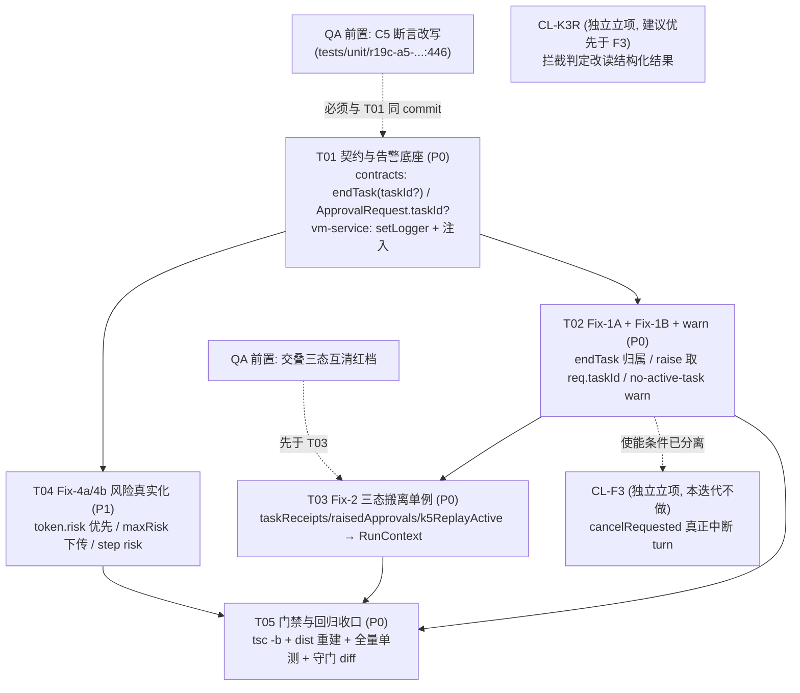

# A5 审批丢弃缺陷 —— 契约增补与实施任务分解

STATUS: FINAL（§0–§8 齐备；commit 见文末 §8）

> 本文档是**修复设计**（contract delta + 任务分解），不是根因判定。
> **权威根因文档 = `docs/design/a5-approval-drop-rootcause.md`（STATUS: FINAL，commit `eb72788`，376 行）** —— 本文引用它、不改写它。
> 本文未修改 `packages/**` 任何文件、未跑 `delivery/*.mjs`、未连 VM（VM 整机不可达，真机实验 BLOCKED）。
> 证据引用 `文件:行`，**行号会漂移**，一律同时给出附近的唯一锚点符号。

---

## 0. 前置：口径、纪律与行号校正

### 0.1 本文遵守的硬约束（逐条可核）

| 编号 | 约束 | 本文的处理 |
| --- | --- | --- |
| **D-1** | 两道门 `replayEnabled \|\| k5ReplayActive` / `raisedApprovals.size === 0` 是受保护契约，禁止移除或弱化；`tests/unit/k5-replay.test.js` 41 例须全绿 | Fix-2 只换三态的**取值来源**（实例字段 → `RunContext` 字段），**门的语义、顺序、短路条件一字不改**（§2.3 / T03） |
| **D-4** | `a2a-framework` 零审计写入侧符号、禁依赖 adapter | 本次改动**不碰** `a2a-framework/src/**`（唯一相邻面是 `task-store.ts` 的 `ApprovalRequest` 只读消费，且本轮不改它） |
| **D-5** | A2A 终态统一 `failed`；`rejected` 仅宿主显式拒绝审批，唯一置位点 `a2a-framework/src/server.ts:306` | 本轮**不改任何终态置位逻辑**；修复目标是让 `:306` 那条路径**可达**（任务先挂起 `input-required`，宿主才有对象可回复） |
| 裁决层级 | 仓库文档 > 任务板描述 > 聊天 | 所有与任务书行号/归属不一致处，均在 §0.3 显式列出并给出实测行号 |

### 0.2 必须落档的两条拍板（team-lead）

1. **`raise` 的 `no-active-task` 分支必须加 `logger.warn`**（输出 taskId / approvalId / 当前 activeTaskId）。→ 落到 C-6（新增 `setLogger`）+ T02，格式见 §4 SK-3。
2. **Fix-2 必须与 Fix-1 同批完成**，不得只修 `activeTaskId` 就宣布结案。→ 本文裁定：**同批、同一迭代、拆成 T02/T03 两个可独立验证的 CL**（§2.3 给出若排期真的不够时的降级缓解方案 Fix-2′，由 team-lead 拍板）。

### 0.3 行号校正（与任务书不一致处，实测为准）

| 任务书写法 | 实测（HEAD `eb72788`） | 说明 |
| --- | --- | --- |
| D-1 两道门在 `packages/a2a-framework/src/server.ts:1008` / `:1009` | 该文件**只有 652 行**，无 `:1008`/`:1009` | 两道门的真实落点是 **`packages/adapter-agent-workbuddy-llm/src/bridge.ts:1008`**（`if (!this.replayEnabled \|\| !this.k5ReplayActive) return base;`）与 **`:1009`**（`if (this.raisedApprovals.size === 0) return base;`），位于 `reconcileExecutionTruth` 内。K4 安全网在 `a2a-framework/src/server.ts:352`，`failed` 收口在 `:365`，`rejected` 唯一置位在 `:306` |
| `vm-service/src/server.ts` 单例字段 `:144` / `endTask` `:173` | 字段 `private activeTaskId: string \| undefined;` = **`:133`**；`endTask(): void {` = **`:171`**；根因守卫 = **`:177`** | 与根因文档附录 A 一致 |
| `contracts/src/bridge.ts` `beginTask`/`endTask` = `:313`/`:322` | `beginTask` = **`:313`**、**`endTask` = `:315`**、`raise` = **`:322`** | 需同步变更的是 `:315` |
| `ApprovalRequest` 加 `taskId?` 位置「`:173` 附近」 | `:173` 是 `export interface ApprovalRequest {` 的**接口起始行** | 字段插入点裁定为 **`:186` 之后**（即 `underlying?: ApprovalUnderlying;` 之后、`}` 之前），见 C-2 |

### 0.4 一句话根因（引自根因文档 §1.1，便于本文自洽）

`packages/vm-service/src/server.ts:177` 的 `if (!this.activeTaskId || !this.tasks) return { approved: false, reason: 'no-active-task' };`
在 A5 上命中 `!this.activeTaskId`（服务级单例被上一次委派 A4 的 `finally → endTask()` 清空）⇒ **从不调用同函数 `:191` 的 `this.tasks.waitApproval(...)`** ⇒ 任务从不进入 `input-required` ⇒ `bridge.ts:961` 的 `if (!outcome.approved) return base;` ⇒ `a2a-framework/src/server.ts:365` 按 `result.ok=false` 收口 `failed`。

---

## 1. 契约增补（逐字段 Before / After）

> 通用判定：**全部为「纯附加可选」类增补，无一项是破坏性变更（breaking change）**。
> 本章每项给出：① Before 原文 ② After 原文 ③ 破坏性判定 ④ 向后兼容论证 ⑤ 全仓实现/调用点清单（`git grep` 全仓核实，含 dist 与 packages 外的说明）。

### C-1 `ApprovalCoordinator.endTask` —— 加可选归属参数 `taskId?`（**必改**）

**落点**：`packages/contracts/src/bridge.ts:315`（锚点：接口 `ApprovalCoordinator`，`beginTask` 在其上一行）

**Before（原文）**
```ts
  /** 离开一个委派任务（清空当前 taskId） */
  endTask(): void;
```

**After**
```ts
  /**
   * 离开一个委派任务（清空当前 taskId）。
   *
   * P1-Fix（**纯附加可选**）：`taskId` 非空时按**归属**释放 —— 仅当它等于协调器当前记录的
   * 活动任务 id 才清空；不相等 ⇒ 本次收尾**不属于**当前活动任务（并发委派交叠），
   * 保持不动，绝不误清他人（根因见 a5-approval-drop-rootcause.md §3.1）。
   *
   * `taskId` 缺席（`undefined`）或空串 `''` ⇒ **旧行为逐字不变**：无条件清空
   * （调用方没有归属信息，协调器无从判断，只能按 K4 原语义释放）。
   */
  endTask(taskId?: string): void;
```

**破坏性判定**：**非破坏**（源码级兼容）。

**向后兼容论证**
1. **对既有调用方**：TS 可选参数 ⇒ 现有 `endTask()` 零参调用**仍合法**，且运行时 `taskId === undefined` ⇒ 走「无条件清空」分支 ⇒ **行为逐字不变**（这一条是保住既有测试的关键）。
2. **对既有实现方**：TS 结构化类型中「参数更少的函数」可赋值给「参数更多的函数签名」⇒ `endTask(): void` 的实现**不改也能通过 `implements ApprovalCoordinator`**。唯一实现 `VmApprovalCoordinator`（`vm-service/src/server.ts:171`）本轮要改，但**不改也能编译**。
3. **对测试桩**：`tests/**` 为 `.js`，无类型约束；`endTask() {}`（0 参字面量）在 JS 中可被任意参数调用 ⇒ 零影响。
4. **唯一不兼容点（必须显式登记）**：`Function.prototype.length` 由 `0` 变 `1` ⇒ `tests/unit/r19c-a5-approval-coordinator.test.js:446` 的 C5 断言 `assert.equal(newCoordinator().endTask.length, 0)` **会翻红**。
   - 该用例标题即 `C5 @todo-P1-fix 预留：按 taskId 归属形态的断言（修复后启用）`，注释自述「归属改造后此断言应失效并改为归属断言」⇒ 这是**设计上预期失效的占位断言**，不是回归。
   - 处置：由 QA 在**同一 PR**内改写（§5-Q1 给出建议新断言原文）。**顺序：先改测试，后改代码**（否则红/绿判读会被污染）。
   - 备选（若 QA 无法同步改）：改用 `endTask(...args: [] | [string]): void` 保住 `length === 0` —— **不推荐**（可读性差、类型推断退化、与本仓既有风格不符），仅作兜底登记。

**全仓调用点清单（`git grep -n "endTask" -- .`，HEAD `eb72788`）**

| 类别 | 位置 | 本轮动作 |
| --- | --- | --- |
| 契约声明 | `packages/contracts/src/bridge.ts:315` | **改**（C-1） |
| 唯一实现 | `packages/vm-service/src/server.ts:171`（`VmApprovalCoordinator`，根因守卫在 `:177`） | **改**（T02） |
| 唯一源码消费点 | `packages/adapter-agent-workbuddy-llm/src/bridge.ts:741`（`runGoal` 的 `finally`） | **改**（T02，传 `input.taskId ?? ''`） |
| 测试 · 真实协调器调用 | `tests/unit/k4-approval.test.js:89,129`；`tests/unit/k4-p3.test.js:197,227`；`tests/unit/k5-replay.test.js:172,187,201,216,228,233,253,268` | **不改**（零参 ⇒ 行为不变） |
| 测试 · 桩实现 | `tests/unit/k4-approval.test.js:187`（`endTask() {}`）；`tests/unit/k5-replay.test.js:711`（`endTask() {}`） | **不改**（0 参合法） |
| 测试 · 形态断言 | `tests/unit/r19c-a5-approval-coordinator.test.js:446`（`endTask.length === 0`） | **由 QA 改写**（§5-Q1） |
| `dist` | `**/dist/` 被 `.gitignore` 排除 ⇒ `git grep` 看不到，但**磁盘上存在**（`packages/vm-service/dist/server.js` 等） | 单测 `import { VmApprovalCoordinator } from '@winvm/vm-service'` 解析到 **dist** ⇒ **改完 src 必须 `tsc -b` 重建 dist 才测得出来**（§4 SK-5） |
| packages 外 | `git grep endTask` 在 `packages/` 之外**零命中**（仅 `docs/**`、`.workbuddy/memory/**` 有文字提及） | 无外部消费者 |

---

### C-2 `ApprovalRequest` —— 加可选 `taskId?`（**必改**，Fix-1B 的载体）

**落点**：`packages/contracts/src/bridge.ts:186` 之后（锚点：`readonly underlying?: ApprovalUnderlying;` 字段之后、`export interface ApprovalRequest {` 的闭合 `}` 之前）

> 位置裁定理由：本文件既有「纯附加可选」字段**一律追加在接口末尾**（`underlying?` `:185`、`channel?` `:230`、`delegationId?` `:235`、`degraded?` `:288`）。追加在末尾 = 最小 diff、不打断既有文档注释块。

**Before（接口现状，`:173`–`:186`）**
```ts
export interface ApprovalRequest {
  readonly approvalId: string;
  readonly capabilityId: CapabilityId;
  readonly risk: RiskLevel;
  readonly summary: string;
  /** dry-run 预览：将影响什么 */
  readonly preview: Record<string, unknown>;
  readonly impact: readonly string[];
  /**
   * K5（纯附加）：被拦截调用的真实意图（外层能力是壳时尤其重要）。
   * 缺席即旧行为（卡片只显示 capabilityId/summary）。
   */
  readonly underlying?: ApprovalUnderlying;
}
```

**After（仅追加一段）**
```ts
  /**
   * P1-Fix（**纯附加可选**）：本次审批**归属**的 A2A 委派任务 id。
   *
   * 由桥从 `LlmGoalInput.taskId` 注入（见 adapter `bridge.ts` `maybeResume` 构造 `req` 处）。
   * 缺席 ⇒ 协调器回退到 `beginTask` 记录的服务级单例（**旧行为逐字不变**）。
   *
   * 存在时协调器**优先用它**挂 `input-required`，不再依赖共享单例 `activeTaskId`
   * —— 这是根治 P1 的关键：并发委派不再互相清场（根因 §3.1 / §5.2）。
   */
  readonly taskId?: string;
```

**破坏性判定**：**非破坏**（可选字段追加）。

**向后兼容论证**
1. 所有既有**构造点**不写该字段 ⇒ 仍合法（`makeReq` 等 fixture 零改动）。
2. 所有既有**消费点**只读既有字段 ⇒ 不受影响。特别地：`packages/a2a-framework/src/task-store.ts:264 approvalMessage` 的 data part 是**逐字段显式构造**（`:298`–`:310`，**无 `...req` 展开**）⇒ 新字段**不会**漏进宿主 `approval-request` data part ⇒ `packages/host-a2a-bridge/src/tools.ts:118 extractApproval` 与 `tests/unit/host-a2a-bridge.test.js` 的深比对**零影响**。
3. `PendingApprovalState.request`（`task-store.ts:41`）持有 `ApprovalRequest` 引用 ⇒ 只读，无影响。

**全仓调用点清单（`git grep -n "ApprovalRequest" -- packages tests`）**

| 类别 | 位置 | 本轮动作 |
| --- | --- | --- |
| 契约声明 | `packages/contracts/src/bridge.ts:173`（接口）/ `:295`（`ProgressSink.onApprovalRequired` 参数）/ `:322`（`raise` 参数） | 接口**改**；`:295`/`:322` **不改** |
| 唯一构造点 | `packages/adapter-agent-workbuddy-llm/src/bridge.ts:950`（`maybeResume` 内 `const req: ApprovalRequest`） | **改**（T02，补 `taskId`） |
| 消费 · 协调器 | `packages/vm-service/src/server.ts:175`（`async raise(req: ApprovalRequest)`）、`:182`（`const enriched: ApprovalRequest`） | **改**（T02，取 `req.taskId`） |
| 消费 · 框架（只读） | `packages/a2a-framework/src/task-store.ts:41` / `:211` / `:264` / `:322` | **不改** |
| 测试 · fixture | `tests/unit/r19c-a5-approval-coordinator.test.js:70`（`makeReq`）；`tests/unit/k4-approval.test.js`、`k5-replay.test.js` 内 req fixture | **不改**（可选字段） |

---

### C-3 `ApprovalCoordinator.beginTask` —— **裁定：不改**

**落点**：`packages/contracts/src/bridge.ts:313`

**Before = After**
```ts
  /** 进入一个委派任务（记录当前 taskId，供 raise 挂接） */
  beginTask(taskId: string): void;
```

**裁定理由**
1. `beginTask` 语义是「进入」——**无条件覆写是正确语义**（后进入者即为当前活动者），不存在归属歧义，无需 taskId 之外的信息。
2. 根因的归属缺口在**释放侧**（`endTask` 不知道清谁）与**使用侧**（`raise` 不知道挂谁），已分别由 C-1、C-2 补齐；再动 `beginTask` 属无收益改动。
3. 若把签名放宽为 `taskId?: string | undefined`，反而会**鼓励**更多空串/空值写入（现有 `bridge.ts:737` 的 `beginTask(input.taskId ?? '')` 已是一个空串源），与 §4 SK-1「空 taskId = 无归属」的收敛方向相悖。

**唯一调用点**：`packages/adapter-agent-workbuddy-llm/src/bridge.ts:737`（`runGoal` 内）。**本轮不改**。

---

### C-4 `ApprovalCoordinator.raise` —— **裁定：签名不改**

**落点**：`packages/contracts/src/bridge.ts:322`

**Before = After**
```ts
  raise(req: ApprovalRequest): Promise<ApprovalOutcome>;
```

**裁定理由**：归属信息经 `req.taskId`（C-2）传入即可，无需第二个参数。保持单参数 ⇒ `Function.prototype.length` 不变 ⇒ `tests/unit/k5-replay.test.js:711` 的桩 `raise()`（0 参）与所有 fixture 零影响；`ApprovalOutcome`（`:211`）判别联合**一字不动**（`no-active-task` 仍是其合法 reason，见 §4 SK-7）。

**唯一实现**：`packages/vm-service/src/server.ts:175`。**唯一调用点**：`packages/adapter-agent-workbuddy-llm/src/bridge.ts:960`。

---

### C-5 `LlmGoalInput.maxRisk?` —— adapter 内部类型增补（**非 contracts 层**）

**落点**：`packages/adapter-agent-workbuddy-llm/src/bridge.ts:47`（`export interface LlmGoalInput`），追加在 `readonly warn?: ...`（`:75`）之后

> **注意**：`LlmGoalInput` **不属于** `packages/contracts`，它是 adapter 的自有类型（`bridge.ts:47`）。故本项**不是契约变更**，只是「把契约里已存在的 `GoalRequest.maxRisk`（`contracts/src/bridge.ts:256`）下传到桥内部」。

**Before（`:63`–`:75` 尾部）**
```ts
  /** K4：A2A 委派任务 id（由 provider 从 GoalRequest.taskId 透传，供审批协调器挂接 input-required） */
  readonly taskId?: string;
```

**After（追加）**
```ts
  /**
   * P1-Fix（**纯附加可选**）：本次委派允许的最高风险（由 provider 从 `GoalRequest.maxRisk`
   * 透传）。用于 `execution-steps` 步骤 `risk` 的如实化 —— 现状两处步骤硬编码 `risk:'L1'`，
   * 导致被拦的 L2/L3 高危在宿主侧展示成 L1（审计/取证缺陷，根因 §4.2）。
   * 缺席 ⇒ 回退 `'L2'`（与审批卡既有的桥侧兜底口径一致）。
   */
  readonly maxRisk?: RiskLevel;
```

**破坏性判定**：**非破坏**（可选字段；`RiskLevel` 已在本文件导入 —— `:942` 处有 `as RiskLevel` 用法，可核）。

**配套（同一 CL，见 T04）**
- `packages/adapter-agent-workbuddy-llm/src/index.ts:337`–`:352`（`this.bridge.runGoal({...})` 入参构造，锚点 `// K4：把 A2A 任务 id 透传给桥接层…`）→ 增加 `...(goal.maxRisk ? { maxRisk: goal.maxRisk } : {}),`。
- `packages/adapter-agent-workbuddy-llm/src/bridge.ts:1176`（常驻路径，锚点 `capabilityId: 'appops.workflow.run'` + `session: 'persistent'`）、`:1360`（单次路径，锚点 `params: { goal: input.goal, runtime: this.cliPath }`）→ `risk: 'L1'` 改为 `risk: input.maxRisk ?? 'L2'`。

---

### C-6 `VmApprovalCoordinator.setLogger` —— 实现侧新增（**不进契约接口**）

**落点**：`packages/vm-service/src/server.ts:132`（`export class VmApprovalCoordinator implements ApprovalCoordinator`，锚点：`noteTimeout` 方法之后、`beginTask` 之前）

**Before**：类内无任何日志出口，`raise` 的 `:177` 早退分支**零日志**（根因文档 §6.4「仍缺的证据」明确点名这是本次只能靠反证定位的原因）。

**After（新增字段 + 方法）**
```ts
  /**
   * P1-Fix：告警出口（可选）。由 `createService` 注入服务 logger；未注入时降级为 no-op，
   * 保证单测/纯逻辑场景零副作用。
   */
  private logger: ApprovalWarnSink | undefined;

  /** P1-Fix：注入告警出口（`createService` 内 `new VmApprovalCoordinator()` 之后调用一次）。 */
  setLogger(logger: ApprovalWarnSink): void {
    this.logger = logger;
  }
```
并在 `ReplayFn`（`:241`）附近补一个最小结构类型：
```ts
/** P1-Fix：协调器告警出口的最小形状（只依赖 warn，便于单测注入 spy）。 */
export interface ApprovalWarnSink {
  warn(msg: string, meta?: Record<string, unknown>): void;
}
```

**为什么不进 `ApprovalCoordinator` 契约**
- 该接口的既有扩展方法（`bind` / `setReplay` / `setReplayEnabled` / `noteTimeout`，`vm-service/src/server.ts:147`–`:165`）**本来就不在接口里** —— 它们是 vm-service 侧的注入式扩展。保持一致。
- 往接口加成员对**外部实现方**是破坏性变更（虽然当前只有 1 个实现 + 2 个测试桩，但代价为零收益）。

**注入点**：`packages/vm-service/src/server.ts:341`（`const approvalCoordinator = new VmApprovalCoordinator();`，锚点注释「K4：审批协调器（须先于 bridgeCtx 创建…）」）之后立即加一行 `approvalCoordinator.setLogger(logger);`。
可行性：`logger` 在 `:286`（`const logger: FileLogger = createFileLogger(...)`）已创建 ⇒ 顺序成立，无需前移。

**warn 调用点**：`packages/vm-service/src/server.ts:177` 的 `no-active-task` 分支内（格式见 §4 SK-3）。

---

### C-7 未采纳的候选改动（明确登记，避免后续重复讨论）

| 候选 | 裁定 | 理由 |
| --- | --- | --- |
| 把 `activeTaskId` 改成 `Map<taskId, ...>` 多任务表 | **不做** | C-1+C-2 已使协调器对并发**无状态**；引入 Map 要解决生命周期与清理（谁来删、何时删），复杂度远超收益，且会让 `endTask()` 零参兼容分支语义含混 |
| 给 `ApprovalOutcome` 增 reason（如 `'no-active-task-with-id'`） | **不做** | 会牵动 `ApprovalOutcome` 判别联合 + `bridge.ts:961` + 全部 fixture；`logger.warn` 已提供可观测性，`reason` 语义保持不变（§4 SK-7） |
| 把 `raise` 改成必传 taskId（移除单例兜底） | **不做** | 破坏性；且会让 `k5-replay.test.js` 的桩构造全部失效。单例兜底保留为兼容路径，只是**优先级降低** |

---

## 2. Fix 裁定与优先级

### 2.0 裁定总表

| 编号 | 裁定 | 优先级 | 本迭代范围 | 依赖 | 回归风险 |
| --- | --- | --- | --- | --- | --- |
| **Fix-1A** | **采纳**（止血） | P0 | ✅ 做 | 无（与 C-1 同批） | 低 |
| **Fix-1B** | **采纳**（根治），与 1A **同 PR** | P0 | ✅ 做 | C-1、C-2 | 低 |
| **Fix-2** | **采纳**，与 Fix-1 同批（team-lead 拍板 ②）。拆为 T03 独立验证 | P0 | ✅ 做 | Fix-1 | 中 |
| **Fix-3** | **不采纳进本迭代** → **独立立项**（下称 **CL-F3**） | P1 | ❌ 不做 | — | 大 |
| **Fix-4** | **拆分采纳**：4a/4b 做，4c 不做 | P1 | ✅ 部分做（T04） | C-5 | 低（见 §6 专项评估） |

**为什么 Fix-1A 与 Fix-1B 都要做（不是二选一）**
- 1A 解决「后收尾者清掉当前者」这一**具体**交叠时序；成本 2 行 + 1 个可选参数。
- 1B 解决「协调器依赖共享可变状态」这一**结构性**缺陷：它还额外覆盖两类 1A 覆盖不到的场景 ——
  ① 非 A2A 委派（`taskId` 缺席 ⇒ `beginTask('')` ⇒ 单例为 falsy）；
  ② 协调器被其它宿主/未来调用方复用时，`beginTask/endTask` 未被成对调用。
- 1B 之后 `beginTask/endTask` 退化为兼容接口（建议加 `@deprecated` 注释，**不在本 PR 删除**）。合并成本 ≈ 3 行，合并收益 = 消除整类缺陷。⇒ **都做，1A 先、1B 后**（1A 是可独立回滚的止血层）。

---

### 2.1 Fix-1A（止血）—— 让 `endTask` 可归属

**目标**：A4 收尾时 `endTask('48a90a2f…')` 与当前 `activeTaskId='51229514…'` 不匹配 ⇒ **不清空** ⇒ A5 的 `raise` 正常走到 `waitApproval`。

**改动文件清单（相对路径）**

| 文件 | 落点（行 + 锚点） | 改法 |
| --- | --- | --- |
| `packages/contracts/src/bridge.ts` | `:315`（`ApprovalCoordinator`，`beginTask` 下一行） | C-1：`endTask(): void;` → `endTask(taskId?: string): void;` |
| `packages/vm-service/src/server.ts` | `:171`（`endTask(): void {`，当前体为 `this.activeTaskId = undefined;`） | 归属实现（下方原文） |
| `packages/adapter-agent-workbuddy-llm/src/bridge.ts` | `:741`（`runGoal` 的 `finally { this.coordinator?.endTask(); }`） | → `this.coordinator?.endTask(input.taskId ?? '');` |

**`endTask` 归属实现（原文，可直接落码）**
```ts
  endTask(taskId?: string): void {
    // 归属语义（P1-Fix）：
    //   taskId 缺席 或 空串  ⇒ 无归属信息 ⇒ 旧行为：无条件清空（兼容既有零参调用方）
    //   taskId 非空且 !== 当前活动任务 ⇒ 本次收尾不属于当前活动任务（并发交叠）⇒ 保持不动
    //   taskId 非空且 === 当前活动任务 ⇒ 正常释放
    if (!taskId) {
      this.activeTaskId = undefined;
      return;
    }
    if (taskId !== this.activeTaskId) return;
    this.activeTaskId = undefined;
  }
```

**依赖顺序**：C-1（契约）→ 本项（实现 + 唯一消费点）。无其它依赖。

**回归风险**：**低**。
- 唯一实现方 `VmApprovalCoordinator`；唯一源码消费点 `bridge.ts:741`；其余消费点是测试的零参调用 ⇒ 走 `!taskId` 分支 ⇒ 行为逐字不变。
- ⚠ 唯一必须同步处理的是 `tests/unit/r19c-a5-approval-coordinator.test.js:446`（`endTask.length === 0`），见 §5-Q1。

**验收判据**
1. `tests/unit/r19c-a5-approval-coordinator.test.js` 的 **B 组红档转绿**：`waitApproval` 被调用 1 次且 `calls[0].id === 'task-A5'`（当前为 0 次）。
2. 同文件 **D 组（桥级交叠）**：`resB` 任务状态为 `input-required` 而非恒 `submitted`；`calls.some(c => c.id === 'tB')` 为真。
3. `k4-approval.test.js` / `k4-p3.test.js` / `k5-replay.test.js`（41 例）**全绿**。
4. `tsc -b` 全量 0 error。

---

### 2.2 Fix-1B（根治）—— `raise` 自带 taskId，协调器对并发无状态

**目标**：`raise` 不再依赖服务级单例；`beginTask/endTask` 降为兼容保留接口。

**改动文件清单**

| 文件 | 落点（行 + 锚点） | 改法 |
| --- | --- | --- |
| `packages/contracts/src/bridge.ts` | `:186` 之后（`underlying?` 字段后） | C-2：追加 `readonly taskId?: string;` |
| `packages/adapter-agent-workbuddy-llm/src/bridge.ts` | `:950`（`maybeResume` 内 `const req: ApprovalRequest = { approvalId, capabilityId, risk, summary: input.goal, preview: {}, impact: [] };`） | 补 `...(input.taskId ? { taskId: input.taskId } : {}),` |
| `packages/vm-service/src/server.ts` | `:175` `async raise(req: ApprovalRequest)`；守卫 `:177`；`waitApproval` 调用 `:191`；`tryGet` `:199` | 见下方原文 |

**`raise` 改动原文（可直接落码）**
```ts
  async raise(req: ApprovalRequest): Promise<ApprovalOutcome> {
    // P1-Fix：归属优先取请求自带 taskId（桥从 LlmGoalInput.taskId 注入），
    // 缺席才回退服务级单例 beginTask 记录值（旧行为逐字保留）。
    const taskId = req.taskId ?? this.activeTaskId;

    // 无挂接任务（非 A2A / 任务已结束）→ 不放行，保持「等待审批」语义
    if (!taskId || !this.tasks) {
      this.logger?.warn('审批协调器：无挂接任务，审批请求被丢弃（任务不会挂起 input-required）', {
        reason: 'no-active-task',
        approvalId: req.approvalId,
        capabilityId: req.capabilityId,
        reqTaskId: req.taskId ?? '',
        activeTaskId: this.activeTaskId ?? '',
        hasTasks: this.tasks !== undefined,
      });
      return { approved: false, reason: 'no-active-task' };
    }
    // …（:179 enriched 段保持不变，Fix-4a 另补 risk，见 §2.4）
    const done = this.tasks.waitApproval(taskId, enriched);   // :191
    // …
    const meta = this.tasks.tryGet(taskId)?.task.metadata as Record<string, unknown> | undefined;  // :199
```
> 全文后续凡出现 `this.activeTaskId` 的位置（`:191`、`:199`）**一律改用局部 `taskId`**；`beginTask` 内的赋值 `:168` 保持不动。

**依赖顺序**：C-2 → 本项。**必须在 Fix-1A 之后**（同 PR 内）：若先做 1B，A5 的 raise 会拿到正确 taskId，但 A4 的 `endTask()` 仍会清掉单例，一旦某条路径 `req.taskId` 缺席就又回到原缺陷 —— 两层都要有。

**回归风险**：**低**。`ApprovalRequest` 加可选字段对 `task-store.ts` 的 `approvalMessage`（显式逐字段构造 data part）零影响；所有 fixture 不写该字段仍合法。`raise` 的返回语义**一字未变**（§4 SK-7）。

**验收判据**
1. 同 Fix-1A 的 1/2/3/4。
2. 新增边界用例：`beginTask('A') → beginTask('B') → endTask()`（零参，模拟旧调用方）后，`raise({..., taskId:'A'})` ⇒ `waitApproval` 以 `'A'` 被调用（证明 `req.taskId` 优先于被清空的单例）。
3. 新增边界用例：`beginTask('')` 后 `raise({...})`（**无** taskId）⇒ 仍 `{approved:false, reason:'no-active-task'}` 且 **产出一条 warn**（证明空串语义与告警出口生效）。

---

### 2.3 Fix-2（P3-b）—— per-delegation 三态搬离共享单例

**目标**：`bridge.ts` 的 `taskReceipts`（`:691`）/ `raisedApprovals`（`:693`）/ `k5ReplayActive`（`:702`）从 `CliLlmBridge` 实例字段搬进**每次 `runGoal` 新建的 `RunContext`**（`:639`，构造于 `runGoalInner` `:764`），使并发委派互不干扰。

**为什么必须做（team-lead 拍板 ② 的复核结论：同意）**
三者都在 `runGoal` 入口被无条件 `.clear()` / `= false`（`:733`–`:735`）。两个委派交叠时：
- B 入口清空 A 的 `taskReceipts` ⇒ A 后续 `applyReceipt`（`:1037`）取不到回执 ⇒ `return base` ⇒ **A 被静默改判**；
- B 入口清空 A 的 `raisedApprovals` ⇒ A 续跑轮再次 raise 同一 approvalId 时**去重失效** ⇒ 二次挂起（K4 旧 token 复用缺陷复发）；
- `k5ReplayActive` 跨任务残留/被清 ⇒ 回执反查错误介入或错误退场（直接威胁 D-1 红线两道门的判定）。
⇒ 只修 `activeTaskId` 就宣布结案，等于**把同一个缺陷留下三条支路**。

**改动文件清单（单文件，但触及 D-1 红线两道门的取值来源）**

| 落点（行 + 锚点） | 改法 |
| --- | --- |
| `:639` `interface RunContext`（末字段 `lastFinalText: string;`） | 追加三字段（下方原文） |
| `:691` / `:693` / `:702` 三个实例字段 | **删除** |
| `:733`–`:735`（`runGoal` 入口 `this.taskReceipts.clear();` / `this.raisedApprovals.clear();` / `this.k5ReplayActive = false;`） | **删除**（状态随 `ctx` 生灭，天然按任务隔离；k5-replay 的「跨任务清零」断言由「每次 runGoal 新建 ctx」**自动满足**，机制变、行为不变） |
| `:764` `const ctx: RunContext = { prompt, outputDir, skillsDir, started, cli, lastFinalText: '' };` | 追加 `receipts: new Map(), raised: new Set(), replayActive: false,` |
| `:780` `return this.reconcileExecutionTruth(truthed, ctx.lastFinalText);` | → `return this.reconcileExecutionTruth(truthed, ctx.lastFinalText, ctx);` |
| `:946` `if (this.raisedApprovals.has(approvalId))` / `:959` `this.raisedApprovals.add(approvalId);` | → `ctx.raised` |
| `:947` `return this.applyReceipt(approvalId, base);` | → `return this.applyReceipt(approvalId, base, ctx);` |
| `:978` `this.taskReceipts.set(approvalId, executed);` / `:980` `this.k5ReplayActive = true;` | → `ctx.receipts.set(...)` / `ctx.replayActive = true;` |
| **`:1003`** `private reconcileExecutionTruth(base, finalText)` | 签名加 `ctx: RunContext` |
| **D-1 红线 `:1008`** `if (!this.replayEnabled \|\| !this.k5ReplayActive) return base;` | → `if (!this.replayEnabled \|\| !ctx.replayActive) return base;`（**语义、顺序、短路条件一字不改**，只换取值来源） |
| **D-1 红线 `:1009`** `if (this.raisedApprovals.size === 0) return base;` | → `if (ctx.raised.size === 0) return base;`（同上） |
| `:1013` `const receipts = [...this.taskReceipts.values()];` / `:1026` `approvalIds: [...this.raisedApprovals]` | → `ctx.receipts` / `ctx.raised` |
| `:1037` `private applyReceipt(approvalId, base)` / `:1038` `const r = this.taskReceipts.get(approvalId);` | 加 `ctx: RunContext` 参数 / → `ctx.receipts.get(...)` |

**`RunContext` 追加字段（原文）**
```ts
  /** P1-Fix：本委派的 K5 服务端执行回执登记（approvalId → 真实执行结果）。随 ctx 生灭 ⇒ 并发委派互不干扰。 */
  readonly receipts: Map<string, ExecutedResult>;
  /** P1-Fix：本委派已 raise 过的 approvalId 集合（去重二次 raise + 回执反查触发面）。 */
  readonly raised: Set<string>;
  /**
   * P1-Fix：本委派是否**实际进入过服务端重放模式**（任一 raise 回包携带 `executed`）。
   * 非 readonly —— 与 `lastFinalText` 同为「跨层写入」字段（先例见 `:650`）。
   */
  replayActive: boolean;
```

**依赖顺序**：**必须在 Fix-1 之后**（T03 依赖 T02）。理由：Fix-2 的验收红档需要「交叠下 A 不被 B 洗白」的用例，而这类用例的基线行为（串行下一切正常）只有在 Fix-1 落地后才干净；否则红/绿混在一起无法归因。

**回归风险**：**中**（纯内部重构、零契约变更，但触及 K5 反查全部判定面 + D-1 红线两道门）。

**三条缓解措施（必须同时执行）**
1. **先钉后改**：改之前先让 QA 把「交叠下三态互清」钉成红档（可复用 `tests/unit/r19c-a5-approval-coordinator.test.js` D 组的双 bridge + 单 coordinator 骨架，把断言换成 `taskReceipts`/`raisedApprovals` 互清的表征）；改完该红档转绿。
2. **只换取值来源**：不增不减任何分支、不改任何短路顺序、不改任何文案 —— diff 应全部是 `this.X` → `ctx.X` 形式。
3. **门禁**：`tsc -b` + `k5-replay.test.js` 41 例全绿 + `k4-approval` / `k4-p3` 全绿，作为 T03 的合入门槛。

**降级缓解方案 Fix-2′（若排期真的不允许，由 team-lead 拍板；我不主张采纳）**
不搬字段，只在 `runGoal` 入口加「在飞计数」门：
```ts
// 实例字段：private readonly inflight = new Set<string>();   // 键 = input.traceId
const key = input.traceId;
this.inflight.add(key);
if (this.inflight.size === 1) {          // ← 仅当本委派是唯一在飞者时才清（止血互清）
  this.taskReceipts.clear();
  this.raisedApprovals.clear();
  this.k5ReplayActive = false;
}
try { … } finally { this.inflight.delete(key); … }
```
- 成本 ≈ 5 行，**零签名变更、零 D-1 触及**，串行时行为逐字不变（保住 k5-replay 的「跨任务清零」断言）。
- 代价：这只是**缓解**不是根治 —— 交叠时三态变为「先到者独占」，后到者的回执会**混入**先到者的集合（可能误判），仅比现状（互相 clear）轻。且 `inflight` 本身又是新单例（但只存 traceId、不参与判定，风险远低于三态）。
- ⇒ 结论：**能用，但不作为结案依据**。若采纳 Fix-2′，仍须把 Fix-2 登记为下迭代必做。

**验收判据**
1. 新增交叠红档：两条委派 A/B 交叠且 A 先登记回执 ⇒ A 的 `applyReceipt` 仍取到回执（当前会被 B 入口 clear 掉）。
2. `k5-replay.test.js` **41 例全绿**（尤其 `:689`「连续两次 runGoal → 按任务清零」）。
3. D-1 红线两道门**源码可核**：`:1008`/`:1009` 仍是两个独立的 `if (…) return base;`，顺序不变、文案不变。

---

### 2.4 Fix-4（风险展示真实化）—— 拆分采纳

> ⚠ 本项**安全相关**：审批卡 risk 现从 LLM 文本正则抠（`parseApprovalBlock`，`bridge.ts:581`，正则 `/risk["']?\s*[:=]\s*["']?(L[0-3])/i`）+ 兜底 `'L2'`；真实 L3 可能展示成 L2/L1 ⇒ **人工据此批准**。

| 子项 | 裁定 | 内容 | 落点 |
| --- | --- | --- | --- |
| **Fix-4a** | ✅ **做**（1 行，最高性价比） | `raise` 的 `enriched` 补 `risk: token?.risk ?? req.risk` —— 权威值在 `PendingApproval.risk`（`vm-service/src/server.ts:70`），而现状 `enriched` 补了 preview/impact/underlying **唯独没补 risk** | `packages/vm-service/src/server.ts:182`（`const enriched: ApprovalRequest = token ? { ...req, preview: …, impact: …, underlying: … } : req;`） |
| **Fix-4b** | ✅ **做**（步骤 risk 如实化） | `LlmGoalInput.maxRisk?`（C-5）+ `index.ts` 透传 + 两处 `risk:'L1'` → `input.maxRisk ?? 'L2'` | `packages/adapter-agent-workbuddy-llm/src/bridge.ts:47` / `:1176` / `:1360`；`packages/adapter-agent-workbuddy-llm/src/index.ts:337`–`:352` |
| **Fix-4c** | ❌ **本迭代不做** | 审批卡/消息文案标注「风险来源：服务端判定 / 桥侧推断」 | 若做需改 `packages/a2a-framework/src/task-store.ts:264 approvalMessage` 文案 ⇒ 牵动 `host-a2a-bridge` fixture 与多个测试断言；收益/风险比不划算。登记为待办（§5-Q5） |
| **Fix-4d**（本文新增发现） | ❌ **本迭代不做** | `packages/vm-service/src/delegation-audit.ts:499` 的 `risk: 'L1'` 同样是硬编码，且被 `tests/unit/r19c-kn1-a-pure.test.js:134`（`assert.equal(e.risk, 'L1')`，输入 `maxRisk:'L2'`）**钉死** | 修它会打破该断言 ⇒ 必须先改测试。划出本迭代（§5-Q6） |

**Fix-4a 后 `enriched` 原文**
```ts
    const enriched: ApprovalRequest = token
      ? {
          ...req,
          // P1-Fix：风险以**服务端策略引擎判定的权威值**为准（PendingApproval.risk，:70）；
          // 桥侧值（源自 LLM 文本正则 + 兜底 'L2'）仅作 token 缺席时的降级。
          risk: token.risk ?? req.risk,
          preview: Object.keys(req.preview).length > 0 ? req.preview : token.preview,
          impact: req.impact.length > 0 ? req.impact : (token.impact ?? []),
          underlying: req.underlying ?? token.underlying,
        }
      : req;
```

**依赖顺序**：4a 依赖 C-2 所在 CL（可与 T02 同 PR）；4b 依赖 C-5（T04）。二者互不依赖。
**回归风险**：**低** —— 详见 §6 专项评估。**值语义收窄**（`ApprovalRequest.risk` 从此是「服务端判定优先」）须写入 §4 SK-8。
**验收判据**
1. 新增单测：服务端 token `risk='L3'`、LLM 文本含 `risk":"L1` ⇒ 审批卡（经真实 `TaskStore.waitApproval` → `approvalMessage`）的 `data.risk === 'L3'` 且文本含「风险 L3」。
2. 新增单测：`LlmGoalInput.maxRisk='L3'` ⇒ `steps[0].risk === 'L3'`；缺省 ⇒ `'L2'`。
3. `host-a2a-bridge.test.js`（含 `:137 assert.equal(a.risk,'L2')`）、`k5-replay.test.js`、`r19c-kn1-a-pure.test.js` **全绿**。

---

### 2.5 Fix-3（P3-c，`cancelRequested` 真正中断 turn）—— 独立立项 **CL-F3**

**裁定：不进本迭代，单独立项。** 四条理由：

1. **它不是 A5 的因**。根因文档 §3.3 P3-c 已判级为「**使能条件**」：`cancelRequested` 只写不读使 `tasks/cancel` 不中断 LLM turn，从而**制造**交叠窗口；但修 Fix-1 即可消除「不挂起」症状。把使能条件与根因混在一起做，会让本 CL 的验收判据无法收敛。
2. **影响面跨 3 包且含新能力**：`packages/a2a-framework/src/task-store.ts`（新增读口）→ `packages/adapter-agent-workbuddy-llm/src/bridge.ts`（turn 进度回调处轮询）→ `packages/adapter-agent-workbuddy-llm/src/persistent-session.ts`（`:546`–`:548` 的 `enqueue` 串行链 + 常驻子进程生命周期，需要 `abortTurn()` 一类**当前未必存在**的能力）。这是「新增能力」而非「修缺陷」。
3. **约束更严**：框架层新增读口要过 D-4 的 E-3 依赖方向守卫（`tests/unit/r19c-kn1-e-shape.test.js:250` 断言 `a2a-framework/**` 不得 import adapter）；收口语义还要与 D-5 对齐（`canceled` 已在 `TERMINAL_TASK_STATES`（`contracts/src/bridge.ts:24`–`:29`），**绝不得**改写为 `rejected`）。
4. **依赖本迭代**：CL-F3 的验收（「cancel 后 turn 不再跑完」）只有在 Fix-1 落地后才可判读 —— 否则 cancel 后的遗留 turn 仍会制造交叠噪声。

**建议形态（给 CL-F3 的 spec 骨架）**
1. `TaskStore` 暴露纯读口 `isCancelRequested(taskId: string): boolean`（**不改状态机、不写任何字段**；读点即 `:188` 写入的 `cancelRequested`）。
2. 桥在两处检查：`runGoalInner` 每轮结束、`pump` 每批产物推送后。置位 ⇒ 提前收口 `ok:false` + `error.code='TASK_CANCELED'`（新错误码，须同步 `contracts/src/errors.ts`）。
3. 常驻路径**分两阶段**：① 软中断（停止读取 stdout、标记本轮丢弃、不再入链）；② 子进程终止（新能力 `PersistentCliSession.abortTurn()`，需评估 `persistent-session.ts` 现状后再定）；**先落 ①**。
4. 收口语义与 D-5 对齐：cancel 路径终态恒 `canceled`，`rejected` 仍唯一致置于 `a2a-framework/src/server.ts:306`。

---

## 3. 有序任务列表（工程师可直接照写）

> 5 个任务，按依赖顺序执行。T01 是底座（契约 + 可观测性），T02/T03/T04 是三个可独立验证的改动面，T05 是门禁收口。
> **每个 CL 单独 commit**（便于回滚）；T04 与 T02/T03 无代码冲突，可并行，但建议 T02 先合（T03 的红档基线依赖它）。

### T01 —— 契约与告警底座（P0，无依赖）

**目标**：把 §1 的 C-1 / C-2 / C-6 三处契约侧增补一次落齐，**不改任何行为**（此时所有测试应保持现状：A5 红档仍红、C5 仍绿）。

**源文件清单**
| 文件 | 动作 |
| --- | --- |
| `packages/contracts/src/bridge.ts` | `:315` → `endTask(taskId?: string): void;`（C-1）；`:186` 后追加 `readonly taskId?: string;`（C-2） |
| `packages/vm-service/src/server.ts` | 类内新增 `private logger` + `setLogger()`（C-6，`noteTimeout` 之后、`beginTask` 之前）；文件内补 `export interface ApprovalWarnSink`（`ReplayFn` `:241` 附近）；`:341` 后加一行 `approvalCoordinator.setLogger(logger);` |

**实现顺序**：契约 → 实现侧 logger → 注入点。

**验收判据**
1. `tsc -b` 全量 0 error（含 `endTask()` 零参调用点仍合法）。
2. `git grep -n "endTask(" -- packages` 输出仍为 3 处（契约声明 / 实现 / `:741` 消费点），无新增。
3. 跑 `tests/unit/r19c-a5-approval-coordinator.test.js` ⇒ **测试结果与改前完全一致**（14/11/3），C5 仍 PASS（因为 `endTask` 实现体尚未改，但 `.length` 已变 1 ⇒ **⚠ 见下**）。
   > ⚠ **注意**：C-1 一旦落地（签名带可选参数），`endTask.length` 立即变 `1` ⇒ C5 断言当场翻红，与实现体是否改无关。**故 C5 的改写必须与 T01 在同一 commit 内完成**（§5-Q1），否则 T01 就会引入一条非预期红档。

**可回滚性**：纯增补，revert 无副作用。

---

### T02 —— Fix-1A + Fix-1B + `no-active-task` 告警（P0，依赖 T01）

**目标**：消除根因，让 A5 类交叠场景**必挂起** `input-required`，并让失败路径**有日志**。

**源文件清单**
| 文件 | 落点 | 动作 |
| --- | --- | --- |
| `packages/vm-service/src/server.ts` | `:171` | `endTask` 归属实现（§2.1 原文） |
| `packages/vm-service/src/server.ts` | `:175` / `:177` / `:191` / `:199` | `raise` 取 `const taskId = req.taskId ?? this.activeTaskId;`；守卫改用 `taskId`；`no-active-task` 分支加 `logger?.warn`（§4 SK-3 格式）；`waitApproval(taskId, enriched)`；`tryGet(taskId)` |
| `packages/adapter-agent-workbuddy-llm/src/bridge.ts` | `:741` | `this.coordinator?.endTask(input.taskId ?? '');` |
| `packages/adapter-agent-workbuddy-llm/src/bridge.ts` | `:950` | `req` 补 `...(input.taskId ? { taskId: input.taskId } : {}),` |
| （可选，建议）`packages/contracts/src/bridge.ts` | `:312`–`:315` | 给 `beginTask` / `endTask` 加 `@deprecated` 注释（**不删除**） |

**实现顺序**：`endTask` 实现 → `raise` 归属 + warn → 桥侧两个调用点。

**验收判据**（逐条对应 QA 的红档）
1. `tests/unit/r19c-a5-approval-coordinator.test.js` **B 组 3 条红档全部转绿**：
   - B1：交叠下 `raise` 不再返回 `no-active-task`，且 `waitApproval` **被调用 1 次**、`calls[0].id === 'task-A5'`；
   - B2：任务状态为 `input-required`（不再恒 `submitted`）；
   - B3：宿主回复 `approved:false` ⇒ 终态 `rejected`（`a2a-framework/src/server.ts:306` **首次可达**）。
2. 同文件 **D 组**：`calls.some(c => c.id === 'tB')` 为真，`resB` 挂起。
3. 新增两条边界用例（§2.2 验收 2/3）通过。
4. `k4-approval.test.js` / `k4-p3.test.js` / `k5-replay.test.js`（41 例）**全绿**。
5. **`tsc -b` 后 `git diff` 中不得出现 `a2a-framework/src/**`**（D-4 守门）。

**回归风险**：低。**可回滚性**：revert 即回到原缺陷状态，无数据迁移。

---

### T03 —— Fix-2：per-delegation 三态搬离单例（P0，依赖 T02）

**目标**：消除 `taskReceipts` / `raisedApprovals` / `k5ReplayActive` 的并发互清（team-lead 拍板 ②）。

**源文件清单**：仅 `packages/adapter-agent-workbuddy-llm/src/bridge.ts`（13 处落点，逐条见 §2.3 表格）。

**实现顺序**（严格按此序，便于二分定位）
1. `RunContext`（`:639`）加三字段；
2. `:764` ctx 构造补初值；
3. 删三个实例字段（`:691` / `:693` / `:702`）与入口清零（`:733`–`:735`）；
4. 改 `maybeResume`（`:946` / `:947` / `:959` / `:978` / `:980`）；
5. 改 `reconcileExecutionTruth`（`:1003` 签名 / **`:1008`+`:1009` 红线门** / `:1013` / `:1026`）与 `applyReceipt`（`:1037` / `:1038`）；
6. 改调用点 `:780`。

**验收判据**
1. 新增交叠红档（QA 前置钉的）：A 先登记回执、B 交叠进入 ⇒ A 的 `applyReceipt` **仍取到回执**。
2. `tests/unit/k5-replay.test.js` **41 例全绿**（尤其 `:689`「连续两次 runGoal → 按任务清零」—— 由「每次 runGoal 新建 ctx」自动满足）。
3. **D-1 红线可核**：`:1008` / `:1009` 仍是两个相邻独立的 `if (…) return base;`，**语义、顺序、短路条件、注释一字未改**，仅取值来源由 `this.` 变 `ctx.`。建议在 PR description 里贴出这两行的 before/after diff 供评审。
4. `tsc -b` 0 error。

**回归风险**：中。**可回滚性**：纯内部重构、零契约变更 ⇒ revert 安全。
**若排期不足**：启用 §2.3 的 Fix-2′ 降级方案，并把 Fix-2 登记为下迭代必做（需 team-lead 拍板，§5-Q3）。

---

### T04 —— Fix-4a / 4b：风险展示真实化（P1，依赖 T01；可与 T02/T03 并行）

**目标**：审批卡 risk 取服务端权威值；`execution-steps` 步骤 risk 不再恒 `'L1'`。

**源文件清单**
| 文件 | 落点 | 动作 |
| --- | --- | --- |
| `packages/vm-service/src/server.ts` | `:182`（`enriched`） | 补 `risk: token.risk ?? req.risk,`（§2.4 原文） |
| `packages/adapter-agent-workbuddy-llm/src/bridge.ts` | `:47`（`LlmGoalInput` 末尾） | 追加 `readonly maxRisk?: RiskLevel;`（C-5） |
| `packages/adapter-agent-workbuddy-llm/src/bridge.ts` | `:1176`（常驻路径）/ `:1360`（单次路径） | `risk: 'L1',` → `risk: input.maxRisk ?? 'L2',` |
| `packages/adapter-agent-workbuddy-llm/src/index.ts` | `:337`–`:352` | 透传 `...(goal.maxRisk ? { maxRisk: goal.maxRisk } : {}),` |

**实现顺序**：4a（服务端，独立）→ 4b 的 `LlmGoalInput` → `index.ts` 透传 → 两处 step risk。

**验收判据**
1. 新增：token `risk='L3'` + LLM 文本 `risk":"L1` ⇒ 审批卡 `data.risk === 'L3'`（经真实 `TaskStore.waitApproval`）。
2. 新增：`maxRisk='L3'` ⇒ `steps[0].risk === 'L3'`；缺省 ⇒ `'L2'`。
3. `host-a2a-bridge.test.js`（`:137`）/ `k5-replay.test.js` / `r19c-kn1-a-pure.test.js` / `llm-provider.test.js` **全绿**（§6 已逐条核实：无断言依赖桥 step risk）。

**回归风险**：低。**可回滚性**：revert 安全。

---

### T05 —— 类型门禁与回归收口（P0，依赖 T02/T03/T04）

**目标**：把「改完能跑」变成「改完有证据」。

**动作清单**
1. `tsc -b` 全量类型检查 0 error（**并重建 dist** —— 见 §4 SK-5，否则单测测的是旧产物）。
2. 跑全量受影响单测：`k4-approval.test.js`、`k4-p3.test.js`、`k5-replay.test.js`、`r19c-a5-approval-coordinator.test.js`、`r19c-kn1-a-pure.test.js`、`r19c-kn1-b-bridge.test.js`、`host-a2a-bridge.test.js`、`llm-provider.test.js`。
3. 记录 before/after 测试计数（当前基线：`r19c-a5-approval-coordinator.test.js` = **tests 14 / pass 11 / fail 3**；`k5-replay.test.js` = **41 例全绿**）。
4. 更新 `docs/test/reports/a2a-coverage-2026-10-03.md` 的 §A6（由 QA 执行；本文不代笔）。

**验收判据（本迭代整体「通过」的定义）**
- ✅ `r19c-a5-approval-coordinator.test.js` **fail 3 → 0**（B 组全绿，且 C5 改写后仍绿）。
- ✅ `k5-replay.test.js` **41/41 绿**（D-1 红线未被削弱）。
- ✅ `tsc -b` 0 error；`git diff --stat` 中 **`packages/a2a-framework/src/**` 为空**（D-4 守门）。
- ✅ 源码可核：`a2a-framework/src/server.ts:306` 仍是 `rejected` 的**唯一**置位点（D-5）。
- ⏳ 真机（VM 恢复后，非本迭代门禁）：静默窗口单跑 A5 必挂起；A4+A5 交叠跑 A5 仍必挂起；宿主 `approved:false` ⇒ 终态 `rejected`。

---

## 4. 共享知识（跨文件约定，工程师必须遵守）

### SK-1｜空 taskId 的语义：**空串 = 无归属**，不是有效标识
- `''` 与 `undefined` **同样是 falsy**，`beginTask('')` 写入的单例值在 `raise` 的 `!taskId` 守卫下与「未设置」不可区分 —— 这是根因文档 §3.3 P3-a 点名的第二个陷阱。
- 统一口径：**任何以 taskId 作键/作比较的地方，都必须先把 `''` 归一为「无归属」**。本轮落地为：
  - `endTask(taskId?)`：`!taskId` ⇒ 走「无条件清空」旧分支（C-1 / §2.1）；
  - `raise`：`const taskId = req.taskId ?? this.activeTaskId;` ⇒ 空串/缺席一律落到 `!taskId` 守卫（§2.2）。
- **禁止**把 `''` 用作 Map/Set 键、禁止用 `''` 表达「当前任务」。

### SK-2｜`activeTaskId` 的归属规则（本轮后的权威口径）
| 操作 | 规则 |
| --- | --- |
| 写入 | `beginTask(taskId)` **无条件覆写**（「进入」语义，后进入者即当前活动者）。写入 `''` 等价于置为「无归属」 |
| 释放（`endTask`） | `taskId` 缺席或 `''` ⇒ **无条件清空**（兼容既有零参调用方，行为逐字不变）；`taskId` 非空且 `=== activeTaskId` ⇒ 清空；`taskId` 非空且 `!== activeTaskId` ⇒ **保持不动**（交叠保护） |
| 读取（`raise`） | 优先 `req.taskId`，缺席才回退 `activeTaskId`。**单例从此只作兼容兜底，不再是判定的唯一依据** |
| 生命周期 | 每次 `runGoal` 由 `bridge.ts:737` 进入、`:741` 释放，**必须成对**（`try/finally` 已保证） |

### SK-3｜`logger.warn` 的输出格式与字段（team-lead 拍板 ① 的落地）
```ts
this.logger?.warn(
  '审批协调器：无挂接任务，审批请求被丢弃（任务不会挂起 input-required）',
  {
    reason: 'no-active-task',
    approvalId: req.approvalId,
    capabilityId: req.capabilityId,
    reqTaskId: req.taskId ?? '',            // 请求自带归属 id；缺席 = ''
    activeTaskId: this.activeTaskId ?? '',  // 协调器单例当前值；已被并发清空时 = ''
    hasTasks: this.tasks !== undefined,     // 区分守卫的两个子条件（根因 §1.2 排空表 #4）
  },
);
```
**字段口径（硬约束）**
1. **绝不输出 `undefined` 字面量** —— 缺席字段一律用 `''`。与全仓既有约定一致（先例：`task-store.ts:308`「缺席即不写该键（绝不输出 undefined 字面量）」）。
2. `reason` 恒为 `'no-active-task'`（与 `ApprovalOutcome` 的 reason 取值保持一致，便于日志检索）。
3. `hasTasks` 必须带上 —— 它把根因守卫的两个子条件（`!taskId` / `!this.tasks`）**在日志里可区分**，下次同类问题不必再靠反证。
4. meta 用**扁平**结构（`logger.warn(msg, meta)` 与 `FileLogger` 既有用法一致，先例 `vm-service/src/server.ts:473`）。
5. **桥侧不重复打**这条 warn（避免双份）；桥侧只在 `outcome.reason === 'no-active-task'` 时走既有的 `input.warn`（`bridge.ts:75` 注入）记一条**委派上下文**告警（含 `traceId`/`goal`），两条日志用文案前缀区分。

### SK-4｜契约增补一律「纯附加可选」
- 只加 `readonly x?: T;` 可选字段、只给方法加**可选参数**；**禁止**改必填字段、**禁止**重排字段顺序、**禁止**收窄既有类型。
- 先例（可核）：`underlying?`（`contracts/src/bridge.ts:185`）、`channel?`（`:230`）、`delegationId?`（`:235`）、`degraded?`（`:288`）。
- 每个新增可选字段的注释必须写明「**缺席即旧行为**」，否则后续无从判断是否安全。

### SK-5｜`dist` 必须先重建，单测才有效
- `**/dist/` 被 `.gitignore` 排除 ⇒ `git grep` / `git ls-files` **看不到** dist，但它**在磁盘上真实存在**。
- 单测 `import { VmApprovalCoordinator } from '@winvm/vm-service'` 解析到 `packages/vm-service/dist/server.js`（不是 src）⇒ **改完 src 不 `tsc -b` 就跑测试 = 测的是旧产物，会得出「改了没生效」的假象**。
- 口令：`npm run build`（= `tsc -b tsconfig.build.json`，见根 `package.json`）。T05 的门禁跑测**必须**先执行它。
- 依赖方向守卫：~~`npm run layout`（`scripts/dep-lint.mjs`）~~ —— D-4 相关改动后应跑。
  **⚠ 2026-10-08 已失效并移除**：`layout` 脚本键已从根 `package.json` 删除（QA R3，commit `c10a400`；
  其所指 `scripts/dep-lint.mjs` 从未存在）。`dep-lint` 属 **Phase 2 规划**；当前 D-4 类改动请
  **人工核对包间依赖方向**（新增导出落 `contracts`/`core`，上层反向依赖），或以
  `git diff --stat -- packages/<被禁改包>/src/` 守门（同 §E-3 处置）。详见本条 E-3。

### SK-6｜审批语义不变式（不得为了「修好吊销者」而改）
- `raise` 返回 `approved:false` 的**三条** reason（`rejected` / `timeout` / `no-active-task`）语义与取值**一字不变**；本轮只让 `no-active-task` 不再被误命中。
- `rejected` 仍是**仅宿主显式拒绝审批**的终态，唯一置位点 `packages/a2a-framework/src/server.ts:306`。本轮**不得**在别处置 `rejected`。
- A2A 委派失败仍统一收口 `failed`（`a2a-framework/src/server.ts:365`）—— 本轮修复后，「审批被拒」走的是 task 层的 `:306`，与「委派失败」的 `:365` 是两条不同路径，不得合并。

### SK-7｜`no-active-task` 的兜底语义保持「绝不自批」
守卫命中时仍返回 `{ approved: false, reason: 'no-active-task' }`（**不改 reason、不改判别联合**）⇒ `bridge.ts:961` 的 `if (!outcome.approved) return base;` 仍把任务停在「等待审批」⇒ 框架收口 `failed`。
**本轮修复改变的是「守卫不再被误命中」，不是「命中后改判」**。

### SK-8｜审批卡 `risk` 的值语义收窄（Fix-4a 引入）
- Fix-4a 前：`ApprovalRequest.risk` = 桥侧值（LLM 文本正则 + 兜底 `'L2'`）。
- Fix-4a 后：**服务端策略引擎判定值优先**（`PendingApproval.risk`，`vm-service/src/server.ts:70`），桥侧值仅作「token 缺席」时的降级。
- 影响面只到**展示与审计字段**（`task-store.ts:285` 文案、`:302` data part），**不参与任何放行判定**（根因 §4.1 已证：全链无以 risk 为条件的分支）⇒ 不会引入新的安全面。

### SK-9｜本次改动的「不改清单」（评审 checklist）
| 对象 | 要求 |
| --- | --- |
| `packages/a2a-framework/src/**` | **一行不改**（D-4；T05 用 `git diff --stat` 守门） |
| `bridge.ts:1008` / `:1009` 两道门 | 语义、顺序、短路条件、注释一字不改；Fix-2 只换取值来源 |
| `ApprovalOutcome`（`contracts/src/bridge.ts:211`） | 一字不改 |
| `raise` / `beginTask` 签名 | 不改（C-3 / C-4） |
| `APPROVAL_WAIT_PATTERN`（`bridge.ts:568`）、`parseApprovalBlock`（`:581`） | **不改**（属 §5-Q8 的独立议题，本迭代不动） |
| `reconcileApprovalWait` 的文案与 steps 改写（`:608`–`:630`） | **一字不改**（A5 终态指纹的对照基准；改了就失去与真机样本逐字比对的能力） |

---

## 5. 待明确事项（需要 team-lead / QA 补充或拍板）

| # | 事项 | 缺什么 | 我的建议 / 前置条件 |
| --- | --- | --- | --- |
| **Q1** | `tests/unit/r19c-a5-approval-coordinator.test.js:446` 的 C5 断言（`endTask.length === 0`）必须与 C-1 **同 commit** 改写 | 缺：**谁改**（我受纪律约束不得改 `tests/**`）+ 改写后的断言原文 | 建议新断言（替换 `:443`–`:448` 的 `assert.equal`）：<br>`assert.equal(newCoordinator().endTask.length, 1, 'endTask 已支持可选归属参数');`<br>并**追加行为断言**：`const c = wired(spyStore); c.beginTask('A'); c.beginTask('B'); c.endTask('A'); await c.raise(makeReq('apr_x'));` ⇒ `spyStore.calls` 中 `id === 'B'`（A 的收尾不得清掉 B）。责任人：**QA**（software-qa-engineer-2） |
| **Q2** | A4（task `48a90a2f…`）那一轮 LLM turn 的真实耗时 | 缺：VM 服务日志 `[llm-session]` 轮次耗时行。**VM 不可达 ⇒ 本轮无法获取** | 不影响根因判定（排空表 + 反证已独立锁定）。列入 VM 恢复后的 R3 第 3 条。可证伪预测：13.8~18.4s |
| **Q3** | Fix-2 是否启用降级方案 Fix-2′ | 缺：本迭代排期/工作量预算 | 我**不主张**降级（Fix-2′ 只是缓解、非根治）。若 team-lead 仍判工作量不足 ⇒ 请明确批复，我将把 Fix-2 登记为下迭代必做并写入已知并发缺陷清单 |
| **Q4** | `maxRisk` 口径冲突（**本文新发现**） | 缺：产品口径裁定 | 现状三处不一致：<br>① 服务侧 `packages/vm-service/src/server.ts:931` `defaultMaxRisk: cfg.policy.defaultMaxRisk ?? 'L1'`；<br>② 宿主侧 `packages/host-a2a-bridge/src/tools.ts:311` 的 schema 描述写「默认 L1」；<br>③ 桥侧 `parseApprovalBlock` 兜底与审批卡兜底是 `'L2'`（`bridge.ts:588`、`:942`）。<br>我把桥侧 step risk 缺省暂定为 `'L2'` ⇒ 未显式传 `maxRisk` 的委派，宿主可能看到「审计条目 L1 / 步骤 L2」。请裁定：步骤 risk 缺省究竟取 `'L1'`（对齐 ①②）还是 `'L2'`（对齐 ③）？**我的建议：`'L2'`**（保守向高，安全相关展示宁高勿低；且审批卡已长期按 L2 兜底，改 L1 会让人以为风险变低） |
| **Q5** | Fix-4c（审批卡标注「风险来源：服务端判定 / 桥侧推断」）是否立项 | 缺：是否接受改 `task-store.ts:264` 文案带来的 fixture 影响 | 建议：单独立项（与宿主侧展示改造一并做），本迭代不做 |
| **Q6** | Fix-4d（`packages/vm-service/src/delegation-audit.ts:499` 硬编码 `risk:'L1'`）是否修 | 缺：是否接受打破 `tests/unit/r19c-kn1-a-pure.test.js:134`（`assert.equal(e.risk,'L1')`，输入 `maxRisk:'L2'`） | 建议：**本迭代不做**。若要修 ⇒ **必须先改测试后改代码**（该断言当前是绿的，属回归锚点） |
| **Q7** | 真机 R3 回归（静默窗口单跑 A5 / A4+A5 交叠跑 / 宿主拒绝得 `rejected`） | 缺：VM 恢复时间窗 + 脚本负责人 | 脚本已存在（`qa/r19/a2a-extra.mjs`，见根因 §6.3）。责任人：**QA**。建议 VM 恢复后**第一时间**跑，作为本迭代的终验 |
| **Q8** | K3 遗留：拦截判定依赖 LLM 文本启发式（**假成功**路径） | 缺：是否立项 + 优先级 | 根因 §2.4：只要 LLM 最终文本既不出现 `APPROVAL_REQUIRED` 也不出现「等待审批」，`reconcileApprovalWait` 就 `return base`（ok=true）⇒ **不挂起、不 raise、直接 completed**。这是比 A5 **更危险**的静默失效（挂起丢失 + 假成功）。建议单独立项 **CL-K3R**，优先级**高于** CL-F3（Fix-3）；根治方向：桥改读 MCP 结构化工具结果而非匹配 LLM 措辞。本迭代不动（SK-9 已把 `APPROVAL_WAIT_PATTERN` 列入不改清单） |

---

## 6. 专项评估：Fix-4 改 `risk:'L1'` 硬编码是否会打破现有测试断言

> 候选文件由 team-lead 指定：`tests/unit/r19c-kn1-e-shape.test.js`、`tests/unit/r19c-kn1-a-pure.test.js`、`tests/unit/k5-replay.test.js`。

### 6.1 结论（先给答案）

**不会打破任何现有断言。** 但有两个**必须区分**的相邻陷阱，以及一处**必须先改测试**的例外（属 T01/T02，不是 Fix-4）。

### 6.2 逐文件核实（`git grep` 全仓，HEAD `eb72788`）

| 候选文件 | `risk` / `'L1'` 命中 | 是否受 Fix-4b 影响 | 依据 |
| --- | --- | --- | --- |
| `tests/unit/r19c-kn1-e-shape.test.js` | **零命中**（`git grep "steps\|risk\|L1"` 均无 steps/risk 断言；`L1` 仅命中 `:250`/`:299` 的「L1b 反向依赖 L2」「L1 SPI」**文案**，与 risk 无关） | ❌ 不受影响 | 该文件是**形状/依赖方向守卫**（E-3），不断言桥产物的 step risk |
| `tests/unit/r19c-kn1-a-pure.test.js` | `:69`（fixture `baseResult` 的 step `risk:'L1'`）、`:134`（`assert.equal(e.risk,'L1')`）、`:977`（fixture `rec`） | ❌ 不受影响（但见 6.3 陷阱一） | `:134` 断言的是 **`buildDelegationAuditEntry` 产出的审计条目** `risk`，来源是 `packages/vm-service/src/delegation-audit.ts:499` 的**独立硬编码**，**不是** `bridge.ts:1176`/`:1360` 的步骤 risk。测试输入虽显式给了 `maxRisk:'L2'`，产出仍是 `'L1'` —— 这恰恰证明它是另一条路径 |
| `tests/unit/k5-replay.test.js` | `:91`/`:103`/`:386`/`:427`/`:475` 均为 `risk:'L2'`（req fixture / token fixture / BLOCK_TEXT） | ❌ 不受影响 | 全部是**输入侧** fixture 与审批卡 req；`k5-replay` 断言的是 `result.ok` / `result.steps[*].ok` / `summary` / `error.code`（`:601`、`:689`），**无一条断言 step risk** |

**补充全仓核实**：`git grep -n "steps\[0\]\|steps\[0\]\.risk" -- tests/unit` ⇒ 命中项断言的全是 `steps[0].ok` 与 `steps[0].summary`（`r19c-kn1-b-bridge.test.js:198-199`、`:285-290`；`k5-replay.test.js:601`），**无一条断言 `steps[0].risk`**。另 `hermes-provider.test.js:71` 的 `risk:'L1'` 属 `adapter-agent-hermes` 自己的 mock step，与本次改动的两个包无关。

### 6.3 两个必须区分的相邻陷阱

**陷阱一：`packages/vm-service/src/delegation-audit.ts:499` 的 `risk: 'L1'` 是第三处硬编码**（本文新发现，根因文档未列；锚点：`buildDelegationAuditEntry` 的 `return {` 内、`capabilityId: DELEGATION_CAPABILITY_ID` 下一行，且同段 `:502` 把 `input.maxRisk` 只写进 `params` 而**未**用于 `risk`）。它被 `r19c-kn1-a-pure.test.js:134` **钉死**（输入 `maxRisk:'L2'`、产出断言 `'L1'`）。
⇒ 若有人把 Fix-4 的「risk 如实化」**顺手扩到**审计条目，**该断言会翻红**。故我把此项划为 **Fix-4d / 本迭代不做**（§2.4、§5-Q6）。

**陷阱二：`ApprovalRequest.risk` 的值语义收窄（Fix-4a）**虽然不改类型，但**改了值**。宿主侧 `packages/host-a2a-bridge/src/tools.ts:133`-`:136`（`RISK_LEVELS` 定义于 `:20`）用 `(RISK_LEVELS as readonly string[]).includes(riskRaw)` 做白名单校验 ⇒ 只要值仍在 `L0..L3` 内就安全（服务端 `PendingApproval.risk` 是 `RiskLevel` 类型，闭合）。⇒ 无风险，但须写入 SK-8。

### 6.4 「先改测试还是先改代码」的顺序建议

| 改动 | 顺序 | 理由 |
| --- | --- | --- |
| **Fix-4b**（`bridge.ts:1176` / `:1360` 的 `risk:'L1'` → `input.maxRisk ?? 'L2'`） | **先改代码，同时补新测试** | 无任何既有断言覆盖桥 step risk（6.2 已证）⇒ **没有测试需要"先改"**。反而必须**同时新增**两条断言（`maxRisk='L3'` ⇒ `L3`；缺省 ⇒ `L2`），否则这次行为变更将处于零覆盖状态 |
| **Fix-4a**（`enriched.risk = token.risk ?? req.risk`） | **先改代码，同时补新测试** | 同理：既有 fixture 走的是「直接构造 req」路径，不经 `raise`；需新增一条经真实 `raise` → `waitApproval` → `approvalMessage` 的端到端断言 |
| **Fix-4d**（审计条目 risk，本迭代不做） | **若做 ⇒ 必须先改测试** | `r19c-kn1-a-pure.test.js:134` 当前是**绿的回归锚点**，先改代码会把它变红，与 A5 红档混在一起无法归因 |
| **T01/T02 的 C-1**（`endTask(taskId?)`） | **必须先改测试（C5），后改代码** | `endTask.length` 由 0 变 1 ⇒ `r19c-a5-approval-coordinator.test.js:446` 会在**签名落地那一刻**翻红，与实现体是否改无关。这是本轮**唯一**「先测试后代码」的项（§5-Q1） |

---

## 7. 任务依赖图



---

## 8. 附：本文的产出与边界声明

- 本文**只做静态设计**：未修改 `packages/**`、未修改 `tests/**`、未修改 `docs/design/a5-approval-drop-rootcause.md`、未跑 `delivery/*.mjs`、未连 VM。
- 所有行号基于 **HEAD `eb72788`**（`packages/a2a-framework/src/server.ts` 652 行、`adapter-agent-workbuddy-llm/src/bridge.ts` 1387 行、`vm-service/src/server.ts` 1340 行、`contracts/src/bridge.ts` 496 行、`adapter-agent-workbuddy-llm/src/index.ts` 463 行）。行号漂移时以 §0.3 给出的**锚点符号**为准。
- 与任务书不一致处已全部在 §0.3 显式列出（含 D-1 红线真实落点的校正）。

---

## 9. 实测勘误（2026-10-04，实施后订正）

> 本章由 **T01–T05 实施完成后**追加，**只订正实施期发现的运行时/工程事实偏差，不修改 §0–§8 的任何裁定、结论与章节文字**。
> 三条均由 Engineer 实施侧实测发现，并经 QA 测试侧与主理人验收侧独立核验。

### E-1｜C5 翻红时点（订正 §5-Q1 与 §3 T01 验收判据 3）

**原文**：「C-1（`endTask(taskId?)` 契约）一旦落地，`endTask.length` 立即变 1 ⇒ C5 当场翻红」。

**实测订正：该说法在运行时不成立。** 三条理由：

1. `packages/contracts/src/bridge.ts` 是 `.ts` **类型声明**，编译期擦除，对运行时**零影响**；
2. `Function.prototype.length` 取决于**实现类**（`packages/vm-service/src/server.ts:171` 的 `endTask()`），不是接口签名；
3. 单测 `import { VmApprovalCoordinator } from '@winvm/vm-service'` 解析到 **`dist/server.js`**（见 §4 SK-5）。

⇒ **真实翻红时刻 = T02 实现端落 `endTask(taskId?)` + dist 重建**，而非 T01。
T01 落地后运行时 `endTask.length` **仍为 0**，C5 **仍 PASS**（T01 实施后实测：`r19c-a5` 计数 18/13/5，与改前完全一致）。

**证据来源**：Engineer 实施侧逐 T 跑测记录 + QA 测试侧改写 C5 时写入的「翻转原因」注释（两者独立得出同一判读口径：「翻红时刻 = 实现落码 + dist 重建，不是契约落地那一刻」）。主理人验收侧已确认 C5 最终转绿。

**对流程的影响**：§5-Q1 要求「C5 改写必须与 T01 同 commit」。实测下 **C5 与 T02 同批改写即可**（T01 不会引入该红档）。

---

### E-2｜构建命令路径（订正 §4 SK-5）

**原文**：口令写作 `npm run build`（= `tsc -b tsconfig.build.json`，见根 `package.json`），但同节另一处写作 `npx tsc -b packages/tsconfig.build.json`。

**实测订正**：**`packages/tsconfig.build.json` 路径不存在**（仓库 `packages/` 下无 tsconfig，`tsconfig.build.json` 与 `tsconfig.base.json` 均在**仓库根**）。正确口令为：

```bash
npx tsc -b tsconfig.build.json          # 增量
npx tsc -b tsconfig.build.json --force  # 全量强制重建（门禁收口推荐）
```

与 `npm run build` / `npm run typecheck`（`package.json` 内均为 `tsc -b tsconfig.build.json`）同源。

**证据来源**：Engineer 实施侧。T05 用 `--force` 全量重建，四个受改包的 dist mtime 均新于对应 src（`vm-service` / `adapter-agent-workbuddy-llm` / `contracts`，见进度文档 `docs/design/a5-approval-drop-fix-impl-progress.md` §6.1）。

---

### E-3｜`npm run layout` 失效（**既存**，非本次引入）

**原文**（§4 SK-5）：「依赖方向守卫：`npm run layout`（`scripts/dep-lint.mjs`）—— D-4 相关改动后应跑」。

**实测订正**：`package.json:16` 定义 `"layout": "node scripts/dep-lint.mjs"`，但仓库**不存在 `scripts/` 目录** ⇒ 该脚本在本 HEAD 上**无法执行**（`MODULE_NOT_FOUND`），与本次改动无关。

**本次处置**：D-4 守门改用 `git diff --stat -- packages/a2a-framework/src/` 达成，结论 **零改动** ✅。

**建议**：补回 `scripts/dep-lint.mjs`，或从 `package.json` 移除该失效 script —— 属独立议题，不在本迭代范围。

**证据来源**：Engineer 实施侧（T05 门禁）；主理人验收侧已确认 D-4 守门结论。

> **2026-10-08 处置闭环**：QA Phase 0 R3（commit `c10a400`）已按建议之二执行 —— `layout` 脚本键
> 从根 `package.json` **删除**（死入口比缺失更误导）；补回 `dep-lint.mjs` 归 **Phase 2 规划**。
> 全仓文档对 `npm run layout` 的引用已同轮标注/改写（见 `docs/changes/phase0-docs-notes.md`
> "C2/C6 连带同步"节）。


