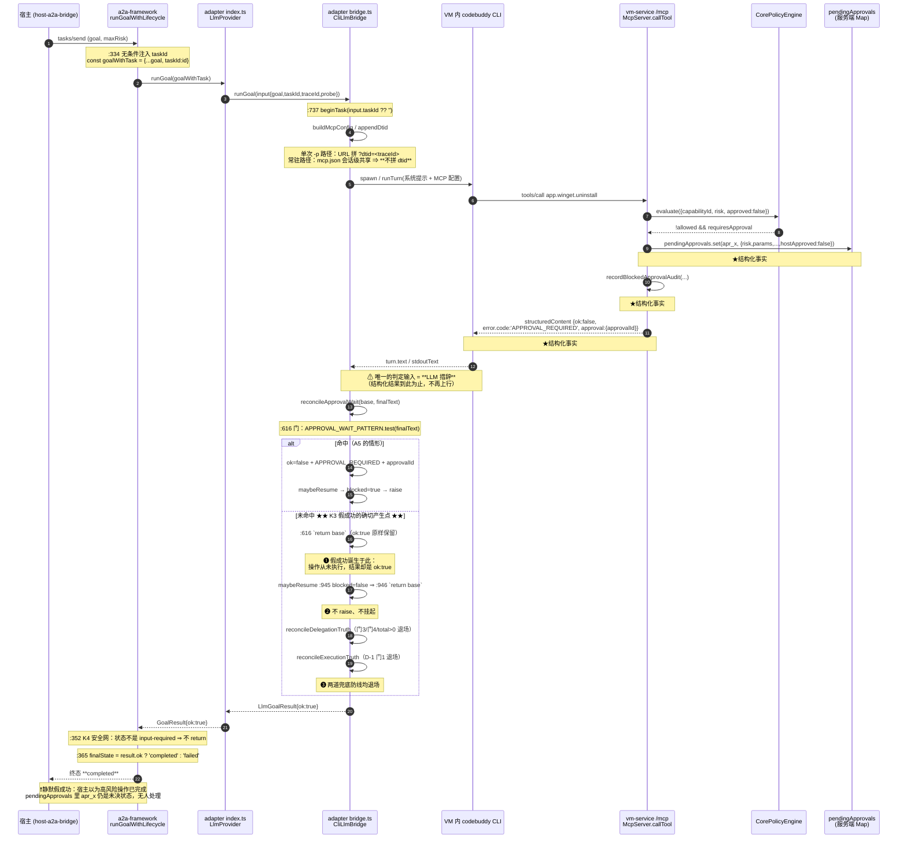
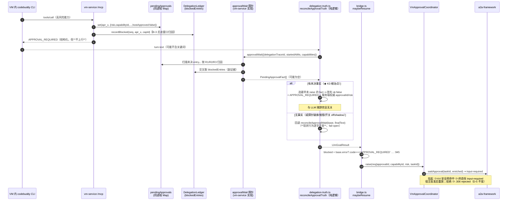
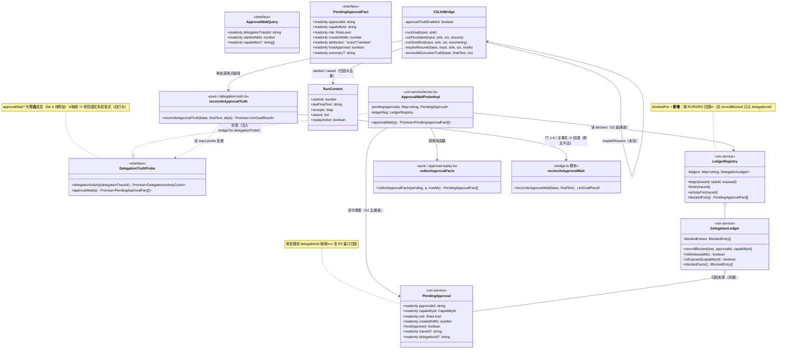
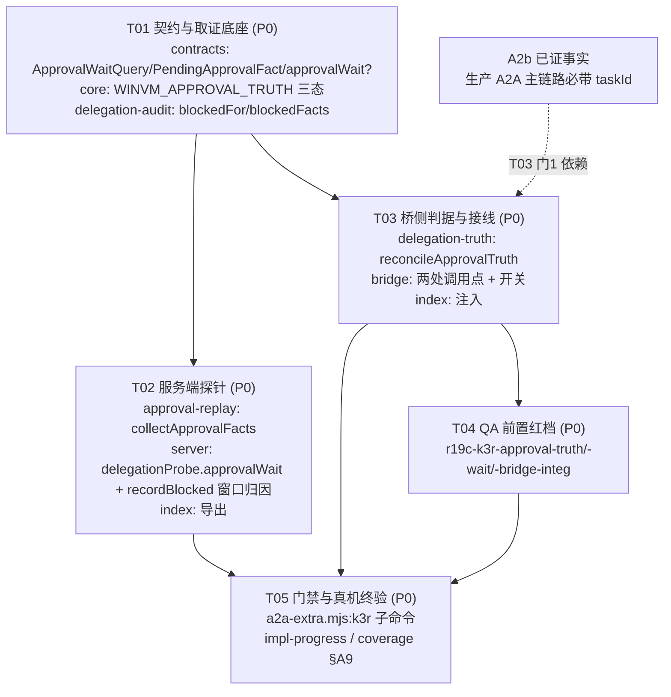

# CL-K3R —— K3「静默假成功」根治：增量架构设计与任务分解

STATUS: DRAFT（架构师产出，待 owner 拍板 §9 后方可进入实施）

> 本文**只做设计**：未修改 `packages/**`、`tests/**`、`qa/**`、`delivery/` 任何文件，未跑部署脚本，未连 VM。
> 基线 HEAD：`6dca16e`（R19F 全部 CL 已合入，真机 R3 三项终验 PASS）。
> 引用口径：**段标签为主、行号为辅**（并行改动会让行号漂移；本文行号仅对 HEAD `6dca16e` 成立）。
> 本文**不改写**上游三份 A5 文档与测试报告；发现的不一致一律登记在 §0.3 并回报主理人。

---

## 0. 前置：口径、纪律与边界

### 0.1 任务定位

R19F（A5 修复）把 `APPROVAL_WAIT_PATTERN` / `parseApprovalBlock` 列入**不改清单**（contract §4 SK-9、§5-Q8），
本迭代未动它 —— 就是为了留给 CL-K3R 整体根治，避免半吊子改动。
本文即为该根治项的**增量设计**：把「审批未决」的判据从 **LLM 文本启发式**升格为 **MCP 结构化工具结果（服务端事实）**。

### 0.2 继承的硬约束（逐条：本文是否触及）

| 编号 | 约束（来源） | 本文处理 |
| --- | --- | --- |
| **D-1** | `bridge.ts` `reconcileExecutionTruth` 内两道门（`replayEnabled \|\| replayActive` / `raised.size === 0`）语义·顺序·短路条件一字不改 | **不触及**。新判据放在收口链**更上游**（`maybeResume` 之前），两道门本身零改动（R19F/T03 已把取值来源换成 `ctx.`，本文不再动） |
| **D-4** | `packages/a2a-framework/src/**` 零改动 | **遵守**：本文方案对该目录**零改动**（不需要） |
| **D-5** | `rejected` 唯一置位点 = `a2a-framework/src/server.ts:306`，不得新增别处置位点 | **不破坏**。新判据只让任务**有机会**走到 `input-required`；`rejected` 仍只由宿主显式拒绝产生。**净效果：让 `:306` 更常可达，而非多出一个置位点** |
| **C-1** | `endTask(taskId?)`：零参/空串 = 无条件清空（保既有零参调用方行为逐字不变） | **不触及**（签名与实现均不动） |
| **A2b** | 生产 A2A 主链路必带非空 `taskId`（`a2a-framework/src/server.ts:334` `const goalWithTask = { ...goal, taskId: id }` 无条件注入） | **依赖**此事实：`dtid` 注入与探针门控均以 `taskId` 非空为前提 |
| **SK-4** | 契约增补一律「纯附加可选」 | **遵守**：新探针成员为**可选方法**、新类型为新增导出、新字段为 `readonly x?: T` |
| **SK-9** | `APPROVAL_WAIT_PATTERN`（`bridge.ts:575`）、`parseApprovalBlock`（`:588`）不改；`reconcileApprovalWait` 的**文案与 steps 改写**（`:615`–`:638`）一字不改 | **遵守**：三者函数体/常量/文案**一字不改**。本文只把它们从「**唯一**判据」降级为「**兜底**判据」（§5.3 专项论证；列为决策点 D-2 供 owner 确认口径） |
| **SK-6** | `raise` 的三条 reason 语义一字不变；`no-active-task` 仍「绝不自批」 | **不触及** |
| **SK-5** | `dist` 必须先重建（`npx tsc -b tsconfig.build.json`，E-2 已订正根级路径）再跑测 | **写入验收判据** |

### 0.3 与上游文档/源码的偏差登记（**不自行改上游文档**，此处记录并回报主理人）

| # | 偏差 | 性质 | 处置 |
| --- | --- | --- | --- |
| **V-1** | `impl-progress.md` §4 记 D-1 红线两门 AFTER 落在 `bridge.ts:1017` / `:1018`；实测 HEAD `6dca16e` 为 **`:1024` / `:1025`** | 纯行号漂移（QA 的 C6 护栏 commit `6a0c950` 之后仓库又前进） | 段标签（`reconcileExecutionTruth` 内两个相邻 `if (…) return base;`）不变，**不影响任何结论**。本文统一用段标签 |
| **V-2** | 根因文档附录 A 记 `contracts/src/bridge.ts` `beginTask=313 / endTask=315 / raise=322`；实测 HEAD `6dca16e` 为 `beginTask=:329`、`endTask=:342`、`raise=:349`（T01 的 C-1/C-2 注释块使之下移） | 行号漂移 | 同上。本文引用一律给段标签 |
| **V-3** | **`vm-service/src/server.ts:770` 的 `ledger?.recordBlocked(...)` 以 `ctx.delegationId` 为唯一前提** ⇒ 常驻会话路径（生产 A2A 主路径）**恒为空操作** | **源码事实，非文档错误**；但上游文档未点名此后果 | 本文 §3.3 给出完整论证，并据此选型（**这是本文最关键的技术发现**）。建议在 K-N1 设计文档补记，但**不由我改** |
| **V-4** | `recordBlockedApprovalAudit` 的 `channel` 取 `ctx.delegationId ? 'a2a' : 'mcp'`（`server.ts:767`）⇒ 常驻路径的**委派内层拦截**被记为 `mcp` 通道 | 与 K-N1「修掉 181/181 恒 mcp」的口径目标同类的**残留观测缺陷** | 本文**不修**（不在 CL-K3R 范围），登记为待办 §9-Q6 |
| **V-5** | `LedgerRegistry.ledgerForInnerTrace()`（`delegation-audit.ts:361`）定义了「按内层 traceId 回挂账本」能力，但全仓**无调用点** | 死代码 / 未完成件 | 本文**不复用**（其匹配面不含被拦调用自身的 traceId），登记 §9-Q7 |

---

## 1. 问题重述与危害定级

### 1.1 K3 的一句话重述

> VM 内 LLM Agent 调用了一个**被策略引擎拦截、需要宿主人工审批**的高风险能力（服务端已返回结构化
> `APPROVAL_REQUIRED` + `approvalId`，并已登记续跑令牌）。但**桥判定「是否真的在等审批」的依据是
> LLM 的最终文本措辞**；一旦 LLM 不用 `APPROVAL_REQUIRED` /「等待审批」这两个词，桥就判定「没在等审批」
> ⇒ 不 raise、不挂起、不改判 ⇒ 任务以 `ok:true` 收口 `completed`。
> **操作从未执行，宿主收到「已完成」，全程零告警。**

### 1.2 触发条件（逐条可核，六条件同时成立）

设 D 为一次 A2A 委派（`taskId` 非空，A2b 已证生产恒成立），其 LLM 回合内确有 ≥1 次能力调用
被 `CorePolicyEngine` 判 `requiresApproval` 并在 MCP 层拦截（`vm-service/src/server.ts:726`–`:791`，
返回 `structuredContent = { ok:false, error:{code:'APPROVAL_REQUIRED'}, approval:{approvalId,…} }`，
同时 `pendingApprovals.set(id, …)`）。

| # | 条件 | 落点 | 证据 |
| --- | --- | --- | --- |
| **K3-a** | LLM 最终文本未命中 `/APPROVAL_REQUIRED\|等待审批/` | `bridge.ts:575` `APPROVAL_WAIT_PATTERN` | 常量原文 |
| **K3-b** | `reconcileApprovalWait` 因此 `return base`，保留 `ok:true`、`error` 为 undefined | `bridge.ts:616` `if (!APPROVAL_WAIT_PATTERN.test(finalText)) return base;` | 根因 §2.2 第 1 条 |
| **K3-c** | `maybeResume` 的 `blocked` 读 `base.error` ⇒ 为 false ⇒ `return base`（不 raise、不挂起） | `bridge.ts:945`–`:946` | 根因 §2.2 第 2 条 |
| **K3-d** | `reconcileDelegationTruth` 退场（门 3 无完成声称 / 门 4 无 probe / `total>0` 采信） | `delegation-truth.ts:81` / `:95` | 见 §1.4 |
| **K3-e** | `reconcileExecutionTruth` 退场（`ctx.replayActive === false`，因从未 raise） | `bridge.ts:1024`（D-1 门 1） | 见 §1.4 |
| **K3-f** | `runGoalWithLifecycle` 按 `result.ok` 收口 `completed` | `a2a-framework/src/server.ts:365` `const finalState = result.ok ? 'completed' : 'failed';` | 框架原文 |

### 1.3 K3-a 为什么**必然会发生**（不是理论风险）

拦截事实在服务端是**结构化**的（§1.2 的 `structuredContent`），但**桥判定它是否发生用的是文本**。二者的桥接点只有一处：

> `bridge.ts:363`–`:372` 的**自然语言纪律**（系统提示词里写着「当工具返回 APPROVAL_REQUIRED…必须立即停止执行，如实上报『等待审批』」）。

即：**「安全纪律」靠提示词约束 LLM，「判据」靠正则匹配 LLM 的回话** —— 同一条链的两端都建在不可靠的措辞上。
已知的具体 evade 形态（按出现的现实性排序）：

1. **同义改写**：LLM 回「该操作需要人工确认」「此操作已被安全策略挂起，等你批准」⇒ 语义完整、正则零命中。
2. **只回显 approvalId 不带错误码**：根因 §2.4 已点名（`apr_…` 出现但 `APPROVAL_REQUIRED` 不出现）⇒ `extractApprovalId` 拿到 id，但 `APPROVAL_WAIT_PATTERN` 不命中 ⇒ 整段 `return base`。
3. **自宣完成**：K5 根因实证 —— 宿主批准后 LLM 未重发工具调用却文本自宣「已卸载」；同源行为在拦截侧就是「我处理完了」的假成功。
4. **常驻会话续跑轮文本覆盖**：`ctx.lastFinalText` 取**最后一轮**（`bridge.ts:1162` / `:1359`），前一轮里说过的「等待审批」会被后续轮覆盖掉。
5. **CLI 输出截断**：`turn.text` / `stdoutText` 的尾部被截 ⇒ 关键词落在截断区。

> **反证式提醒**：A5 之所以**没有**表现为 K3，是因为那一轮 LLM **恰好**说了 `APPROVAL_REQUIRED`
> （根因 §2.3 的三段指纹逐字命中）。也就是说：**A5 是「运气好」，K3 才是默认脆弱面。**

### 1.4 为什么既有三道防线在 K3 场景下**全部退场**（这是必须新建判据的论证）

| 防线 | 退场原因（K3 场景下） |
| --- | --- |
| **K3 文本启发式**（`reconcileApprovalWait`） | 见 §1.2 K3-a —— 它**正是**被绕过的那一道 |
| **K5 回执反查**（`reconcileExecutionTruth`） | D-1 门 1 `if (!this.replayEnabled \|\| !ctx.replayActive) return base;` —— `ctx.replayActive` 只在「raise 回包携 `executed`」时置 true（`bridge.ts:996`）。K3 场景**从未 raise** ⇒ 恒 false ⇒ 整段退场 |
| **K-N1 账本反查**（`reconcileDelegationTruth`） | 三重退场：① 门 3 要求 `finalText` 命中 `COMPLETION_CLAIM_PATTERN`（无完成声称则透传）；② 即便反查，`total` 可能因**其它**成功/失败调用（wild/executed）非零 ⇒ 判「有活动」⇒ 采信（判"有活动"取宽松是 K-N1 的既定纪律）；③ **常驻路径的 `blocked` 根本不进账本**（§3.3）⇒ 连 `blocked` 这一路证据都没有 |

⇒ **结论**：现有三道判据在 K3 场景下**结构性失效**，且失效方向**一致**（都偏向"放过"）。
必须在 `maybeResume` **之前**新增一道**结构化**判据，且该判据的失效方向必须是**保守**的（§5.4）。

### 1.5 危害定级：K3 > A5（为什么更危险）

| 维度 | **A5（已修）** | **K3（本项）** |
| --- | --- | --- |
| 终态 | `failed` | **`completed`** |
| 可观测性 | **显式失败**：宿主立刻知道、可重试 | **静默**：宿主收到成功，零告警、零 failed 样本 |
| 触发条件 | **并发委派交叠**（`endTask()` 误清单例）—— 相对罕见 | **单次委派 + LLM 措辞漂移** —— 常见、且随模型/版本/提示词变化而漂移 |
| 失效方向 | **fail-closed**（安全闸咬死，任务失败） | **fail-open**（安全闸被绕过，且无人知晓） |
| 下游后果 | 任务失败，人工可重试 | 宿主/用户**据此认定高风险操作已完成**（如"已卸载/已删除"）⇒ 形成错误事实认知，**不会重试**，且后续决策建立在错误前提上 |
| 定位成本 | 有 failed 终态 + 三段文案指纹可反查 | **无失败态** ⇒ 只能靠事后 grep「零调用但 completed」形态（K-N1 `ext.zeroInnerCalls` 恒落才勉强可查） |
| 现状 | R19F 已修，真机 R3 三项终验 PASS（报告 §A8.2） | **未修**（R19F 明确列入不改清单，留给本项） |

> **定级理由（一句话）**：A5 是「安全闸咬死」（显式噪声），K3 是「安全闸被绕过且无人知晓」（静默失效）。
> 安全工程的基本排序是 **静默失败 ≫ 显式失败**。故 owner 的判级（K3 比 A5 更危险）成立，本文采纳。

---

## 2. 现状机制剖析（文本启发式链路 + 假成功的确切产生点）

### 2.1 全链时序图（现状，HEAD `6dca16e`）



**图中三个「★结构化事实」与「❶/❷/❸」的位置关系，就是本缺陷的全部**：
结构化事实**在服务端已经存在**（三处，且互相独立），但它们**从未上行到桥**；桥只看得到 LLM 的话。

### 2.2 假成功的确切产生点（一句话定位）

> **`packages/adapter-agent-workbuddy-llm/src/bridge.ts:616`**
> `if (!APPROVAL_WAIT_PATTERN.test(finalText)) return base;` —— **这一行的 `return base`**。
>
> 它把 `base`（`ok:true`、`error:undefined`、summary「LLM 运行时（常驻会话）完成目标：…」）**原样放行**，
> 从而使下游 `maybeResume`(:945) 的 `blocked` 为 false ⇒ `:946 return base` ⇒ 不 raise ⇒ 不挂起 ⇒ `completed`。

与 A5 的对照：A5 的失败点是 **`vm-service/src/server.ts` `raise()` 首行守卫**（`no-active-task`，R19F 已修，
现为 `const taskId = req.taskId ?? this.activeTaskId;` + `:213` 早退）。**两者是同一条收口链上不同位置的两个洞**：
R19F 补的是「raise 之后挂到哪里」，CL-K3R 补的是「根本没走到 raise」。

### 2.3 现状判据的失效方向（关键，决定新判据该怎么设计）

`reconcileApprovalWait` 是**单向**判据：命中 ⇒ 改判为「等待审批」（保守）；未命中 ⇒ **透传**（放行）。
它的**默认输出是放行**。因此「LLM 没说」与「LLM 说没被拦」在桥侧**不可区分** —— 这就是 fail-open 的结构性根源。

---

## 3. 可行性论证：桥侧到底能拿到什么结构化信息？

> 本节是全设计最大的不确定性，已**实地读码核实**（未凭摘要、未想当然）。结论先行，证据在后。

### 3.1 结论（三句话）

1. **桥与服务端同进程** —— `CliLlmBridge` 由 `vm-service` 的 `loadProvider(cfg.agent, bridgeCtx)` 加载，
   且与服务端 `VmApprovalCoordinator` 共享**同一个对象实例**（根因 §3.2「全链单实例」已证）。
   ⇒ **不需要任何跨进程/跨网络/改 MCP 协议的新通道**，只要补一个**注入式探针**（与既有 `bridgeCtx.delegationProbe` 同形），桥就能直读服务端的结构化事实。
2. **服务端确实握有权威结构化事实，且不止一份** —— 拦截发生时同时落三处（§3.2 通道盘点），其中
   `pendingApprovals`（`vm-service/src/server.ts:512`）**最完整**：`approvalId` / `capabilityId` / `risk` / `params` / `preview` / `impact` / `underlying` / `createdAtMs` / `hostApproved` / `traceId`。
   这已**超过** K3 根治所需的全部字段（甚至顺带把 §4.3 的「risk 靠 LLM 文本正则抠」一并根治）。
3. **但有一处结构性缺口必须补**：常驻会话路径（**生产 A2A 主路径**）**不带 `dtid`** ⇒
   服务端无法把拦截**归属**到具体委派 ⇒ `PendingApproval.delegationId` 缺席、账本 `blocked` 通道**恒为 0**（§3.3 源码实证）。
   ⇒ **要补的不是"通道"，而是"归因"**：一套与 K-N1 通道 1（时间窗）同构的归因规则（§3.6）。

> **给 owner 的一句话**：**能拿到**，且不必改 MCP / 不必改 CLI / 不必碰 `a2a-framework`；
> 缺的是「常驻路径下这条拦截属于哪个委派」的归因，用**时间窗 + 能力面**兜底即可闭合（与 K-N1 既有纪律同构）。

### 3.2 通道盘点：五条可能的「结构化信息」通道，逐条判定

| # | 通道 | 桥侧现状可见性 | 结构化程度 | 字段完备度 | 判定 |
| --- | --- | --- | --- | --- | --- |
| **C-1** | **LLM 最终文本**（`turn.text` / `stdoutText`） | ✅ **唯一在用** | ❌ 纯文本 | 靠正则抠（`approvalId` / `capabilityId` / `risk`，抠不到兜底 `'L2'`） | **现状判据 = 缺陷根源** |
| **C-2** | **`pendingApprovals` Map**（`server.ts:512`，同进程） | ❌ 桥不可见（**但可以补**，§3.5-B2） | ✅ 强结构 | **最完备**：approvalId/capabilityId/risk/params/preview/impact/underlying/createdAtMs/hostApproved/traceId/(delegationId?) | ⭐ **推荐主通道** |
| **C-3** | **`DelegationLedger.blockedEntries`**（`delegation-audit.ts:116`） | ⚠ 经 `DelegationTruthProbe` 只暴露**计数** `blocked:number`，**拿不到 approvalId**；且常驻路径恒 0（§3.3） | ✅ 结构 | 有 approvalId + capabilityId + seq | ⭐ **推荐副通道**（补归因后可用，且入哈希链，取证最强） |
| **C-4** | **哈希链审计条目**（`recordBlockedApprovalAudit`，`server.ts:754`） | ❌ 桥不可见 | ✅ 结构 | approvalId/capabilityId/risk/params/ts/seq | 可作取证，不宜作判定输入（IO + 脱敏开销） |
| **C-5** | **MCP 工具结果本体**（`structuredContent`，`server.ts:776`–`:791`） | ❌ **桥根本看不到**（它在 CLI 进程里；桥只见 CLI 的 stdout） | ✅ 最强结构 | 完整拦截语义 | ❌ **不可行**，见 §3.4 |

### 3.3 关键缺口实证：常驻路径下「拦截」对服务端账本的贡献**恒为 0**

逐跳源码核实（HEAD `6dca16e`）：

| 跳 | 落点 | 原文/事实 | 常驻路径下的值 |
| --- | --- | --- | --- |
| 1 | `bridge.ts:1134`（常驻）/ `:1259`–`:1260`（单次） | `prepareMcpConfig(outputDir)` —— 常驻**不传** `delegationId`；单次传 `const dtid = input.taskId ? input.traceId : undefined` | 常驻：**不拼 `?dtid=`** |
| 2 | `bridge.ts:1108`–`:1112`（方法注释） | 「常驻会话的 `mcp.json` 是**会话级共享文件** … 把逐次委派 dtid 写进去只在该进程**下次 spawn** 时才生效」 | 归因时点错位，故**刻意不传** |
| 3 | `mcp-framework/src/server.ts:194`–`:195` | `const ctx: ToolContext = reqCtx?.delegationId ? { traceId, delegationId } : { traceId };` | `ctx.delegationId` = **undefined** |
| 4 | `vm-service/src/server.ts:746` | `...(ctx.delegationId ? { delegationId: ctx.delegationId } : {})` | `PendingApproval.delegationId` **缺席** |
| 5 | `vm-service/src/server.ts:767` | `channel: ctx.delegationId ? 'a2a' : 'mcp'` | 误标为 **`mcp`**（登记为 V-4，本项不修） |
| 6 | `vm-service/src/server.ts:770` | `const ledger = ctx.delegationId ? ledgerReg.get(ctx.delegationId) : undefined;` | `ledger` = **undefined** |
| 7 | `vm-service/src/server.ts:771` | `ledger?.recordBlocked(record.seq, id, cap.id);` | **空操作** ⇒ `blockedEntries` 恒空 |
| 8 | `delegation-audit.ts:189` | `const blocked = this.blockedEntries.length;` | **`blocked === 0`** |
| 9 | `delegation-audit.ts:329` | `if (record.policyDecision?.matchedRule === 'approval-required') return;` | 被拦记录**也不进 wild** ⇒ `wild` 也不增 |

> ⇒ **常驻会话路径下，一次真实的高风险拦截，对 K-N1 账本 `activityCount()` 的三个计数贡献全部为 0。**
>
> 而**生产 A2A 走的就是常驻路径**：根因 §3.4 已证 A5 为 `persistent`（`params.session="persistent"`，
> 与 `bridge.ts:1190` 构造的 step 逐字一致）；真机 R3 报告 §A8.2 的三条终验亦全部跑在常驻会话上
> （`[llm-session] LLM 常驻会话轮次完成`）。**这不是边角场景。**

### 3.4 为什么「让 MCP 工具结果本体上行」（C-5）**不是**可行根治路径

owner 拍板的方向原话是「桥侧直读 MCP 结构化工具结果」。**读码后的判读：该方向的**精神**（不依赖 LLM 措辞）完全正确，
但**字面路径**（把工具结果本体搬给桥）不可取，理由三条：

1. **物理上不可达**：工具结果在 `codebuddy` **子进程**里。桥只见子进程的 `stdout`（`bridge.ts:1276` 累计 `stdoutText`）。
   要拿到结构化结果必须让 CLI 以机器可读格式输出调用记录 —— 真机 CLI 契约（`bridge.ts:88`–`:97` 注释）里
   `--output-format json|stream-json` 是 **CLI 自有格式**，受 codebuddy 版本约束，且要新增解析器、处理截断与多行。
2. **即便拿到，仍是"转述"**：那是**CLI 运行时**的转述，不是**拦截发生地**的账本。拦截的权威记录者是服务端的
   `pendingApprovals`（`server.ts:730`）—— 直接问它，比解析 CLI 输出更短、更准、更抗版本漂移。
3. **成本/收益**：C-5 要改 CLI 参数模板 + 输出解析 + 兼容层；C-2/C-3 只加一个**同进程注入探针 + 一套归因规则**，
   且**完全复用** K-N1 已落地的 `DelegationTruthProbe` 注入范式（`bridgeCtx` cast → provider 读 → 桥收口反查）。

> ⇒ **本文推荐把「直读 MCP 结构化工具结果」落为「直读服务端在拦截时已落的结构化账本/令牌表」** ——
> 数据源在**更上游**（拦截发生地），且零协议改动。**这一点需 owner 确认（决策点 D-1）。**

### 3.5 要补什么（最小补齐清单，4 项）

| 编号 | 要补的东西 | 落在哪 | 为什么必须 |
| --- | --- | --- | --- |
| **B-1** | 探针契约：给 `DelegationTruthProbe` 加**可选**方法 `approvalWait?(q)` + 两个新类型（`ApprovalWaitQuery` / `PendingApprovalFact`） | `packages/contracts/src/bridge.ts`（`DelegationTruthProbe` 段之后） | 桥**只认契约类型**，不认服务端实现（既有 `delegationProbe` 注入范式） |
| **B-2** | 服务端探针实现（读 `pendingApprovals` + 账本 `blockedEntries`），并在 `bridgeCtx.delegationProbe` 内注入 | `packages/vm-service/src/server.ts`（纯函数放 `approval-replay.ts`，对称 K-N1 的纯逻辑拆分纪律） | §3.2 C-2/C-3 的事实目前**无暴露面** |
| **B-3** | **归因**：① 账本 `blocked` 的窗口归因（`LedgerRegistry` 增按窗口查 blocked 事实）；② `server.ts:770` 的 `recordBlocked` 改用同一归因规则 | `packages/vm-service/src/delegation-audit.ts` + `server.ts` | §3.3 已证：常驻路径下 `blocked` 恒 0，无归因则副通道不可用 |
| **B-4** | 桥侧新判据（结构化优先、文本兜底）+ 两处调用点接线 | `packages/adapter-agent-workbuddy-llm/src/delegation-truth.ts`（纯逻辑）+ `bridge.ts`（接线） | §1.4 已证：既有三道防线在 K3 场景全部退场 |

**明确不需要补的**（成本优势）：不需要跨进程通道、不需要改 MCP 协议、不需要改 CLI 契约与参数模板、
不需要改 `packages/a2a-framework/**`（D-4）、不需要改 `packages/mcp-framework/**`。

### 3.6 归因规则（补齐 B-3 的核心；与 K-N1 通道 1/通道 2 完全同构）

对一条 `PendingApproval`（或一条 `BlockedEntry`）与一次委派 D（`delegationTraceId`、`startedAtMs`、`capabilities`）：

| 规则 | 条件 | 判定 | 说明 |
| --- | --- | --- | --- |
| **R1 精确归因** | `entry.delegationId === D.traceId` | **属于 D** | 通道 2：单次 `-p` 路径（`?dtid=` 生效）；与 K-N1 `ext.delegationId` 同源 |
| **R2 精确排除** | `entry.delegationId` 非空且 `!== D.traceId` | **不属于 D**（跳过） | 已精确归属他人的，绝不因窗口重合被重复计入 —— 这条是防止"串台"的关键 |
| **R3 窗口兜底** | `entry.delegationId` 缺席 **且** `entry.createdAtMs >= D.startedAtMs` **且** `!entry.hostApproved` **且** `capabilityId` ∈ D 的能力面 | **属于 D** | 通道 1：与 `DelegationLedger.inWindow` / `isExposed` **同口径**（`delegation-audit.ts:143`/`:148`） |

**能力面取值优先级**：① 委派的 `LlmGoalInput.capabilities`（= `GoalRequest.allowedCapabilities`，最窄、最准）；
② 缺席/空 ⇒ 退服务端 `exposedIds`（与 wild 归因一致）。

**为什么 R3 在生产足够可靠**（不是拍脑袋）：
- 常驻会话的轮次被 `persistent-session.ts` 的 `enqueue`（`this.chain.then(fn, fn)`）**串行化** ⇒
  同一 bridge 实例同一时刻**只有一轮 turn 在跑**；
- 单次 `-p` 路径各自独立进程且**带 dtid** ⇒ 走 R1，不占 R3；
- ⇒ R3 在窗口内看到的"未归属未决审批"，**极大概率**就是本委派自己触发的那一条。

**R3 的残余噪声与其方向（必须显式登记）**：

| 噪声源 | 后果 | 方向 |
| --- | --- | --- |
| 宿主**非委派**的 MCP 直调在窗口内被拦 | 被误归给 D ⇒ D 被改判「等待审批」（多报一次挂起） | **fail-closed**（安全方向） |
| 上一次委派遗留的**未决** token 还没被清理 | 同上，多报 | **fail-closed** |
| 拦截已发生但 entry 不在 Map 里 | —— | **不可能发生**：拦截的**唯一**代码路径（`server.ts:730`）必然 `set`，且批准/超时才 `delete` |

> ⇒ **R3 只会"多报"，不会"漏报"**。这正是对 K3（漏报 ⇒ 假成功）的根治方向，代价是引入**可控的假挂起噪声**。
> 该取舍的完整论证见 §5.4。

---

## 4. 候选方案对比与推荐

> 四个候选。维度：**结构化程度 / 归因精度 / 改动面 / 外部依赖 / 是否触及 D-4 / 取证价值 / 失效方向**。

### 4.1 候选一览

| # | 候选 | 一句话做法 |
| --- | --- | --- |
| **S1** | **服务端令牌表探针**（`pendingApprovals` 直读） ⭐**推荐** | 给 `DelegationTruthProbe` 加可选 `approvalWait?()`，桥在收口前反查"本委派窗口内是否有**未决**审批"；有 ⇒ 强制改判「等待审批」并携带**服务端权威** approvalId/capabilityId/risk |
| **S2** | **账本 blocked 事实探针**（`DelegationLedger.blockedEntries`） ⭐**推荐作为副通道** | 补 B-3 归因后，`blockedEntries` 也能给出 approvalId；与 S1 同探针暴露，互为交叉验证，且**已入哈希链**（取证最强） |
| **S3** | **CLI 结构化输出解析**（`--output-format json\|stream-json`） ❌不推荐 | 改 CLI 参数模板 + 新增解析器，从 CLI 输出里提取工具调用结果 |
| **S4** | **让常驻路径也带 `dtid`**（精确归因） ❌本迭代不做 | 使常驻会话的内层 MCP 调用也能携带委派 traceId |

### 4.2 逐项 pros / cons

#### S1｜服务端令牌表探针（`pendingApprovals` 直读）—— **推荐（主通道）**

**Pros**
1. **数据源最权威**：`pendingApprovals` 是拦截的**发生地**（`server.ts:730` 同一段代码 `set`），不是转述、不是推测。
2. **字段最完备**：直接给出 `approvalId` / `capabilityId` / `risk` / `preview` / `impact` / `underlying` / `createdAtMs`。
   ⇒ **顺带根治 §4.3 缺陷 2（审批卡 risk 靠 LLM 文本正则抠 + 兜底 `'L2'`）** —— 新判据产出的 `risk` 是**服务端策略引擎判定值**，
   与 R19F 的 Fix-4a（`enriched.risk = token?.risk ?? req.risk`）同源同值。
3. **零协议/零 CLI/零框架改动**；同进程直读，**无 IO、无网络**（`delegation-truth.ts` 的「零 HTTP」纪律可保）。
4. **天然只报未决项**：批准（`server.ts:804` `delete`）与 TTL 超时（`server.ts:526` `delete`）都会摘除 entry
   ⇒ 不会把"已批准已执行"误报成"还在等审批"。
5. **失效方向可控**：只会**多报**（fail-closed），不会漏报（§3.6）。
6. **复用既有范式**：与 `DelegationTruthProbe` 注入/消费链路完全同形，工程师零学习成本。

**Cons**
1. **进程内内存态**：重启即失；跨进程/跨机器部署形态下不可用。（当前架构单进程 ⇒ 可接受；须写入 SK。）
2. **常驻路径无精确归属**，依赖 R3 窗口归因 ⇒ 有**串台**可能（宿主并发直调），方向 fail-closed（可接受）。
3. **新增一处探针契约**（可选方法，非破坏）。
4. `pendingApprovals` 当前**无上限**（不像 `LedgerRegistry` 有 `maxLive=64` 与 6h TTL）；长期未决的 token 会累积
   ⇒ 查询是 O(n) 线性扫描。当前规模（审批场景低频）可接受，建议**顺带给清理/上限**（列为待办 §9-Q5）。

#### S2｜账本 blocked 事实探针 —— **推荐（副通道 / 交叉验证 / 取证）**

**Pros**
1. **已入哈希链**（`recordBlockedApprovalAudit`）⇒ 事后可审计、可回放，是**取证最强**的证据面。
2. 与 S1 独立（一个读令牌表，一个读账本）⇒ 两者可做交叉断言："S1 说有 ⇒ S2 也应有"，任一缺失即告警。
3. 补 B-3 后，`blocked` 计数在常驻路径也不再恒 0 ⇒ **顺带修正 K-N1 账本本身的观测缺陷**（V-3）。
4. 与既有 `activityCount()` 的 `blocked` 通道**语义一致**，不引入新概念。

**Cons**
1. **必须补 B-3 归因**才可用（否则常驻路径恒 0）。
2. `BlockedEntry` 只有 `{approvalId, capabilityId, seq}` —— **无 `risk`** ⇒ 审批卡 risk 仍需 S1 提供。
3. 写链是 `fire-and-forget`（`server.ts:754` `void recordBlockedApprovalAudit(...)`）⇒
   **存在"拦截已 set 令牌、审计条目尚未落链"的极小窗口** ⇒ S2 可能晚于 S1 一拍。
   ⇒ **因此 S2 只能做副通道/取证，不能做唯一判据**（这是选 S1 为主通道的决定性理由）。

#### S3｜CLI 结构化输出解析 —— **不推荐**

**Pros**：理论上能拿到"工具结果本体"（C-5），最贴近 owner 原话的字面路径。

**Cons（决定性）**
1. **物理上绕远**：工具结果在 CLI 子进程，桥只见 stdout；需改 CLI 参数模板（`DEFAULT_CLI_ARG_TEMPLATE`，`bridge.ts:104`）
   与输出解析，且真机 `--output-format json|stream-json` 是 **codebuddy 自有格式**（`bridge.ts:88`–`:97` 注释）
   ⇒ **强依赖外部 CLI 版本**，版本漂移即判据失效（重蹈"依赖外部措辞"的覆辙，只是换了个依赖对象）。
2. **仍是"转述"**：CLI 的转述 ≠ 拦截发生地的账本；拿不到 `risk` 的权威值（仍在服务端）。
3. **成本最高**：新增解析器 + 截断/多行/多行合并处理 + 兼容性回归面，且要重跑真机验证 CLI 输出形态。
4. **可能触发 CLI 冷启动/输出格式副作用**（真机 `stream-json` 与 `--add-dir` 产物扫描的交互未验证）。

#### S4｜让常驻路径也带 `dtid`（精确归因）—— **本迭代不做**

**Pros**：一旦成立，R1 精确归因覆盖 100% 路径，R3 窗口兜底可完全退场，串台风险归零。

**Cons（决定性）**
1. **根因是 MCP 配置文件的会话级共享**（`bridge.ts:1108`–`:1112`）：`mcp.json` 只在 CLI **spawn 时**被读取，
   而常驻会话**复用同一进程** ⇒ 逐次委派改写文件**对已运行进程无效**。
2. 可行解只有两条，均不可接受：
   - **(a) 常驻会话按委派重建** ⇒ 每条委派付一次进程级冷启动（≈75–107s，K2 已专门修过这个问题）⇒ **直接回退 K2 的成果**；
   - **(b) 让 MCP 层按"轮次/会话"再分一层归属** ⇒ 需 `mcp-framework` 暴露 MCP session id 并由服务端维护「session ↔ 委派」映射，
     而同一常驻 session 服务多个委派 ⇒ **session 粒度 ≠ 委派粒度**，需再加"轮次边界"信号（桥何时开始/结束一轮 turn 要上报服务端）
     ⇒ 改动面跨 `mcp-framework` + `vm-service` + `adapter`，且引入新的跨层状态同步。
3. ⇒ **收益（消除 R3 的串台噪声）< 成本**。登记为后续项 §9-Q4；R3 已使 K3 结构性闭合。

### 4.3 推荐组合与理由（一句话）

> **推荐「S1 主判据 + S2 副证据 + R3 窗口归因兜底」**，以**同进程注入探针**交付，
> **不动 MCP 协议、不动 CLI 契约、不动 `a2a-framework`、不改 `APPROVAL_WAIT_PATTERN`（只把它降级为兜底）**。

**理由**：S1 是**唯一**同时满足「权威（拦截发生地）+ 完备（含 risk）+ 零外部依赖 + 失效方向保守」的通道；
S2 补取证与交叉验证；R3 以最小代价闭合常驻路径的归因缺口；S3/S4 的成本显著高于收益，且 S3 会引入新的外部版本依赖。

---

## 5. 根治方案设计

### 5.1 总览：新判据插在收口链的哪一处

```
runGoalInner
  └─ runGoalCore → runPersistent / runOneShot
        └─ 【新增】reconcileApprovalTruth(base, finalText, deps)   ← ★ 本项插入点（maybeResume 之前）
              ├─ 结构化优先：probe.approvalWait(...) 有未决事实 ⇒ 改判 ok:false + APPROVAL_REQUIRED（服务端权威字段）
              └─ 结构化无事实 ⇒ 回退 reconcileApprovalWait(base, finalText)（**原文不动**，现状行为）
        └─ maybeResume(...)                                   ← 读 base.error，未动
  └─ reconcileDelegationTruth(...)                            ← K-N1，未动
  └─ reconcileExecutionTruth(...)                             ← K5 + **D-1 两道门，未动**
```

**为什么放在 `maybeResume` 之前**：`maybeResume` 的 `blocked` 只读 `base.error` 的结构化字段（`:945`）。
只有让 `base.error.code === 'APPROVAL_REQUIRED'` 且 `details.approvalId` 有值，`blocked` 才为真 ⇒ 才会 raise ⇒ 才会挂起。
⇒ **新判据的唯一职责就是"把服务端事实翻译成 `base.error`"**，从而让**既有**的 raise/挂起/重放链路原样工作。

**两处调用点的改动量**（各 1 行函数名替换 + `await`）：
- `bridge.ts:1179`（常驻路径 `runPersistent` 的 `return { result: await this.maybeResume(reconcileApprovalWait({…}, turn.text), …) }`）
- `bridge.ts:1365`（单次路径 `runOneShot` 的 `finish(await this.maybeResume(reconcileApprovalWait({…}, stdoutText), …))`）

### 5.2 改造后的数据流（时序图）



### 5.3 判据函数设计（`reconcileApprovalTruth`，纯逻辑，放 `delegation-truth.ts`）

> 与 `reconcileDelegationTruth` 同文件同风格：无副作用、证据只从注入 `probe` 取、fail-open。
> **桥侧只做接线**（`bridge.ts` 新增一个 private async 方法转发），便于 `node --test` 零进程断言。

**判定表（自上而下短路）**

| 门 | 条件 | 动作 | 理由 |
| --- | --- | --- | --- |
| **门 0** | `!base.ok` | 透传 | 已是失败态，不重复改判（与 `reconcileDelegationTruth` 门 1 同口径） |
| **门 1** | 无 `taskId`（非委派 / 纯 MCP 直调 / 单测） | 回退文本启发式 | 旧行为逐字不变（SK-1：无归属 ⇒ 不介入） |
| **门 2** | 灰度开关 `= off` | 回退文本启发式 | 一键回滚面（§5.4） |
| **门 3** | 无 `probe` 或 `probe.approvalWait` 缺席 | 回退文本启发式 | 兼容旧服务端 / 单测 / degraded；**绝不 warn**（单测大量用例无 probe，warn 会刷屏） |
| **门 4** | `probe.approvalWait(...)` 抛错 | 回退文本启发式 + **warn 恰一条** | 对齐 `delegation-truth.ts:86`–`:93` 的 fail-open 纪律 |
| **门 5** | 探针返回 `facts.length === 0` | 回退文本启发式 | **结构化说"无未决审批"时，绝不强行改判** ⇒ 判据只做减法不做加法 |
| **门 6** | 所有 fact 的 `approvalId` 都已在 `ctx.raised` | 回退文本启发式 | 都挂过起了 ⇒ 交既有的 `applyReceipt` 去重路径（K4 旧 token 复用防护），不二次挂起 |
| **命中** | 存在未 raise 的未决 fact | **改判**（见下） | ★ K3 根治 |

**命中时的改判产出（字段全为服务端权威值）**

```ts
{
  ...base,
  ok: false,
  // 与 reconcileApprovalWait 共用**同一前缀**（保 A5 终态指纹可比对能力，SK-9），
  // 仅以可区分后缀标记来源，便于取证归因（先例：delegation-truth.ts 的 ZERO_ACTIVITY_STEP_SUMMARY）
  summary:
    `等待审批：高危操作被宿主审批闸拦截（APPROVAL_REQUIRED），目标「${base.summary}」未执行完成，` +
    `须经宿主人工审批后经 MCP 直调通道续跑；approvalId=${fact.approvalId}` +
    `（来源=服务端结构化判定·${fact.attribution}）`,
  steps: base.steps.map((s) => ({ ...s, ok: false, summary: '等待审批（未执行完成·服务端结构化判定）' })),
  error: makeError('APPROVAL_REQUIRED', '服务端结构化记录显示存在未决审批，操作未执行', {
    details: {
      approvalId: fact.approvalId,
      capabilityId: fact.capabilityId,
      risk: fact.risk,                       // ★ 服务端策略引擎权威值（顺带根治文本正则扣 risk）
      attribution: fact.attribution,         // 'exact' | 'window'
      source: 'server-ledger',
      ...(rest.length ? { others: rest.map((f) => f.approvalId) } : {}),
    },
  }),
}
```

**选取规则**：`facts` 按 `createdAtMs` 升序，取**第一个**不在 `ctx.raised` 中的（FIFO，最老的未决项优先）；
其余进 `details.others`；若 `rest.length > 0` ⇒ 记一条 warn（"同一委派存在多个未决审批"，提示宿主逐条处理）。

**与 `reconcileApprovalWait` 的关系（SK-9 合规论证）**
- `APPROVAL_WAIT_PATTERN`（`:575`）、`parseApprovalBlock`（`:588`）**函数体一字不改**；
- `reconcileApprovalWait`（`:615`–`:638`）**函数体、文案、steps 改写一字不改**，且**仍在被调用**（门 1/2/3/4/5/6 与"无事实"全走它）；
- 变的只有它的**角色**：从"唯一判据"变为"兜底判据"。⇒ **未违反 SK-9 的字面要求**；是否越界请 owner 确认（决策点 **D-2**）。

### 5.4 fail-open / fail-closed 的取舍（**本项最关键的安全论证**）

**先给结论：本项把 K3 的失效方向从 fail-open 翻转为 fail-closed，且保留一键回到现状的开关。**

| 情形 | 现状（R19F 后） | 改造后 | 方向 |
| --- | --- | --- | --- |
| 拦截发生 + LLM **说了**关键词 | 挂起（正确） | 挂起（正确，走文本兜底；结构化可能也命中，幂等） | 不变 |
| 拦截发生 + LLM **没说**关键词（**K3**） | **`completed`（假成功）** | **挂起 `input-required`** | ✅ **fail-open → fail-closed** |
| 拦截未发生 + LLM 没说 | `completed`（正确） | `completed`（正确；探针返回空 ⇒ 门 5 回退） | 不变 |
| 拦截未发生 + 宿主并发直调在窗口内被拦（**串台**） | `completed`（正确） | **挂起（误报）** | ⚠ **新增 fail-closed 噪声** |
| 探针缺席 / 抛错 / 开关 off | —— | **完全退回现状** | 不劣化 |

**论证要点（三条）**

1. **新判据只做单向变换**：`ok:true → ok:false`，且**仅在有结构化证据时**触发。
   ⇒ **它在任何路径上都不可能制造新的假成功**（这是最硬的安全性质）。
2. **误报的代价是可观测、可恢复的**：任务卡在 `input-required` ⇒ 宿主**看得见**审批卡、可批准（触发服务端重放）或拒绝
   （⇒ `rejected`，D-5 `:306`）。而**假成功的代价是不可观测、不可恢复的**（宿主以为做完了，不会重试）。
   ⇒ **宁可多挂一次，不可漏挂一次**。这与 K-N1「宁可放过 completed，不可错杀合法完成」看似相反，
   实则是**两条判据的失效方向本来就应相反**：K-N1 判的是"有没有做"（缺证据 ⇒ 不应断言完成，但也不应轻易判失败）；
   本项判的是"有没有被拦"（有证据 ⇒ 必须断言未完成）。**两者不冲突，且合成后覆盖完整**。
3. **串台概率被三重收窄**：① R2 精确排除他人已归属项；② 能力面过滤（委派 allowlist 最窄）；③ 常驻会话 `enqueue` 串行
   ⇒ 同一时刻只有一轮 turn。残余窗口主要是"宿主并发 MCP 直调"这一低频场景。

**灰度与回滚开关（三态，先例 `resolveApprovalReplay`，`core/src/constants.ts:205`）**

| 值 | 行为 | 用途 |
| --- | --- | --- |
| `on`（**建议默认**） | 新判据生效 | 生产常态 |
| `shadow` | 只 `warn` 不改判（埋点对拍：结构化说有 / 文本说没有 ⇒ 记一条证据） | **上线前第一轮：量化串台率与命中率** |
| `off` | 完全退场，行为逐字 = R19F 后现状 | 一键回滚 |

> **我的默认建议：`on`**。理由：K3 是 fail-open 洞（更危险），且 R19F 真机已证「挂起」路径本身健康
> （报告 §A8.2 ① 静默单跑 11035ms 到挂起、② 交叠 26999ms 到挂起、③ 拒绝得 `rejected`）。
> 但**强烈建议先 `shadow` 跑一轮真机**（成本极低）再用 `on` —— 列为决策点 **D-3**。

### 5.5 类图（契约 + 服务端实现 + 桥侧接线）



### 5.6 兼容性与「不劣化」论证（逐条）

| 既有行为 | 是否改变 | 依据 |
| --- | --- | --- |
| 纯 MCP 直调（无 `taskId`） | **不变** | 门 1（SK-1：无归属不介入） |
| 单测中大量"无 probe / 无 coordinator"用例 | **不变** | 门 3；且新判据在 `maybeResume` 之前，`maybeResume` 的 `:946` 无 coordinator 分支仍原样生效 |
| `k5-replay.test.js` 41 例（**D-1 红线**） | **不变** | 两道门本身零改动；且这些用例无 `probe.approvalWait` ⇒ 门 3 回退文本 ⇒ 与现状**逐字节**一致 |
| `r19c-a5-*` 22 例（R19F 红档已转绿） | **不变** | 同上；新判据的改判产物只在"有未决事实"时出现，而这些用例注入的 stub 探针可保持不带 `approvalWait` |
| A5 终态文案（SK-9 对照基准） | **不变** | 文本路径一字未改；新路径用**同一前缀 + 可区分后缀**，不覆盖旧文案 |
| `rejected` 唯一置位点（D-5） | **不变** | 未新增任何 `rejected` 置位；新判据只增加"挂起"的机会 |
| `a2a-framework/**`（D-4） | **零改动** | 本方案不需要 |
| 委派成功路径（无拦截） | **不变** | 探针返回空 ⇒ 门 5 回退 |

---

## 6. 契约改动清单（若有，按 C-1~C-6 格式）

> 通用判定：**全部为「纯附加可选」类增补**（对齐 R19F 的 SK-4），**无一项破坏性变更**。
> 改动集中在 `packages/contracts/src/bridge.ts`；`packages/core/src/constants.ts` 的 env 开关属**常量而非契约**（单列 §9-Q3）。

### 6.1 C-K1｜`DelegationTruthProbe.approvalWait?`（**必改**）

**落点**：`packages/contracts/src/bridge.ts`（`DelegationTruthProbe` 段，`:520` 之后）

**Before（现状，`:520`–`:522`）**
```ts
export interface DelegationTruthProbe {
  /** 查询该委派回合的真实活动证据（按委派 traceId） */
  delegationActivity(delegationTraceId: string): Promise<DelegationActivityCount>;
}
```

**After（仅追加一个**可选**方法）**
```ts
export interface DelegationTruthProbe {
  /** 查询该委派回合的真实活动证据（按委派 traceId） */
  delegationActivity(delegationTraceId: string): Promise<DelegationActivityCount>;

  /**
   * CL-K3R（**纯附加可选成员**）：反查「本委派回合内是否仍有**未决**审批」。
   *
   * 与 `delegationActivity` 同源：桥在收口处用它替代/补强「LLM 文本是否说等待审批」的启发式
   * （根因 `APPROVAL_WAIT_PATTERN` 仅作兜底）。返回空集 ⇒ 桥回退文本启发式（旧行为逐字不变）。
   *
   * 缺席（旧服务端 / 单测 / degraded）⇒ 桥侧 `undefined` 检查后**完全退回 R19F 后现状**（fail-open），
   * 既不影响既有实现方（不强制实现），也不影响既有调用方（`reconcileDelegationTruth` 门 3 短路）。
   */
  approvalWait?(q: ApprovalWaitQuery): Promise<readonly PendingApprovalFact[]>;
}
```

**破坏性判定**：**非破坏**（可选方法；TS 结构化类型下既有实现方不实现它仍 `implements` 通过；既有消费方不调它仍合法）。

**向后兼容论证**
1. 唯一实现方 `vm-service/src/server.ts:427` `delegationProbe`（对象字面量）未实现 `approvalWait` ⇒ 仍合法；本 CL 在**同处**补上实现（§7 T02）。
2. 既有单测桩（如 `tests/unit/r19c-kn1-a-pure.test.js` 的 probe 注入）多为 `{ delegationActivity: async () => ({...}) }` ⇒ 不实现可选成员 ⇒ 合法。
3. 桥侧消费点（`delegation-truth.ts`）以 `'approvalWait' in probe && probe.approvalWait` 守卫 ⇒ 缺席即回退。

### 6.2 C-K2｜`ApprovalWaitQuery`（**新增导出类型**）

**落点**：`packages/contracts/src/bridge.ts`（`DelegationTruthProbe` 段之后；与 `DelegationActivityCount` 同级）

**Before**：无。**After**
```ts
/** CL-K3R：未决审批反查的入参（全部为服务端可得/桥可推算的事实） */
export interface ApprovalWaitQuery {
  /** 本委派 traceId（= `GoalRequest.traceId`，账本/令牌表键） */
  readonly delegationTraceId: string;
  /** 委派回合开始时刻（ms，= `RunContext.started`）—— R3 时间窗归因下界 */
  readonly startedAtMs: number;
  /**
   * 委派能力面（`LlmGoalInput.capabilities` = `GoalRequest.allowedCapabilities`）。
   * 非空 ⇒ 只认落在能力面的未决审批（R3 收窄串台）；空/缺席 ⇒ 不按能力过滤。
   */
  readonly capabilities?: readonly string[];
}
```

**破坏性判定**：**非破坏**（纯新增导出接口）。

### 6.3 C-K3｜`PendingApprovalFact`（**新增导出类型**）

**落点**：`packages/contracts/src/bridge.ts`（C-K2 之后）

**Before**：无。**After**
```ts
/** CL-K3R：一条未决审批的结构化事实（服务端权威，桥据以改判「等待审批」） */
export interface PendingApprovalFact {
  readonly approvalId: string;
  readonly capabilityId: CapabilityId;
  /** 服务端策略引擎判定值（顺带根治 `parseApprovalBlock` 的文本正则扣 risk，根因 §4.3） */
  readonly risk: RiskLevel;
  readonly createdAtMs: number;
  /** 归因方式：'exact' = dtid 精确（单次 -p 路径）/ 'window' = 时间窗兜底（常驻路径） */
  readonly attribution: 'exact' | 'window';
  /** 恒 false（探针只返回未决项；已批准/超时已被服务端 delete） */
  readonly hostApproved: boolean;
  /** 服务端可读摘要（preview/underlying 派生），供审批卡与日志 */
  readonly summary?: string;
}
```

**破坏性判定**：**非破坏**（纯新增导出接口）。

### 6.4 调用点清单（`git grep` 全仓，HEAD `6dca16e`）

| 类别 | 位置 | 本 CL 动作 |
| --- | --- | --- |
| 契约声明 | `packages/contracts/src/bridge.ts:520` `DelegationTruthProbe` | 加可选 `approvalWait?`（C-K1） |
| 契约新增 | `packages/contracts/src/bridge.ts`（`:522` 之后） | `ApprovalWaitQuery` / `PendingApprovalFact`（C-K2/C-K3） |
| 唯一实现 | `packages/vm-service/src/server.ts:427` `delegationProbe` | 补 `approvalWait`（读 `pendingApprovals` + 账本，§7 T02） |
| 桥侧消费 | `packages/adapter-agent-workbuddy-llm/src/delegation-truth.ts`（新增 `reconcileApprovalTruth`） | 读 `input.probe?.approvalWait?` |
| 桥侧接线 | `packages/adapter-agent-workbuddy-llm/src/bridge.ts:1179` / `:1365` | `reconcileApprovalWait(...)` → `await this.reconcileApprovalTruth(...)` |
| 桥侧注入 | `packages/adapter-agent-workbuddy-llm/src/index.ts:352` 已透传 `probe: this.probe` | **不改**（probe 对象已含可选成员） |
| 经 `LlmGoalInput` | `packages/adapter-agent-workbuddy-llm/src/bridge.ts:70` `probe?: DelegationTruthProbe` | **不改**（类型已覆盖） |
| `packages/a2a-framework/**` | — | **零改动**（D-4 守门） |

> 注：章首"无破坏性"结论与 R19F §1 一致；本 CL 不碰 `APPROVAL_WAIT_PATTERN` / `parseApprovalBlock` / `reconcileApprovalWait`（SK-9）。

---

## 7. 任务分解（有序，T01…T05，每节即 commit）

> 5 个任务，按依赖顺序执行。**每个 CL 单独 commit**（便于回滚）。T01 是底座（契约 + 常量 + 账本归因），
> T02/T03 是两套可独立验证的改动面（服务端 / 桥侧），T04 是 QA 前置红档，T05 是门禁与真机终验收口。
> **每个任务 ≥3 个相关文件**，T01 为基础设施（契约 + 常量 + 归因底座，全放一个任务）。

### 7.1 T01 —— 契约与取证底座（P0，无依赖）

**目标**：把 §6 的 C-K1/C-K2/C-K3 与灰度开关常量一次落齐，**不改任何行为**。

| 文件 | 落点 | 动作 |
| --- | --- | --- |
| `packages/contracts/src/bridge.ts` | `DelegationTruthProbe`（`:520` 后）/ 其后 | C-K1 `approvalWait?` + C-K2 `ApprovalWaitQuery` + C-K3 `PendingApprovalFact`（§6 原文） |
| `packages/core/src/constants.ts` | `ENV_APPROVAL_REPLAY`/`resolveApprovalReplay`（`:201`/`:205` 旁 | 新增 `ENV_APPROVAL_TRUTH = 'WINVM_APPROVAL_TRUTH'` + `resolveApprovalTruth(env): 'on'\|'shadow'\|'off'`（缺省 `'on'`，非法值回退 `'on'`） |
| `packages/vm-service/src/delegation-audit.ts` | `LedgerRegistry`（`:282` 后）/ `DelegationLedger` | 新增 `LedgerRegistry.blockedFor(q): PendingApprovalFact[]`（R1/R2/R3 归因实现，经 `ApprovalWaitQuery`）、`DelegationLedger.blockedFacts(): BlockedEntry[]`；`recordBlocked` 窗口归因入口仍为 server 调用侧（§7.2 T02 接入） |

**实现顺序**：contracts 类型 → core 常量 → delegation-audit 归因纯逻辑。

**验收判据**
1. `npx tsc -b tsconfig.build.json` 全量 0 error（含新增导出可解析）。
2. `resolveApprovalTruth` 三态单测：`'on'`/`'shadow'`/`'off'` 与非法值回退（仿 R19F E-2 根级构建路径）。
3. `blockedFor` 与 `blockedFacts` 纯单测：**尚未接入拦截点**，但逻辑可独立断言（R1 exact / R2 排除他人 / R3 窗口）。

**可回滚性**：纯增补，revert 无副作用。

### 7.2 T02 —— 服务端探针实现与注入（P0，依赖 T01）

**目标**：把"未决审批"事实经 `DelegationTruthProbe.approvalWait` 暴露给桥，并让常驻路径的 `blocked` 真正入账本。

| 文件 | 落点 | 动作 |
| --- | --- | --- |
| `packages/vm-service/src/approval-replay.ts` | 文件末尾（仿 `recordBlockedApprovalAudit` 在 `:64`） | 新增**纯函数** `collectApprovalFacts(pendingApprovals: Map, q: ApprovalWaitQuery, nowMs: number): PendingApprovalFact[]` —— S1 主通道事实构造（R1/R2/R3 + 只返未决项 + 能力面过滤） |
| `packages/vm-service/src/server.ts` | `:427` `delegationProbe` 对象字面量内补 `approvalWait`；`:771` `ledger?.recordBlocked(...)` | ① `approvalWait: async (q) => [...collectApprovalFacts(this.pendingApprovals, q, Date.now()), ...ledgerReg.blockedFor(q)]`；② `recordBlocked` 窗口归因：`:771` 改为 `ledgerReg.recordBlockedWindow(seq, id, cap.id, q?)`（或复用 `blockedFor` 反向写入），使常驻路径 `blockedEntries` 不再恒空（补 V-3） |
| `packages/vm-service/src/index.ts` | 导出表（`:16` `recordBlockedApprovalAudit` 旁） | re-export `collectApprovalFacts` / `PendingApprovalFact` |

**实现顺序**：纯函数 → 探针实现 + 拦截点归因 → 导出。

**验收判据**
1. `collectApprovalFacts` 三规则单测：given 两条 `pendingApprovals`，一条 `delegationId===myTrace`（R1）、一条 `delegationId===其他`（R2 排除）、一条无 delegationId 且 `createdAtMs>=startedAtMs`（R3 命中）⇒ 返回前者 + 后者，排除中间的。
2. 常驻路径归因：stub 一个无 `delegationId` 的 `pendingApprovals` 条目 + `ledgerReg.begin` 注册常驻委派 ⇒ `blockedFor` 返回 ≥1 ⇒ 证 `blocked` 通道在常驻路径**不再恒 0**。
3. `git diff --stat -- packages/a2a-framework/src/` **为空**（D-4 守门）。

**可回滚性**：revert 即回到"探针缺席"；桥侧门 3 自动退回文本启发式。

### 7.3 T03 —— 桥侧纯逻辑判据与接线（P0，依赖 T01）

**目标**：新增 `reconcileApprovalTruth`（结构化优先、文本兜底），接入两处收口点。

| 文件 | 落点 | 动作 |
| --- | --- | --- |
| `packages/adapter-agent-workbuddy-llm/src/delegation-truth.ts` | `reconcileDelegationTruth`（`:73`）之后 | 新增导出 `reconcileApprovalTruth(base, finalText, deps)`（§5.3 判定表 7 门 + 命中改判产出；零副作用、fail-open） |
| `packages/adapter-agent-workbuddy-llm/src/bridge.ts` | `:724` `this.replayEnabled = ...` 旁；`:1179` `runPersistent`；`:1365` `runOneShot` | ① 加 `private readonly approvalTruthEnabled: boolean`（构造自 `resolveApprovalTruth(process.env)`）；② 两处 `reconcileApprovalWait({…}, text)` → `await this.reconcileApprovalTruth({…}, text, { input, ctx, enabled: this.approvalTruthEnabled })` |
| `packages/adapter-agent-workbuddy-llm/src/index.ts` | `:724` 同形 `resolveApprovalReplay` 引入处 | `import { resolveApprovalTruth } from '@winvm/core';` + 构造 `approvalTruthEnabled: resolveApprovalTruth(process.env)`（若 provider 需从 cfg 覆盖，走既有 `opts` 注入范式） |

**实现顺序**：纯函数 → bridge 接线（2 处 + 开关）→ index 注入。

**验收判据**
1. `reconcileApprovalTruth` 判定表单测：门 0（!ok 透传）/ 门 1（无 taskId 回退文本）/ 门 2（开关 off 回退）/ 门 3（无 probe 回退）/ 门 4（探针抛错 → 回退 + warn）/ 门 5（facts 空 → 回退）/ 门 6（全在 raised → 回退）/ 命中（改判 ok:false + APPROVAL_REQUIRED + 服务端 approvalId）。
2. 桥集成（stub 探针返回未决事实）：`runPersistent`/`runOneShot` 终态 `base.error.code==='APPROVAL_REQUIRED'` 且 `details.approvalId` 取自服务端 ⇒ `maybeResume` 走 raise ⇒ 挂起（不再 completed）。
3. `k5-replay.test.js` **41/41 绿**（D-1 两道门未动，且这些用例无 `approvalWait` ⇒ 门 3 逐字节旧行为）。

**可回滚性**：revert `bridge.ts` 接线即回到文本启发式；纯函数无副作用。

### 7.4 T04 —— QA 前置红档与并发/串台夹具（P0，依赖 T02/T03，QA 独占）

**目标**：在合并前把"K3 被根治"钉成红档（含**反例**：串台误报受控）。

| 文件 | 动作 |
| --- | --- |
| `tests/unit/r19c-k3r-approval-truth.test.js` | `reconcileApprovalTruth` 判定表 7 门断言 + 归因选择（最早未 raise 优先 + `others`） |
| `tests/unit/r19c-k3r-approval-wait.test.js` | `collectApprovalFacts` / `blockedFor` 的 R1/R2/R3 三规则 + **串台排除**（host 并发直调不误挂本委派） |
| `tests/unit/r19c-k3r-bridge-integ.test.js` | 端到端：stub 探针返回未决事实、stub CLI 文本**不含**关键词 ⇒ 终态应 `input-required`（**不再 completed**）；对照 R19c 的双桥共享 coordinator 骨架与 `gate` 文件因果序（根因 §6.2/§8.2） |

**纪律**：与 R19F 同 —— 本 CL 桥侧已是纯逻辑，可**先红档后接线**；但**改完 packages 必须同批跑绿**（避免"改了没测"假象，R19F E-1 已订正结论）。

### 7.5 T05 —— 门禁、守门与真机终验收口（P0，依赖 T03/T04）

**目标**：把"改完能跑"变成"改完有证据"，并在真机**验证 K3 专项**（而非仅回归 A5）。

| 文件 | 动作 |
| --- | --- |
| `qa/r19/a2a-extra.mjs` | 新增 `k3r` 子命令：构造「LLM **不含**关键词但确有拦截」的委派（stub 已拦截 + 提示词引导 LLM 不说"等待审批"），断言终态 `input-required` 而非 `completed`（仿 `overlap` 子命令 `b01a41a`） |
| `docs/design/a5-approval-drop-fix-impl-progress.md` | Engineer 独占：落 CL-K3R 增量进度（仿 R19F 同名文档 §0 环境事实 + 逐 T 验收） |
| `docs/test/reports/a2a-coverage-2026-10-03.md` | QA 独占：新增 §A9 CL-K3R 终验（shadow 一轮命中率/串台率 + 切 on 后 K3 专项 + D-4/D-1 守门结论） |

**动作清单（门禁）**
1. `npx tsc -b tsconfig.build.json --force` 重建 dist（SK-5，E-2 根级路径）。
2. 全量受影响单测：`k5-replay`(41) / `k4-approval` / `k4-p3` / `r19c-a5-*`(22) / `r19c-k3r-*` / `r19c-kn1-a-pure` / `r19c-kn1-b-bridge` / `host-a2a-bridge` / `llm-provider`。
3. `git diff --stat -- packages/a2a-framework/src/` **空**（D-4 守门）。
4. 源码可核：`a2a-framework/src/server.ts:306` 仍是 `rejected` 唯一置位点；`bridge.ts:575`/`parseApprovalBlock` 未改；`reconcileApprovalWait` 文案未改。

**验收判据（整体「通过」定义）**
- ✅ `r19c-k3r-*` 全绿；`k5-replay` 41/41 绿（D-1 未削弱）。
- ✅ `tsc -b` 0 error；`a2a-framework/src/**` 守门空。
- ✅ **真机 K3 专项**（`k3r` 子命令）：构造"LLM 不说关键词" ⇒ 终态 `input-required`（R19F 后的**新增**判定，证明 K3 假成功被结构性消除）。
- ✅ **真机 shadow 一轮**：量化 R3 串台率（host 并发直调误报次数），供 owner 决策默认 `on`。
- ⏳ 非门禁：VM 重启/长期运行后 `pendingApprovals` 累积观测（§9-Q5 待办）。

### 7.6 任务依赖图



---

## 8. 共享知识 SK（跨文件约定，供 Engineer 落地）

> 本节承上：CL-K3R 是 **A5（CL-R19F）的增量续作**，A5 合同 §4 的 `SK-1`～`SK-9` **全部继续有效**，本设计不重述其正文，只在 §8.1 标明"哪些被 K3R 直接继承、哪些被 K3R 局部收紧"。§8.2 是本设计**新增**的 K3R 专属约定（`SK-K1`～`SK-K7`）。
> 引用上游一律用**章节标签**为主、行号（HEAD `6dca16e`）为次。

### 8.1 继承自 R19F（A5 合同 §4）的约定 —— K3R 继续遵守

| 上游约定 | 在 K3R 中的状态 | 说明 |
| --- | --- | --- |
| `SK-1` 空 taskId = 无归属 | **继承** | T03 门 1（`!input.taskId`）即据此回退文本启发式；`beginTask('')` 仍等同「无归属」 |
| `SK-2` `activeTaskId` 归属规则 | **继承** | K3R 不改 coordinator，只新增桥侧判据；`RunContext.taskId` 取自既有 `beginTask`/`req.taskId` |
| `SK-3` `logger.warn` 格式 | **继承** | T02 新增的探针/归因 warn 沿用同一扁平 meta 结构（reason/approvalId/capabilityId/`myTrace`/`hasBlocked`） |
| `SK-4` 契约纯附加可选 | **继承并强化** | C-K1/C-K2/C-K3 全员 `?:` 可选；`approvalWait?` 缺席即旧行为（§8.2 SK-K1） |
| `SK-5` `dist` 必须先重建 | **继承** | T05 门禁 `npx tsc -b` 前所有单测测的是 dist，必先重建（§10 再强调） |
| `SK-6` 审批语义不变式 | **继承** | `raise` 三条 reason 取值不变；`rejected` 唯一置位点仍是 `a2a-framework/src/server.ts:306`（D-5 守门） |
| `SK-7` `no-active-task` 绝不自批 | **继承** | K3R 不触动该分支 |
| `SK-8` `risk` 值语义收窄 | **继承** | K3R 命中改判**直接采用服务端 `PendingApproval.risk` 权威值**（与 Fix-4a 同源，无新增安全面） |
| `SK-9` 不改清单 | **继承 + 局部收紧**（见 §8.2 SK-K6） | `APPROVAL_WAIT_PATTERN` / `parseApprovalBlock` 仍**一字不改**；`reconcileApprovalWait` 函数体仍**一字不改**，仅调用层级降为兜底 |

### 8.2 K3R 新增约定

#### SK-K1｜探针注入纪律：可选 + fail-open（绝不阻断主链路）
- `DelegationTruthProbe.approvalWait?`（`contracts/src/bridge.ts` §6 C-K1）**必须**保持可选。桥侧取到 `bridgeCtx.delegationProbe` 后**先 cast 再空判**：`const probe = (ctx as any).delegationProbe as DelegationTruthProbe | undefined; const fn = probe?.approvalWait;`
- 任一下列情形 ⇒ `reconcileApprovalTruth` 落到**门 3 文本兜底**，**不得**抛错、不得改变 `base.ok`：
  1. `probe` 不存在（老版本 vm-service 未注入）；
  2. `fn` 为 `undefined`（未在 `delegationProbe` 字面量内实现）；
  3. `fn` 执行抛异常（T03 门 4：`try/catch` 包住，记一条 `warn` 后回退）。
- 这是**不可妥协**的兜底：即便 K3R 全部落完，任何探针缺席/异常都**必须**退化为"与今无异"的文本启发式行为，保证新代码对老链路零破坏。

#### SK-K2｜`WINVM_APPROVAL_TRUTH` 三态语义（灰度开关）
| 取值 | 行为 | 用途 |
| --- | --- | --- |
| `'on'`（默认） | 结构化优先判据生效；命中即改判 `ok:false` | 根治态（推荐终态） |
| `'shadow'` | 判据**照常计算**，命中时**只发 `warn`、不改 `base.ok`**；warn 必须同时打印"结构化结论"与"文本启发式结论"以便对账 | 上线前一轮灰度：量化命中率 + 串台率，供 owner 决策默认 `on` |
| `'off'` | 判据函数整体短路（T03 门 2）：`return base`（今行为） | 一键回滚（§10） |

- 解析函数 `resolveApprovalTruth(env)`：只认 `'on'`/`'shadow'`/`'off'`，**非法值/缺席一律回退 `'on'`**（与 A5 `resolveApprovalReplay` 的回退纪律对齐）。
- 开关在 `bridge.ts` 构造期一次解析成只读字段 `approvalTruthEnabled: boolean`（`'off'` → `false`，其余 → `true`）；`shadow` 通过另一只读字段 `approvalTruthShadow: boolean` 区分。两字段构造自 `process.env`，不走运行时热切换（避免并发态不一致）。

#### SK-K3｜`pendingApprovals` 内存态 caveat（S1 主通道的前提）
- `VmApprovalCoordinator.pendingApprovals`（`vm-service/src/server.ts:512`）是**服务端进程内 `Map`**，桥通过 `loadProvider` 注入、与 server **同一进程** ⇒ 探针可读；这是 §3 可行性论证成立的前提。
- 三条固有特性，Engineer 与 QA 必须知悉：
  1. **重启即空**：进程重启后未决审批丢失（与 K2/K3 修复无关，属既有行为）。
  2. **只含"未决"**：`hostApproved` 置真或已 `rejected` 的项会被移出/标记 ⇒ 探针**只返未决项**（`collectApprovalFacts` 过滤 `hostApproved !== true`）。
  3. **长期累积风险**：生产长会话可能累积未清理条目 ⇒ T05 验收判据 §7.5 的"⏳ 非门禁"项要求观测；清理策略（容量上限/超时回收）列为 §9-Q5 待办，**本轮不实现**，避免扩大改动面。

#### SK-K4｜R3 窗口归因 tie-break 与 R2 串台排除（防误报）
- 常驻路径无 `delegationId`（V-3 实证），只能靠时间窗归因。**三个规则严格有序**：
  1. **R1（精确）**：`fact.delegationId === myTrace` ⇒ 命中（最高优先，零歧义）。
  2. **R2（精确排除）**：`fact.delegationId` 存在但 `!== myTrace` ⇒ **排除**（防其他委派拦截串到本委派）。注意：R2 必须先于 R3 判定，否则会误把"他人拦截"当"自己窗口内拦截"。
  3. **R3（窗口兜底）**：`fact.delegationId` 缺失 且 `fact.createdAtMs >= ctx.started`（本委派进入时刻）⇒ 命中。窗口上界用 `Date.now()`（判据执行时刻）。
- R3 的窗口边界语义**必须与 `DelegationLedger.inWindow` / `isExposed`（`delegation-audit.ts`）同源**，不得另写一套阈值，避免口径分裂。
- `myTrace` 取值：优先 `ctx.delegationId`，缺席回退 `RunContext` 内既有 trace 标识（§5.3 `ApprovalWaitQuery.myTrace`）。
- **反例夹具**（T04）：构造"host 并发直调另一个 capability 触发拦截、本委派 `runGoal` 窗口内但其 `delegationId` 为**他人**" ⇒ 断言**不误挂本委派**（R2 过滤生效）。

#### SK-K5｜与 SK-5 同源：dist 重建 + 依赖方向守卫
- 同 R19F `SK-5`：`packages/**` 改完 `src` 必须 `npx tsc -b tsconfig.build.json` 重建 dist，单测才测新产物。
- 新增守卫：`npm run layout`（`scripts/dep-lint.mjs`）—— 因 T01 在 `contracts`/`core` 加导出，T02/T03 反向依赖，需确认 `vm-service`/`adapter-...` → `contracts`/`core` 方向未被破坏。

#### SK-K6｜`reconcileApprovalWait` 不改（SK-9 合规）+ 新判据单向 fail-closed
- **函数体一字不改**：`APPROVAL_WAIT_PATTERN`（`bridge.ts:575`）、`parseApprovalBlock`（`:588`）、`reconcileApprovalWait` 的 steps/文案（`:615`–`:638`）全部维持 A5 终态指纹基准。本设计只把它的**调用层级降为兜底**（T03 门 1/2/3/4/5 任一不命中才调用），不改其源码。
- **新判据 `reconcileApprovalTruth` 单向性**：只做 `ok:true → ok:false`（并已附服务端权威 `approvalId`/`risk` 证据），**绝不**做 `ok:false → ok:true`。这是 §5.4 论证"fail-closed 安全"的代码级保证：任何误报只会让本应 `completed` 的任务多一次 `input-required`（可观测、可恢复、用户手动放行即可），而**绝不**制造新的假成功。
- **指纹可比性**：命中改判的 `base.error.code` 复用 `APPROVAL_REQUIRED` 前缀（与 `reconcileApprovalWait` 现有终态同源），仅 `details.approvalId` 取服务端权威值 + 可加可分辨后缀（如 `source:'structured'`），便于与 A5 真机样本逐字比对（D-2 决策点）。

#### SK-K7｜D-1 / D-4 / D-5 三道红线在 K3R 中**一字不动**
- **D-1**（`reconcileExecutionTruth` 两道门，HEAD `bridge.ts:1024`/`:1025`）：K3R 在**其后**插入审批真值判据，不触及 D-1 的短路顺序与语义（§5.3 门 0 已显式 `if (!base.ok) return base` 让 D-1 结论优先）。
- **D-4**（`a2a-framework/src/**` 零改动）：T02 只在 `vm-service` 内补探针与入库；T05 用 `git diff --stat -- packages/a2a-framework/src/` 守门为空。
- **D-5**（`rejected` 唯一置位点 `a2a-framework/src/server.ts:306`）：K3R 不引入任何新 `rejected` 写入点，`ApprovalOutcome` 判别联合一字未改。

<!-- APPEND-MARKER -->
