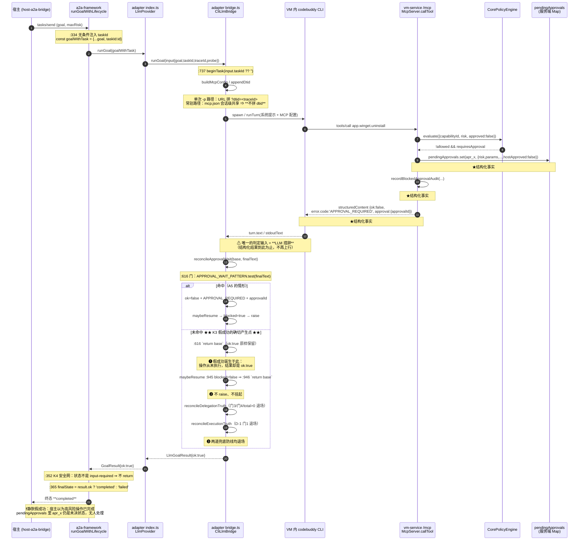

# CL-K3R —— K3「静默假成功」根治：增量架构设计与任务分解

STATUS: DRAFT（架构师产出，待 owner 拍板 §9 后方可进入实施）

> 本文**只做设计**：未修改 `packages/**`、`tests/**`、`qa/**`、`delivery/` 任何文件，未跑部署脚本，未连 VM。
> 基线 HEAD：`6dca16e`（R19F 全部 CL 已合入，真机 R3 三项终验 PASS）。
> 引用口径：**段标签为主、行号为辅**（并行改动会让行号漂移；本文行号仅对 HEAD `6dca16e` 成立）。
> 本文**不改写**上游三份 A5 文档与测试报告；发现的不一致一律登记在 §0.3 并回报主理人。

---

## 0. 前置：口径、纪律与边界

### 0.1 任务定位

R19F（A5 修复）把 `APPROVAL_WAIT_PATTERN` / `parseApprovalBlock` 列入**不改清单**（contract §4 SK-9、§5-Q8），
本迭代未动它 —— 就是为了留给 CL-K3R 整体根治，避免半吊子改动。
本文即为该根治项的**增量设计**：把「审批未决」的判据从 **LLM 文本启发式**升格为 **MCP 结构化工具结果（服务端事实）**。

### 0.2 继承的硬约束（逐条：本文是否触及）

| 编号 | 约束（来源） | 本文处理 |
| --- | --- | --- |
| **D-1** | `bridge.ts` `reconcileExecutionTruth` 内两道门（`replayEnabled \|\| replayActive` / `raised.size === 0`）语义·顺序·短路条件一字不改 | **不触及**。新判据放在收口链**更上游**（`maybeResume` 之前），两道门本身零改动（R19F/T03 已把取值来源换成 `ctx.`，本文不再动） |
| **D-4** | `packages/a2a-framework/src/**` 零改动 | **遵守**：本文方案对该目录**零改动**（不需要） |
| **D-5** | `rejected` 唯一置位点 = `a2a-framework/src/server.ts:306`，不得新增别处置位点 | **不破坏**。新判据只让任务**有机会**走到 `input-required`；`rejected` 仍只由宿主显式拒绝产生。**净效果：让 `:306` 更常可达，而非多出一个置位点** |
| **C-1** | `endTask(taskId?)`：零参/空串 = 无条件清空（保既有零参调用方行为逐字不变） | **不触及**（签名与实现均不动） |
| **A2b** | 生产 A2A 主链路必带非空 `taskId`（`a2a-framework/src/server.ts:334` `const goalWithTask = { ...goal, taskId: id }` 无条件注入） | **依赖**此事实：`dtid` 注入与探针门控均以 `taskId` 非空为前提 |
| **SK-4** | 契约增补一律「纯附加可选」 | **遵守**：新探针成员为**可选方法**、新类型为新增导出、新字段为 `readonly x?: T` |
| **SK-9** | `APPROVAL_WAIT_PATTERN`（`bridge.ts:575`）、`parseApprovalBlock`（`:588`）不改；`reconcileApprovalWait` 的**文案与 steps 改写**（`:615`–`:638`）一字不改 | **遵守**：三者函数体/常量/文案**一字不改**。本文只把它们从「**唯一**判据」降级为「**兜底**判据」（§5.3 专项论证；列为决策点 D-2 供 owner 确认口径） |
| **SK-6** | `raise` 的三条 reason 语义一字不变；`no-active-task` 仍「绝不自批」 | **不触及** |
| **SK-5** | `dist` 必须先重建（`npx tsc -b tsconfig.build.json`，E-2 已订正根级路径）再跑测 | **写入验收判据** |

### 0.3 与上游文档/源码的偏差登记（**不自行改上游文档**，此处记录并回报主理人）

| # | 偏差 | 性质 | 处置 |
| --- | --- | --- | --- |
| **V-1** | `impl-progress.md` §4 记 D-1 红线两门 AFTER 落在 `bridge.ts:1017` / `:1018`；实测 HEAD `6dca16e` 为 **`:1024` / `:1025`** | 纯行号漂移（QA 的 C6 护栏 commit `6a0c950` 之后仓库又前进） | 段标签（`reconcileExecutionTruth` 内两个相邻 `if (…) return base;`）不变，**不影响任何结论**。本文统一用段标签 |
| **V-2** | 根因文档附录 A 记 `contracts/src/bridge.ts` `beginTask=313 / endTask=315 / raise=322`；实测 HEAD `6dca16e` 为 `beginTask=:329`、`endTask=:342`、`raise=:349`（T01 的 C-1/C-2 注释块使之下移） | 行号漂移 | 同上。本文引用一律给段标签 |
| **V-3** | **`vm-service/src/server.ts:770` 的 `ledger?.recordBlocked(...)` 以 `ctx.delegationId` 为唯一前提** ⇒ 常驻会话路径（生产 A2A 主路径）**恒为空操作** | **源码事实，非文档错误**；但上游文档未点名此后果 | 本文 §3.3 给出完整论证，并据此选型（**这是本文最关键的技术发现**）。建议在 K-N1 设计文档补记，但**不由我改** |
| **V-4** | `recordBlockedApprovalAudit` 的 `channel` 取 `ctx.delegationId ? 'a2a' : 'mcp'`（`server.ts:767`）⇒ 常驻路径的**委派内层拦截**被记为 `mcp` 通道 | 与 K-N1「修掉 181/181 恒 mcp」的口径目标同类的**残留观测缺陷** | 本文**不修**（不在 CL-K3R 范围），登记为待办 §9-Q6 |
| **V-5** | `LedgerRegistry.ledgerForInnerTrace()`（`delegation-audit.ts:361`）定义了「按内层 traceId 回挂账本」能力，但全仓**无调用点** | 死代码 / 未完成件 | 本文**不复用**（其匹配面不含被拦调用自身的 traceId），登记 §9-Q7 |

---

## 1. 问题重述与危害定级

### 1.1 K3 的一句话重述

> VM 内 LLM Agent 调用了一个**被策略引擎拦截、需要宿主人工审批**的高风险能力（服务端已返回结构化
> `APPROVAL_REQUIRED` + `approvalId`，并已登记续跑令牌）。但**桥判定「是否真的在等审批」的依据是
> LLM 的最终文本措辞**；一旦 LLM 不用 `APPROVAL_REQUIRED` /「等待审批」这两个词，桥就判定「没在等审批」
> ⇒ 不 raise、不挂起、不改判 ⇒ 任务以 `ok:true` 收口 `completed`。
> **操作从未执行，宿主收到「已完成」，全程零告警。**

### 1.2 触发条件（逐条可核，六条件同时成立）

设 D 为一次 A2A 委派（`taskId` 非空，A2b 已证生产恒成立），其 LLM 回合内确有 ≥1 次能力调用
被 `CorePolicyEngine` 判 `requiresApproval` 并在 MCP 层拦截（`vm-service/src/server.ts:726`–`:791`，
返回 `structuredContent = { ok:false, error:{code:'APPROVAL_REQUIRED'}, approval:{approvalId,…} }`，
同时 `pendingApprovals.set(id, …)`）。

| # | 条件 | 落点 | 证据 |
| --- | --- | --- | --- |
| **K3-a** | LLM 最终文本未命中 `/APPROVAL_REQUIRED\|等待审批/` | `bridge.ts:575` `APPROVAL_WAIT_PATTERN` | 常量原文 |
| **K3-b** | `reconcileApprovalWait` 因此 `return base`，保留 `ok:true`、`error` 为 undefined | `bridge.ts:616` `if (!APPROVAL_WAIT_PATTERN.test(finalText)) return base;` | 根因 §2.2 第 1 条 |
| **K3-c** | `maybeResume` 的 `blocked` 读 `base.error` ⇒ 为 false ⇒ `return base`（不 raise、不挂起） | `bridge.ts:945`–`:946` | 根因 §2.2 第 2 条 |
| **K3-d** | `reconcileDelegationTruth` 退场（门 3 无完成声称 / 门 4 无 probe / `total>0` 采信） | `delegation-truth.ts:81` / `:95` | 见 §1.4 |
| **K3-e** | `reconcileExecutionTruth` 退场（`ctx.replayActive === false`，因从未 raise） | `bridge.ts:1024`（D-1 门 1） | 见 §1.4 |
| **K3-f** | `runGoalWithLifecycle` 按 `result.ok` 收口 `completed` | `a2a-framework/src/server.ts:365` `const finalState = result.ok ? 'completed' : 'failed';` | 框架原文 |

### 1.3 K3-a 为什么**必然会发生**（不是理论风险）

拦截事实在服务端是**结构化**的（§1.2 的 `structuredContent`），但**桥判定它是否发生用的是文本**。二者的桥接点只有一处：

> `bridge.ts:363`–`:372` 的**自然语言纪律**（系统提示词里写着「当工具返回 APPROVAL_REQUIRED…必须立即停止执行，如实上报『等待审批』」）。

即：**「安全纪律」靠提示词约束 LLM，「判据」靠正则匹配 LLM 的回话** —— 同一条链的两端都建在不可靠的措辞上。
已知的具体 evade 形态（按出现的现实性排序）：

1. **同义改写**：LLM 回「该操作需要人工确认」「此操作已被安全策略挂起，等你批准」⇒ 语义完整、正则零命中。
2. **只回显 approvalId 不带错误码**：根因 §2.4 已点名（`apr_…` 出现但 `APPROVAL_REQUIRED` 不出现）⇒ `extractApprovalId` 拿到 id，但 `APPROVAL_WAIT_PATTERN` 不命中 ⇒ 整段 `return base`。
3. **自宣完成**：K5 根因实证 —— 宿主批准后 LLM 未重发工具调用却文本自宣「已卸载」；同源行为在拦截侧就是「我处理完了」的假成功。
4. **常驻会话续跑轮文本覆盖**：`ctx.lastFinalText` 取**最后一轮**（`bridge.ts:1162` / `:1359`），前一轮里说过的「等待审批」会被后续轮覆盖掉。
5. **CLI 输出截断**：`turn.text` / `stdoutText` 的尾部被截 ⇒ 关键词落在截断区。

> **反证式提醒**：A5 之所以**没有**表现为 K3，是因为那一轮 LLM **恰好**说了 `APPROVAL_REQUIRED`
> （根因 §2.3 的三段指纹逐字命中）。也就是说：**A5 是「运气好」，K3 才是默认脆弱面。**

### 1.4 为什么既有三道防线在 K3 场景下**全部退场**（这是必须新建判据的论证）

| 防线 | 退场原因（K3 场景下） |
| --- | --- |
| **K3 文本启发式**（`reconcileApprovalWait`） | 见 §1.2 K3-a —— 它**正是**被绕过的那一道 |
| **K5 回执反查**（`reconcileExecutionTruth`） | D-1 门 1 `if (!this.replayEnabled \|\| !ctx.replayActive) return base;` —— `ctx.replayActive` 只在「raise 回包携 `executed`」时置 true（`bridge.ts:996`）。K3 场景**从未 raise** ⇒ 恒 false ⇒ 整段退场 |
| **K-N1 账本反查**（`reconcileDelegationTruth`） | 三重退场：① 门 3 要求 `finalText` 命中 `COMPLETION_CLAIM_PATTERN`（无完成声称则透传）；② 即便反查，`total` 可能因**其它**成功/失败调用（wild/executed）非零 ⇒ 判「有活动」⇒ 采信（判"有活动"取宽松是 K-N1 的既定纪律）；③ **常驻路径的 `blocked` 根本不进账本**（§3.3）⇒ 连 `blocked` 这一路证据都没有 |

⇒ **结论**：现有三道判据在 K3 场景下**结构性失效**，且失效方向**一致**（都偏向"放过"）。
必须在 `maybeResume` **之前**新增一道**结构化**判据，且该判据的失效方向必须是**保守**的（§5.4）。

### 1.5 危害定级：K3 > A5（为什么更危险）

| 维度 | **A5（已修）** | **K3（本项）** |
| --- | --- | --- |
| 终态 | `failed` | **`completed`** |
| 可观测性 | **显式失败**：宿主立刻知道、可重试 | **静默**：宿主收到成功，零告警、零 failed 样本 |
| 触发条件 | **并发委派交叠**（`endTask()` 误清单例）—— 相对罕见 | **单次委派 + LLM 措辞漂移** —— 常见、且随模型/版本/提示词变化而漂移 |
| 失效方向 | **fail-closed**（安全闸咬死，任务失败） | **fail-open**（安全闸被绕过，且无人知晓） |
| 下游后果 | 任务失败，人工可重试 | 宿主/用户**据此认定高风险操作已完成**（如"已卸载/已删除"）⇒ 形成错误事实认知，**不会重试**，且后续决策建立在错误前提上 |
| 定位成本 | 有 failed 终态 + 三段文案指纹可反查 | **无失败态** ⇒ 只能靠事后 grep「零调用但 completed」形态（K-N1 `ext.zeroInnerCalls` 恒落才勉强可查） |
| 现状 | R19F 已修，真机 R3 三项终验 PASS（报告 §A8.2） | **未修**（R19F 明确列入不改清单，留给本项） |

> **定级理由（一句话）**：A5 是「安全闸咬死」（显式噪声），K3 是「安全闸被绕过且无人知晓」（静默失效）。
> 安全工程的基本排序是 **静默失败 ≫ 显式失败**。故 owner 的判级（K3 比 A5 更危险）成立，本文采纳。

---

## 2. 现状机制剖析（文本启发式链路 + 假成功的确切产生点）

### 2.1 全链时序图（现状，HEAD `6dca16e`）

**图中三个「★结构化事实」与「❶/❷/❸」的位置关系，就是本缺陷的全部**：
结构化事实**在服务端已经存在**（三处，且互相独立），但它们**从未上行到桥**；桥只看得到 LLM 的话。

### 2.2 假成功的确切产生点（一句话定位）

> **`packages/adapter-agent-workbuddy-llm/src/bridge.ts:616`**
> `if (!APPROVAL_WAIT_PATTERN.test(finalText)) return base;` —— **这一行的 `return base`**。
>
> 它把 `base`（`ok:true`、`error:undefined`、summary「LLM 运行时（常驻会话）完成目标：…」）**原样放行**，
> 从而使下游 `maybeResume`(:945) 的 `blocked` 为 false ⇒ `:946 return base` ⇒ 不 raise ⇒ 不挂起 ⇒ `completed`。

与 A5 的对照：A5 的失败点是 **`vm-service/src/server.ts` `raise()` 首行守卫**（`no-active-task`，R19F 已修，
现为 `const taskId = req.taskId ?? this.activeTaskId;` + `:213` 早退）。**两者是同一条收口链上不同位置的两个洞**：
R19F 补的是「raise 之后挂到哪里」，CL-K3R 补的是「根本没走到 raise」。

### 2.3 现状判据的失效方向（关键，决定新判据该怎么设计）

`reconcileApprovalWait` 是**单向**判据：命中 ⇒ 改判为「等待审批」（保守）；未命中 ⇒ **透传**（放行）。
它的**默认输出是放行**。因此「LLM 没说」与「LLM 说没被拦」在桥侧**不可区分** —— 这就是 fail-open 的结构性根源。

---

## 3. 可行性论证：桥侧到底能拿到什么结构化信息？

> 本节是全设计最大的不确定性，已**实地读码核实**（未凭摘要、未想当然）。结论先行，证据在后。

### 3.1 结论（三句话）

1. **桥与服务端同进程** —— `CliLlmBridge` 由 `vm-service` 的 `loadProvider(cfg.agent, bridgeCtx)` 加载，
   且与服务端 `VmApprovalCoordinator` 共享**同一个对象实例**（根因 §3.2「全链单实例」已证）。
   ⇒ **不需要任何跨进程/跨网络/改 MCP 协议的新通道**，只要补一个**注入式探针**（与既有 `bridgeCtx.delegationProbe` 同形），桥就能直读服务端的结构化事实。
2. **服务端确实握有权威结构化事实，且不止一份** —— 拦截发生时同时落三处（§3.2 通道盘点），其中
   `pendingApprovals`（`vm-service/src/server.ts:512`）**最完整**：`approvalId` / `capabilityId` / `risk` / `params` / `preview` / `impact` / `underlying` / `createdAtMs` / `hostApproved` / `traceId`。
   这已**超过** K3 根治所需的全部字段（甚至顺带把 §4.3 的「risk 靠 LLM 文本正则抠」一并根治）。
3. **但有一处结构性缺口必须补**：常驻会话路径（**生产 A2A 主路径**）**不带 `dtid`** ⇒
   服务端无法把拦截**归属**到具体委派 ⇒ `PendingApproval.delegationId` 缺席、账本 `blocked` 通道**恒为 0**（§3.3 源码实证）。
   ⇒ **要补的不是"通道"，而是"归因"**：一套与 K-N1 通道 1（时间窗）同构的归因规则（§3.6）。

> **给 owner 的一句话**：**能拿到**，且不必改 MCP / 不必改 CLI / 不必碰 `a2a-framework`；
> 缺的是「常驻路径下这条拦截属于哪个委派」的归因，用**时间窗 + 能力面**兜底即可闭合（与 K-N1 既有纪律同构）。

### 3.2 通道盘点：五条可能的「结构化信息」通道，逐条判定

| # | 通道 | 桥侧现状可见性 | 结构化程度 | 字段完备度 | 判定 |
| --- | --- | --- | --- | --- | --- |
| **C-1** | **LLM 最终文本**（`turn.text` / `stdoutText`） | ✅ **唯一在用** | ❌ 纯文本 | 靠正则抠（`approvalId` / `capabilityId` / `risk`，抠不到兜底 `'L2'`） | **现状判据 = 缺陷根源** |
| **C-2** | **`pendingApprovals` Map**（`server.ts:512`，同进程） | ❌ 桥不可见（**但可以补**，§3.5-B2） | ✅ 强结构 | **最完备**：approvalId/capabilityId/risk/params/preview/impact/underlying/createdAtMs/hostApproved/traceId/(delegationId?) | ⭐ **推荐主通道** |
| **C-3** | **`DelegationLedger.blockedEntries`**（`delegation-audit.ts:116`） | ⚠ 经 `DelegationTruthProbe` 只暴露**计数** `blocked:number`，**拿不到 approvalId**；且常驻路径恒 0（§3.3） | ✅ 结构 | 有 approvalId + capabilityId + seq | ⭐ **推荐副通道**（补归因后可用，且入哈希链，取证最强） |
| **C-4** | **哈希链审计条目**（`recordBlockedApprovalAudit`，`server.ts:754`） | ❌ 桥不可见 | ✅ 结构 | approvalId/capabilityId/risk/params/ts/seq | 可作取证，不宜作判定输入（IO + 脱敏开销） |
| **C-5** | **MCP 工具结果本体**（`structuredContent`，`server.ts:776`–`:791`） | ❌ **桥根本看不到**（它在 CLI 进程里；桥只见 CLI 的 stdout） | ✅ 最强结构 | 完整拦截语义 | ❌ **不可行**，见 §3.4 |

### 3.3 关键缺口实证：常驻路径下「拦截」对服务端账本的贡献**恒为 0**

逐跳源码核实（HEAD `6dca16e`）：

| 跳 | 落点 | 原文/事实 | 常驻路径下的值 |
| --- | --- | --- | --- |
| 1 | `bridge.ts:1134`（常驻）/ `:1259`–`:1260`（单次） | `prepareMcpConfig(outputDir)` —— 常驻**不传** `delegationId`；单次传 `const dtid = input.taskId ? input.traceId : undefined` | 常驻：**不拼 `?dtid=`** |
| 2 | `bridge.ts:1108`–`:1112`（方法注释） | 「常驻会话的 `mcp.json` 是**会话级共享文件** … 把逐次委派 dtid 写进去只在该进程**下次 spawn** 时才生效」 | 归因时点错位，故**刻意不传** |
| 3 | `mcp-framework/src/server.ts:194`–`:195` | `const ctx: ToolContext = reqCtx?.delegationId ? { traceId, delegationId } : { traceId };` | `ctx.delegationId` = **undefined** |
| 4 | `vm-service/src/server.ts:746` | `...(ctx.delegationId ? { delegationId: ctx.delegationId } : {})` | `PendingApproval.delegationId` **缺席** |
| 5 | `vm-service/src/server.ts:767` | `channel: ctx.delegationId ? 'a2a' : 'mcp'` | 误标为 **`mcp`**（登记为 V-4，本项不修） |
| 6 | `vm-service/src/server.ts:770` | `const ledger = ctx.delegationId ? ledgerReg.get(ctx.delegationId) : undefined;` | `ledger` = **undefined** |
| 7 | `vm-service/src/server.ts:771` | `ledger?.recordBlocked(record.seq, id, cap.id);` | **空操作** ⇒ `blockedEntries` 恒空 |
| 8 | `delegation-audit.ts:189` | `const blocked = this.blockedEntries.length;` | **`blocked === 0`** |
| 9 | `delegation-audit.ts:329` | `if (record.policyDecision?.matchedRule === 'approval-required') return;` | 被拦记录**也不进 wild** ⇒ `wild` 也不增 |

> ⇒ **常驻会话路径下，一次真实的高风险拦截，对 K-N1 账本 `activityCount()` 的三个计数贡献全部为 0。**
>
> 而**生产 A2A 走的就是常驻路径**：根因 §3.4 已证 A5 为 `persistent`（`params.session="persistent"`，
> 与 `bridge.ts:1190` 构造的 step 逐字一致）；真机 R3 报告 §A8.2 的三条终验亦全部跑在常驻会话上
> （`[llm-session] LLM 常驻会话轮次完成`）。**这不是边角场景。**

### 3.4 为什么「让 MCP 工具结果本体上行」（C-5）**不是**可行根治路径

owner 拍板的方向原话是「桥侧直读 MCP 结构化工具结果」。**读码后的判读：该方向的**精神**（不依赖 LLM 措辞）完全正确，
但**字面路径**（把工具结果本体搬给桥）不可取，理由三条：

1. **物理上不可达**：工具结果在 `codebuddy` **子进程**里。桥只见子进程的 `stdout`（`bridge.ts:1276` 累计 `stdoutText`）。
   要拿到结构化结果必须让 CLI 以机器可读格式输出调用记录 —— 真机 CLI 契约（`bridge.ts:88`–`:97` 注释）里
   `--output-format json|stream-json` 是 **CLI 自有格式**，受 codebuddy 版本约束，且要新增解析器、处理截断与多行。
2. **即便拿到，仍是"转述"**：那是**CLI 运行时**的转述，不是**拦截发生地**的账本。拦截的权威记录者是服务端的
   `pendingApprovals`（`server.ts:730`）—— 直接问它，比解析 CLI 输出更短、更准、更抗版本漂移。
3. **成本/收益**：C-5 要改 CLI 参数模板 + 输出解析 + 兼容层；C-2/C-3 只加一个**同进程注入探针 + 一套归因规则**，
   且**完全复用** K-N1 已落地的 `DelegationTruthProbe` 注入范式（`bridgeCtx` cast → provider 读 → 桥收口反查）。

> ⇒ **本文推荐把「直读 MCP 结构化工具结果」落为「直读服务端在拦截时已落的结构化账本/令牌表」** ——
> 数据源在**更上游**（拦截发生地），且零协议改动。**这一点需 owner 确认（决策点 D-1）。**

### 3.5 要补什么（最小补齐清单，4 项）

| 编号 | 要补的东西 | 落在哪 | 为什么必须 |
| --- | --- | --- | --- |
| **B-1** | 探针契约：给 `DelegationTruthProbe` 加**可选**方法 `approvalWait?(q)` + 两个新类型（`ApprovalWaitQuery` / `PendingApprovalFact`） | `packages/contracts/src/bridge.ts`（`DelegationTruthProbe` 段之后） | 桥**只认契约类型**，不认服务端实现（既有 `delegationProbe` 注入范式） |
| **B-2** | 服务端探针实现（读 `pendingApprovals` + 账本 `blockedEntries`），并在 `bridgeCtx.delegationProbe` 内注入 | `packages/vm-service/src/server.ts`（纯函数放 `approval-replay.ts`，对称 K-N1 的纯逻辑拆分纪律） | §3.2 C-2/C-3 的事实目前**无暴露面** |
| **B-3** | **归因**：① 账本 `blocked` 的窗口归因（`LedgerRegistry` 增按窗口查 blocked 事实）；② `server.ts:770` 的 `recordBlocked` 改用同一归因规则 | `packages/vm-service/src/delegation-audit.ts` + `server.ts` | §3.3 已证：常驻路径下 `blocked` 恒 0，无归因则副通道不可用 |
| **B-4** | 桥侧新判据（结构化优先、文本兜底）+ 两处调用点接线 | `packages/adapter-agent-workbuddy-llm/src/delegation-truth.ts`（纯逻辑）+ `bridge.ts`（接线） | §1.4 已证：既有三道防线在 K3 场景全部退场 |

**明确不需要补的**（成本优势）：不需要跨进程通道、不需要改 MCP 协议、不需要改 CLI 契约与参数模板、
不需要改 `packages/a2a-framework/**`（D-4）、不需要改 `packages/mcp-framework/**`。

### 3.6 归因规则（补齐 B-3 的核心；与 K-N1 通道 1/通道 2 完全同构）

对一条 `PendingApproval`（或一条 `BlockedEntry`）与一次委派 D（`delegationTraceId`、`startedAtMs`、`capabilities`）：

| 规则 | 条件 | 判定 | 说明 |
| --- | --- | --- | --- |
| **R1 精确归因** | `entry.delegationId === D.traceId` | **属于 D** | 通道 2：单次 `-p` 路径（`?dtid=` 生效）；与 K-N1 `ext.delegationId` 同源 |
| **R2 精确排除** | `entry.delegationId` 非空且 `!== D.traceId` | **不属于 D**（跳过） | 已精确归属他人的，绝不因窗口重合被重复计入 —— 这条是防止"串台"的关键 |
| **R3 窗口兜底** | `entry.delegationId` 缺席 **且** `entry.createdAtMs >= D.startedAtMs` **且** `!entry.hostApproved` **且** `capabilityId` ∈ D 的能力面 | **属于 D** | 通道 1：与 `DelegationLedger.inWindow` / `isExposed` **同口径**（`delegation-audit.ts:143`/`:148`） |

**能力面取值优先级**：① 委派的 `LlmGoalInput.capabilities`（= `GoalRequest.allowedCapabilities`，最窄、最准）；
② 缺席/空 ⇒ 退服务端 `exposedIds`（与 wild 归因一致）。

**为什么 R3 在生产足够可靠**（不是拍脑袋）：
- 常驻会话的轮次被 `persistent-session.ts` 的 `enqueue`（`this.chain.then(fn, fn)`）**串行化** ⇒
  同一 bridge 实例同一时刻**只有一轮 turn 在跑**；
- 单次 `-p` 路径各自独立进程且**带 dtid** ⇒ 走 R1，不占 R3；
- ⇒ R3 在窗口内看到的"未归属未决审批"，**极大概率**就是本委派自己触发的那一条。

**R3 的残余噪声与其方向（必须显式登记）**：

| 噪声源 | 后果 | 方向 |
| --- | --- | --- |
| 宿主**非委派**的 MCP 直调在窗口内被拦 | 被误归给 D ⇒ D 被改判「等待审批」（多报一次挂起） | **fail-closed**（安全方向） |
| 上一次委派遗留的**未决** token 还没被清理 | 同上，多报 | **fail-closed** |
| 拦截已发生但 entry 不在 Map 里 | —— | **不可能发生**：拦截的**唯一**代码路径（`server.ts:730`）必然 `set`，且批准/超时才 `delete` |

> ⇒ **R3 只会"多报"，不会"漏报"**。这正是对 K3（漏报 ⇒ 假成功）的根治方向，代价是引入**可控的假挂起噪声**。
> 该取舍的完整论证见 §5.4。

<!-- APPEND-MARKER -->
