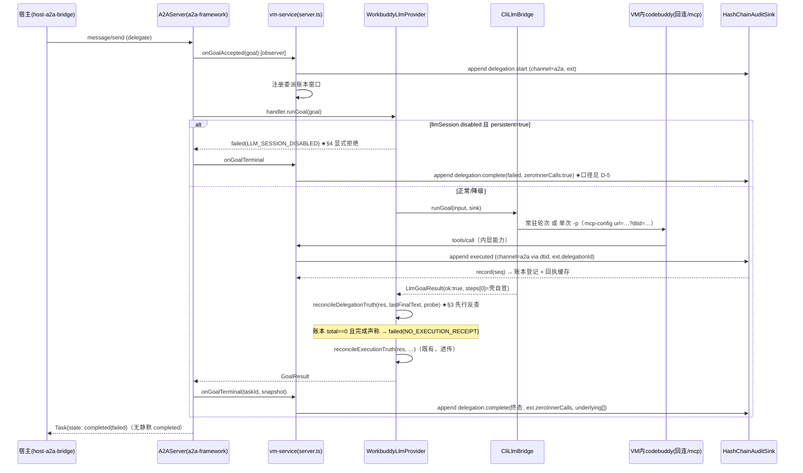
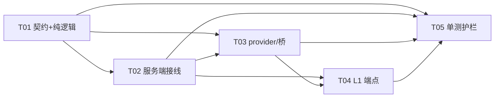

# K-N1 委派层审计真实性契约设计（含 S-3 / L1 取舍与任务分解）

- **文档性质**：设计-only。不含实现代码，不改任何源码。
- **缺陷来源**：`docs/test/reports/real-test-2026-09-30-r19.md` §5 K-N1（High，阻塞 E4 收尾）、§5 策略表 S-3、§8 L1/L2/L4/L8。
- **被测版本基线**：HEAD `9139239`。
- **作者**：software-architect（Bob）· 任务板 #5。
- **硬约束遵守**：最小变更、不重构；所有结论先读码后设计，引用一律 `file:line`。

---

## TL;DR

K-N1 的判定层根因是：K5 回执反查 `reconcileExecutionTruth` 在「本任务从未 raise 审批」时**按设计退场**（`bridge.ts:1095` 的 `if (ctx.raised.size === 0) return base;` 短路），导致委派回合**零工具调用**也能静默 `completed`，且链上无一条能证伪它的记录。

本契约把完成判据从「审批回执反查」**升格为「委派账本反查」**，共三层：

1. **委派壳双态审计**：每次 A2A 委派（`appops.workflow.run` 壳）落 **2 条** `channel="a2a"` 审计条目——`delegation.start`（受理时）与 `delegation.complete`（终态时，`ext.zeroInnerCalls` 显式记录「零工具调用」事实与内层活动清单）。哈希链结构零破坏（`AuditRecord` 只增可选 `ext` 字段）。
2. **NO_EXECUTION_RECEIPT 无条件反查**：完成声称 + 服务端账本（窗口内 executed/blocked 条目 + 内层回连 MCP 调用）零活动 → 改判 `failed`。此分支**不受 K5 审批灰度门控**（`replayEnabled`/`k5ReplayActive` 只门控"审批回执"分支），填掉 `bridge.ts:1095` 的短路盲区。
3. **disabled 显式拒绝**：`llmSession.state="disabled"` 且配置启用常驻（`persistent=true`，"disabled=故障"态）时，委派在入口即 `failed(LLM_SESSION_DISABLED)`，禁止进入降级回合；`persistent=false`（"单次 -p=设计"态）不拒绝，靠第 2 层账本反查兜底——**两种降级语义由此可区分**。

配套：**S-3 推荐新增 `GET /audit/receipt?traceId=` 只读端点**（基于 `HashChainAuditSink.query`，零哈希链体积增长、零新增入链敏感面）；**L1 推荐 `POST /admin/llm-session/reset`**（重置计数并重建会话，可选 `?faultInjection=1` 支撑 K-N1 确定性回归，env 门控默认关）。

任务分解 5 个（T01 契约与纯逻辑 → T02 服务端接线 → T03 provider/桥改判 → T04 运维端点 → T05 单测护栏），依赖全部汇聚于 T01/T02，无长链。

> **本文三处「推荐」已由主理人拍板为定稿决策，见 §11 决策日志（D-1/D-2/D-3）**。实现以 §11 为准。

---

## 1. 读码定位结论（设计依据）

| 事实 | 源码位置 |
|---|---|
| 审计哈希链写入器：`append` 串行区内取号，`hash = SHA256(canonicalJson(去 hash 字段的整条记录))`，`prevHash = 上一条 hash`；**任意新增字段自动纳入哈希**，可选字段对历史记录校验无影响 | `packages/core/src/audit/chain.ts:261`（append）、`:275-284`（doAppend）、`:26-38`（canonicalJson/computeRecordHash）、`:299`+`:331`（verifyChain 从记录自身重算）、`:355-373`（query，`:373` since 为字符串日期比较） |
| 记录契约：`result` 现仅 `{ok, errorCode?, summary?}`；`principal.channel: 'mcp'|'a2a'|'internal'`；`artifacts?: readonly string[]`（sha256 指针形态） | `packages/contracts/src/audit.ts`（`AuditRecord` 全字段） |
| **executed 审计在 provider 内部落**：成功路径 `adapter-agent-workbuddy/src/index.ts:345-365`（`ctx.audit.append`，`:349` 硬编码 `channel:'mcp'`）；失败路径 `fail()` `:902-914`（同样硬编码）。委派内层回连的 tools/call 走的就是这条链 → **内层真实调用确实落审计**（与报告离线复核一致） | `packages/adapter-agent-workbuddy/src/index.ts:345`、`:902` |
| blocked 审计正常工作（R19 实证 seq179/181）；硬编码 `channel:'mcp'` | `packages/vm-service/src/server.ts:645`（调用点）、`packages/vm-service/src/approval-replay.ts:55-62` |
| **`POLICY_DENIED` 硬拒绝零审计（S-4，对照项）** | `server.ts:490-501`（executeCapability 前置拒绝）、`:676-684`（handler 内拒绝）——无 audit 调用 |
| K-N1 判定层根因：`reconcileExecutionTruth` 首两行短路 | `packages/adapter-agent-workbuddy-llm/src/bridge.ts:1089-1115`（`:1094` 灰度门、`:1095` `if (ctx.raised.size === 0) return base;` 退场）；调用点 `:854`（`reconcileDelegationTruth` 在 `runGoalInner`）、`:863`（`reconcileExecutionTruth` 在 `runGoalInner`） |
| 壳步骤合成：委派成功时硬造 `steps[0]={appops.workflow.run, ok:true}`（常驻 `bridge.ts:1067-1078`、单次 `:1248-1258`），**零能力调用也造** | `bridge.ts` runPersistent / runOneShot 的 `steps` 字面量 |
| 降级标记现状：`summary` 追加文案 `（常驻会话不可用：…已降级为单次 -p 路径）`，无结构化字段 | `bridge.ts:724`（runGoalCore 降级分支，`:716-728`） |
| 内层 LLM 回连方式：VM 内 codebuddy CLI 经 `--mcp-config` 连本服务 `/mcp`（`url=endpoint`），**每次 tools/call 由 mcp-framework 自造 traceId**（`callTool` `newTraceId()`），与委派 traceId 无父子链 | `bridge.ts:97-105`（buildMcpConfig）、`packages/mcp-framework/src/server.ts:164-190`（callTool）、`:65-69`（newTraceId） |
| A2A 终态收口：`result.ok → completed/failed`（无服务端反查介入点） | `packages/a2a-framework/src/server.ts:328-331` |
| MCP 通道无鉴权、无上下文透传机制；`ToolContext` 现仅 `{traceId, signal?}` | `server.ts:814-824`（/mcp 路由）、`mcp-framework/src/server.ts:31-34` |
| disabled 永久态：`ensureReady` 超 `maxRestarts` 置 `disabled` 后 `:306/:551/:608/:842` 各处直接退场，无重置入口；`restarts = spawnAttempts - 1`（累计制，非连续） | `packages/adapter-agent-workbuddy-llm/src/persistent-session.ts:305-313`、`:249-250`、`:861-885`（`dispose` 软释放不进 disabled；`shutdown` 硬关闭置 disabled） |
| `llmSessionHealth()` 是 provider 上的**同步** SPI 成员，vm-service 直接调用 | `packages/adapter-agent-workbuddy-llm/src/index.ts:255-257`、`packages/contracts/src/bridge.ts:437` |
| `/health` 已透出 `llmSession`（`server.ts:948` 取 `provider?.llmSessionHealth?.()`）；HTTP 仅 4 条路由（`/health` `/.well-known` `/mcp` `/a2a`），404 兜底 | `server.ts:804-863`（路由）、`:948` |
| 服务端→桥注入面：`WorkbuddyLlmProvider` 构造 `CliLlmBridge({cliPath, endpoint, sessionConfig, onSessionLog, ...})` | `adapter-agent-workbuddy-llm/src/index.ts:151` 附近 |

**盲区复述（一句话）**：`bridge.ts:1094-1095` 两道门都在"有审批才有参照物"的假设上；零 raise 的降级回合没有任何服务端参照物被查询 → 壳的 `steps[0].ok:true` 是 LLM 自宣的转写，不是证据。

---

## 2. 委派壳双态审计契约（设计项 1）

### 2.1 两态条目定义

每次 A2A 委派（`message/send` 触发 `runGoalWithLifecycle`）落 **2 条**审计：

| 态 | 写入时机 | `result.summary` | `result.ok` |
|---|---|---|---|
| **delegation.start** | `runGoalWithLifecycle` 调 handler 前（`a2a-framework/src/server.ts` 经注入回调；实现落点见 §2.4） | `"delegation.start"` | `true`（受理即成功，无歧义） |
| **delegation.complete** | 终态收口处（completed / failed / rejected / input-required 挂起均落） | `"delegation.complete:<终态>"`（≤500 字符） | 与终态一致（completed→true，其余→false） |

> **各终态的产生路径（见 §11 D-5）**：`failed` = disabled 显式拒绝、NO_EXECUTION_RECEIPT 改判、异常路径；`rejected` = **仅**宿主显式拒绝审批（框架先置 TaskStore `rejected`，observer 据此透出）；`input-required` = 审批挂起。disabled 拒绝**不**产生 `rejected`。

`errorCode` 约定：`completed` 无；`failed(NO_EXECUTION_RECEIPT)` 记 `"NO_EXECUTION_RECEIPT"`；disabled 拒绝记 `"LLM_SESSION_DISABLED"`。

> **注意（读码发现）**：`query({since})` 是**字符串日期比较**（`chain.ts:373`），且 complete 条目 `ts` 天然晚于窗口内条目、`seq` 更大——**窗口过滤绝不能用 since**，必须用 seq 区间（见 §2.2 的 `auditSeqs`）或按 ext 过滤。

### 2.2 审计条目 JSON schema 增量（哈希链兼容）

`AuditRecord` **仅新增一个可选顶层字段 `ext`**（旧读者忽略；新记录整字段入 `canonicalJson` 哈希；历史记录校验不受影响——`verifyChain` 从记录自身重算，`chain.ts:299-343`）：

```jsonc
// delegation.complete 条目全文（示例：K-N1 现场 —— 零工具调用的假完成）
{
  "seq": 182, "ts": "2026-10-02T02:35:09.120Z",
  "traceId": "tr_mur1…_182", "auditId": "aud_…",
  "principal": { "host": "vm-service", "user": "User", "channel": "a2a" },
  "capabilityId": "appops.workflow.run",
  "risk": "L1",
  "params": { "goal": "<前 300 字符，redact 脱敏后>", "maxRisk": "L2", "allowedCapabilities": ["app.winget.uninstall"] },
  "policyDecision": { "allowed": true, "matchedRule": "delegation" },
  "result": { "ok": false, "errorCode": "NO_EXECUTION_RECEIPT",
              "summary": "delegation.complete:failed（零工具调用；完成声称不予采信）" },
  "durationMs": 17403,
  "prevHash": "…", "hash": "…",
  "ext": {
    "kind": "delegation-complete",
    "delegationId": "tr_muo0d…_166",        // 委派 traceId（goal.traceId，a2a-framework/src/server.ts:225 生成）
    "taskId": "task_…",
    "zeroInnerCalls": true,                  // ★ 核心事实断言字段
    "underlying": [                          // 真实目标能力清单（账本聚合，≤50 项）
      { "capabilityId": "app.winget.uninstall", "ok": false, "count": 1,
        "approvalId": "apr_…", "auditSeqs": [179] }
    ],
    "blockedCount": 1,
    "downgraded": true,                      // 常驻不可用→单次 -p 降级事实（结构化，替代 summary 文案）
    "downgradeReason": "已超重建上限（5），此后回退单次 -p",
    "terminalState": "failed",               // A2A 终态
    "stepsSummary": [{ "capabilityId": "appops.workflow.run", "ok": false }]  // ≤10 项，各 summary 截 200
  }
}
```

start 条目同形，`ext.kind="delegation-start"`，`ext.underlying` 缺席、`zeroInnerCalls` 无（未判定），终态字段无。

> **`ext.terminalState` 取值口径（见 §11 D-5）**：类型为 `TaskState`，可含 `rejected`；但**取值由 observer 的 `terminalState` 实参决定**，实测 disabled 拒绝落 `failed`。断言 `ext.terminalState` 时须按路径区分，不得跨路径泛化。

**脱敏纪律**：`ext` 内一切自由文本（goal、summary、downgradeReason）出 `redact()`（`chain.ts:47`）后截断；`params` 沿用 sink 现有 `doRedact`（`chain.ts:282`）。零新增敏感面：不新增任何未脱敏通道。

**S-4 边界（明确排除）**：`POLICY_DENIED` 硬拒绝不落账本、不改造（报告已单列 S-4，不在本契约范围）；账本口径 = executed 条目 + `blocked:approval-required` 条目。

### 2.3 内层调用归因（ledger 双通道）

委派 traceId 与内层回连 MCP 调用的 traceId **无父子关系**（读码事实，§1）。归因采用两条互补通道：

- **通道 1（零 plumbing，P0）**：vm-service 进程内**委派账本** `Map<delegationTraceId, DelegationLedger>`：
  - `runGoalWithLifecycle` 前注册窗口（`startedAtMs = Date.now()`）；
  - handler 调 `executeCapability` 时随 `ToolContext` 携带账本句柄，provider 审计 `append` 返回的 `AuditRecord`（含 seq）经 per-call ctx 累加器 `ctx.auditSeqs` 回传，服务端按 `(ts ≥ startedAtMs) && 任务存活 && capabilityId ∈ 暴露面` 归入 `executed[]`（**排除**两条壳条目自身）；blocked 条目由 `recordBlockedApprovalAudit` 的可选回调登记（含 approvalId）；
  - 内层回连调用（CLI→`/mcp`）不带委派 traceId，按**时间窗 + 能力域**归入 `wild[]`：`wild.length > 0` 即足以推翻"零活动"（保守、无误判风险，因为窗口内任何 executed/blocked 都算活动证据）。
- **通道 2（精确归因，P1）**：`buildMcpConfig(endpoint)`（`bridge.ts:98-105`）把 endpoint 拼为 `{endpoint}?dtid=<委派traceId>`；`/mcp` 路由解析 `url.searchParams.dtid` 注入 `ToolContext.ext`；provider 审计条目写 `ext: { delegationId, channel: "a2a" }`。URL query 对 streamableHttp 客户端零成本（无 header 能力依赖），旧 CLI 无感。内层条目的 `principal.channel` 由此**真实**记 `a2a`（修掉 181/181 恒 mcp 的观测缺陷在"委派回连"这一半；纯宿主直调仍为 mcp，语义正确）。

**不变式**：账本判"有活动"取**宽松**（宁可放过 completed，不可错杀合法完成）；判"零活动"必须两通道同时为空。

### 2.4 写入落点与依赖方向（最小接线）

审计写入必须在 **vm-service 层**（它拥有 `audit` sink、`mcpTools` handler、`pendingApprovals`；`a2a-framework` 不依赖 `core`，不得直接写审计）。接线：`A2AServer` 增可选构造项 `delegationObserver?: { onGoalAccepted(goal): void; onGoalTerminal(taskId, goal, snapshot): void }`，server.ts 实现之（纯附加，缺席零改动）。

---

## 3. completed 反查规则：NO_EXECUTION_RECEIPT（设计项 2）

### 3.1 判定分层（放哪一层）

| 层 | 职责 | 依据 |
|---|---|---|
| **provider/桥（改判执行层）** | 在 `runGoal` 收口处施加反查、产出 `failed(NO_EXECUTION_RECEIPT)` | 改判要写进 `GoalResult`，A2A 框架据 `result.ok` 收口（`a2a-framework/src/server.ts:328`），故必须在 handler 返回前完成；`WorkbuddyLlmProvider.ctx.audit: AuditSink` 在 `init()` 已可得（`adapter-agent-workbuddy/src/index.ts:345` 同款用法），查询能力现成 |
| **server（事实供给层）** | 委派账本 + `delegation.complete` 审计条目是判定的**客观参照物**；server 不改判（它拿不到 LLM 文本，也无时序做终态改判） | 保持"a2a-framework 通用、vm-service 拥有语义"的既有分层 |
| **壳（appops.workflow.run）自身** | 不判。`bridge.ts:1067-1078/:1248-1258` 的 `steps[0].ok:true` 合成本身是"自宣转写"，无证据地位 → 反查改判时**一并改写 steps**（对齐 `:928` 既有做法） | 壳步骤历来不是服务端证据（K-N1 现象本身） |

### 3.2 规则（新纯函数，落 `vm-service/src/delegation-audit.ts`，桥侧调用）

```
reconcileDelegationTruth(base, finalText, { probe }): Promise<LlmGoalResult>
  门 1: base.ok === false → 透传（不重复改判）
  门 2: 非委派上下文（无 taskId）→ 透传（MCP 直调语义零改动）
  门 3: !COMPLETION_CLAIM_PATTERN.test(finalText) → 透传（无完成声称不猜；登记局限 §10-1）
  证据 = await probe.delegationActivity(delegationTraceId)
         // 账本 executed/blocked 登记 + ext.delegationId 索引查询 + traceId 串匹配（approvalId 关联）
         // wild 通道：窗口内非壳审计条目
  若 证据.total === 0:
    → { ...base, ok:false,
        error: makeError('EXECUTION_FAILED', '委派回合零服务端活动记录，完成声称不予采信',
                { reason:'NO_EXECUTION_RECEIPT',
                  details:{ delegationTraceId, ledger:{executed:0, blocked:0, wild:0} } }),
        summary: 前缀"执行回执缺失：", steps 全量改 ok:false }
  否则透传。
```

### 3.3 时序（在哪一步反查）

`runGoalInner` 收口链（`bridge.ts:849-863`）改为：

```
res = runGoalCore(...)                          # 既有
res = await reconcileDelegationTruth(res, ctx.lastFinalText, probe)   # ★ 新增：先行、无条件
res = reconcileExecutionTruth(res, ctx.lastFinalText)                 # 既有：保留
```

顺序理由：零活动改判后 `base.ok===false`，`reconcileExecutionTruth` 的 `:916`（`!base.ok` 透传）自然不重复改判；两判据不可能产生矛盾终态。

### 3.4 与既有 raisedAt / k5 逻辑的关系

- **不动** `bridge.ts:1094-1095` 两道既有门——它们守护的是"审批回执反查不被 K4 灰度误杀"，语义仍然成立；`bridge.ts:634-645` 注释所述 raisedAt 集清空即退场的行为逐字保留。
- **新分支只受 `taskId` 门控**（委派上下文才反查），**不受** `replayEnabled`/`k5ReplayActive` 门控（账本参照物与审批灰度无关）。
- `approval-replay.ts:155` 注释自认"被拦的能力常是壳"：契约兑现点——blocked 条目进账本后，壳被拦（`e1r2` 现场 `tr_…-replay`）与壳零活动（K-N1 现场）在 `ext.underlying` 上第一次可区分。

### 3.5 降级结果两种形态的区分（对应任务约束 3 的边界）

| 形态 | 账本 | 终态 | 判定 |
|---|---|---|---|
| 降级单次 -p，**真发起**了 tools/call（合法降级按设计工作，E1/E5 实证内层落审计） | >0 | completed | **采信**（completed + `ext.downgraded:true` 照落审计） |
| 降级单次 -p，**零调用**还宣告完成（K-N1 现场三例） | 0 | completed 声称 | **改判 failed(NO_EXECUTION_RECEIPT)** |
| 常驻启用态 + `state=disabled`（OBS-F 永久态） | 不会走到 | — | **入口显式拒绝 failed(LLM_SESSION_DISABLED)**（§4） |

---

## 4. disabled 显式拒绝语义（设计项 3）

### 4.1 判定规则

在 `WorkbuddyLlmProvider.runGoal`（`adapter-agent-workbuddy-llm/src/index.ts:259`）入口：

```
若 goal.taskId 存在（= A2A 委派）
且 persistent === true（配置启用常驻；env WINVM_LLM_PERSISTENT 缺省即 true）
且 this.llmSessionHealth()?.state === 'disabled'
→ return { ok:false, summary:'委派通道不可用：LLM 常驻会话已停用（<lastError>）',
           steps:[], artifacts:[],
           error: makeError('PROVIDER_UNAVAILABLE', 'LLM 常驻会话 disabled，拒绝降级委派',
                   { reason:'LLM_SESSION_DISABLED', details:{ restarts, lastErrorAt } }) }
且同步写一条 delegation.complete 审计（终态 rejected，errorCode=LLM_SESSION_DISABLED，
zeroInnerCalls:true —— 未开始即拒绝，账本空）
```

> **口径更正（见 §11 D-5，保留上文原文不改写）**：本条描述的 disabled 显式拒绝路径，实测终态为 **`failed`**（`errorCode=LLM_SESSION_DISABLED`），**不是** `rejected`。上文「终态 rejected」为设计期笔误，已登记为待整改项；`rejected` 仅在**宿主显式拒绝审批**路径出现（详见 D-5）。

A2A 框架据 `result.ok=false` 收口 `failed`（`a2a-framework/src/server.ts:328`），宿主在 `message/send` 响应里直接拿到失败终态与原因码——**零静默**。

### 4.2 两种部署态的边界（设计上必须区分）

| 配置 | 语义 | disabled 时委派行为 |
|---|---|---|
| `persistent=true`（默认部署，OBS-F 现场） | disabled **是故障态**（重建超限） | **显式拒绝**（本节规则）→ 运维收到明确信号，走 L1 重置（§6） |
| `persistent=false`（显式选择"单次 -p 即设计"） | 无"disabled=异常"概念（`persistentEnabled=false` 时根本不进常驻分支、不建会话，`bridge.ts:662` 赋值、`:717` 门控） | **不拒绝**，委派正常走单次 -p；假完成由 §3 账本反查兜底 |

### 4.3 既有 D4.4 降级链不受影响

`index.ts:290`（调用点）/ `:317`（`shouldDegrade` 定义）：`PROVIDER_UNAVAILABLE` 且零 artifact 会触发"回退确定性执行器模板"。§4.1 的拒绝发生在 `bridge.runGoal` **之前**、直接 return，不进入 `shouldDegrade` 分支——确定性模板（E4 通道 B 型操作）不因此失去委派入口；若要连模板一起封死属过度设计（拒绝语义已满足"不静默 completed"）。**登记为待明确（§10-3）**：如需 `WINVM_A2A_REJECT_ON_DISABLED=strict` 全封档，留接口位。

### 4.4 降级标记结构化

`bridge.ts:724` 降级文案追加处，同步在 `LlmGoalResult`（契约加可选 `degraded?: {reason: string}`）与 `delegation.complete.ext` 记 `downgraded:true` + reason——summary 文案保留（宿主可读性），但判定与取证不再依赖字符串匹配。

---

## 5. S-3 取舍：审计落 data 白名单 vs 回执查询端点（设计项 4）

### 5.1 对比

| 维度 | A. 哈希链 `result.dataDigest`（白名单摘要） | B. `GET /audit/receipt?traceId=`（推荐） |
|---|---|---|
| 哈希链体积 | **永久增长**：每条 executed +150~400B；且 `verified` 含路径/包名等半敏感数据 | 零增长（端点只读投影，不落链） |
| 脱敏面 | 入链即不可删改（append-only），白名单外泄一次=永久；`redact()` 键名规则（`chain.ts:42`）覆盖不了 `verified.exeGone` 这类路径值 | 复用既有 `sink.query` + `redact` 出参过滤；不落链无持久化风险 |
| 取证完备性 | 只有白名单字段（exitCode/success/verified/fallbackUsed/residualEvidence 截断）；白名单外字段仍不可重建 | **回执全量结构化**（MCP `structuredContent.data` 即权威形状），E1/E4/E5 字段级断言一次解锁 |
| 篡改一致性 | 摘要入链 → 天然防篡改 | 端点返回记录附 `seq/hash` → 与链对齐校验；工件级信任弱于入链（登记为残余局限 §10-4） |
| 实现侵入 | 动 `AuditRecord.result` 结构 + 4 个写入点 | 纯附加路由 + 现成 `sink.query({traceId})`（`chain.ts:355-390` 零改动） |

### 5.2 推荐：**B 为主，A 的极简版为辅（可选 P2）**

1. **B（P0）**：`GET /audit/receipt?traceId=<id>`（仅 loopback 绑定面内，与 `/health` 同安全边界；服务本就监听 `127.0.0.1:18443`）。响应：`{ records: [{seq, hash, ts, capabilityId, result, dataDigest|dataRedacted}], receipts: [...] }`。数据源两段：
   - 链上记录（`sink.query({traceId})`）——证明"发生过"；
   - 进程内**回执环形缓存** `Map<traceId, {ok, data(脱敏+截断1KB)}>`（容量有界 ≤200 条，重启即失）——供字段级重建。缓存只留**脱敏后**副本（复用 `redact`）。
   - K-N1 回归（§9 R-4 步）直接查 `traceId=<delegationId>` → 返回壳两态条目 + `ext.underlying.auditSeqs` 指向的内层记录——**委派 traceId 为键**：壳条目上已聚合内层 seq/清单，端点按 ext.underlying 展开，无需内层条目自身可检索到委派（通道 2 缺席也能工作）。
2. **A-极简（P2 可选）**：executed 条目 `result` 增可选 `dataDigest?: string`——固定五字段紧凑串（`exitCode=0;success=true;verified=hash:8;fallbackUsed=false;residual=hash:8`，对象值以 sha256 前 8 位指纹承载，**不内联原值**）。体积可预算（≤120B/条）、脱敏可证明。仅在 B 的环形缓存"重启即失"不可接受时再上。

**理由收口**：S-3 的验收诉求是"字段级回执**可重建**"，不是"字段级回执**在链上**"。链的职责是证明发生过（哈希序），回执内容属可查投影——B 用零体积代价满足验收，同时给 K-N1 修复提供现成的回归取证入口（一鱼两吃）。

---

## 6. L1 运维开关：llmSession disabled 重置路径（设计项 5）

### 6.1 推荐：`POST /admin/llm-session/reset`（最小面）

- **门控**：env `WINVM_ADMIN_ENDPOINT=1` 才注册路由（默认 404）；服务仅 loopback 监听（`server.listen(cfg.server.port, cfg.server.host)`，`server.ts:1012`，与 `/health` 同级信任面，不新增鉴权体系——VM 内 localhost 可达即运维可达，宿主经既有 SSH 隧道，与现状一致）。
- **语义**（新增纯方法，`persistent-session.ts`）：`restartFresh()` —— 杀现存子进程（若有）→ `spawnAttempts = 0`（**计数归零，累计制语义由此解开**，`restarts` getter `:249` 自动回 0）→ `state: disabled → stopped` → `lastError` 保留（D11 两信号分离纪律不破）→ 返回 `snapshot()`。实现复用 `dispose()` 软释放路径（`:862`，它本就不进 disabled）。
- **响应**：`{ ok:true, before: snapshot, after: snapshot }`；非 disabled 态调用 → 幂等重放计数复位并如实返回（不报错）。
- **不选**"新增 system.* 能力 `system.session.reset`"：能力面要进白名单/策略/审批语义全套治理流程，且 L2+ 风险级；运维动作与能力语义异质。管理端点是更小、更正交的面。
- **不选**"自动自愈（disabled 后冷却重试）"：报告 OBS-F 现场是 22:34Z 六连败——盲目自动重试会复发资源抖动；保留"人工确认环境后复位"的运维语义。可选 P2：reset 端点已给运维足够杠杆，若下轮实证"瞬时故障"再谈自动。

### 6.2 故障注入（测试专用，同一门控）

`?faultInjection=1`：复位后注入"每次 spawn 立即以错误退出"钩子（`PersistentCliSession` 构造参数可选 `spawnFault?: () => void`，仅端点传入，默认 undefined 零影响）。效果：后续 1 + maxRestarts 次委派即**确定性**进入 disabled → K-N1 回归不再依赖真实 LLM 会话劣化（§9）。复位（不带参数）清除注入。**生产 env 未开门控 → 注入不可达；开门控时端点日志 warn 记录每次调用（审计不入哈希链——运维面与证据面分离）**。

---

## 7. 契约与类型增量（Mermaid classDiagram）

```mermaid
classDiagram
    direction LR
    class AuditRecord {
        +seq: number
        +ts: string
        +traceId: string
        +capabilityId: string
        +result: {ok, errorCode?, summary?}
        +ext?: AuditExt   <<新增可选>>
        +prevHash: string
        +hash: string
    }
    class AuditExt {
        +kind?: 'delegation-start'|'delegation-complete'|'inner-call'
        +delegationId?: string
        +taskId?: string
        +zeroInnerCalls?: boolean
        +underlying?: DelegationActivity[]
        +blockedCount?: number
        +downgraded?: boolean
        +downgradeReason?: string
        +terminalState?: string
        +stepsSummary?: {capabilityId, ok, summary?}[]
    }
    class DelegationActivity {
        +capabilityId: string
        +ok: boolean
        +count: number
        +approvalId?: string
        +auditSeqs: number[]
    }
    class DelegationLedger {
        +delegationTraceId: string
        +startedAtMs: number
        +executed: DelegationActivity[]
        +blocked: {approvalId, capabilityId, seq}[]
        +wild: {seq, capabilityId}[]
        +recordExecuted(rec, capId): void
        +recordBlocked(seq, approvalId, capId): void
        +snapshot(): DelegationActivitySummary
    }
    class DelegationTruthProbe {
        <<interface>>
        +delegationActivity(delegationTraceId): Promise~ActivityCount~
    }
    class HashChainAuditSink {
        +append(input): Promise~AuditRecord~
        +query(filter): Promise~AuditRecord~[]
    }
    class CliLlmBridge {
        -taskReceipts: Map
        -raisedApprovals: Set
        -probe?: DelegationTruthProbe  <<新增注入>>
        +runGoal(input, sink): Promise~LlmGoalResult~
    }
    class PersistentCliSession {
        +restartFresh(): LlmSessionHealth  <<新增>>
        +snapshot(): LlmSessionHealth
    }
    AuditRecord "1" --> "0..1" AuditExt
    AuditExt "1" --> "0..*" DelegationActivity
    DelegationLedger --> DelegationActivity : 聚合
    DelegationLedger ..> HashChainAuditSink : append 返回 seq 登记
    CliLlmBridge ..> DelegationTruthProbe : 反查（provider 实现）
    DelegationTruthProbe <|.. DelegationLedger : 服务端实现

    note for AuditRecord "ext 全可选：哈希自动覆盖新字段，\n历史记录校验不受影响（chain.ts:299,331）"
```

调用时序（K-N1 修复后的委派生命周期）：



---

## 8. 文件清单与任务分解（设计项 6）

### T01 契约与纯逻辑层（无外部依赖）P0

| 文件 | 变更 |
|---|---|
| `packages/contracts/src/audit.ts` | `AuditRecord` 增可选 `ext?: AuditExt`；定义 `AuditExt`/`DelegationActivity`（§2.2/§7） |
| `packages/contracts/src/bridge.ts` | `CapabilityRequest` 增可选 `channel?: AuditPrincipal['channel']`、`delegationId?: string`；`AgentServiceProvider` SPI 增可选 `sessionFaultInject?()`（L1 端点用）；`LlmGoalResult` 所在文件可选 `degraded?:{reason}`（bridge.ts 导出类型） |
| `packages/core/src/audit/chain.ts` | `doAppend` 对 `input.ext` 递归 `redact`（与 params 同纪律，`:282` 旁一处） |
| `packages/vm-service/src/delegation-audit.ts`（**新**，纯逻辑，仿 approval-replay.ts 拆单元纪律） | `DelegationLedger`（有界）、`buildDelegationAuditEntry(kind, …)`（字段截断/脱敏口径）、`reconcileDelegationTruth(base, finalText, probe)`（§3.2，纯函数，probe 可注入）、`evaluateDisabledRejection({persistent, sessionState, taskId})`（§4.1 纯判定） |

依赖：无。验收：类型编译过 + T05 纯逻辑单测绿。

### T02 服务端接线：壳双态审计 + 账本 + channel/dtid P0

| 文件 | 变更 |
|---|---|
| `packages/vm-service/src/server.ts` | `mcpTools` handler：建 per-call ctx 累加器（`auditSeqs`）；`executeCapability` 透传 `channel/delegationId`（ExecutionSegment 扩展）；注册账本 Map 与 observer 实现；新增 dtid 解析（`/mcp` 路由 `:814` 处 `url.searchParams`）；`GET /audit/receipt`（§5.2）与 `POST /admin/llm-session/reset`（§6，env 门控）路由 |
| `packages/vm-service/src/approval-replay.ts` | `recordBlockedApprovalAudit` 增可选参 `{ channel, delegationId, onRecorded? }`（默认值保既有调用零改动，`:55-84`） |
| `packages/adapter-agent-workbuddy/src/index.ts` | `:345`/`:902` 两处 append：`channel: req.channel ?? 'mcp'`、`ext: req.delegationId ? {kind:'inner-call', delegationId} : undefined` |
| `packages/mcp-framework/src/server.ts` | `ToolContext` 增可选 `ext?: {delegationId?}` 与 `auditSeqs?: number[]`（纯附加，`callTool` 组装一次） |
| `packages/a2a-framework/src/server.ts` | `A2AServer` 增可选 `delegationObserver`，在 `runGoalWithLifecycle`（`:294-340`）受理/终态两点回调（缺席零行为变化；框架不碰审计，依赖方向不破） |

依赖：T01。验收：委派跑一次（哪怕失败），链上新增恰 2 条 `channel:"a2a"` 壳条目；`query({capabilityId:'appops.workflow.run'})` 非空。

### T03 provider/桥：改判链 + disabled 拒绝 + dtid 透传 P0

| 文件 | 变更 |
|---|---|
| `packages/adapter-agent-workbuddy-llm/src/index.ts` | `runGoal` 入口：`evaluateDisabledRejection` → 拒绝分支（§4.1）；构造桥时注入 `probe`（读服务端账本，经 ctx 传递的回调，cast 模式同 `reportNetCfg` 惯例 `server.ts:338`） |
| `packages/adapter-agent-workbuddy-llm/src/bridge.ts` | `runGoalInner` 收口链插入 `await reconcileDelegationTruth`（`:707-712`，§3.3 顺序）；`buildMcpConfig` 增可选 `delegationId` 拼 `?dtid=`（`:98-105`）；`:724` 降级处结构化 `degraded` 字段（summary 文案保留）；既有 `reconcileExecutionTruth` **一字不动** |
| `packages/adapter-agent-workbuddy-llm/src/persistent-session.ts` | （与 T04 共文件，见 T04） |

依赖：T01、T02（probe 实现在 server 侧）。验收：§9 R-3/R-4。

### T04 L1 重置与故障注入 P1

| 文件 | 变更 |
|---|---|
| `packages/adapter-agent-workbuddy-llm/src/persistent-session.ts` | `restartFresh()`（§6.1）、可选 `spawnFault` 钩子（§6.2） |
| `packages/adapter-agent-workbuddy-llm/src/index.ts` | SPI：`llmSessionReset()`, `llmSessionInjectFault()`（薄封装，转发到 bridge.session） |
| `packages/adapter-agent-workbuddy-llm/src/bridge.ts` | `LlmBridge` 可选成员转发（`sessionHealth?.()` 同款模式） |
| `packages/vm-service/src/server.ts` | `POST /admin/llm-session/reset` 路由体（env `WINVM_ADMIN_ENDPOINT` 门控、query `faultInjection`） |

依赖：T02（路由骨架同文件协作）、T03。验收：§9 R-5 + 复位后 `/health.llmSession.state` 回 `stopped/starting`。

### T05 单测护栏（QA 实现，断言清单见 §9） P0

| 文件 | 内容 |
|---|---|
| `tests/unit/kn1-delegation-audit.test.js` | T01 纯逻辑 + T03 改判链（mock probe） |
| `tests/unit/kn1-channel-stamp.test.js` | T02 dtid→channel→链形态（E 类源码形态守卫，仿 `k5-replay.test.js:38` 的"沙箱起不了服务→源码形态断言"惯例） |
| `tests/unit/l1-session-reset.test.js` | T04 `restartFresh`/`spawnFault` 状态机 |

依赖：T01–T04。**逐分支断言清单强制，见 §9。**

**依赖图**：



可独立 commit 序：T01 → T02 → T03 → T04 → T05（每个都是编译自洽单元）。

---

## 9. 单测护栏断言清单（设计项 7，回应 L8；QA 实现）

惯例基线：仓库测试形态为 `tests/unit/*.test.js`（`node --test`，`npm run test:unit`）；packages/ 下零测试（L8）——**本契约要求 T01 新纯逻辑件必须带 packages 内 co-located 测试或 tests/unit 覆盖，二者必居其一**；沙箱内起不了 `createService`（V8 fatal）的既有事实下，沿用 `k5-replay.test.js` 的 A–E 分层（纯函数 + 类行为 + 源码形态守卫）。

**A. `delegation-audit.ts` 纯逻辑**
1. `buildDelegationAuditEntry`：start/complete 两态字段齐备（channel=a2a、capabilityId=appops.workflow.run、ext.kind/…）；goal>300 截断；`ext` 内敏感键（password/token…）出 `***REDACTED***`；stepsSummary ≤10、单项 summary ≤200。
2. `reconcileDelegationTruth` 判定表 8 例：①无 taskId→透传；②ok:false→透传；③无完成声称→透传；④完成声称+total0→failed(NO_EXECUTION_RECEIPT, details 含三计数)；⑤完成声称+executed1→透传；⑥完成声称+blocked1(无 executed)→透传（"到过且被拦"合法）；⑦改判产物 steps 全 ok:false 且保留原 steps 长度；⑧error.reason==='NO_EXECUTION_RECEIPT' 字符串与 bridge.ts:1110 既有用法逐字一致（同一 reason 复用断言；真正定义见 `delegation-truth.ts:110`）。
3. `evaluateDisabledRejection` 矩阵：{taskId 有/无} × {persistent t/f} × {state disabled/ready/stopped/starting} = 12 例；**仅 (有 taskId, true, disabled) → reject(LLM_SESSION_DISABLED)**；(有 taskId, **false**, disabled) → pass-through（§4.2 两种部署态可区分钉死）。

**B. 桥收口链（`CliLlmBridge` + mock probe）**
1. 常驻禁用 + probe total=0 + 文本含"卸载成功" → 终态 `failed` + 错误码，**不发 A2A completed**。
2. probe total>0 → `completed` 保持（**E1/E5 真执行委派零回归**）。
3. probe 抛错 → fail-open：透传 base + logger.warn 恰一条（绝不因取证件故障挂死委派；对齐 approval-replay "写失败不影响拦截结果"纪律）。
4. 顺序钉死：`reconcileExecutionTruth` 对已被 NO_EXECUTION_RECEIPT 改判的结果**不再二次改判**（summary 无前缀重复；两判据互斥）。
5. `buildMcpConfig(url, dtid)` → `url` 以 `?`/`&` 正确拼接；dtid undefined 时逐字节等于旧输出（回归护栏）。
6. 账本/raisedApprovals 跨任务隔离：第二次 runGoal 不复用第一次 probe 计数（对齐 k5-replay C 组⑥）。

**C. `PersistentCliSession`（T04）**
1. `restartFresh()`：disabled → stopped；`spawnAttempts` 归零 ⇒ `snapshot().restarts === 0`；`lastError/lastErrorAt` **保留**（D11）；dispose 子进程恰一次 kill。
2. `spawnFault` 注入：ensureReady 连续失败计数递增、达 maxRestarts 后 disabled 的**既有路径**被确定性触发（不依赖真机抖动）；不带注入 → 行为与 HEAD 逐字一致（构造参数可选回归）。
3. restartFresh 后一次 ensureReady 成功 spawn（计数重新 0→1）。

**D. `WorkbuddyLlmProvider.runGoal`**
1. disabled+persistent+委派 → `failed`，`bridge.runGoal` **零调用**（vi/mock 断言调用次数 0）；`shouldDegrade` 不触发（确定性执行器零调用）。
2. disabled+persistent=false → 委派正常进 `bridge.runGoal`（拒绝矩阵与 §4.2 一致）。
3. 非委派（无 taskId）+ disabled → 行为不变（MCP 直调零回归）。

**E. server.ts 接线形态守卫**（沙箱无法起服务，用源码文本断言，仿 k5-replay E 组）
1. `/mcp` 路由解析 `dtid` 并注入 ToolContext.ext（grep `dtid`）。
2. provider append 两处均 `channel: req.channel ?? 'mcp'`（grep 双写点数==2，禁止第三处硬编码）。
3. `delegationObserver` 在 `a2a-framework` 为**可选**，且声明**恰 2 处**（`A2AServerOptions.delegationObserver` 与 `A2AServer` 类成员），**每处各自带 `?`**——断言须按「2 处 + 逐处带 `?`」双条件，缺一即失败；只改其中一处为必填会被另一处的 `?` 掩盖。依赖方向守卫改为**两层可判定不变量**（**口径见 §11 D-4**，原「框架不得出现 `@winvm/core` import」一句已废止——该 import 在 T01 基线即存在，字面执行会对未改动的正确代码误报）：
   - **(a) 框架零审计符号** —— 框架 `src/**` 内不得出现审计**写入侧**符号（`audit.append` / `AuditSink` 的写入方法 / `buildDelegationAuditEntry` / `appendAudit`）。这是 §2.4「审计写入只在 vm-service 层」的可判定形式；只读侧符号（如类型引用）不在此列。
   - **(b) 框架禁依赖 adapter** —— grep 范围含 `packages/a2a-framework/src/**` **与** `packages/a2a-framework/package.json` 的 `dependencies`/`devDependencies` 表，`@winvm/adapter*` 一律禁止出现。
4. 管理端点路由体存在 `WINVM_ADMIN_ENDPOINT` 检查文本（默认关）。
5. `/audit/receipt` 响应体过滤走 `sink.query` 且带 `redact`（grep）。

**F. 链兼容集成（可脱沙箱跑，`node --test <单文件>`）**
1. 带 `ext` 记录 append → `verifyChain().valid === true`；ext 内 `password:'x'` → 读出为 REDACTED。
2. 旧记录（无 ext）与新记录混链 → 校验通过（模拟 D30 续链）。
3. `GET /audit/receipt?traceId`：命中壳条目 + `ext.underlying.auditSeqs` 可展开；未命中 → `{records:[]}` 200 非 4xx。

---

## 10. Anything UNCLEAR / 残余局限（登记，不假装闭环）

> 本节各项的最终处置（是否实现、是否留 P2）见 **§11 决策日志**；冲突时以 §11 为准。

1. **无完成声称的零调用委派**（如 LLM 只输出解释文本，`e4e` 型）：§3 门 3 透传 completed——文本无承诺时改判是过度推断。缓解：`delegation.complete.ext.zeroInnerCalls:true` **恒落审计**（即使终态 completed），报告 grep 该字段即可发现"零调用但 completed"形态供人工审视；后续若要强制，加 `ext.zeroInnerCalls && terminalState=completed → 宿主侧告警`规则（P2，需产品确认）。
2. **窗口 wild 归因的并发噪声**：两个委派窗口重叠时互相可见对方内层条目 → 只会**更宽松**（更不容易误杀合法完成），不会制造假改判；可接受，登记。
3. **disabled 拒绝是否连带封死确定性模板回退**：§4.3 选择"不封"；`WINVM_A2A_REJECT_ON_DISABLED=strict` 位留而未定。
4. **S-3 端点数据的工件级信任**：环形缓存重启即失、不入链。若验收要求"字段级回执可长期存证"，升级路径 = §5.2 A-极简（`result.dataDigest` 入链）；本轮先 B。
5. **dtid 通道依赖真机 CLI 透传 query 到 MCP 连接**：理论成立（streamableHttp url 原样使用），但需 R19 harness 实调一步验证；失败不影响 P0（通道 1 时间窗兜底），仅通道 2 降级。
6. **`a2a-framework` observer 回调形状**以 T02 实现定稿为准（本文只锁语义两点：accepted/terminal）。

---

## 附：与报告条目映射

| 报告条目 | 本契约对应 |
|---|---|
| K-N1 路由建议 1（reconcile 去短路） | §3（升格为账本反查，**不改** `:913-914` 原门，新增先行分支——比"去短路"更小且不误伤 K4 灰度） |
| K-N1 路由建议 2（壳落审计 + channel=a2a） | §2（双态 + ext.zeroInnerCalls；内层回连 channel 真实化经 §2.3 通道 2） |
| K-N1 路由建议 3（disabled 显式失败） | §4 |
| S-3 | §5（推荐 B+可选 A） |
| L1/OBS-F | §6 |
| L8（零单测） | §9 A–F |
| S-4（POLICY_DENIED 零审计） | 明确排除（§2.2 末），另轮处理 |

---

## 11. 决策日志（主理人拍板，2026-10-02）

设计经主理人独立核验后通过（未返工）。§10 待明确项的最终处置如下，**实现（#26 / T01–T04）以本节为准，不得回退到被否方案**：

| # | 决策点 | 结论 | 约束含义（给 Engineer / QA） |
|---|---|---|---|
| D-1 | `bridge.ts:1094-1095` 是否去短路 | **不删**。采用"只受 `taskId` 门控的先行分支"（§3.4） | K4 灰度回滚保险不可牺牲。T05 断言 B-4（既有反查不二次改判）与 A-3 矩阵必须同时成立；若实现中出现"删门"倾向即为契约违背 |
| D-2 | S-3 落链 vs 端点 | **选 B**：`GET /audit/receipt?traceId=`；A-极简（`result.dataDigest`）**降级为 P2 升级位**，本轮不实现 | 哈希链体积零增长是硬约束；环形缓存必须有界（≤200）且只存脱敏副本 |
| D-3 | §10-1「零调用 + completed 但无完成声称」是否强制改判/告警 | **维持现状：不改判、不加告警**。仅保证 `ext.zeroInnerCalls:true` 恒落审计、grep 可发现 | 文本无完成承诺时改判属过度推断，与"绝不错杀合法完成"总取向一致。「零调用+completed → 宿主侧告警」记入 **P2 backlog**，待产品口径明确再议；实现侧**不得**自行加此规则 |
| D-4 | §9 E-3 依赖方向守卫口径（原字面「框架不得出现 `@winvm/core` import」） | **原字面废止**，改为**两层机器可判定不变量**：(a) **框架零审计符号**——框架 `src/**` 不得出现审计写入侧符号（`audit.append` / `AuditSink` 写入方法 / `buildDelegationAuditEntry` / `appendAudit`），此为 §2.4「审计写入只在 vm-service 层」的可判定形式；(b) **框架禁依赖 adapter**——grep 范围含 `src/**` **与** `package.json` 依赖表，`@winvm/adapter*` 一律禁止。`delegationObserver` 为可选的半句**保留**，并加严为「**恰 2 处**声明（`A2AServerOptions` + 类成员）且每处各自带 `?`」 | **背景与证据**：①`git show 608d4e0:packages/a2a-framework/src/server.ts:20` 的 `import { NullLogger } from '@winvm/core'` **在 T01 基线即存在**（`:96` 处消费），非 T02 引入；②`a90e54b` 对 `packages/a2a-framework/` 的 numstat 为 `server.ts +57/-0`、`index.ts +8/-1`，**纯增量、零 import 增删**（diff 内唯一 `import` 命中是 `+` 注释文本，非代码）；③同类既有 import 另有两处：`client.ts:11 import type { JsonRpcChannel }`、`task-store.ts:13 import { resolveApprovalTtlMs }`；④`packages/a2a-framework/src/index.ts:8` 包内铁律原文为「依赖铁律：仅依赖 `@winvm/contracts` 与 `@winvm/core`，**禁止依赖 adapter**」，`package.json` dependencies 亦**明列** `@winvm/core`——该包本就合法依赖 core。**理由**：字面「零 `@winvm/core` import」对未改动的正确代码必然误报，字面执行即错；真正的架构约束是「不写审计、不碰 adapter」，与 core 依赖无关。**影响面**：QA 的 E-3 断言须按两层重写（源码形态 grep，不做 import 全集判定）；**待整改项**：`a2a-framework/src/server.ts:58` 的 T02 新增注释沿用了被废止字面（「框架层不得 import `@winvm/core`（设计 §2.4）」），与 `index.ts:8` 铁律自相矛盾，**登记待改注释文案**（不改行为、不在本轮改码） |
| D-5 | 委派拒绝终态口径：设计 §4.1/§7 写 `rejected`，实现收口 `failed` | **当前实现终态口径统一为 `failed`；`rejected` 标记予以保留、不删**——但其语义**收窄**为「**仅**宿主显式拒绝审批」这一条路径。§4.1 与 §7 时序图中「disabled 拒绝 → rejected」的字面为**设计期笔误**，已就地加注指向本条（原文保留不删） | **背景与证据**（`ok:false → failed` 收口发生在**框架层**）：①`packages/a2a-framework/src/server.ts` 的 `runGoalWithLifecycle`，段标签 `finalState` 计算行：`const finalState: A2A.TaskState = result.ok ? 'completed' : 'failed'`，紧随的 `onGoalTerminal` 回调同式传 `state: result.ok ? 'completed' : 'failed'`——**框架只有 completed/failed 二分，无第三分支**；②`DelegationTerminalSnapshot.state` 的类型即钉死为 `'completed' \| 'failed' \| 'input-required'`（**结构上无法表达 `rejected`**）；③adapter 拒绝分支 `adapter-agent-workbuddy-llm/src/index.ts` 的 `runGoal` 段标签「K-N1 §4.1：disabled 入口显式拒绝」，返回 `ok:false` + `steps:[]`，源码注释已自登记该偏差；④vm-service observer `onGoalTerminal` 中确有 `failed → rejected` 的**回改**：`snap.state === 'failed' && storedState === 'rejected' ? 'rejected' : snap.state`，而 `storedState` 来自 TaskStore——`rejected` 仅由框架 `updateStatus(taskId,'rejected')`（宿主审批拒绝应答段）置入。**裁定理由**：`rejected` **并非死语义**，它在宿主显式拒绝审批路径上真实可达（`tests/unit/protocols.test.js` 有「宿主拒绝后任务置 rejected」用例佐证该状态机行为），故**不删**；但它**不是** disabled 拒绝的终态，故 disabled 路径口径统一为 `failed`。**影响面**：QA 断言须按**路径**区分终态，不得跨路径泛化；**待整改项**：(i) `adapter-agent-workbuddy-llm/src/index.ts` 拒绝分支注释「设计 §4.1 写 rejected」的表述已随本裁定过期，登记待改；(ii) `ext.terminalState` 的 `rejected` 分支目前**无测试覆盖**（现有断言只覆盖 completed/failed），建议 T05 补一条宿主拒绝 → `terminalState==='rejected'` 的护栏，本轮不强制 |

**范围确认**：#26 实现按 T01→T04 派发（Engineer）；**T05 留 QA 后上**（对应 L8 护栏缺口）；S-4（POLICY_DENIED 零审计）与 §10 其余残余项不在本轮范围。

