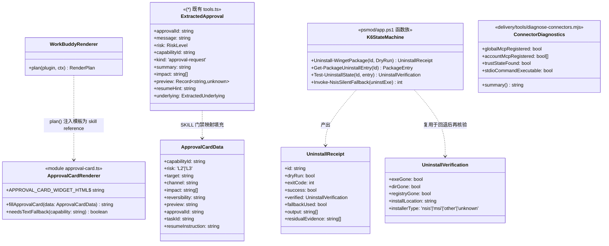
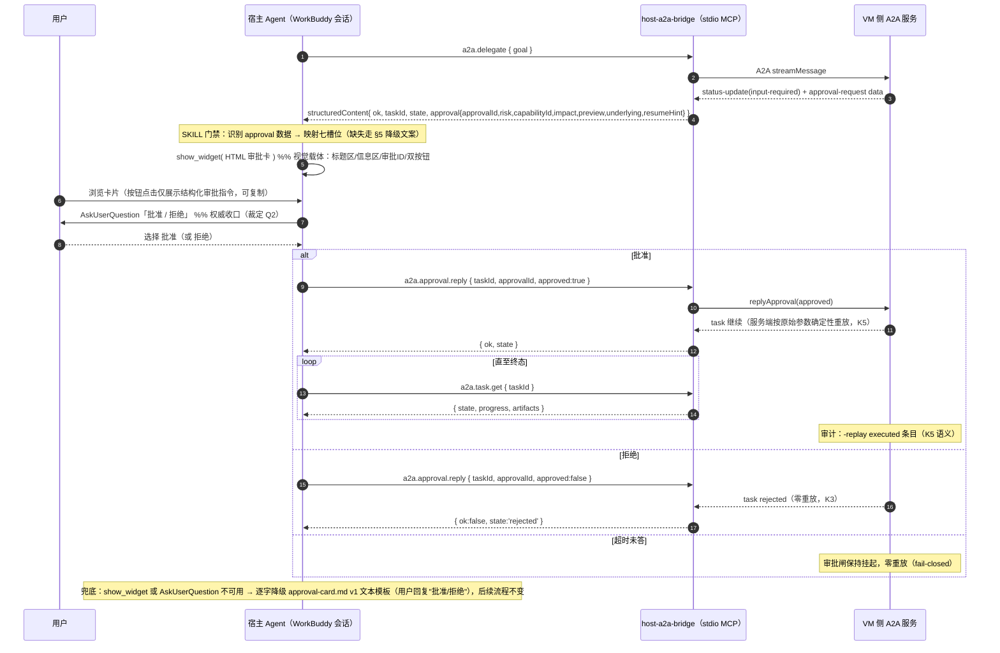
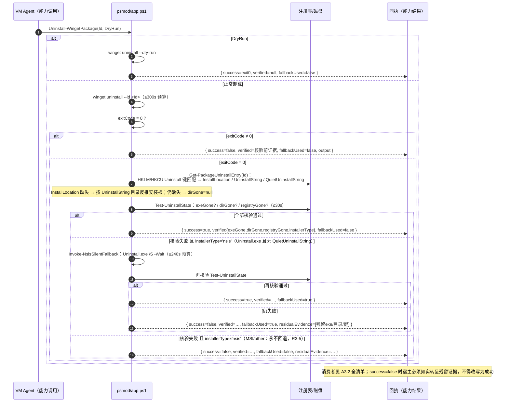
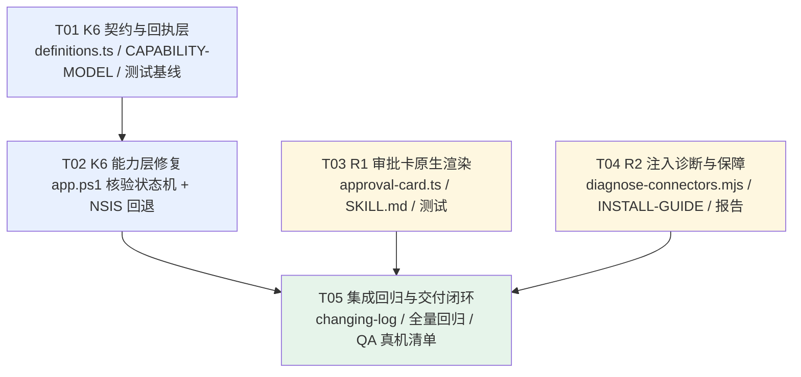

# R17 架构设计 + 任务分解（增量设计）

| 项 | 值 |
|---|---|
| 文档 ID | DESIGN-R17-v1 |
| 作者 | 高见远（架构师） |
| 上游依据 | `docs/prd/r17-prd.md`（PRD-R17-v1）+ 主理人对 Open Questions Q1/Q2/Q3 的裁定 |
| 日期 | 2026-09-30 |
| 状态 | 待评审（实现前必读） |

> **裁定背书（摘自主理人，实现时必须遵守）**
> - **Q1**：渲染机制由架构师选型（结论见 §A1）；**文本模板降级为强制兜底路径**，不得因选型阻塞实现。
> - **Q2**：卡片点击**不直调** `a2a.approval.reply`——卡片交互产出**结构化审批指令注入会话**，由宿主 agent 经工具面 `a2a.approval.reply` 执行（标准四步纪律 + `approvalId` 不可伪造）。
> - **Q3**：若注入根因属 WB 平台缺陷，交付**根因诊断报告 + 规避方案 + 门禁兜底**即可，推动 WB 修复但不阻塞本迭代。

---

# Part A：系统设计

## A1. 实现方案与选型依据

### A1.0 核心难点分析

| 难点 | 分析 |
|---|---|
| R1 渲染机制 | 插件本质是 **MCP server + Skill 产物**，插件代码**没有**主动向会话推 UI 的运行时 API；渲染只能由**宿主 agent** 在收到工具结果后发起。因此"原生卡"的正确落点是：**工具结果携带结构化数据（已有）→ SKILL 门禁指挥宿主 agent 调用宿主自带的渲染工具面 → 交互收口 → 宿主 agent 经工具面执行审批**。 |
| R1 交互闭环 | 卡片按钮点击后由谁执行审批？裁定 Q2 已定：不直调。交互面必须能把用户的选择**无损**转成结构化审批指令（taskId/approvalId/approved），且不得给宿主 agent 任何"自行放行"的口实。 |
| R2 注入根因 | 工具注入是 WB 平台行为（加载时机 / trust 加密文件 / stdio 子进程拉起），本插件**无法根治**平台侧逻辑；只能①只读探测诊断②保证双处注册一致③文档化自助路径④门禁兜底。 |
| R3 假成功 | `Uninstall-WingetPackage` 仅看 exit code；需引入"事后核验"状态机。难点在核验目标派生（`InstallLocation` 常缺失）与回退触发判定（只对 NSIS 型回退，避免误伤 MSI）。 |

### A1.1 R1-4 渲染机制调研结论（选型）

对 WorkBuddy 宿主当前可用的原生交互面做了清单化评估（结合 `packages/adapter-host-workbuddy` L2 Renderer 现状与 `docs/02-design/SPEC-HOST-AGENT-PLUGIN.md` 的分层约束）：

| 候选机制 | 能力 | 可行性 | 结论 |
|---|---|---|---|
| **show_widget（会话内 HTML/SVG 可视组件）** | 宿主 agent 把自包含 HTML 片段（无 `<html>/<head>/<body>`）渲染在会话流中；支持标题、加载文案、下载文件名 | ✅ 宿主 agent 工具面原生提供；本项目实测环境即有该面 | **主选：视觉载体**。用一张自包含 HTML 审批卡（七槽位 + 审批 ID + 双按钮）渲染 |
| **AskUserQuestion（结构化二选一）** | 宿主 agent 以结构化选项向用户提问，用户点击作答，答案直接进入会话上下文 | ✅ 宿主 agent 工具面原生提供；答案**结构化、不可被措辞稀释** | **主选：交互收口**。批准/拒绝的**权威输入**来自这里 |
| interactive widget 按钮直调 MCP 工具 | 卡片内按钮触发工具调用 | ❌ WB 未提供 widget→MCP 工具回调的运行时权限；插件代码无会话 UI 注入 API | **否决**（与裁定 Q2 一致：点击不直调） |
| 插件自定义卡片 / 插件面板 | 插件进程内 UI | ❌ 本插件是 MCP server + Skill 形态，无常驻 UI 进程 | 否决 |
| MCP App artifact 面板 | 独立画布页面 | ⚠️ 可承载展示，但脱离会话流、审批时效性差、且无结构化交互回传 | 备选不做 |
| 纯文本转呈（approval-card.md v1） | Skill 门禁指挥 agent 按文本模板渲染 | ✅ 现状行为，零依赖 | **强制兜底路径**（裁定 Q1），渲染工具不可用时逐字降级 |

**选型结论（R1 定稿）**：

> **show_widget（HTML 审批卡，视觉）+ AskUserQuestion（批准/拒绝，权威收口）** 两段式组合。
> 用户在卡片按钮上的点击行为**只产生视觉反馈与结构化审批指令展示**（复制用），权威放行输入来自 AskUserQuestion；宿主 agent 拿到答案后经工具面 `a2a.approval.reply` 执行（裁定 Q2）。
> 任何一环（show_widget / AskUserQuestion）不可用时，**逐字降级**为 approval-card.md v1 文本模板（"请回复批准/拒绝"），行为与现状完全一致——兜底为强制路径。

**依据**：
1. 与裁定 Q2 精确对齐：卡片不直调工具，宿主 agent 是唯一执行者，`approvalId` 仍只来自 A2A 事件透传（不可伪造）。
2. 中立分层不变式：卡片 HTML 模板作为 **install-time 产物**由 `adapter-host-workbuddy`（L2 Renderer）渲染进 skill references（见 A3），运行时由 SKILL 门禁指挥宿主 agent 填充调用——`host-sdk` 中性模型与 skills 源最小改动。
3. 可为 `adapter-host-claude` 等未来渲染器留同构扩展：其它宿主只需替换"视觉载体 + 收口"两个面的说明，模板与数据契约复用。

### A1.2 R2 实现方案

按裁定 Q3 的边界设计为"**诊断 + 一致性加固 + 文档 + 门禁兜底**"四件套，不做平台侧根治：

1. **只读诊断脚本** `delivery/tools/diagnose-connectors.mjs`：逐项探测 ① `~/.workbuddy/mcp.json` 全局注册；② 各 `connectors/<account>/mcp.json` 增量注册；③ `connector-states.v3.json`（trust/enabled 状态，只读解析不写回）；④ stdio 条目 `winvm-a2a` 的 command 可执行性（只读 stat，不拉起子进程）；输出结构化诊断摘要（JSON + 人读文本），供 QA 真机复跑（R2-5）。
2. **注册一致性加固**：`delivery/install-host.mjs` 安装末尾自动调用诊断（只读）并输出"新会话若未注入工具"的自助指引，保证全局与各 account 双处注册在安装后即刻可验证。
3. **文档化临时路径**（R2-3）：`docs/INSTALL-GUIDE.md` 新增 troubleshooting 章节；`skills/winvm-orchestrator/SKILL.md` 门禁链接之。
4. **根因诊断报告**：`docs/design/r17-connector-injection-diagnosis.md`（实现期以真机探测结果填充，若属 WB 缺陷则记录规避方案 + 上报材料）。

### A1.3 R3 实现方案（K6 状态机）

`Uninstall-WingetPackage` 改造为**卸载→核验→（NSIS）回退→再核验→回执**状态机（详见 A5 时序图）：

- **核验目标派生**（PRD OQ4 定稿）：优先注册表卸载键的 `InstallLocation`；缺失/为空时按 `UninstallString` 去掉引号与参数后取目录**反推**安装根；再缺失则跳过磁盘核验只做注册表核验（并在 `verified` 中如实标注 `dirGone=null`）。不在 PS 里全盘扫描（不可靠且慢）。
- **NSIS 判定**：卸载键存在且 `UninstallString` 指向 `Uninstall.exe`（不区分大小写）且无 `QuietUninstallString` → 判为 NSIS 型，才允许 `/S` 回退。MSI（`UninstallString` 含 `msiexec`）及其它类型**永不回退**（R3-5）。
- **回退**：`Start-Process -Wait` 执行 `Uninstall.exe /S`，等待退出后**再次核验**；回退结果如实进回执。
- **dry-run 语义不变**：`$DryRun` 时不做核验/回退，回执 `verified=null, fallbackUsed=false`（免审批语义保持）。
- **超时预算**（PRD OQ5 定稿）：不新增分段超时参数，维持能力级 600s 总预算，内部软分配：winget 阶段 ≤300s、回退阶段 ≤240s、核验阶段 ≤30s（核验为本地 stat/registry 读取，实际秒级）；实现时留决策空间，但**总时长严禁突破 600s**。
- **回执契约**（R3-3，K6 破坏性字段见 A3.2）：`success` 以最终核验为准；新增 `verified` 与 `fallbackUsed`；失败附残留证据。

### A1.4 架构模式

维持现有分层不变：L0 contracts → L1 host-sdk / core → L1.5 bridge（host-a2a-bridge）→ L2 Renderer（adapter-host-workbuddy）→ skills 产物。R1 的卡片模板属 L2 渲染产物；R3 属 VM 侧能力层（psmod）；R2 属 delivery 层。**本轮零新增包、零新增进程。**

## A2. 文件列表（相对路径，精确到包）

```
packages/
  adapter-host-workbuddy/
    src/approval-card.ts                        # [新增] R1：HTML 审批卡模板常量 + fillApprovalCard() 占位符填充 + 降级判定
    src/index.ts                                # [修改] R1：导出 approval-card；plan() 把卡片模板作为 reference 注入 winvm-orchestrator skill 产物
  host-a2a-bridge/
    src/tools.ts                                # [零改动·复核] extractApproval/withA2aResumeHint/resumeHint/underlying 已满足 R1 数据面（本设计消费，不修改）
  vm-capabilities/
    psmod/app.ps1                               # [修改] R3：Uninstall-WingetPackage 重写为核验状态机；新增 Get-PackageUninstallEntry/Test-UninstallState/Invoke-NsisSilentFallback
    src/registry/definitions.ts                 # [修改] R3：app.winget.uninstall output schema + 描述（verified/fallbackUsed/核验语义/600s 预算说明）
    src/ps-bridge.ts                            # [复核·如需] 回执为 ordered dict 透传则零改动；仅当有强类型映射时补字段
  contracts/
    (无改动)                                    # R1/R2/R3 均不触及 L0 契约；审批数据沿用 bridge 既有 ExtractedApproval 结构
skills/
  winvm-orchestrator/
    SKILL.md                                    # [修改] R1：审批门禁流程升级为"结构化数据→show_widget 卡片→AskUserQuestion 收口→a2a.approval.reply"；R2：工具缺失指引链接；保留文本兜底
    references/approval-card.md                 # [修改·最小] R1：v1 → v1.1（新增 §10 原生渲染段：show_widget 用法 + 强制兜底声明；§1-§9 正文不动）
delivery/
  install-host.mjs                              # [修改] R2：安装后自动跑只读诊断并输出注入保障摘要
  tools/diagnose-connectors.mjs                 # [新增] R2：只读探测（全局/账户 mcp.json、connector-states.v3.json、stdio command 可执行性）
docs/
  INSTALL-GUIDE.md                              # [修改] R2：新增"新会话工具未注入"troubleshooting 章节
  design/r17-connector-injection-diagnosis.md   # [新增] R2：根因诊断报告（真机探测后填充）
  02-design/CAPABILITY-MODEL.md                 # [修改] R3：app.winget.uninstall 回执语义更新
tests/
  unit/r1-approval-card.test.js                 # [新增] R1：占位符填充/降级文案/通道隔离（卡内不得出现 __approvalId）
  unit/r3-uninstall-verify.test.js              # [新增] R3：NSIS 判定/核验派生/回执字段（node --test 单文件跑）
.dev/changing-log.md                            # [修改] M3：第十七轮闭环记录
```

## A3. 数据结构与接口

### A3.1 类图



### A3.2 K6 回执契约变更与**全部消费者清单**（R3-3）

```ts
// 旧回执（app.ps1 产出，经 ps-bridge 透传为能力结果）
{ id, dryRun, exitCode, success /* = exitCode===0 */, output }
// 新回执（追加两字段，success 语义变更：以最终核验为准）
{ id, dryRun, exitCode, success, verified, fallbackUsed, output, residualEvidence? }
// verified: { exeGone: boolean, dirGone: boolean|null, registryGone: boolean,
//             installLocation?: string, installerType: 'nsis'|'msi'|'other'|'unknown' }
// dryRun 时：verified=null, fallbackUsed=false（语义不变）
```

| # | 消费者 | 文件 | 影响 |
|---|---|---|---|
| 1 | 能力注册表 output schema/描述 | `packages/vm-capabilities/src/registry/definitions.ts` | **必改**：schema 增 `verified`/`fallbackUsed`，描述更新（核验语义 + 600s 预算） |
| 2 | PS 侧产出源 | `packages/vm-capabilities/psmod/app.ps1` | **必改**：回执构造 |
| 3 | 透传层 | `packages/vm-capabilities/src/ps-bridge.ts` | 复核：回执为动态对象透传则零改动（预期零改动） |
| 4 | 宿主 skill 文档语义 | `skills/winvm-orchestrator/SKILL.md` 及 app 能力 skill 若引用回执字段 | 复核：`success=false` 文案口径（核验失败 ≠ winget 失败，需如实转呈） |
| 5 | 设计文档 | `docs/02-design/CAPABILITY-MODEL.md` | **必改**：回执语义行 |
| 6 | 测试 | `tests/unit/r3-uninstall-verify.test.js`（新增）；`tests/unit/cl017-winget-parse.test.js` 等既有 winget 测试 | 复核：既有断言仅覆盖 search/install 路径则零改动 |
| 7 | 审计链路 | 宿主侧 `approval-audit.ts` 走 previewHash，不消费回执字段 | 零改动（确认即可） |

### A3.3 R1 数据映射（A2A → 卡片七槽位）

| 卡片槽位 | 来源（SKILL 门禁从 `structuredContent.approval` 填充） | 缺失降级（逐字，approval-card.md §5） |
|---|---|---|
| 操作 | `capabilityId`（+ `underlying.capabilityId` 优先展示真实意图） | `操作：<未提供>（请勿确认）` |
| 目标 | `underlying.paramsSummary` / `preview` 关键字段 | `目标：见影响清单` |
| 通道 | 固定 `A2A 委派 · <taskId>` | 不适用 |
| 风险 | `risk` | 无 → **不出卡**，走文本兜底报错 |
| 影响清单 | `impact[]` | `影响清单：VM 未提供（按参数推断：…）` |
| 可逆性 | approval-card.md §6 规则（按 preview.params/risk 判定） | `可逆性：未知 —— 按不可逆处理` |
| 预览 | `preview` 摘要 | L2 `预览：未提供`；L3 先 `dryRun:true` 取 preview |
| 审批 ID + 续跑 | `approvalId` + `resumeHint`（A2A 通道） | 无 → **不得出卡** |
| 真实目标行 | `underlying` → `真实目标：…`（resumeHint 已合成） | 缺省即整行省略 |

**红线（写进模板与测试）**：卡片 HTML 及其产出的结构化审批指令中**绝不允许出现 `__approvalId`**（MCP 通道标记）；只允许 `a2a.approval.reply { taskId, approvalId, approved }` 一条 A2A 续跑指令（K3/通道隔离）。

## A4. R1 审批卡交互闭环（时序图）



## A5. K6 卸载核验状态机（时序图）



## A6. Anything UNCLEAR（待明确事项，标注实现决策空间）

| # | 事项 | 决策空间 |
|---|---|---|
| U1 | R2 根因最终归属（WB 平台缺陷 vs 本地配置） | 实现期以 `diagnose-connectors.mjs` 真机探测定稿；若属 WB 缺陷，按裁定 Q3 交付报告+规避+兜底即可，**不阻塞** R1/R3 |
| U2 | show_widget 对 HTML 交互（按钮点击）的支持深度 | 按钮行为按"仅视觉反馈+指令展示"实现，不依赖任何回调能力；若实测支持更多交互，可增强但不作为依赖 |
| U3 | `winvm-orchestrator` 之外是否还有 skill 引用 `app.winget.uninstall` 回执 | 实现时全仓 grep 复核（A3.2 #4），有则同步文案 |
| U4 | `Uninstall.exe /S` 个别包需 `/SILENT` 或 NSIS 专属参数 | 回退命令允许实现期按包加参数，但**必须**先判 NSIS；不扩大到非 NSIS |
| U5 | 卡片 HTML 的视觉规格（配色/尺寸） | 工程师自主决策，但七槽位 + 审批 ID + 续跑指令为**必含项**，降级文案逐字不改 |
| U6 | 单测对 PS 函数的覆盖方式（PS 不可在 CI 直跑时） | 把 NSIS 判定/目录反推等纯逻辑用等价 TS 小函数镜像到 `r3-uninstall-verify.test.js` 断言规则本身，PS 侧留 QA 真机回归（R3-6） |

---

# Part B：任务分解

## B1. 依赖包（Required Packages）

**零新增第三方包。** 既有栈足够：Node ≥18（ESM）、TypeScript strict、`node --test`、PS 5.1+（VM 侧）。R1 卡片为纯内联 HTML/CSS/JS，不引前端框架。

## B2. 任务列表（有序、含依赖）

| Task ID | 任务名 | Source Files（相对路径） | 依赖 | 优先级 |
|---|---|---|---|---|
| **T01** | **K6 契约与回执层**（schema + 文档 + 测试基线） | `packages/vm-capabilities/src/registry/definitions.ts`；`docs/02-design/CAPABILITY-MODEL.md`；`tests/unit/r3-uninstall-verify.test.js`（新增，先落断言基线：NSIS 判定规则 / InstallLocation 反推 / 回执字段 / dryRun 语义） | — | **P0** |
| **T02** | **K6 能力层修复**（核验状态机 + NSIS 回退） | `packages/vm-capabilities/psmod/app.ps1`（Uninstall-WingetPackage 重写 + 新增 Get-PackageUninstallEntry / Test-UninstallState / Invoke-NsisSilentFallback）；复核 `packages/vm-capabilities/src/ps-bridge.ts`（预期零改动）；跑通 T01 测试 | T01 | **P0** |
| **T03** | **R1 审批卡原生渲染**（L2 模板 + 门禁升级） | `packages/adapter-host-workbuddy/src/approval-card.ts`（新增）；`packages/adapter-host-workbuddy/src/index.ts`（导出 + plan() 注入 reference）；`skills/winvm-orchestrator/SKILL.md`（门禁流程：show_widget→AskUserQuestion→a2a.approval.reply，兜底声明）；`skills/winvm-orchestrator/references/approval-card.md`（v1.1 增补 §10）；`tests/unit/r1-approval-card.test.js`（新增：槽位映射/降级/通道隔离） | — | **P0** |
| **T04** | **R2 注入诊断与保障** | `delivery/tools/diagnose-connectors.mjs`（新增，只读）；`delivery/install-host.mjs`（安装后诊断输出）；`docs/INSTALL-GUIDE.md`（troubleshooting）；`docs/design/r17-connector-injection-diagnosis.md`（新增报告骨架，真机后填充）；`skills/winvm-orchestrator/SKILL.md`（门禁链接，与 T03 同文件需协同） | — | **P0/P1**（R2-1/R2-2 P0，R2-3/R2-5 P1） |
| **T05** | **集成、回归与交付闭环** | `.dev/changing-log.md`；`tests/unit/r1-approval-card.test.js` + `tests/unit/r3-uninstall-verify.test.js` 全量回归（`node --test tests/unit/r3-uninstall-verify.test.js` 单文件口径）；`tsc -b tsconfig.build.json` 零错误；QA 真机清单（R1 验收：委派→原生卡→批准→重放→completed + `-replay` 审计；R2 验收：连续 ≥3 新会话 ToolSearch 命中 + `a2a.health`；R3 验收：企业微信 NSIS + MSI 对照三案例） | T02, T03, T04 | **P0** |

> T03 与 T04 同改 `skills/winvm-orchestrator/SKILL.md`：T03 改"审批门禁流程"节，T04 追加"工具面缺失指引"节，互不覆盖；工程师按 T03 → T04 顺序提交。

## B3. 共享知识（跨文件约定，工程师必读）

1. **审批卡七槽位**：操作/目标/通道/风险/影响清单/可逆性/预览 + 审批 ID + 续跑方式；数据缺失按 `approval-card.md` §5 **逐字**降级，任一槽位不得留空、不得写 N/A。
2. **K5 重放语义**：批准后由**服务端**按原始参数确定性重放执行，宿主/用户无需也不能重发参数；审计含 `-replay executed` 条目；超时/拒绝/取消**零重放**（fail-closed）。
3. **K3 审批纪律**：`approvalId` 不可伪造；拒绝/超时保持 `ok=false`；呈现文本严禁"超时默认批准/已修复"类措辞（CL-016/CL-018 红线沿用）。
4. **单向流纪律**：一切修改先落本 git 仓库；宿主经 `delivery/install-host.mjs`、VM 经 `.env.deploy-vm` 部署管道分发；**禁止双侧直改**。
5. **通道隔离红线**：MCP 直调通道续跑标记 `__approvalId` 与 A2A 通道 `resumeHint`（`a2a.approval.reply`）**不得混用**；本迭代所有卡片产物（HTML/测试断言）中 A2A 通道输出**绝不允许出现 `__approvalId`**。
6. **构建与测试口径**：TypeScript strict ESM；构建用 `tsc -b tsconfig.build.json`（不是裸 `tsc`）；单测用 `node --test tests/unit/<file>.test.js` **单文件跑**；新增测试沿用 `tests/unit/*.test.js` 命名。
7. **最小变更**：`host-a2a-bridge/src/tools.ts` 本轮**零改动**（数据面已完备）；`contracts/`、`host-sdk/` 零改动；skills 源仅按 T03/T04 两节最小改动。
8. **审批闸不可绕过**：任何渲染/诊断改动不得引入"自动批准/跳过确认"路径；R2 门禁兜底文案必须保持"工具不可用 → 停止并请求用户启用连接器"，严禁宿主 agent 手写脚本直打 A2A/MCP/SSH。

## B4. 任务依赖图



---

## 附录：与 PRD 需求映射

| PRD 需求 | 设计章节 | 任务 |
|---|---|---|
| R1-1/R1-2/R1-3 原生卡 + 七槽位 + 批准转 reply | §A1.1 选型、§A3.3 映射、§A4 时序 | T03 |
| R1-4 选型调研 | §A1.1（本节即调研结论） | 已完成（本设计） |
| R1-5 文本兜底 | §A1.1 兜底声明、T03 | T03 |
| R1-6 通道隔离 | §A3.3 红线、§B3-5 | T03/T05 |
| R2-1 诊断 | §A1.2、diagnose-connectors.mjs | T04 |
| R2-2 长期方案 | §A1.2（Q3 边界：规避+推动 WB） | T04 |
| R2-3 文档化路径 | INSTALL-GUIDE + SKILL.md 链接 | T04 |
| R2-4 门禁兜底 | §B3-8 | T04/T05 |
| R2-5 诊断脚本入仓 | delivery/tools + QA 复跑 | T04 |
| R3-1/R3-2/R3-3 核验+回退+回执 | §A1.3、§A3.2、§A5 | T01/T02 |
| R3-4 schema 更新 | definitions.ts | T01 |
| R3-5 通用性约束（非 NSIS 不回退 / dry-run 不变） | §A1.3、§A5 | T02 |
| R3-6 QA 对照回归 | T05 QA 清单 | T05 |
