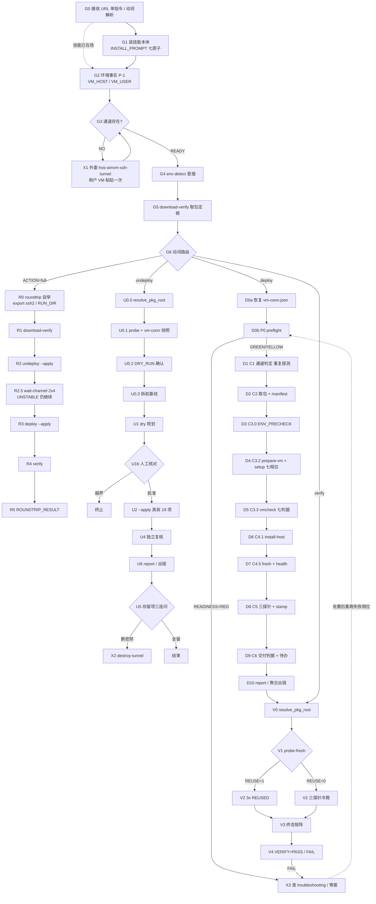
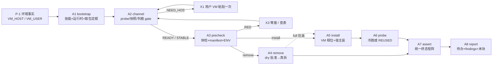

# winvm-plugin-deploy · undeploy / deploy / verify 全流程步骤审计

> 日期 2026-11-13 ｜ 对象：`athronix/winvm-plugin-deploy` **v1.4.3**（canonical `/storage/Users/currentUser/Documents/Projects/skills/winvm-plugin-deploy/`），母项目运行码 V1.4.26 + 未入包的 R5 修复。
> 目的：把 skill 指引出的**每一次命令/脚本执行动作**拆到原子级，判定清晰度、潜在缺陷、可合并性，给出新 scripts 划分，并以 2026-11-12 两轮 E2E 为样本做根因复盘。

## 0. 审计口径与证据源

| 项 | 说明 |
|---|---|
| 步骤粒度 | 「skill 指引出的每次命令/脚本执行动作」= SKILL.md 明写的命令、driver 的每次子进程调用、`ps-run.sh` 的每次远端 PS、纯判定函数（`vm_channel_probe` / `resolve_pkg_root` / `probe-fresh.sh`）；包内 `setup.mjs` 七相位等**黑盒内部**只作子动作注记，不再递归拆分 |
| 执行主体取值 | `WB 命令调用`（宿主发起的 shell/node 调用）、`用户辅助执行`（AskUserQuestion / VM 桌面粘贴 / 人工审批）、`LLM 判读`（会话内读输出做决策） |
| 执行环境取值 | `鸿蒙 WB 沙箱`、`VM Windows`、或 `鸿蒙沙箱 → VM Windows（ssh2 / ps-run）` |
| 合并判据 | 可合并 = 同主体 + 同环境 + 上一步输出是**纯数据**（不需人/LLM 决策）+ 失败语义可原子化 + 无安全断点。任一不满足即不可合并 |
| 证据源 | `SKILL.md`（含 URL 入口/铁律/三主流程/通道外委章）、`scripts/*.sh`（16 件）、`references/{troubleshooting,known-good-flow}.md`、`INSTALL_PROMPT.md`（GitHub raw 实取）、`hos-winvm-ssh-tunnel/SKILL.md v2.3.0`、历史 `docs/deploy/{deploy,undeploy}.prompt`、`qa/real-test-2026-11-12-e2e{,2}.md`、`qa/e2e2-ops-ledger.md` |
| 编号 | G=全局入口 / U=undeploy / D=deploy / V=verify / R=roundtrip 编排 / X=外委与异常分支 |

> ⚠ 重要前提：**技能是唯一执行权威**（SKILL.md L10/L175，迭代28 用户裁定），两 `.prompt` 已退役为历史档案。但下文会指出 SKILL.md 与 references 中仍有 3 处「以 .prompt 为准」的残留引用（F-11）。

---

## 1. 全局入口层（三流程共同前置）

### G0 · 接收 URL 单指令与动词解析
- **来源 skill / 上下文**：`INSTALL_PROMPT.md` §0 + `winvm-plugin-deploy/SKILL.md`「URL 单指令入口」第 1 步；上下文=`athronix/skills` 聚合仓（`.link.json` / `marketplace.json`）。
- **上一步**：无（起点）。
- **上一步输出（本步前置输入）**：用户一句话：skill URL + 动词 + 可选的 `VM_HOST`/`VM_USER`。
- **动作 / 逻辑**：解析动词（安装 / 卸载 / 部署 / 验证）；判定技能是否已被系统加载或已在 `~/.workbuddy/skills/`（含 symlink 挂载）——在场则跳过 G1，**禁止 unzip 覆盖 symlink**。
- **命令**：无（LLM 决策）。
- **主体 / 环境**：LLM 判读 / 鸿蒙 WB 会话。
- **依赖前置条件**：① 用户指令（环境外输入）② `raw.githubusercontent.com` 可达 ③ 本地 skills 目录可读。
- **可能结果 → 下一步**：技能在场 → **G2**；不在场 → **G1**；URL 非法/未在册 → 终止报错。
- **与上一步合并**：不适用（起点）；与 G1 可合并为「ensure-skill」动作（无人工断点）。

### G1 · 安装技能本体（INSTALL_PROMPT 七原子）
- **来源 skill / 上下文**：`INSTALL_PROMPT.md` §1–§5（GitHub raw 实取全文）；e2e2 原子台账 S1.1–S1.7 实证。
- **上一步**：G0 接收指令与动词解析（输出：need_install=true + skill 名）。
- **上一步输出（前置输入）**：目标 skill 名 = `winvm-plugin-deploy`。
- **动作 / 逻辑**：读聚合指针 → 凭据探测 → 解析 asset API url → 私有 asset 下载 → 同名在场备份 → 解压 → 三判据验证并报告。
- **命令**：
  1. `curl -fsSL https://raw.githubusercontent.com/athronix/skills/main/.link.json`（取 `repo/visibility/version/package`；raw 假 404 → `GET api.github.com/repos/athronix/skills/contents/.link.json` 带 `Accept: application/vnd.github.raw` 复核 → 再退 `marketplace.json`）
  2. 凭据探测 `GITHUB_READ_TOKEN` → `GH_TOKEN` → 本机 `~/.config/gh/hosts.yml` oauth_token（e2e2 S1.2 实证命中本档）；`visibility=private` 且都无 → 向用户索要 PAT
  3. `curl -fsSL -H "Authorization: Bearer $TOKEN" "https://api.github.com/repos/<repo>/releases/tags/v<version>"` → 取 `assets[].url`（**非 browser_download_url**）
  4. `curl -fsSL -H "Authorization: Bearer $TOKEN" -H "Accept: application/octet-stream" "<asset api url>" -o <资产原名>.zip`
  5. 同名在场先 `mv` 到 `winvm-plugin-deploy.backup-symlink-<ts>`（禁静默删）
  6. `unzip -oq <zip> -d ~/.workbuddy/skills/`
  7. §5 三判据：`SKILL.md` 存在且 `name==目录名`；`version==link.version`；`scripts/` + `references/` 在场（e2e2：scripts=16 ref=2）→ 报告四项（名称/版本/路径/方式/备份位）
- **主体 / 环境**：WB 命令调用（凭据缺失时转用户辅助）/ 鸿蒙 WB 沙箱 + GitHub API 公网。
- **依赖前置条件**：① 聚合仓 raw 可达（G0）② PAT 或 hosts.yml 凭据（**环境配置**）③ `~/.workbuddy/skills/` 可写 ④ `curl`/`unzip` 可用 ⑤ HTTPS 证书链（历史 `ssl_context()` 坑）。
- **可能结果 → 下一步**：三判据 PASS → **G2**；401/404/版本不符 → 终止并原始错误上报（禁伪造成功）。
- **与上一步合并**：✅ 可与 G0 合并；七个原子彼此全部可合并成 `ensure-skill.sh`（唯一例外=凭据缺失需人工）。

### G2 · 环境事实采集（P-1 唯一提问点）
- **来源 skill / 上下文**：SKILL.md「URL 单指令入口」第 2 步 + 铁律 7（每步判据自检不过=停）+ 执行协议 P-1。
- **上一步**：G1 安装技能本体（输出：技能目录 + version + scripts 路径）。
- **上一步输出（前置输入）**：`scripts/` 相对基准 = `~/.workbuddy/skills/winvm-plugin-deploy/`。
- **动作 / 逻辑**：采集 `VM_HOST` / `VM_USER`（默认 `User`）；密码/私钥按 `vm-conn.sh` 三级链现探。仅此一处允许反问用户。
- **命令**：无（`AskUserQuestion` / 读用户指令）。
- **主体 / 环境**：用户辅助执行 / WB 会话。
- **依赖前置条件**：① 用户指令含 IP 或用户答复（环境外）② 通道密钥事实（hos 路 A `~/.ssh/id_ed25519` / 路 B `id_ed25519_winvm`，见 X1）。
- **可能结果 → 下一步**：有值 → **G3**；无值 → 等待用户（不得猜）。
- **与上一步合并**：❌ 不可（唯一合法人工决策点）。

### G3 · 免密通道存在性判定
- **来源 skill / 上下文**：SKILL.md 入口第 2 步 +「SSH 免密通道生命周期（外委）」章；上下文=`hos-winvm-ssh-tunnel` v2.3.0。
- **上一步**：G2 环境事实采集（输出 `VM_HOST`/`VM_USER`）。
- **上一步输出（前置输入）**：VM 地址与账号。
- **动作 / 逻辑**：判定通道是否在；在→直接下一步，不在→不造轮子，走外委入口。
- **命令**：`VM_HOST=.. VM_USER=.. [WINVM_VM_KEY=..] node scripts/ssh2-conn.mjs ping`（SKILL.md 接口适配注记：hos 的 `verify-tunnel.sh` 走 ssh 二进制，灭窗期失败 ≠ 通道没建好，须 ssh2 ping 复核定论）。
- **主体 / 环境**：WB 命令调用 / 鸿蒙沙箱 → VM Windows。
- **依赖前置条件**：① VM_HOST（G2）② 密钥三级链 `WINVM_VM_KEY > vm-conn.json identityFile > ~/.ssh/id_ed25519`（**环境配置**）③ 包内 `node_modules/ssh2` 与 `ssh2-resolve.mjs` 可解析（≥V1.4.25 候选链动态化）④ VM sshd 处于健康窗（**环境相位，不可控**）。
- **可能结果 → 下一步**：READY → **G4**；NO_CHANNEL / rc=111 → **X1**（外委重建）。
- **与上一步合并**：❌ 与 G2 不可（人工点）；✅ 与 G4 可。

### G4 · 宿主运行时探测（env-detect.sh）
- **来源 skill / 上下文**：SKILL.md 脚本清单 + 分步 driver 示例第 3 行；D1/I-6.11（脆弱 node V8 ENOMEM）。
- **上一步**：G3 免密通道存在性判定（输出：READY / NO_CHANNEL）。
- **上一步输出（前置输入）**：通道可用；`VM_SSH_BACKEND=ssh2` 建议值。
- **动作 / 逻辑**：逐个候选做**冒烟门禁**（node 跑 `.mjs` 回显、python `-c`、bash 跑带 shebang 脚本、rm 实删探针），产出 `~/wbtmp/vmdeploy-env.sh`；后续脚本一律 source。
- **命令**：`bash scripts/env-detect.sh` → `source ~/wbtmp/vmdeploy-env.sh`（导出 `NODE/PY/BASH_OK/VMDEPLOY_ENV_SH`）。
- **主体 / 环境**：WB 命令调用 / 鸿蒙 WB 沙箱。
- **依赖前置条件**：① `$HOME/wbtmp` 可写 ② 至少一枚健康 node/python/bash ③ 技能 scripts 目录在场（G1）。
- **可能结果 → 下一步**：`SMOKE_NODE_FINAL=OK` → **G5**；`NO_HEALTHY_NODE/PYTHON3` → 终止。
- **与上一步合并**：✅ 与 G3、G5 可（纯宿主侧只读 + 一次网络动作，无人工断点）。

### G5 · 取发布包与包根定根（download-verify.sh）
- **来源 skill / 上下文**：SKILL.md 入口第 3 步 +「通道后端与包根选择」章（pkg-root.sh 单一事实源，run19 R-1）。
- **上一步**：G4 运行时探测（输出 `NODE/PY/BASH_OK`）。
- **上一步输出（前置输入）**：健康解释器；`VMDEPLOY_ENV_SH`。
- **动作 / 逻辑**：gitee `releases/latest` 现解 tag → 双源下载 zip + sidecar sha256 → 校验 → 旧 `overall-root` **整体 rename 隔离**到 `stale-quarantine/`（.env 回位）→ `unzip` → 按 `MANIFEST version==TAG` 选根（内层优先）→ `verify-manifest.py` → 写 `pkg-root.txt` → 打印 `PKG_ROOT=`。同 TAG 完整在场走 cache 快路径（`VMDEPLOY_FORCE_FETCH=1` 可强制）。
- **命令**：`bash scripts/env-detect.sh` → `source ~/wbtmp/vmdeploy-env.sh` → `bash scripts/download-verify.sh [--tag V1.4.x]`。
- **主体 / 环境**：WB 命令调用 / 鸿蒙 WB 沙箱 + 公网（gitee 主 / github 备）。
- **依赖前置条件**：① NODE（latest JSON 解析用）② 公网可达；gitee 302→foruda **一次性签名，禁 `-C -`**（github 备源可续传）③ `$DEPLOY_ROOT` 可写 ④ `sha256sum`/`unzip` ⑤ `.env` 用户配置面传导（X-6 凭据回注位）。
- **可能结果 → 下一步**：`PKG_ROOT=<合法层>` → **G6**；`LATEST_RESOLVE_FAILED`/`DOWNLOAD_FAILED` → 终止（A/D 表）；`SHA256_MISMATCH` → **停，属事故，禁重试硬跑**；`⚠ 版本≠TAG` → 告警继续（陈旧层风险）。
- **与上一步合并**：✅ 与 G4 可；✅ 与 G6 可（roundtrip R1 即已把两者连进一脚本）。

### G6 · 动词路由
- **来源 skill / 上下文**：SKILL.md 入口第 4 步（v1.3.0 一键往返模板，**优先于分步 driver**）+「安装/拆除/复验」三章。
- **上一步**：G5 取发布包（输出 `PKG_ROOT=` + pkg-root.txt 状态）。
- **上一步输出（前置输入）**：包根、tag、状态文件路径。
- **动作 / 逻辑**：选 `ACTION=full|deploy|undeploy|verify`，一次后台调用跑完；LLM 只在「问环境 + 发命令 + 读末块」三处介入。分步 driver 仅排障/细粒度计时用。
- **命令**：`VM_HOST=<ip> ACTION=<...> [VM_USER=User] [RELEASE_TAG=] [SKIP_DOWNLOAD=1] [VERIFY_FORCE_PROBE=1] bash scripts/roundtrip.sh`（`run_in_background`）。
- **主体 / 环境**：WB 命令调用 / 鸿蒙 WB 沙箱。
- **依赖前置条件**：① VM_HOST（G2）② PKG_ROOT 状态（G5）③ `VM_SSH_BACKEND=ssh2`（**roundtrip.sh L30 自动 export；分步 driver 路径无此 export = F-02**）④ `VMDEPLOY_RUN_DIR` / `VMDEPLOY_PROBE_STAMP` 路径一致。
- **可能结果 → 下一步**：full → **R0**；deploy → **D0a**；undeploy → **U0.0**；verify → **V0**；卡住 → **X3**（查 troubleshooting）。
- **与上一步合并**：✅ 路由本身可并入编排器（保留为参数，不做 LLM 决策）。

---

## 2. 三条主链 · 原子步骤清单

### 2.1 undeploy 链（SKILL.md「拆除主流程」+ `undeploy.sh` + 历史 `.prompt` U0→U5）

#### U0.0 · 包根解析（`resolve_pkg_root`）
- **来源 / 上下文**：`undeploy.sh` L18–26 + `pkg-root.sh`（run19 R-1；拆除场景包根可能已被隔离）。
- **上一步**：G6 动词路由（ACTION=undeploy）。
- **上一步输出**：`ACTION`、`VM_HOST`、`NODE`。
- **动作 / 逻辑**：三级默认 `env PKG_ROOT/--pkg > $DEPLOY_ROOT/pkg-root.txt > _pick_pkg_root 现探`；解析失败**显式报错**，不静默用空壳（run20 QA nit① 修正）。
- **命令**：`resolve_pkg_root`（内部：`_pkg_layer_valid` = MANIFEST.txt + delivery 双在）。
- **主体 / 环境**：WB 命令调用 / 鸿蒙沙箱。
- **依赖前置条件**：① `DEPLOY_ROOT`（默认 `~/winvm-deploy`）② pkg-root.txt（G5 或 D2 产出）③ 至少一层合法包根（MANIFEST+delivery）。
- **结果 → 下一步**：合法层 → **U0.1**；三皆空 → `UNDEPLOY_PKG_ROOT_MISSING` exit 2 → 人工三选一（PKG_ROOT 覆盖 / 重取包 / 查 stale-quarantine）。
- **合并**：✅ 与 U0.1/U0.2/U0.3 可合成 `pre-undeploy.sh`。

#### U0.1 · 免密通道判定 + vm-conn.json 快照（E2R4）
- **来源 / 上下文**：`undeploy.sh` L36–41；SKILL.md「通道生命周期」衔接口 2（U0.1 通道失效 → P-2 外委重建，先报告审批）；E2R4（uninstall 清场会删 `vm-conn.json`，拆后立装往返必断）。
- **上一步**：U0.0 包根解析（输出 `PKG` + `PKG_SOURCE`）。
- **上一步输出**：合法包根路径。
- **动作 / 逻辑**：`vm_channel_probe`（ssh2 快路径 / key 五试 15s 间隔 / password askpass 三试）→ 通过则 `cp -f vm-conn.json vm-conn.json.roundtrip` 留**运行态续命快照**（非安装落点）。
- **命令**：`vm_channel_probe`；`cp -f "$HOME/.workbuddy/winvm/vm-conn.json" "$HOME/.workbuddy/winvm/vm-conn.json.roundtrip"`。
- **主体 / 环境**：WB 命令调用 / 鸿蒙沙箱 → VM Windows。
- **依赖前置条件**：① VM_HOST/VM_USER（G2）② `WINVM_VM_KEY` 三级链（**环境配置**；vm-conn.sh L61–68）③ `VM_SSH_BACKEND=ssh2`（**分步路径需手工 export**）④ VM sshd 健康窗 ⑤ `vm-conn.json` 在场（快照可缺席=空操作）。
- **结果 → 下一步**：`channel=key|password` + `[R4]` 快照 → **U0.2**；FAIL rc=1 → **X1**（P-2 先报告审批，「勿在拆到一半时重建」）。
- **合并**：✅ 与上一步可。

#### U0.2 · WINVM_DRY_RUN=0 确认
- **来源 / 上下文**：`undeploy.sh` L43–45；known-good-flow §二。
- **上一步**：U0.1（输出 `VM_CHANNEL` + 快照路径）。
- **动作 / 逻辑**：只读打印 `.env` 干跑开关；无该键=默认 0。**纯展示，不阻断**。
- **命令**：`grep -E "^WINVM_DRY_RUN" "$PKG/.env" 2>/dev/null || echo "（.env 无该键=默认 0）"`。
- **主体 / 环境**：WB 命令调用 / 鸿蒙沙箱。
- **依赖前置条件**：`$PKG/.env` 可读（G5/D2 的 .env 传导）。
- **结果 → 下一步**：恒 → **U0.3**（STEP end PASS）。
- **合并**：✅ 与上一步可。

#### U0.3 · 拆前基线留档
- **来源 / 上下文**：`undeploy.sh` L47–58（run17 D-3 假绿止血：capture rc + `BRIDGE=` 行判据）；known-good-flow U0 预期 15~30s。
- **上一步**：U0.2（输出：DRY_RUN 键/默认值）。
- **动作 / 逻辑**：宿主 `find` 列 `*winvm*` 前 50 条；VM 侧 `ps-run.sh -c` 采五点（BRIDGE/TASK/LISTEN/SSHD/WS）→ `baseline.log` → `step.sh log baseline`。
- **命令**：`find "$HOME/.workbuddy" -iname '*winvm*' | head -50`；`bash scripts/ps-run.sh -c '$a=Test-Path C:\WinVMBridge; … Write-Output ("BRIDGE=" + …)'`。
- **主体 / 环境**：WB 命令调用触发；**PS 在 VM Windows 执行**（ssh2/ps-run 铁律通道）。
- **依赖前置条件**：① VM_CHANNEL（U0.1）② `ps-run.sh` + `vm-conn.sh` 在场 ③ `$LOGD` 可写（`undeploy.sh` L30 默认 `~/wbtmp/vmdeploy-undeploy-default`，**与 RUN_DIR 分裂 = F-05**）④ VM 通道健康窗。
- **结果 → 下一步**：rc=0 且含 `BRIDGE=` → **U1**；rc≠0/无行 → 记 `U0/0.3-baseline` 到 FAILED_STEPS（**不阻断**，继续 U1，末尾出链 rc=1）。
- **合并**：✅ 与 U0.0–U0.2 可（同一 `pre-undeploy.sh` 内跨环境编排）。

#### U1 · DRY-RUN 规划核对（`uninstall.mjs` 无 --apply）
- **来源 / 上下文**：`undeploy.sh` L60–70；SKILL.md「拆除主流程」第 1 行（`bash scripts/undeploy.sh`）；known-good-flow「U1 首行必见 `mode : DRY-RUN`」。
- **上一步**：U0.3（输出 `baseline.log`）。
- **动作 / 逻辑**：跑卸载器 dry 规划，输出 `[DRY]/[DO]/[SKIP]/[KEEP]` 清单 + 计数；`APPLY=0` 时打印提示并 `STEP report` 后 exit 0。
- **命令**：`bash scripts/undeploy.sh`（内部 `node delivery/uninstall.mjs > dry.log`）。
- **主体 / 环境**：WB 命令调用 / 鸿蒙沙箱（uninstall.mjs dry 规划本地执行）。
- **依赖前置条件**：① NODE（G4）② PKG（U0.0）③ `.env` ④ `$LOGD` 可写。
- **结果 → 下一步**：`mode : DRY-RUN` + 清单 → **U1b 人工核对**；rc≠0 → 记 `U1/1-dry` 聚合（不即时阻断）。
- **合并**：⚠️ 与 U0 段可合并为「一次性输出 dry 清单」；**与 U1b 之间必须断开**（安全断点）。

#### U1b · 人工核对落点清单（决策点）
- **来源 / 上下文**：SKILL.md「拆除主流程」注释「人工核对无越界项后 --apply」；历史 `undeploy.prompt` U1.3（trash 目标路径、要删的 mcp.json 键、KEEP 项）。
- **上一步**：U1（输出 dry 清单 + `dry+keep 行数`）。
- **动作 / 逻辑**：判读有无意外 `[DO]` 越界项；有则停。
- **命令**：无（LLM 判读 / 用户辅助）。
- **主体 / 环境**：LLM 判读或用户辅助 / WB 会话。
- **依赖前置条件**：dry 清单可读；执行者理解 KEEP 语义。
- **结果 → 下一步**：无越界 → **U2**；有越界 → 终止并报告。
- **合并**：❌ **不可合并**（这是唯一防误删的人工闸）。

#### U2 · `--apply` 真拆（19 项 POST-CLEANUP）
- **来源 / 上下文**：`undeploy.sh` L72–87；SKILL.md「拆除主流程」第 2 行；known-good-flow U2 预期 13~27s。
- **上一步**：U1b 人工核对（输出：批准）。
- **动作 / 逻辑**：`uninstall.mjs --apply` 宿主侧删除物移入 `~/.workbuddy/winvm-trash/<ts>/`（可回滚）、清 mcp.json 键、connector 配置；VM 侧停服务/删计划任务/清 `C:/WinVMBridge`。存留项（SSH 密钥/trash/下载物）**全默认保留**。统计 `POST-CLEANUP` 段 `[PASS]`/`[FAIL]` 数。
- **命令**：`bash scripts/undeploy.sh --apply` → `node delivery/uninstall.mjs --apply --vm-host "$VM_HOST" --vm-user "$VM_USER" --vm-ssh-port "$VM_SSH_PORT"`。
- **主体 / 环境**：WB 命令调用 / 鸿蒙沙箱（宿主文件）+ VM Windows（服务/目录，经 ssh2/PS）。
- **依赖前置条件**：① U1b 批准 ② NODE/PKG/.env ③ `WINVM_DRY_RUN=0`（U0.2）④ VM 通道全程健康（拆完 sshd must-survive=Running）⑤ 无僵尸 node（troubleshooting B 表）。
- **结果 → 下一步**：`APPLY complete` + FAILN=0 → **U4**；≤V1.4.8 `workspace kept` 唯一 FAIL 且自报 0 failure → 兼容判据 ARC=0 → **U4**；僵尸形态 → **仅打印** `VM 内 shutdown /r /t 5 /f` 提示（**红线：禁止自动重启**）；其它 rc≠0/FAILN>0 → exit 1 终止 → **X3**。
- **合并**：✅ 与 U4 已在同一脚本；⚠️ **U2 会重跑 U0.0/U0.1/U0.2/U0.3/U1**（dry 与 apply 是同一脚本两次调用）= 重复开销，见 §4。

#### U4 · 独立复核（防假 PASS）
- **来源 / 上下文**：`undeploy.sh` L89–104；known-good-flow §二（U4 期望 `health=000` / `GLOBAL_MCP_CLEAN` / VM 五点 `False False 0 Running True`）。
- **上一步**：U2（输出 19 项全 PASS + `APPLY complete`）。
- **动作 / 逻辑**：三条独立探针（宿主回环 health 必须拒连、全局 mcp.json 无 winvm 键、VM 五点终态），`U4_RC` 段内独立计数，避免前序段失败混入归因。
- **命令**：`curl -sS -o /dev/null -w '%{http_code}' --connect-timeout 4 http://127.0.0.1:18443/health`；`node -e "const j=require(process.env.HOME+'/.workbuddy/mcp.json'); …"`；`bash scripts/ps-run.sh -c '<VM 五点 PS>'`。
- **主体 / 环境**：WB 命令调用 / 鸿蒙沙箱 + VM Windows。
- **依赖前置条件**：① U2 已拆 ② VM sshd 仍 Running ③ ps-run 通道可用（**灭窗会让本步假 FAIL**）④ `~/.workbuddy/mcp.json` 可读。
- **结果 → 下一步**：三项全符 → **U6**；任一不符 → `U4_RC=1` + FAILED_STEPS → 出链 rc=1 → **X3**。
- **合并**：✅ 已与 U2 同脚本；✅ 建议与 V3 参数化合并成统一 `assert-state.sh`（判据 `expect_health=000|200`）。

#### U5 · 存留项处置（**无脚本实现**）
- **来源 / 上下文**：SKILL.md「拆除主流程」注释行「存留项逐项问用户（U5；删密钥走 undeploy.prompt 的 vm-rmkey 子流程）」；历史 `undeploy.prompt` U5/U5.1/U5.2/U5.3（已退役）；SKILL.md v1.4.0 章又说删密钥改用 hos `destroy-tunnel.sh` → **自相矛盾，见 F-01/F-12**。
- **上一步**：U6（`UNDEPLOY_DONE` 提示）。
- **动作 / 逻辑**：一次三连问（①SSH 密钥 ②trash 回滚源 ③下载物），各项默认=留；删密钥 → `DRYRUN=1 destroy-tunnel.sh` 预演 → 真跑（journal v2 对称回滚，他人密钥无损）；无 hos 环境 → `vm-rmkey.ps1` 模板经 ps-run 在 VM 两处各精确删 1 行；删 trash/下载物 → `node -e fs.unlinkSync/rmSync`。
- **命令**：`AskUserQuestion`（三连）；`DRYRUN=1 sh $S/destroy-tunnel.sh` → `sh $S/destroy-tunnel.sh`；或 `bash scripts/ps-run.sh ~/wbtmp/vm-rmkey.ps1`。
- **主体 / 环境**：用户辅助决策 + WB 命令调用 / VM Windows（删授权文件）+ 鸿蒙沙箱（删私钥）。
- **依赖前置条件**：① hos skill 在场或 vm-rmkey 模板可用 ② VM 通道健康窗（灭窗先 ssh2 ping 复核择窗）③ 私钥路径/基线 `host-state.json` ④ 用户明确选择「删」。
- **结果 → 下一步**：全留 → **结束**；删密钥 → **X2**；删其余 → 结束。
- **合并**：❌ 不可（人工决策 + 破坏性动作需二次确认）；且当前**仅文字指引、无脚本**（F-01）。

#### U6 · 计时报告与聚合出链
- **来源 / 上下文**：`undeploy.sh` L106–113；`step.sh report`（SKILL.md「复验与汇报」）。
- **上一步**：U4（输出 `U4_RC`）。
- **命令**：`STEP report`（`steps.tsv` 汇总 + Top5 + 问题行）；FAILED_STEPS 非空 → 出链 rc=1。
- **主体 / 环境**：WB 命令调用 / 鸿蒙沙箱。
- **依赖前置条件**：`VMDEPLOY_RUN_DIR` 一致（steps.tsv 共享）；`step.sh` 在场。
- **结果 → 下一步**：`UNDEPLOY_DONE` → **U5** 或（roundtrip 场景）**R2.5**；`UNDEPLOY_WITH_FAILURES` → **X3**。
- **合并**：✅ 可并入统一 report 动作。

### 2.2 deploy 链（SKILL.md「安装主流程」+ `deploy.sh`，对应历史 Step 0→6）

#### D0a · E2R4 恢复 `vm-conn.json`（**位置：一切通道动作之前**）
- **来源 / 上下文**：`deploy.sh` L38–43（E2R4b：初版误放 Step 1 之后，S7 终轮实锤 P0 preflight 先失明 RED 早退）。
- **上一步**：U6（往返场景）或 G6（单装场景）。
- **上一步输出**：`vm-conn.json` 被 uninstall 删除 + `.roundtrip` 快照在场。
- **动作 / 逻辑**：仅当原件缺且快照在 → `cp -f` 恢复并打印 `[R4]`。**必须先于 P0**，否则 preflight 的密钥三级链第二级失明。
- **命令**：`cp -f "$HOME/.workbuddy/winvm/vm-conn.json.roundtrip" "$HOME/.workbuddy/winvm/vm-conn.json"`。
- **主体 / 环境**：WB 命令调用 / 鸿蒙沙箱。
- **依赖前置条件**：U4a（undeploy U0.1）已留快照；`~/.workbuddy/winvm/` 可写。
- **结果 → 下一步**：恢复打印 / 无需恢复 → **D0b**。
- **合并**：✅ 必须与 D0b 同脚本（现状已同脚本且位置正确）。

#### D0b · P0 五项体检（`preflight.sh`）
- **来源 / 上下文**：`deploy.sh` L45–50；`preflight.sh`；SKILL.md 分步 driver 第 4 行；D1/I-6.11。
- **上一步**：D0a（输出：vm-conn.json 在场）。
- **动作 / 逻辑**：① VM_HOST ② 运行时（无 env.sh 则自跑 env-detect）③ `vm_channel_probe` + `nc -z` TCP22 ④ **heredoc 写 `$HOME/wbtmp/vmdeploy-preflight.ps1` → `ps-run.sh`** 探 OS/SSHD/BRIDGE_SVC/LISTEN18443/NODE/CLI/NETCAT/FW ⑤ 输出 `READINESS=GREEN|YELLOW|RED` + 逐项修复命令。`APPLY=0` 时此处打 DRY-RUN 提示并 exit 0。
- **命令**：`bash scripts/preflight.sh > "$LOGD/preflight.log" 2>&1`；内部 `bash scripts/ps-run.sh "$_pfps"`。
- **主体 / 环境**：WB 命令调用 / 鸿蒙沙箱 + VM Windows（PS）。
- **依赖前置条件**：① VM_HOST（G2）② 健康 NODE（G4 或自举）③ VM 通道（**G3 已探过一次 = 重复**）④ `$HOME/wbtmp` 可写 ⑤ VM sshd 健康窗（E2E S3 命中 rc=124 真灭窗 186s）。
- **结果 → 下一步**：`GREEN|YELLOW` → **D1**（APPLY）/ DRY-RUN 退出；`READINESS=RED` → **exit 1 硬阻断** → X3 / 等窗复跑（E2E S3-R 复跑 137s 得 YELLOW）。
- **合并**：✅ 与 D0a、D1 可；⚠️ 与 G3/G4 功能重复（见 §4/§8 效率根因）。

#### D1 · C1 免密/密码通道判定
- **来源 / 上下文**：`deploy.sh` L54–57；SKILL.md「通道生命周期」衔接口 1（C1 `无通道` FAIL → 外委 hos）。
- **上一步**：D0b（输出 READINESS）。
- **命令**：`vm_channel_probe`。
- **主体 / 环境**：WB 命令调用 / 鸿蒙沙箱 → VM Windows。
- **依赖前置条件**：同 D0b（密钥链 / 后端 / 健康窗）。
- **结果 → 下一步**：PASS（`channel=${VM_CHANNEL}`）→ **D2**；FAIL → exit 1 → **X1**。
- **合并**：✅ **与 D0b 强可合并**——preflight 内部第 ③ 项已跑 `vm_channel_probe`，C1 是同一探测的第二次执行（结果应复用 `VM_CHANNEL`）。

#### D2 · C2 包根判定 / 取包三件套 / MANIFEST
- **来源 / 上下文**：`deploy.sh` L59–97；run18 P-1（旧「外层有 MANIFEST 即跳过」使最新 release 永不落地）+ run19 R-2（全量日志落盘）。
- **上一步**：D1（输出 `VM_CHANNEL`）。
- **动作 / 逻辑**：显式 `PKG_ROOT/--pkg` → 跳过取包；否则 `download-verify.sh`（全量日志落 `$LOGD/download-verify.log`，只取末行 `PKG_ROOT=`）→ 失败回退 `resolve_pkg_root` / 保底旧默认 → **统一写 `pkg-root.txt` 状态文件** → `verify-manifest.py .` 校验（rc 入判定，不即时阻断）。
- **命令**：`bash scripts/download-verify.sh [--tag "$TAG"]`；`python3 qa/deploy-probes/verify-manifest.py . > manifest.log`。
- **主体 / 环境**：WB 命令调用 / 鸿蒙沙箱 + 公网。
- **依赖前置条件**：① NODE/PY（G4）② 网络（G5）③ `DEPLOY_ROOT` 可写 ④ `PKG_EXPLICIT` 标志正确 ⑤ `$LOGD` 可写。
- **结果 → 下一步**：PASS → **D3**；manifest rc≠0 → 记 `C2/2-manifest` 到 FAILED_STEPS（不阻断）；取包全败 → exit 1 → X3。
- **合并**：✅ 与 G5 强可合并（roundtrip R1 已做，分步 driver 又做一次；cache 快路径使重复成本降至 ~1s）。

#### D3 · C3.0 ENV_PRECHECK 硬门禁
- **来源 / 上下文**：`deploy.sh` L100–110；`vm-env-check.ps1`；troubleshooting B 表 E2Q3（VM 重载期 rc=124 假 FAIL）。
- **上一步**：D2（输出 `PKG` + pkg-root.txt 状态）。
- **动作 / 逻辑**：`ps-run.sh` 推 `vm-env-check.ps1` 到 VM 执行，检查 `ENV_PRECHECK/BLOCKERS/NODE_OK/CLI_OK`。run17 D-3：capture rc + 日志必须含 `ENV_PRECHECK` 行。
- **命令**：`bash scripts/ps-run.sh "$PKG/qa/deploy-probes/vm-env-check.ps1" > env-check.log 2>&1`。
- **主体 / 环境**：WB 命令调用触发；**PS 在 VM Windows**。
- **依赖前置条件**：① PKG/qa/deploy-probes（D2）② VM 通道 + ps-run 铁律 ③ VM 非重载期（**否则 rc=124 假 FAIL**）。
- **结果 → 下一步**：rc=0 且有 `ENV_PRECHECK` → **D4**；rc≠0/无行 → 记 `C3/3.0-env-check` 到 FAILED_STEPS（**不阻断，末尾聚合出链 rc=1**）。
- **合并**：✅ 与 D4 可（同 VM 侧前置相位）。

#### D4 · C3.2 prepare-vm --ensure-node + setup --apply --skip-build
- **来源 / 上下文**：`deploy.sh` L112–127；包内 `setup.mjs` 七相位 `BUILD / VM / VM-START / QA-PROBE / TUNNEL / TEST / HEALTH`（`--skip-build` 省略 BUILD）；X-6/X-7（.env 凭据回注、BUILD 假败降级）。
- **上一步**：D3（输出 ENV_PRECHECK 行）。
- **动作 / 逻辑**：① `bootstrap.mjs prepare-vm --apply --ensure-node` 补 VM node（winget→zip+镜像兜底）② `.env` 缺失则从 `delivery/env.example` 生成骨架 ③ `setup.mjs --apply --skip-build` 跑七相位（宿主插件 / VM 部署 / 服务启动 / QA 探针分发 / 隧道 / 自检 / health）。prepare rc≠0 只记 FAIL（setup 成功可覆盖）；setup rc≠0 **硬阻断**。
- **命令**：
  - `cd "$PKG" && "$NODE" delivery/bootstrap.mjs prepare-vm --apply --ensure-node --vm-host "$VM_HOST" --vm-user "$VM_USER" --vm-ssh-port "$VM_SSH_PORT"`
  - `[ -f "$PKG/.env" ] || cp "$PKG/delivery/env.example" "$PKG/.env"`
  - `cd "$PKG" && "$NODE" delivery/setup.mjs --apply --skip-build`
- **主体 / 环境**：WB 命令调用 / 鸿蒙沙箱（宿主插件、隧道、mcp.json）+ VM Windows（node 安装、服务、计划任务、QA 夹具）。
- **依赖前置条件**：① NODE（G4）② PKG/.env（D2 的 .env 传导）③ VM node 就绪（**E2E Q2：远端下载+解压超 ssh2 exec 300s 硬窗 → rc=0 假完成**）④ ssh2 后端 ⑤ 健康窗 ≥ 420s 监听窗 ⑥ 凭据回注（≥V1.4.20）。
- **结果 → 下一步**：setup rc=0 → **D5**（prepare rc≠0 时 STEP 判 FAIL 但仍继续）；setup rc≠0 → **exit 1** → X3（BUILD 假败 / 420s 未监听 / 僵尸行）。
- **合并**：✅ 已在同一 STEP；⚠️ prepare 与 setup 的 VM 相位部分重叠，建议把「ensure-node」做成 setup 的前置断言而非两次独立调用。

#### D5 · C3.3 vmcheck 七判据
- **来源 / 上下文**：`deploy.sh` L129–134；known-good-flow §三（`task_state=Running` / `listen_addr=127.0.0.1` / `listen_count=1` / `side_json=true` / `bridge_dir=true` / `health_http=200` / `health_body.ok=true`；N1 兜底态 Ready+listen=1+200）。
- **上一步**：D4（输出 `部署全部完成`）。
- **命令**：`bash scripts/ps-run.sh "$PKG/qa/deploy-probes/vmcheck.ps1" > vmcheck.log 2>&1`。
- **主体 / 环境**：WB 命令调用触发；PS 在 VM Windows。
- **依赖前置条件**：VM 服务已起；VM 通道健康；vmcheck.ps1 随包分发。
- **结果 → 下一步**：rc=0 → **D6**；rc≠0 → **exit 1 硬阻断**（`Ready+GUI SESSION_UNAVAILABLE` → schtasks /End+/Run；僵而不绑 → 僵尸处置）。
- **合并**：✅ 与 D4 可（但作为可独立重入的门禁建议保留）。

#### D6 · C4.1 install-host --yes
- **来源 / 上下文**：`deploy.sh` L139–143；母项目 `delivery/install-host.mjs`（R5 修复：`effectiveVmKey = explicitVmKey || persistedVmKey(vm-conn.json) || probeDefaultSshKey()`，**已修源码、待 V1.4.27 pack**）。
- **上一步**：D5（输出七判据）。
- **动作 / 逻辑**：宿主侧安装插件缓存（9 件白名单）、全局 mcp.json、connector skills、隧道 daemon，并**回写 `vm-conn.json`**（R5 前会用 `probeDefaultSshKey()` 把正确钥污染成 `id_ed25519`）。
- **命令**：`cd "$PKG" && "$NODE" delivery/install-host.mjs --yes --vm-host "$VM_HOST" --vm-user "$VM_USER" --vm-ssh-port "$VM_SSH_PORT"`。
- **主体 / 环境**：WB 命令调用 / 鸿蒙沙箱（+ 本地回环隧道）。
- **依赖前置条件**：① NODE/PKG/VM_HOST ② R5 修复的运行码（否则钥污染 → 后续 verify 失败）③ 插件缓存目录可写 ④ `connector-states ⚠` 为平台账户噪声（X-4 放行）。
- **结果 → 下一步**：rc=0 → **D7**；errno=12（脆弱 node）→ X3；其它 → **exit 1**。
- **合并**：✅ 与 D7 可。

#### D7 · C4.5 fresh + 隧道 health
- **来源 / 上下文**：`deploy.sh` L144–154（run18 P-5：begin/end 成对修复孤儿行）。
- **上一步**：D6（输出 install-host rc=0）。
- **命令**：`node delivery/install-host.mjs --check-fresh | tail -1`；`curl -sS --noproxy 127.0.0.1 -o /dev/null -w '%{http_code}' --max-time 15 http://127.0.0.1:${WINVM_TUNNEL_LOCAL_PORT:-18443}/health`。
- **主体 / 环境**：WB 命令调用 / 鸿蒙沙箱（本地回环）。
- **依赖前置条件**：隧道 daemon 已就绪；`--noproxy` 避开 TUN 拦截。
- **结果 → 下一步**：`health=200` → **D8**；≠200 → 记 `C4/4.5-health` 到 FAILED_STEPS（不阻断）。
- **合并**：✅ 与 D6 可。

#### D8 · C5 三探针 38 项 + 新鲜 stamp
- **来源 / 上下文**：`deploy.sh` L156–179；X-5 带宽（热 ~97s / 冷 ~145s / 深冷 ≤250s）；v1.3.0 探针新鲜复用。
- **上一步**：D7（输出 health=200）。
- **动作 / 逻辑**：顺序跑三个探针，rc 入判定；全过则写 `~/wbtmp/vmdeploy-probes-stamp.txt`（`epoch/pkg/run`），供 verify 在 600s 内同包根复用。
- **命令**：`for pr in mcp-probe a2a-probe example-probe; do (cd "$PKG" && "$PY" "qa/deploy-probes/$pr.py" > "$LOGD/$pr.log" 2>&1); done`。
- **主体 / 环境**：WB 命令调用；探针经 MCP/A2A 通道打到 VM Windows。
- **依赖前置条件**：① 隧道 200（D7）② VM provider ready ③ 探针窗（服务端闸 ≥V1.4.17 300s / 客户端 330s）④ `VMDEPLOY_PROBE_STAMP` 路径与 verify 一致。
- **结果 → 下一步**：三 rc=0 → 落 stamp → **D9**；任一 FAIL → PROBLEMS + `C5/5-probes` 记入 FAILED_STEPS，**不落 stamp**。
- **合并**：✅ 可并入统一 probe 动作；⚠️ **stamp 只看探针 rc、不看 FAILED_STEPS**（F-03 假绿）。

#### D9 · C6 交付判据 + 交付待办显形（E2R2 / R4+）
- **来源 / 上下文**：`deploy.sh` L181–208；首轮 E2E Q4（DB-4 codebuddy 登录人工项埋 log）；e2e2 R4+（日志双落点都扫）。
- **上一步**：D8（输出三探针结果 / stamp）。
- **动作 / 逻辑**：计 connector-winvm skills 数（≥8）；扫 `$LOGD/prepare-vm.log`、`$LOGD/vmcheck.log`、`$RUN2/logs/prepare-vm.log`、`$RUN2/logs/vmcheck.log` 中 `[MANUAL]`/`DB-4` 行，命中则打印「交付待办（结构性人工项，非失败）」。
- **命令**：`ls ~/.workbuddy/connectors/skills/connector-winvm/ | wc -l`；`grep -oE "DB-4[^↔]*|\[MANUAL\][^↔]*" "$_lg"`。
- **主体 / 环境**：WB 命令调用 / 鸿蒙沙箱。
- **依赖前置条件**：① C4 已装（D6）② 日志落点与 `VMDEPLOY_RUN_DIR` 对齐（R4+ 已修 deploy.sh，**undeploy/verify 仍未修 = F-05**）③ `connector skills=0` 时须 `install-host --yes` 幂等恢复（宿主重启擦除坑）。
- **结果 → 下一步**：skills≥8 → **D10**；<8 → 记 `C6/6.1-skills` 聚合；有 [MANUAL] → 打印待办后仍 **D10**（**无闭环确认步骤 = F-06**）。
- **合并**：✅ 可并入 report 动作。

#### D10 · 计时报告与聚合出链
- **来源 / 上下文**：`deploy.sh` L210–217（run17 D-3：FAILED_STEPS 非空 → 如实 rc=1，杜绝假绿）。
- **上一步**：D9（输出 skills 计数 + 交付待办）。
- **命令**：`STEP report`；`FAILED_STEPS` 非空 → `DEPLOY_APPLY_WITH_FAILURES:…` + exit 1，否则 `DEPLOY_APPLY_DONE PKG_ROOT=…`。
- **主体 / 环境**：WB 命令调用 / 鸿蒙沙箱。
- **依赖前置条件**：`steps.tsv` 共享同一 RUN_DIR。
- **结果 → 下一步**：DONE → **V0**（或 R4）；WITH_FAILURES → **X3**（只重跑失败相位，幂等）。
- **合并**：✅ 可并入统一 report。

### 2.3 verify 链（SKILL.md「复验与汇报」+ `verify.sh`）

#### V0 · 包根解析 + 探针目录在场
- **来源 / 上下文**：`verify.sh` L8–20（run19 R-1 三级默认）。
- **上一步**：D10（往返场景）或 G6（单验场景）。
- **动作 / 逻辑**：`resolve_pkg_root`；失败则保底旧默认并告警；`qa/deploy-probes` 缺 → `pkg_root_usage_error` + exit 2。
- **命令**：`resolve_pkg_root`；`[ -d "$PKG/qa/deploy-probes" ]`。
- **主体 / 环境**：WB 命令调用 / 鸿蒙沙箱。
- **依赖前置条件**：① pkg-root.txt（D2/G5）② NODE/PY（**verify.sh L7 用 `command -v` 兜底，不做冒烟门禁 = F-04**）③ `VMDEPLOY_LOG_DIR`/默认 `vmdeploy-verify-<ts>`（**与 RUN_DIR 分裂 = F-05**）。
- **结果 → 下一步**：合法 → **V1**；缺探针目录 → exit 2 → 人工指定 PKG_ROOT。
- **合并**：✅ 与 V1 可。

#### V1 · 探针新鲜复用判定（probe-fresh.sh）
- **来源 / 上下文**：`verify.sh` L22–31；`probe-fresh.sh`（三防线：时效窗 600s / 同包根 / `VERIFY_FORCE_PROBE=1` 强制冷跑；stamp 缺/损坏/未来时钟 → 保守冷跑）。
- **上一步**：V0（输出 `PKG`）。
- **命令**：`VMDEPLOY_PROBE_STAMP=… PROBE_PKG="$PKG" PROBE_FRESH_BUDGET_S=600 bash scripts/probe-fresh.sh` → 解析 `REUSE=0|1` + `REASON=`。
- **主体 / 环境**：WB 命令调用 / 鸿蒙沙箱（纯本地零副作用）。
- **依赖前置条件**：① D8 落的 stamp ② 同 PKG ③ 当前 epoch。
- **结果 → 下一步**：`REUSE=1` → **V2（REUSED 分支）**；`REUSE=0` → **V2（冷跑分支）**。
- **合并**：✅ 与 V0/V2 可。

#### V2 · 三探针（冷跑 或 3×REUSED）
- **来源 / 上下文**：`verify.sh` L33–48；首轮 E2E S6 实证 3/3 REUSED 省 ~240s。
- **上一步**：V1（输出 `REUSE` + `REASON`）。
- **命令**：冷跑 `cd "$PKG" && "$PY" "qa/deploy-probes/$pr.py" > "$LOGD/$pr.log" 2>&1`；复用则只 `STEP end … PASS "REUSED(deploy C5 fresh)"`（`step.sh log < /dev/null`）。
- **主体 / 环境**：WB 命令调用 / 鸿蒙沙箱 → VM（探针）。
- **依赖前置条件**：① REUSE 判定（V1）② 冷跑需 VM provider ready + 探针窗 ③ `PY`（F-04）。
- **结果 → 下一步**：三 PASS → **V3**；任一 rc≠0 → FAILS 累积 → **V4 出链 FAIL**。
- **合并**：✅ 与 V1 可（同一 for 循环）；⚠️ REUSED 分支未做任何「deploy 是否整体成功」校验（F-03）。

#### V3 · 终态矩阵
- **来源 / 上下文**：`verify.sh` L50–75；SKILL.md「复验与汇报」（fresh / disabledTools=8 / 隧道 / health / skills=8 / VM 点）；run18 P-3（PIPESTATUS 取 ps-run 真 rc，防管道末级吞码）。
- **上一步**：V2（输出三探针结果）。
- **动作 / 逻辑**：`--check-fresh` → `mcp.json disabledTools` 计数 → `curl 127.0.0.1:18443/health`（装完态须 `health=200`）→ connector skills 计数 → 若 `VM_HOST` 在场则 `vm_channel_probe` + `ps-run.sh -c` 取 VM 三点（task/listen/sshd）。`VRC` 聚合，非 200 或 VM 行失败/缺失 → VRC=1。
- **命令**：`node "$PKG/delivery/install-host.mjs" --check-fresh`；`node -e "const j=require(...mcp.json)…"`；`curl -sS --noproxy 127.0.0.1 -o /dev/null -w 'health=%{http_code}\n' http://127.0.0.1:18443/health`；`ls …/connector-winvm/ | wc -l`；`bash scripts/ps-run.sh -c '<VM 三点 PS>'`。
- **主体 / 环境**：WB 命令调用 / 鸿蒙沙箱 + VM Windows。
- **依赖前置条件**：① 插件已装（D6）② 隧道 200 ③ **VM 通道健康窗 + 正确后端**（`verify.sh` 不 export `VM_SSH_BACKEND=ssh2`，默认 key 二进制，灭窗必挂 → `VRC=1` 假 FAIL = F-07）④ `VM_HOST` 是否在 env 决定 VM 行是否执行（**判据面不稳定 = F-08**）。
- **结果 → 下一步**：VRC=0 → **V4（PASS）**；VRC=1 → **V4（FAIL）**；`skills=0` → 建议 `install-host --yes` 幂等恢复（宿主重启擦除，非 VM 问题）。
- **合并**：✅ 建议与 U4 合并为统一 `assert-state.sh`（按 expect-health 参数化）。

#### V4 · 报告与 `VERIFY=PASS|FAIL`
- **来源 / 上下文**：`verify.sh` L77–79。
- **上一步**：V3（输出 `VRC`）。
- **命令**：`STEP report`；`FAILS` 含 probe/matrix → `VERIFY=FAIL:…` exit 1，否则 `VERIFY=PASS`。
- **主体 / 环境**：WB 命令调用 / 鸿蒙沙箱。
- **依赖前置条件**：steps.tsv 同一 RUN_DIR；**判读须只读本轮末块**（e2e2 S11-X 曾误读 S10 旧账）。
- **结果 → 下一步**：PASS → 结束 / R5；FAIL → **X3**（查表后只重跑失败探针）。
- **合并**：✅ 可并入统一 report。

### 2.4 roundtrip 编排层（`roundtrip.sh` v1.3.0，SKILL.md 首选入口）

| 步 | 名称 | 上一步 / 前置输出 | 命令 | 主体 / 环境 | 结果 → 下一步 | 可合并 |
|---|---|---|---|---|---|---|
| **R0** | 参数与运行时自举 | G6（ACTION/VM_HOST） | `: "${VM_SSH_BACKEND:=ssh2}"` export；`VMDEPLOY_RUN_DIR`/`VMDEPLOY_PROBE_STAMP` 统一；`NODE` 缺位自跑 `env-detect.sh` 并 source | WB / 鸿蒙沙箱 | OK → R1；env-detect 挂 → exit 3 | ✅ 已是编排器首段 |
| **R1** | 取发布包 | R0（RUN_DIR/NODE） | `bash scripts/download-verify.sh [--tag]` → 取 `PKG_ROOT=` | WB / 沙箱+公网 | OK → R2；FAIL → **exit 4** | ✅ 与 G5/D2 同一动作，已合并 |
| **R2** | 拆除 | R1（PKG_ROOT） | `bash scripts/undeploy.sh --apply > undeploy.log 2>&1` | WB / 沙箱+VM | PASS → R2.5；FAIL → **exit 5** + `ROUNDTRIP_RESULT VERDICT=NO` | ✅ 已合并（整条 U 链） |
| **R2.5** | 拆后判稳（E2R6） | R2（UNDEPLOY_DONE） | `timeout 560 bash scripts/wait-channel.sh 2 4 > wait-channel.log 2>&1 \|\| true` → grep `STABLE\|UNSTABLE` | WB / 沙箱→VM | 打印 STABILITY → **R3（无论结果都继续）** | ⚠ 应改成 gate，见 F-09 |
| **R3** | 安装 | R2.5（STABILITY） | `VMDEPLOY_PROBE_STAMP="$STAMP" bash scripts/deploy.sh --apply > deploy.log 2>&1` | WB / 沙箱+VM | PASS → R4；FAIL → 记 FAILED，**R4 SKIP** | ✅ 已合并（整条 D 链） |
| **R4** | 验证 | R3（DEPLOY APPLY DONE） | `bash scripts/verify.sh > verify.log 2>&1`；`grep -c REUSED` | WB / 沙箱+VM | PASS → R5；FAIL → 记 FAILED | ✅ 已合并（整条 V 链） |
| **R5** | 机器可读末块 | R4 | `echo == ROUNDTRIP_RESULT ==`（ACTION/三段结果/WALL_S/RUN_DIR/PKG/TIMINGS_TOP5/VERDICT）；`node -e` 读 steps.tsv 排 Top5 | WB / 沙箱 | `VERDICT=YES` exit 0 / `NO` exit 1 | ✅ LLM 只读末块，勿分段轮询 |

### 2.5 外委与异常分支

| 步 | 名称 | 来源 / 上下文 | 触发（上一步输出） | 命令 / 动作 | 主体 / 环境 | 结果 → 下一步 | 可合并 |
|---|---|---|---|---|---|---|---|
| **X1** | 免密通道从零建 / 重建（外委 hos-winvm-ssh-tunnel） | SKILL.md「SSH 免密通道生命周期」+ hos SKILL.md v2.3.0 三步主线 | G3 NO_CHANNEL / D1 C1 FAIL / U0.1 通道失效（P-2 先审批） | ① 按 INSTALL_PROMPT 装 hos skill ② `sh $S/host-generate-key.sh [~/.ssh/id_ed25519]`（路 A 零配置推荐；路 B 默认 `id_ed25519_winvm` ⇒ 全 driver 会话 `export WINVM_VM_KEY`）③ **用户唯一人工步**：VM 管理员 PowerShell 粘贴执行公钥已填的 ps1 ④ `sh $S/verify-tunnel.sh <VM_IP> <user>`（四段：TCP→none 必拒→认证通告→纯公钥）⑤ 灭窗期用 `node scripts/ssh2-conn.mjs ping` 复核定论 | 用户辅助（VM 粘贴）+ WB 命令调用 / VM Windows + 鸿蒙沙箱 | 通道 READY → 回 G3/D1/U0.1 复跑；verify 二进制失败≠没建好 | ❌ 不可（唯一人工步 + 跨主体） |
| **X2** | U5 删 SSH 密钥 | SKILL.md v1.4.0 章 / 历史 undeploy.prompt U5.1 | U5 用户选「删密钥」 | `DRYRUN=1 sh $S/destroy-tunnel.sh` 预演 → `sh $S/destroy-tunnel.sh` 真跑（VM 侧 `-Rollback` 走 SYSTEM 计划任务，宿主侧按 journal 回滚）；hos 不在场 → `vm-rmkey.ps1` 经 `ps-run.sh` | 用户辅助审批 + WB 命令调用 / VM Windows + 鸿蒙沙箱 | 免密登录不再可用 → 结束 | ❌ 不可（破坏性 + 二次确认） |
| **X3** | 卡住查表 / 定点重跑 | SKILL.md「卡住时」+ troubleshooting.md A–E 表；铁律 7 | 任一 FAIL / RED / rc≠0 | 按现象查表（A 通道 / B 安装拆除 / C 宿主特例 / D gitee / E 版本门槛）；四元组（现象/根因/证据/处置）记录；只重跑失败相位（driver 幂等）；**红线：绝不主动重启 VM/guest** | LLM 判读 + WB 命令调用 / 会话 + 沙箱 | 处置后 → 回失败步骤 | ❌ 不可（需诊断决策） |

---

## 3. 「结果 → 下一步」跳转总表（关键分支）

| 当前步 | 结果 | 下一步 |
|---|---|---|
| G3 / D1 / U0.1 | NO_CHANNEL / rc=111 / 124 | **X1** 外委建通道 → 回原步 |
| G5 | SHA256_MISMATCH / DOWNLOAD_FAILED | 终止（禁硬跑） |
| D0b | `READINESS=RED` | **退出** → 等健康窗 / X3 → 复跑 D0b |
| U1 | dry 清单有越界 `[DO]` | 终止（U1b 不批准） |
| U2 | `kept (default)` 唯一 FAIL + 0 failure | 兼容放行 → U4 |
| U2 | 僵尸形态 | 仅提示，等用户处置（**红线禁自动重启**） |
| U4 | health≠000 / mcp 未净 / VM 五点不符 | 出链 rc=1 → X3 |
| D4 | setup rc≠0 | 硬阻断 → X3（BUILD 假败 / 420s / 僵尸） |
| D3 / D2 / D7 / D9 / U0.3 | 非阻断 FAIL | 记 FAILED_STEPS → 继续 → D10/U6 出链 rc=1 |
| D5 | vmcheck rc≠0 | 硬阻断 → X3 |
| D8 | 三探针全 PASS | 落 stamp → D9（verify 可 3×REUSED） |
| D8 | 任一探针 FAIL | 不落 stamp → D9 → D10 出链 rc=1（**F-03 例外：其它段 FAIL 仍落 stamp**） |
| V1 | REUSE=1 | V2 REUSED 分支 → V3 |
| V3 | health≠200 / VM 行缺失 | VRC=1 → V4 `VERIFY=FAIL` |
| R2 / R3 / R4 | 任一 FAIL | 末块 `VERDICT=NO` + 定点报障（R2 FAIL 立即 exit 5，R4 前序败则 SKIP） |

---

## 4. 可合并性总表与效率收益估算

| 合并组 | 现有步骤 | 判据 | 现状 | 预计节省 |
|---|---|---|---|---|
| **M1 宿主侧前置** | G3+G4+G5+D0b+D1+D2 | 同主体同环境、纯数据、无人工 | ❌ 分步路径重复 3~4 次：`preflight` 内部已 `vm_channel_probe`，`C1` 再探；`env-detect` 在 G4/preflight 各跑；`download-verify` 在 G5 与 D2 各跑 | preflight 实测 **137~186s × 2** + probe 重复 ≈ **300~400s/轮** |
| **M2 dry+apply 单次化** | U1+U1b+U2 | ⚠ 含人工核对断点 | ❌ 现为**同一脚本两次调用**，`--apply` 会重跑 U0.0/U0.1/U0.2/U0.3/U1 | 重复 U0 段 ≈ **30~70s/轮**（e2e2 S4.1 70s + S4.2 140s） |
| **M3 拆除侧一体** | U0.0+U0.1+U0.2+U0.3 | 全 WB 调用、纯数据 | ❌ 已同脚本但每次调用重复 | 见 M2 |
| **M4 VM 侧相位** | D3+D4+D5 | 全 VM 侧 PS/安装、串行无决策 | ❌ 已同脚本但三个独立 STEP，各自 `ps-run` 建通道 | 每次 ps-run 建连 + 三试 ≈ 数秒~数十秒；合并可复用单会话 |
| **M5 宿主安装+健康** | D6+D7 | 同环境、本地回环 | ❌ 两个 STEP，两次 `install-host.mjs` | 小（~2s） |
| **M6 终态断言统一** | U4 + V3 + D7 + D9 | 同类判据（health/mcp/skills/VM 点），仅 expect 不同 | ❌ 三套实现三套判据 | 消除判据漂移（F-07/F-08）+ 复用代码 |
| **M7 探针+报告** | D8+D9+D10 / V2+V3+V4 | 纯 WB、无决策 | ❌ 已同脚本，但 report 在三个 driver 各跑一次 | 输出噪音 + 重复汇总 |
| **M8 编排层** | R1~R4 | 固定链、动态参数仅 4 个 | ✅ **已实现**（roundtrip.sh） | 已省「LLM 分段轮询」；探针复用省 ~240s |
| **M9 不可合并** | G2 / U1b / U5 / X1 / X2 / X3 | 人工决策、安全断点、破坏性动作 | — | 保持断点（不要为效率牺牲） |

> **净估算**：健康窗纯往返现状 ≈ 19min（e2e2 §一）→ 落实 M1/M2/M4/M6 后目标 **≈ 10~12min**；叠加 F-09（判稳真正生效）可避免整轮 805s 级无效重跑。

---

## 5. 缺失步骤 / 不清楚点 / 潜在缺陷（1b）

| ID | 级别 | 类别 | 现象与证据 | 建议处置 |
|---|---|---|---|---|
| **F-01** | **P0** | 缺失步骤 | **U5 存留项处置无任何脚本**：SKILL.md 仅一句「逐项问用户」，实际三连问、destroy-tunnel.sh 调用、vm-rmkey 兜底、trash/下载物清理由执行者自由发挥（e2e2 台账无 U5 行） | 新增 `act-retain.sh`（三连问 + 分派），把历史 `.prompt` U5 逻辑收编进技能 |
| **F-02** | **P0** | 指引/实现不一致 | SKILL.md「通道后端」章写「凡在 WB 沙箱跑 driver，**export VM_SSH_BACKEND=ssh2**」，但 `vm-conn.sh` 默认 `key`；只有 `roundtrip.sh` L30 自动 export，**分步 driver 示例（SKILL.md L50–60）没有这一行**。e2e2 S3 首跑 preflight 用二进制撞 rc=124，复跑才带 ssh2 语义 | 在 `env-detect.sh` 产出或 driver 头部统一 export；SKILL.md 示例同步 |
| **F-03** | **P1** | 假绿 | `deploy.sh` L175 落探针 stamp 的条件仅 `[ -z "$PROBLEMS" ]`（三探针 rc），**不看 `FAILED_STEPS`**。若 D3/D2/D7/D9 任一段 FAIL（如 C3.0 假 FAIL），deploy 出链 rc=1，但 stamp 仍在 → verify 3×REUSED + 矩阵 → `VERIFY=PASS`，**掩盖部署部分失败** | stamp 增加 `deploy_ok` 字段（仅 `FAILED_STEPS` 为空才写），`probe-fresh.sh` 增第四防线 |
| **F-04** | **P1** | 不一致 | `verify.sh` L7 `NODE="${NODE:-$(command -v node)}"`、`PY` 同理，**绕过 `env-detect.sh` 冒烟门禁**；`deploy.sh`/`undeploy.sh` 用 `NODE="${NODE:?先跑 env-detect.sh}"`。e2e2 S3-K1/K2/K3 rc=126（node 未定义）即此类 | verify.sh 统一 `source $VMDEPLOY_ENV_SH` 并要求健康解释器 |
| **F-05** | **P1** | 日志分裂 | `deploy.sh` L30 已按 R4+ 把 `LOGD` 对齐 `VMDEPLOY_RUN_DIR`；**`undeploy.sh` L30 仍固定 `vmdeploy-undeploy-default`、`verify.sh` L18 仍 `vmdeploy-verify-<ts>`**。所以 D9 才要扫 `$LOGD` 与 `$RUN2/logs` 双落点 | 三个 driver 统一 `LOGD="${VMDEPLOY_LOG_DIR:-${VMDEPLOY_RUN_DIR:-…}}"`，D9 单点扫描 |
| **F-06** | **P1** | 缺失闭环 | C6 只「打印」交付待办（DB-4 = VM 内 codebuddy 交互登录），**无确认步骤、无 verify 复判 provider 态**；首轮 E2E Q4 即因此漏项 | 新增 `act-handoff.sh`：待办落 `handoff.json` + verify 增 `provider_ready` 判据 + 人工确认回执 |
| **F-07** | **P1** | 判据缺陷 | `verify.sh` V3 的 VM 终态行经 `ps-run.sh`，但**不 export `VM_SSH_BACKEND=ssh2`**（默认 key 二进制）；灭窗期 VM 行失败 → `VRC=1` → `VERIFY=FAIL`。e2e2 S8.4/S9.4 `VERIFY=FAIL` 与 health ERR 同时出现，与此吻合 | V3 复用 R0 的后端设置；或矩阵把「VM 通道不通」判为 `SKIP/环境窗` 而非 FAIL |
| **F-08** | **P2** | 判据面不稳定 | `verify.sh` L60 `if [ -n "${VM_HOST:-}" ]` 才跑 VM 终态行 → **同一安装态，带不带 VM_HOST 得到不同判据面** | VM 终态行恒跑；无 VM_HOST 时从 `vm-conn.json` / pkg-root 状态补 |
| **F-09** | **P1** | 编排缺陷 | `roundtrip.sh` R2.5：`wait-channel.sh 2 4` **没有 source `vm-conn.sh`，也没有 `-i $WINVM_VM_KEY`**（其 L16 裸 `ssh -o BatchMode=yes …`）。路 B 专用钥场景下判稳必然 UNSTABLE；且 `\|\| true` 吞 rc，UNSTABLE **仍继续 R3**。e2e2 S10.1 判稳 153s UNSTABLE → S10.2 强跑 805s 撞 C3.3 rc=124 | ① wait-channel.sh 复用 vm-conn.sh 的 `vmssh`/密钥链 ② UNSTABLE 作为 gate：延迟重试或 `VERDICT=NO` 止损，不再硬跑 |
| **F-10** | **P2** | 缺失防护 | 全流程**无并发互斥锁**（troubleshooting A 表只写「多 agent 禁并发同 VM」）；无部署失败自动回滚点；`stale-quarantine/` 只隔离不清理会无限增长 | 加 `flock` 单 VM 锁 + 拆前快照（已有 vm-conn）扩展到配置快照 + 隔离区 GC 策略 |
| **F-11** | **P2** | 文档残留（不清楚） | `known-good-flow.md` L4「判据权威原文始终以 `docs/deploy/{deploy,undeploy}.prompt` 为准」、SKILL.md L72「删密钥走 undeploy.prompt 的 vm-rmkey 子流程」、`undeploy.sh` 注释多处「deploy.prompt Step 1」——与 SKILL.md L175「**.prompt 已退役、不再是判据来源**」直接冲突 | 全量替换为「以 SKILL.md / troubleshooting.md 为准」；退役文件仅作档案 |
| **F-12** | **P2** | 指引矛盾 | U5 删密钥：SKILL.md「拆除主流程」注释指向 `vm-rmkey.ps1`，v1.4.0 章指向 hos `destroy-tunnel.sh`（后者才是权威，历史 prompt v2.13 已改「首选 hos、vm-rmkey 兜底」） | 统一为 hos 主路 + 兜底注记 |
| **F-13** | **P2** | 文档瑕疵 | SKILL.md L50–51 **连续两个 ` ```bash ` 围栏**（示例块重复开头）；L52 注释与 L53 命令重复；README「当前 v1.3.1」与 SKILL.md frontmatter `1.4.3` 版本漂移 | 修文档；版本单一事实源=frontmatter，README 不写死版本 |
| **F-14** | **P2** | 缺失步骤 | 无「技能版本 ↔ 发布包 tag ↔ marketplace」一致性校验；仅靠 `releases/latest` 现解。无 `.env` 明文密码收尾脱敏步骤（troubleshooting C 表提到风险，流程无对应动作） | 新增 `act-version-gate.sh` + 交付脱敏收尾 |
| **F-15** | **P2** | 缺失步骤 | 无「四元组 FAIL 自动落盘」：`step.sh` 只记 judgement 文本，FAIL 的现象/根因/证据依赖执行者手工写报告（e2e2 靠人工台账） | 新增 `act-report.sh` 输出结构化 `findings.json` + 归档报告 |
| **F-16** | **P2** | 缺失步骤 | 无「隧道 daemon 存活」独立判据（只探 `/health`）；无「拆前 VM 服务状态快照」用于失败回滚 | 并入统一 `assert-state.sh` |

---

## 6. 步骤间流程图（现状）



---

## 7. 新的 skill scripts 动作划分与执行流程

### 7.1 划分原则（由 §4 合并判据反推）

1. **按执行主体/环境切，不按「动词」切**：宿主侧纯本地（离线可先行）→ 通道面 → VM 侧 → 宿主侧断言 → 报告，减少跨边界往返。
2. **一个动作 = 一个可独立重入的原子单元**，带 `begin/end/log` 与 `rc`，失败只重跑该动作（保留现有幂等优势）。
3. **人工断点显式化**：只保留 3 个（P-1 环境事实 / dry 清单批准 / U5 存留项），其余全部脚本内。
4. **状态单一事实源**：`pkg-root.txt`、`vm-conn.json`、`vmdeploy-env.sh`、`probes-stamp`、`RUN_DIR` 全部由编排器统一注入，禁止各 driver 自己默认。
5. **判据统一**：`assert-state.sh` 一处实现，按 `MODE=installed|removed` 参数化 health 期望值（200 / 000）。

### 7.2 新动作清单（8 个 `act-*.sh` + 1 编排器）

| 动作 ID | 新脚本 | 合并了旧步骤 | 主体 / 环境 | 入参 | 出参 / 落点 | 失败语义 | 人工断点 |
|---|---|---|---|---|---|---|---|
| **A1** | `act-bootstrap.sh` | G0 + G1 + G4 +（G5 的 latest 现解/下载/校验/隔离/解包/选根） | WB / 鸿蒙沙箱 + 公网 | `SKILL_URL`(可选) / `RELEASE_TAG` / `DEPLOY_ROOT` | `vmdeploy-env.sh` / `pkg-root.txt` / `PKG_ROOT` / skill 装载报告 | 硬失败（sha 不符/无健康 node） | 凭据缺失时 1 次 |
| **A2** | `act-channel.sh` | G3 + D0a/D0b 的通道面 + D1 + U0.1 + R2.5 | WB / 沙箱→VM | `VM_HOST/VM_USER` / `WINVM_VM_KEY` / `ACTION` | `VM_CHANNEL` / `vm-conn.json`(+`.roundtrip`) / `STABILITY` | NO_CHANNEL → 返回 `NEED_HOS=1`；UNSTABLE → **gate**（等窗或止损） | 从零建时 X1（VM 粘贴） |
| **A3** | `act-precheck.sh` | D0b 的 VM 侧五项体检 + D2 manifest + D3 ENV_PRECHECK + U0.0/U0.2/U0.3 | WB / 沙箱 + VM Windows | `PKG_ROOT` / `MODE=install|remove` | `READINESS` / `baseline.json` / `precheck.json` | RED → 硬阻断；非阻断 FAIL 记入 findings | dry 清单批准（仅 remove） |
| **A4** | `act-remove.sh` | U1 + U2 + U4 | WB / 沙箱 + VM Windows | `PKG_ROOT` / `MODE=remove` / 批准标记 | `removed.state.json` / trash 路径 / 19 项结果 | 僵尸/kept 按兼容判据；失败出链 rc=1 | 1 个（dry 批准） |
| **A5** | `act-install.sh` | D4 + D5 + D6 + D7 | WB / 沙箱 + VM Windows | `PKG_ROOT` / `VM_HOST/USER` | `installed.state.json` / health=200 | setup / vmcheck / install-host 任一硬失败即停 | 0（DB-4 人工项转 A8 待办） |
| **A6** | `act-probe.sh` | D8 + V1 + V2 | WB / 沙箱→VM | `PKG_ROOT` / `FORCE` / `STAMP` | `probes.json`（含 `deploy_ok`） / stamp | 探针 FAIL → 不写 stamp | 0 |
| **A7** | `act-assert.sh` | U4 + V3 + D7(health) + D9(计数) + F-07/F-08/F-16 | WB / 沙箱 + VM Windows | `MODE=installed|removed` / `VM_HOST` | `matrix.json` / `VERDICT` | 判据不符 → rc=1；**通道窗不通判 SKIP 而非 FAIL** | 0 |
| **A8** | `act-report.sh` | D9 待办 + D10/U6/V4 + X3 四元组 + U5 | WB / 沙箱（U5 含 VM） | `RUN_DIR` / 所有 state.json | `report.md` + `findings.json` + `handoff.json` + `ROUNDTRIP_RESULT` | 聚合出链真实 rc | 1 个（U5 三连问） |
| **ORCH** | `winvm-flow.sh` | 取代 `roundtrip.sh` 的编排骨架（保留 `roundtrip.sh` 为兼容别名） | WB / 沙箱 | `ACTION` / `VM_HOST` / `VM_USER` / `RELEASE_TAG` / `SKIP_DOWNLOAD` / `VERIFY_FORCE_PROBE` / `MODE` | 统一 `RUN_DIR` / 末块 | FAIL-FAST + 定点重跑 `--from <动作ID>` | 3 个 |

> 旧 `deploy.sh` / `undeploy.sh` / `verify.sh` 降级为 **thin wrapper**（`exec winvm-flow.sh --from A5 …`），保留现有调用面与 pack V11 断言（四 driver 在场）不被破坏。

### 7.3 新执行流程



**标准命令（新）**：

```bash
# 一键往返（替代 4 个 driver 的串跑；后台一次调用，只读末块）
VM_HOST=172.16.100.2 ACTION=full bash scripts/winvm-flow.sh
# 定点重跑（排障时不重跑已绿动作）
VM_HOST=172.16.100.2 ACTION=full --from A5 bash scripts/winvm-flow.sh
# 兼容旧入口（thin wrapper）
VM_HOST=172.16.100.2 ACTION=deploy bash scripts/roundtrip.sh
```

**关键流程改动**：
- A2 把 R2.5 判稳从「打印后继续」升级为 **gate**：`UNSTABLE` → 按 `CHANNEL_WAIT_BUDGET_S` 稀疏等窗，超预算 → `VERDICT=NO / 环境窗止损`（不再 805s 硬跑）。
- A3 只跑**一次** preflight，结果写 `precheck.json`；A5/A7 复用，消除 M1 的 3~4 次重复探测。
- A1 把 `download-verify` 结果（PKG_ROOT）注入全流程，`pkg-root.txt` 由编排器唯一维护。
- A6 的 stamp 增加 `deploy_ok=1` 前置（F-03 第四防线）。
- A8 将 `VERIFY=PASS/FAIL`、`VERDICT=YES/NO`、`UNDEPLOY_DONE`、`DEPLOY_APPLY_DONE` 归一为**单一末块 + findings.json**，杜绝 e2e2 S11-X 的「回显旧账误读」。

### 7.4 与旧脚本的映射

| 旧 | 新 | 备注 |
|---|---|---|
| `env-detect.sh` / `download-verify.sh` / `pkg-root.sh` | A1 内部复用（保留脚本，不复制逻辑） | 单一事实源不变 |
| `vm-conn.sh` / `ssh2-conn.mjs` / `wait-channel.sh` / `preflight.sh`(通道面) | A2 | F-02/F-09 修复落点 |
| `ps-run.sh` / `preflight.sh`(VM 面) / `verify-manifest.py` / `vm-env-check.ps1` | A3 | — |
| `undeploy.sh` | A4 + A7(removed) | dry 批准仍留断点 |
| `deploy.sh` | A5 + A6 + A7(installed) | — |
| `verify.sh` | A6 + A7 + A8 | — |
| `step.sh` / `probe-fresh.sh` | 编排器 + A6 | step 计时保留 |
| `troubleshooting.md` | X3 决策输入（不变） | 新增查表命中自动落 findings |
| `INSTALL_PROMPT.md` / hos skill | A1 / X1（外部，不改） | — |

---

## 8. 以上次 E2E 为例：失败 / 阻碍 / 低效的根因与解决办法

> 样本：`qa/real-test-2026-11-12-e2e.md`（首轮，33min）与 `qa/real-test-2026-11-12-e2e2.md` + `qa/e2e2-ops-ledger.md`（第二轮原子级，墙钟 ≈2h20m，健康窗纯往返 ≈19min，终态 `VERIFY=PASS`）。

### 8.1 分层根因

| 层 | 根因 | 样本证据 | 可控性 |
|---|---|---|---|
| **L1 环境相位（不可控）** | VM guest sshd **认证/会话建立段**间歇挂起：光谱 124 挂起 / 111 瞬拒 / 255 公钥拒；网络层无罪（banner 28/28 秒回）；拆机触发 sshd 重启后瞬态窗 | S3 preflight 186s RED；S5.0a 66s RED（111+255）；S8/S9 68s RED×2；S10.2 805s 止于 C3.3 rc=124；S10.1 判稳 153s UNSTABLE | ❌ 只能规避/择窗；红线禁重启 |
| **L2 运行态事实（可控，已部分修）** | `vm-conn.json` 是**通道运行态**而非安装落点：`uninstall.mjs` 清场删它 → R1 三级链第二级失明；`install-host.mjs` 又用 `probeDefaultSshKey()` 回写污染成 `id_ed25519` | S5.0b `cat vm-conn.json`=不存在；S5.0c 定性 E2R4；S10.3 `identityFile=id_ed25519`（R5 污染） | ✅ R4 快照 / R4b 位置 / R5 源码修复（**待 V1.4.27 pack**） |
| **L3 编排（可控）** | 拆→装背靠背零判稳；判稳器**不认专用钥**且 `\|\| true` 吞结果仍硬跑；driver 各自 probe/定根/计时；日志双落点分裂 | S10.0 发现 R6；S10.1 UNSTABLE→S10.2 805s 无效；S7.3/S8.2/S9.2 反复重跑 | ✅ A2 gate + 统一 RUN_DIR |
| **L4 判据（可控）** | 假 FAIL（C3.0 env-check 重载期 rc=124）、旧账误读（S11-X 把 S10 FAIL 当本轮）、stamp 与整体 deploy 结果解耦、verify 默认二进制后端 | 台账 S6.1 `VERIFY=PASS 4 REUSED` vs S8.4/S9.4 `VERIFY=FAIL`；S11.1 干净窗 279s PASS | ✅ A6/A7/A8 统一判据面 |
| **L5 指引（可控）** | SKILL.md 分步示例缺 `export VM_SSH_BACKEND=ssh2`；U5 无脚本；`.prompt` 残留引用；README 版本漂移 | S3-K1/K2/K3 rc=126（探针构造 + node 未定义）；S3-R 才带 ssh2 语义复跑 137s | ✅ 文档与实现对齐 |
| **L6 delivery 执行模型（可控，P2 backlog）** | 远端长任务用同步 exec + 固定 300s 窗；超时后 `rc=0` **假完成**（zip 在 %TEMP%、node.exe 缺）；回落二进制一发不带钥 → 静默 Permission denied | 首轮 S5 594s FAIL、S5b 335s 假达成、S5m 人工补位 ~4min | ✅ 异步化 fire+poll 落盘标记（backlog） |

### 8.2 具体问题 → 解决办法

| 问题 | 直接解决办法 | 落地状态 |
|---|---|---|
| 拆后立装 RED（R4） | undeploy 留 `.roundtrip` 快照 + deploy **P0 之前**恢复 | ✅ v1.4.3（S9.2 打印实效） |
| 恢复块位置错（R4b） | 移到一切通道动作之前 | ✅ v1.4.3 |
| install-host 钥污染（R5） | `effectiveVmKey = explicit > persisted > probe` | ✅ 源码 + gate GREEN；⏳ **待 V1.4.27 pack 入包** |
| 背靠背无判稳（R6） | roundtrip full 插 R2.5 `wait-channel 2 4` + A 表三形态行 | ✅ 语法层；❌ **实效未验**（F-09：错钥 + 非 gate） |
| 交付待办埋 log（R2） | C6 扫双落点 `[MANUAL]`/`DB-4` 显形 | ✅ 代码；⏳ 显形验证移交下轮（S10 止于 C3.3） |
| LOGD / RUN_DIR 分裂 | deploy.sh L30 对齐 RUN_DIR | ✅ deploy；❌ undeploy/verify 未对齐（F-05） |
| preflight 重复 186s+137s | A3 单次体检 + 结果复用 | ⏳ 待新划分 |
| `VERIFY=PASS/FAIL` 旧账误读 | 单一末块 + run_id 隔离的 steps.tsv 分段 | ⏳ 待 A8 |
| 判稳器错钥 / 非 gate | wait-channel 复用 vm-conn 密钥链 + UNSTABLE 作 gate | ⏳ 待 A2 |
| ensure-node 假完成 | 补跑解压段（判定：zip 在 TEMP 且 node.exe 缺）；根治=异步化 | ✅ 表行；⏳ backlog |
| 技能版本与包内运行码不同步 | v1.4.3 技能 + R5 运行码必须**同一 pack** 发布 | ⏳ V1.4.27 |

### 8.3 效率低下的量化归因（第二轮 ≈2h20m）

| 耗时块 | 时长 | 归因 | 可消除 |
|---|---|---|---|
| 4 轮往返 × 拆 67~183s | ~460s | L1 瞬态窗反复撞 → 重跑 | 部分（A2 gate 提前止损） |
| preflight 186s + 137s | 323s | 灭窗 + 重复执行（M1） | ✅ 大部分 |
| 判稳 153s（UNSTABLE）+ 805s 强跑 | 958s | F-09 无效判稳 + 硬跑撞 C3.3 | ✅ 大部分 |
| deploy S10.2 805s / S10.4 311s | 1116s | 拆窗连锁 + 深冷探针 | 部分 |
| S6.1 verify 35s（4 REUSED） | 35s | ✅ 探针复用生效 | 已优化 |
| 手工补快照 / 手工 export 钥 / 旧账核对 | 数十分钟 | L2/L4/L5 指引缺口 | ✅ |

> **结论**：真正不可控的只有 L1（sshd 相位窗）。其余 ~70% 的墙钟消耗来自 **状态事实不统一 + 编排重复 + 判据面漂移**，正是 §7 新动作划分要消灭的部分。

---

## 9. 宏观完善优化建议（路线图）

### P0（下个 pack 前必须）
1. **V1.4.27 pack 一次收编**：技能 v1.4.3 + 母项目 R5 运行码 + F-02/F-05/F-07/F-09 修复，杜绝「技能已修、包内仍旧」的两层语义分裂（首轮/第二轮 E2E 都栽在这一点）。
2. **统一后端与密钥链**：所有 driver / `wait-channel.sh` 一律 `source vm-conn.sh` + `VM_SSH_BACKEND=ssh2` 由编排器注入；把「密钥三级链」从 vm-conn.sh 提升为唯一事实源（含 `wait-channel`、hos `verify-tunnel` 复核）。
3. **stamp 绑定整体结果**（F-03）+ **判稳结果作 gate**（F-09），两者是防「绿着错」与防「805s 无效硬跑」的关键闸门。
4. **第三轮 E2E 验收判据**：`VM_HOST=… ACTION=full bash scripts/roundtrip.sh` 健康窗**单命令一次绿** + 交付待办显形 + 末块 `VERDICT=YES`，且全程零手工补位。

### P1（技能架构）
5. 落地 §7 的 `act-*` 八动作 + `winvm-flow.sh` 编排器，旧三 driver 改 thin wrapper（保 pack V11 断言兼容）。
6. 统一 `assert-state.sh`（F-07/F-08/F-16）：判据面恒定，通道窗不通判 `SKIP/ENV_WINDOW` 而非 FAIL。
7. 单一 `RUN_DIR` / `LOGD` / `report.md` / `findings.json`，FAIL 四元组自动落盘（F-05/F-15）；末块带 `run_id` 杜绝旧账误读。
8. U5 与交付待办脚本化（F-01/F-06）：`act-retain.sh` + `handoff.json` + verify 增加 `provider_ready` 复判。

### P2（治理与韧性）
9. 文档一致性清扫（F-11/F-12/F-13/F-14）：清 `.prompt` 残留引用、修重复围栏、README 版本改动态、增版本门槛一致性 gate。
10. 并发锁 + 失败回滚点 + `stale-quarantine/` GC + `.env` 明文密码收尾脱敏（F-10/F-14）。
11. delivery 异步化：远端长任务改 fire+poll 落盘标记，根治「exec 300s 窗贴任务耗时跑 → rc=0 假完成」（L6，与 I-6.13 同族）。
12. 把「窗驱动短段制」写进编排器：段前单发探窗（CT6/12s），命中即冲最短链，塌陷退避再探；长链赌窗已证必败（run15 全天 6 轮拦停零误伤）。
13. 保持红线：**绝不主动重启 VM/guest**；环境级故障一律止损上报 + 移交 VM 桌面排查清单。

---

## 10. 结论

- **清晰度**：三主流程的**主链步骤是完整且可执行的**（SKILL.md 判据 + troubleshooting 表 + driver 内建计时/假绿防御），两轮 E2E 终态 `VERIFY=PASS` 已证明健康窗下可用。
- **主要不清楚处**：U5 无脚本、分步路径漏 `VM_SSH_BACKEND=ssh2`、`.prompt` 退役后 references 仍指向它、U5 删密钥两处指引矛盾、README 版本漂移。
- **主要潜在缺陷**：F-09（判稳器错钥且非 gate）、F-03（stamp 假绿）、F-07（verify 默认二进制后端灭窗假 FAIL）、F-05（日志双落点）、F-02（后端指引与默认不一致）——这五项是第三轮 E2E 前必须修的。
- **效率**：按 §4 合并组估算，健康窗往返可从 ~19min 压到 ~10~12min；`roundtrip.sh` 已验证「固定链连成一脚本 + LLM 三点介入」方向正确，下一步是**把合并粒度从 4 个 driver 下沉到 8 个原子动作**，并把人工断点压缩到 3 个。
